# 主役デザイン12案（2026-10-17）

白い棒人間のかわりの主役を、2D で6つ、3D で6つ描きました。

## 選んでほしいこと

12枚から、好きな絵の番号を1〜3つ教えてください。2D と 3D が混ざっても大丈夫です。

「これはなし」があれば、それも教えてください。理由はひとことで十分です（「暗すぎ」「日本っぽすぎ」など）。

返事の例：「2D-5 と 3D-3 が好き。2D-1 はなし。」

## 2D の6案

### 2D-1 墨と朱（すみとしゅ）（INK & VERMILION）

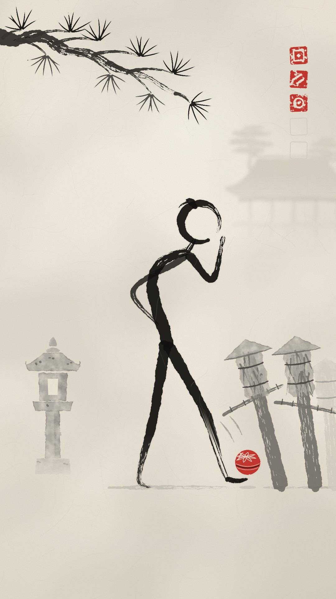

白い和紙に墨の筆だけで描く。色は手毬の朱1つだけ。

場面：NEVER DROP。あくび中の老師のつま先に、地面すれすれで手毬が落ちてくる瞬間。後ろで巻藁の門下生3体が固まっている。

作る手間：3/5 ／ 子ども向け判定：低い。水墨と落款は、大人のアート作品に見える。

見た目

・白い和紙に、墨の筆で描いた棒人間。手足は1本ずつ、筆のひと払いで描く。
・頭は「円相」（筆で描く、少し切れた丸）。切れ目が、見ている方向。
・画面の半分以上は何もない紙。遠くの寺と霧は、薄い墨のにじみ。
・色は朱だけ。手毬と、隅に押す落款（はんこ）。
・当たるたびに、隅の朱のはんこが1つ増える（音符の代わり）。
・霧の昼。静かで、達人の余裕がある。

よく出た所

・色は白い和紙と墨と朱だけ。色が少ないので安っぽくならず、掛け軸や版画のような落ち着いた品が出ています。朱は手毬とはんこにしか使っていません（画素を調べて確認済み）。
・筆の質感：線の終わりがかすれて筆の毛先が割れ、墨が少しにじみ、和紙の繊維とムラも見えます。1枚目にあった「ベタ塗りの図形」っぽさは、かなり消えました。
・奥行きが3段あります。手前は真っ黒な松の枝と老師、中ほどは灰色の石灯籠と巻藁、奥は霧に溶ける薄い寺と松。上から下へ霧が流れる空気感もあります。
・手足は1本ずつ、筆のひと払いで描きました。腰の曲がった背中、背中で組んだ腕（ひじが後ろに出る）、口元の手。シルエットだけで「のんびりしたおじいさん」に見えます。
・スマホの縮小サイズ（135×240）でも「黒い人影」「つま先の赤い点」「右上の赤いはんこ」の3つが一瞬で読めます。
・毬とつま先の間には、わずかな紙の隙間を残しました。「まだ落ちていない、次の瞬間に乗る」という張りつめた一瞬になっています。
・上の約12%と下の約18%は静かな紙の余白です。字幕やUIを載せやすい構図です。

まだ弱い所

・「あくび」はほとんど伝わりません。顔がないので、口元の手は「考えている」「何か食べている」にも見えます。吐く息の表現を2回試しましたが、口笛やタバコの煙に見えたので外しました。
・老師はまだ細長く、「達人」の威厳より「ひょろっとしたおじいさん」寄りです。腰の曲がりは出ましたが、凄みはこれからの課題です。
・巻藁の門下生3体は「笠をかぶった杭」に見えます。驚いて固まった人たちとして伝わるかは微妙です。
・手毬は直径80pxと小さく、菊の模様はスマホではほぼ見えません。ただの赤い玉に見えます。
・松の葉の房は、やや図案的で「草の束」っぽい形です。
・絵としては静かできれいですが、勢いや爽快感は弱いです。そこは動き（当たるたびに増えるはんこ、藁が弾けて縄で戻る）頼みになります。
・墨絵に朱の落款は昔からある様式なので、墨絵風のゲーム（『大神』など）と雰囲気が近いと感じる人はいるかもしれません。構図やキャラクターを似せたものではありません。

3つの企画で使うと

NEVER DROP：朱の手毬が画面でただ1つの色なので、どこにあるか一目で分かる。
BRIMFUL：円盤の帽子は横一本の筆、エプロンは淡い墨のひと塗り。色は茶の琥珀とカップの藍のふちだけ。
SOJI：竹ぼうきは筆そのもの。はいた所だけ床の墨の汚れが消えて、白い紙に戻る。輪に戻る木人の真鍮だけが金色。

敵（ザコ）

巻藁（まきわら）の打ち込み台。わらを巻いた柱に竹の腕、平たい笠。顔なし。薄い墨で描くので、主人公より一段弱く見える。当たるとわらがパッとほどけ、2秒以内に縄がしまって元の形に戻る。

よい所

「平面」と「色の使い方」を一番はっきり見せる案です。白と黒の世界で朱だけが意味を持つので、スマホでも手毬とはんこが目に飛び込みます。筆の線は骨格から自動で作るので、1コマずつ描く必要はありません。はんこが増えていく仕掛けで、「1打＝1音」が目に見えます。

心配な所

大神（Okami）の見た目（赤い渦の雲、白い狼、隈取り）は避けます。刀も出しません。墨の飛沫は灰色か黒にして、赤くしません（血に見えるため）。円相の頭が「O」の字に見えることがあります。にじみを毎コマ計算すると重いので、筆ごとに固定します。

参考になる実在の作品

・山水情 Feelings of Mountains and Waters（1988, 上海美術電影製片廠）4K版 https://www.youtube.com/watch?v=qBllW-s_UGQ（台詞なしの水墨アニメ。老いた師と少年。余白と墨の濃淡だけで見せる。NEVER DROP と題材ごと相性がいい）
・Animating Chinese Ink-Wash Paintings（Animation Obsessive） https://animationobsessive.substack.com/p/animating-chinese-ink-wash-paintings?open=false（水墨アニメの技法と歴史。にじみと余白の作り方の参考）
・鹅鹅鹅（Goose Mountain, 中国奇谭 2023）：Sixth Tone https://www.sixthtone.com/news/1012350（台詞のない水墨調の短編。今の作品でも水墨が通用する例）

### 2D-2 リソの夕暮れ屋上（RISO DUSK ROOFTOP）

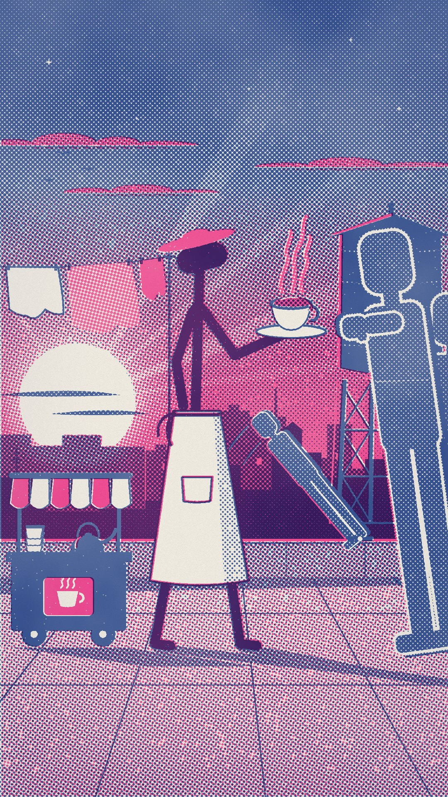

蛍光ピンクと青の2色だけで刷った版画。主人公だけ、2色が重なった紫。

場面：BRIMFUL。夕暮れの屋上の屋台。BRIM がなみなみのカップを前に差し出したまま、横からのびる段ボール人間の手を見もしない。

作る手間：2/5 ／ 子ども向け判定：やや低い。蛍光ピンクは遊び心が強いが、粒子・大人の体型・夕暮れのさびしさで打ち消す。

見た目

・蛍光ピンクと青の2色のインクを重ね刷りした、ZINE のような版画。
・空は粗いドット（網点）のグラデーション。版が少しずれている。
・主人公だけ2色が重なって紫になる。世界はピンクか青の1色ずつ。
・頭は横長のカプセル。かしげ方だけで、無表情の演技をする。
・夕暮れの街の屋上。洗濯物、給水タンク、小さなお茶の屋台。
・回が進むとピンクから青へ。最後は紺の空にピンクの窓明かり。

よく出た所

・ピンクと青の2色インクの重ね刷りが、ちゃんと「刷った紙」に見えます。網点、版ズレで出る細いピンクと青のフチ、インクのかすれ、紙の地の色。デジタルのベタ塗りっぽさはありません。
・色の流れで夕暮れの空気が出ています。上は青い夜空と一番星、真ん中に紫の帯、地平線は濃いピンク、そこに白い太陽が街の向こうへ沈んでいく。太陽のまわりはほんのり明るく、光の筋もかすかに入れました。
・奥行きは4段です。遠くのビルはピンクにかすみ、手前のビルは濃い紫。その手前に屋上の手すり、さらに手前に屋上の床。床の継ぎ目は奥へすぼまり、長い影は右へのびています。
・主人公だけが紫（2色が重なった色）なので、どこにいるかすぐ分かります。ピンクの円盤帽子と白いエプロンが目印で、スマホの小さい画面でも読めます。
・場面は一瞬で伝わります。主人公は湯気の立つカップを腕いっぱい差し出し、あごを上げてそっぽを向いている。段ボール人間の平たい手が、あと少しのところまでのびています。お茶は縁から盛り上がるほど、なみなみです。
・段ボール人間は、白い切り口のギザギザと、ずらした厚みの影で「切り抜きの板」に見えます。
・上の約12%と下の約18%は、空と床だけの静かな場所にしてあり、字幕やボタンが乗っても邪魔しません。

まだ弱い所

・主人公はまだ素朴な棒人間です。「見もしない」は首のかしげ方だけで表しているので、スマホサイズだと「少しあごを上げている」くらいにしか見えません。
・左側に白い大きな形が3つ並んでいます（太陽、エプロン、白いシーツ）。目が少し散ります。
・右端の段ボール人間B（2体目）は、頭と肩が見切れた塊にしか見えません。それに右下はショート動画のボタンが並ぶ位置と重なります。
・手すりの上でパタンと起き上がる小さな段ボール人間Cは、傾いた板には見えますが、「動いている途中」という感じは弱いです。
・空の真ん中の紫の帯と床の網点は、拡大するとややザラザラして濁って見えます。縮小したときに、網点のうなりで薄い横じまが出ることがあります（段ボール人間の中でかすかに確認しました）。
・給水タンクは、ふたを浅くして輪っかを足しましたが、まだ少し「小屋」っぽさが残っています。
・「リソ印刷風の夕暮れ」自体はよくある画風で、似た絵柄は世の中に多いです。特定のチャンネルにそっくり、という感じはありません。

3つの企画で使うと

BRIMFUL：帽子はピンク、エプロンは紙の白を抜いた形、カップのふちは青。
NEVER DROP：曲がった紫の背中に、白抜きのちょんまげ。手毬はピンクに青の糸。舞台は屋上か公園。
SOJI：竹ぼうきは網点の扇。はくたびにピンクの網点がほこりのように散る。木人は屋上のふちの真鍮の金具に戻る。

敵（ザコ）

段ボールの切り抜き人間。人の形をした平たい板で、顔なし。青の版だけで刷る。背中に立てかけ用の脚。当たるとパタンと倒れ、1秒で蝶番から起き上がる（射的の的のように）。

よい所

色が2つしかないので、色の意図が一番はっきり出ます。サムネ1枚で「あのチャンネル」と覚えてもらえます。網点と版ずれは全部コードで作れて、平らな絵の安っぽさを消してくれます。夕方から夜へ色が動くので、毎回の動画に色の流れが自然にできます。

心配な所

ピンクが多すぎると「ポップ」すぎるので、紙の白と紺を多めにします。リソ風は流行なので、構図が弱いとありふれて見えます。網点が細かいと YouTube の圧縮でしま模様（モアレ）が出るので、1080p で8px 以上の粗さにします。段ボールの敵は、刷りの質感が弱いと安っぽく見えます。

参考になる実在の作品

・Julia Schimautz『Every Thought You've Ever Had』（Pan Well の MV） https://peopleofprint.com/animation/julia-schimautz-every-thought-youve-ever-had-music-video（1102コマをリソで刷って動画にした例。版ずれと粒子が動く様子）
・Tal Uliel『Geshem Bejuni』（It's Nice That） https://www.itsnicethat.com/articles/tal-uliel-geshem-bejuni-animation-project-290124（CG にリソ風の見た目を後処理で重ねた MV。コードで刷りを作る方法に近い）
・Hiromu Oka『Hodo Station』タイトル（It's Nice That） https://www.itsnicethat.com/articles/hiromu-oka-animation-130422（リソ刷りのコマで作った放送用タイトル。2〜3色の統一感）

### 2D-3 雪夜の版画（WOODBLOCK SNOW）

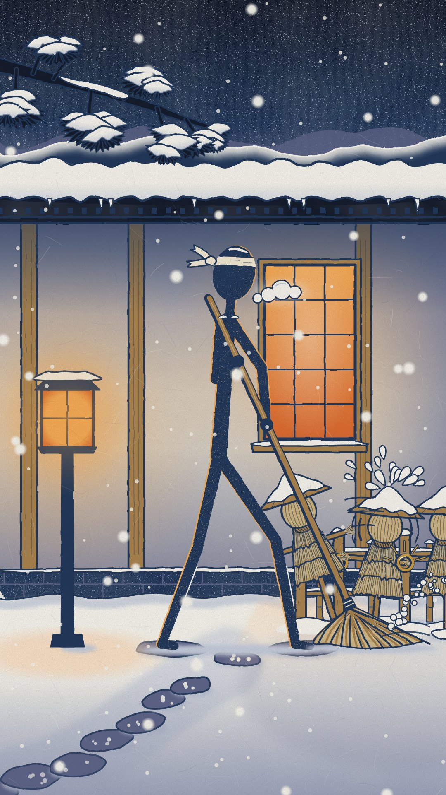

新版画の雪の夜。ベロ藍の闇に、柿色の灯りが雪へ落ちる。

場面：SOJI。雪にうもれた宿の中庭で、ソウジが石畳の雪をはく。はいた所にもう雪が積もっている。はじかれたかかしが柵の真鍮の輪に戻り、笠の雪がパッと散る。

作る手間：2/5 ／ 子ども向け判定：低い。木版画は大人向けで、教養のある印象。

見た目

・木版画の雪の夜。濃い藍（ベロ藍）の空、白い雪、柿色の灯り。
・色は版ごとに平らに塗り、空は「ぼかし」のグラデーション。
・木目、和紙、少しの版ずれで、刷り物の手ざわりを出す。
・主人公は藍一色の棒人間。生成りの手ぬぐいと、白い息が目印。
・手前に雪の積もった松の枝。大きな雪がまばらに降る。
・とても静か。大きく当たると屋根の雪がドサッと落ちる（シンバルの代わり）。

よく出た所

・色は、藍の夜空（上ほど濃いぼかし）、白い雪、柿色の窓と行灯の灯り2つだけ。パッと見て「雪の夜」と分かります。壁も上と右と足元を暗くしたので、灯りのまわりだけ暖かく見えます。
・空の木目、ごま摺りの細かい点、和紙の繊維、線のわずかなガタつきで、刷り物の手ざわりを出しました（拡大するとよく見えます）。
・主人公は藍一色の棒人間に、生成りの手ぬぐい（結び目と、上へなびく端）。柿色の窓の前に白い息を置きました。スマホの小さい画面（135x240で確認）でも、頭・手ぬぐい・息・竹ぼうきの扇が読めます。
・主人公のふちに細い暖色が入っています。体は行灯側の左、頭は窓側の右です。光がどちらから来ているか分かります。
・奥行きは3段です。手前に雪の松の枝、中に主人公、奥に宿と山並み。そこに大小の雪が降っています。
・上の12%（空）と下の18%（雪と飛び石）は静かなので、文字やボタンを乗せても邪魔になりにくいです。
・はいたばかりの飛び石に、もう新しい雪が点々と積もっています（ギャグ）。真鍮の輪に戻ったかかしは笠の雪がパッと散り、輪のまわりに「カチッ」の火花も描きました。

まだ弱い所

・右下のかかし3体と竹垣がごちゃっとしています。スマホの大きさだと「わらの固まり」に見えます。輪に戻る「カチッ」や、1体が飛びかかる動きは、拡大しないと伝わりにくいです。
・主人公は細い棒なので、作り込んだ背景に比べるとあっさりしています。「雪をはいている」より「ほうきを持って歩いている」に見える瞬間もあります。
・白い息がマンガの雲の形で、少し記号っぽいです。
・松の雪のかたまりは似た形のくり返しなので、ハンコを押したように見える所があります。
・版ずれ（+2,-1px）は線が太いので、ほとんど見えません。ごま摺りの点は、拡大すると夜空でテレビの砂嵐のように見える所があります。
・屋根の雪の白い帯が太くて明るいので、画面の上の方で少し目立ちすぎます。
・「屋根の雪がドサッと落ちる」は動画用の演出なので、この静止画には描いていません。

3つの企画で使うと

SOJI：雪が降り続ける中で雪をはく。終わらないそうじが、そのまま無表情のギャグになる。
NEVER DROP：朱と金の手毬が、青と白の雪の中で一番目立つ。笠のかかしが門下生。
BRIMFUL：拍の合間に帽子へ雪が積もっていくのに、カップには1片も入らない。

敵（ザコ）

蓑（みの）を着たかかし。竹の十字の腕、わらを束ねた丸い頭（顔なし）、雪の積もった笠。当たると雪がはじけ、柱ごとぐらぐら揺れて立ち直る。SOJI では柵の真鍮の輪にカチッと戻る。

よい所

雪と木版画は「日本の版画」として、世界中の大人が部屋に飾るような絵です。藍と柿色は反対色なので、スマホでもはっきり見えます。平らな版を重ねるだけなので安く動かせます。雪が、当たりの結果を目に見える形にしてくれます。

心配な所

川瀬巴水など、特定の版画の構図は写しません（伝統の原理だけ使います）。モノノ怪の画面装飾も避けます。夜の顔のないかかしはホラーに寄りやすいので、動きはコミカルにし、びっくりさせる演出はしません。画面全体の雪は YouTube の画質を食うので、大きくまばらにします。藍の主人公は暗い背景の前では消えるので、白壁や雪の前に立たせます。

参考になる実在の作品

・川瀬巴水『大宮見沼川（Night Rain at Omiya）』1930 https://www.fujiarts.com/shin-hanga-modern-japanese-prints/hasui/1210834-night-rain-at-omiya-1930（新版画の夜。窓の灯りとぼかしで空気を描く。構図は写さず、光の考え方だけ参考にする）
・AWN：How Blue Eye Samurai Brings Edo Period Japan to Life https://awn.com/animationworld/beauty-behind-blade-how-blue-eye-samurai-brings-edo-period-japan-life（木版画を目指した映像。明暗の形（notan）でコントラストを集める設計）
・nippon.com：『モノノ怪』劇場版の記事 https://nippon.com/en/japan-topics/c030287（浮世絵の平面構成と和紙の質感を画面の土台にした例（色彩や装飾はまねない））

### 2D-4 折り紙の秋（ORIGAMI AUTUMN）

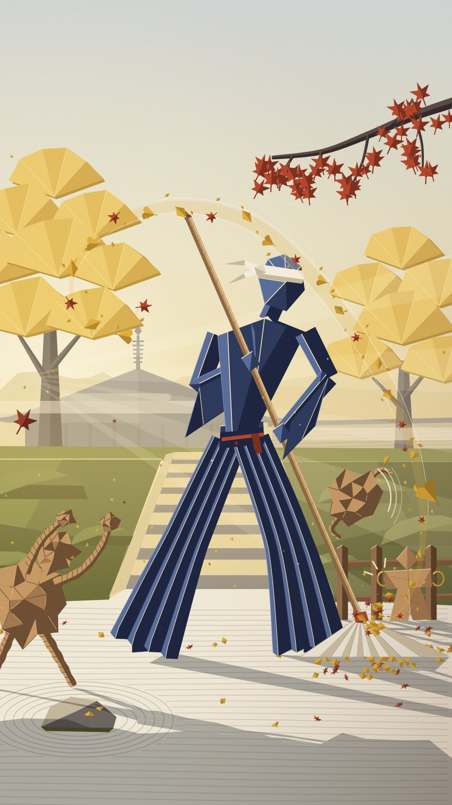

秋の午後の低い日差しで、折り紙の面が光と影に分かれる。金と錆色の落ち葉が、動きの軌跡になる。

場面：SOJI。閉門前の寺の庭。ソウジの紙の扇ほうきが、落ち葉をらせんに巻き上げる。くしゃくしゃの紙くず人間が襲ってきて、1体は柵の真鍮の輪に戻ったところ。

作る手間：3/5 ／ 子ども向け判定：やや低い。折り紙は工作っぽく見えることがあるが、角ばった大人の体型と秋のさびしさで打ち消す。

見た目

・主人公も敵も、折り紙のような平らな面の組み合わせ。
・日の当たる面は明るく、反対側は暗い。回ると面の明暗が入れ替わる。
・主人公は濃い藍の紙。折り目の稜線だけが金色に光る。
・秋の寺の庭。銀杏の金、もみじの錆色、苔の緑。ななめの光の筋。
・落ち葉が、けりやほうきの軌跡をなぞって動きの線になる。
・6案で唯一の昼の光。暖かくて、少しさびしい。

よく出た所

・銀杏の木は、銀杏の葉の形をした折り紙の扇を重ねて作りました。木そのものが折り紙に見えて、背景だけでも「紙の世界」だと伝わります。安っぽい3Dっぽさ（三角形のポリゴンの集まり）からは一番遠くなった部分です。
・主人公の袴はじゃばら折りのひだにしました。山折りの線が金色に光り、谷は濃い藍です。スマホの小さい画面でも「金の線が入った濃い藍の折り紙の人」として、金色のもやの前で一目で分かります。
・光は左奥の低い太陽から来ます。光の筋、金色のもや、右手前に長く伸びる影、うっすらかかった霞。6案で唯一の昼の光で、暖かいけれど少しさびしい「閉門前」の空気が出ています。
・ほうきが巻き上げた落ち葉が金色の帯になり、ほうきの先から主人公の頭上を越えて左へ大きく弧を描きます。これがそのまま動きの線になっています。
・紙くず人間は、くしゃくしゃの多面体に、ねじった紙ひもの手足です。倒した1体は伝統の折り紙「やっこさん」にきれいに折り直され、柵の真鍮の輪に両袖を留められています。「散らかったゴミが片付いた」というオチが、言葉なしで伝わります。
・色は銀杏の金、もみじの錆色、苔の緑、和紙の白、藍の5系統だけに絞りました。帯の細い錆色のひもが、主人公の唯一の差し色です。

まだ弱い所

・主人公の上半身がまだ硬いです。腕が棒状で、マネキンやロボットのように見えます。ポーズも「掃いている瞬間」というより「ほうきを持って立っている」に近く、勢いは落ち葉の帯に頼っています。いちばんの弱点です。
・頭（多面体＋手ぬぐい）は、小さく表示すると帽子をかぶった三角形に見えることがあります。手ぬぐいの結び目の端も、少し鳥のくちばしのようです。
・左端の紙くず人間は、両手を上げて踊っているようにも見えます。襲いかかる怖さが弱いです。
・やっこさんは小さいうえに落ち葉が少し重なっています。スマホでは「柵のところの小さな人形」くらいにしか読めず、輪に「カチッ」とはまった気持ちよさは静止画では伝わりにくいです。
・地面の砂紋、苔の土手、石段は平たく、木や光に比べると手数が少ないです。
・2Dで振り向かせるには、向き（正面・斜め・横）ごとに面の組み合わせを作る必要があります。制作の手間は6案の中でも多い方です。

3つの企画で使うと

SOJI：落ち葉と紙くずそのものが振り付けになる。
NEVER DROP：多面体に折った手毬（朱と金）が、回るたびに日差しをキラッと返す。
BRIMFUL：帽子は折った八角形、エプロンは大きな白い紙のひだ、カップは白い折り紙に藍のふち。

敵（ザコ）

くしゃくしゃに丸めたクラフト紙の人間。丸めた紙の頭で、顔なし。当たるとさらに小さく丸まって転がり、2秒以内に広がって戻る。SOJI では「ゴミが逆襲してくる」話になる。

よい所

6案で唯一の「昼の暖かい光」です。面の明暗だけで立体感と光が出るので、3D を使わずに光の雰囲気が作れます。落ち葉の軌跡で、音ハメと振り付けが目で追えます。硬い面のパーツなので、コードの骨格と相性がいいです。

心配な所

角ばった面の絵（ローポリ）は、よくある見た目になりやすいです。紙の繊維と構図で版画らしさを足します。折り紙は工作・子ども向けに寄りやすいので、背の高い大人の体型と秋のさびしさで締めます。2D で振り向かせるには、角度ごとの面のセットを先に作る必要があります。落ち葉が多すぎると画質を食います。

参考になる実在の作品

・The Art of Firewatch（GDC 2015, Jane Ng） https://gdcvault.com/play/1022295/The-Art-of（平らな色面と1つの光の色で、時間帯の空気を作る方法）
・How a small art team created Firewatch's beautiful environment（Boing Boing） https://boingboing.net/2015/03/27/how-a-small-art-team-created-f.html（重ねた色の層、はっきりした形、長い影）
・鹬蚌相争 Snipe-Clam Grapple（1983, 上海美術電影製片廠） https://www.youtube.com/watch?v=WxtZNyD3cx4（紙のパーツで作った台詞なしの膠着コメディ。紙の質感とシュールな間の参考）

### 2D-5 夏夜の影絵芝居（SUMMER SHADOW THEATRE）

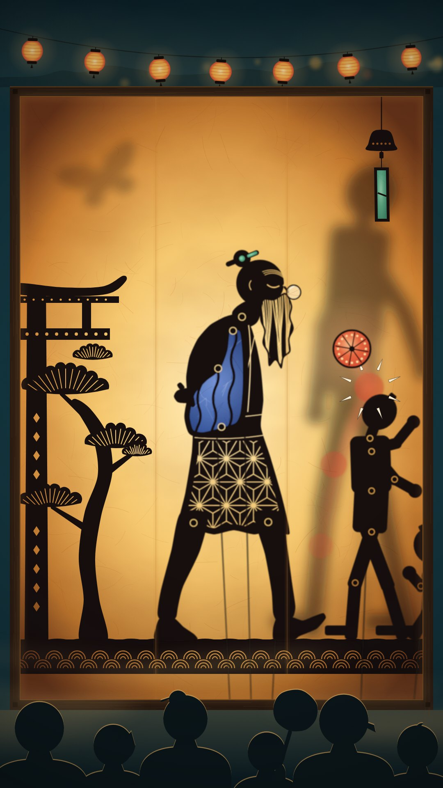

夏祭りの影絵芝居。光る琥珀のスクリーンに、色ガラスのような人形が映る。

場面：NEVER DROP「三つ頭」。眠そうな老師は後ろ手のまま。朱の手毬が門下生の頭で「ポン」とはね返り、光りながらつま先へ戻ってくる途中。

作る手間：1/5 ／ 子ども向け判定：やや低い。人形劇の連想はあるが、深い琥珀の光、夜祭りの空気、大人のテンポで打ち消す。

見た目

・画面いっぱいの、後ろから光る紙のスクリーン。中心は熱い琥珀色、ふちは暗い。
・人物は、関節を鋲で留めた黒い切り絵の人形。服に透かし彫りの模様。
・袖や持ち物だけ、色セロファンのように光る（藍、翡翠、朱）。
・人形を動かす細い棒が見えている。人形なのに動きは完璧、というシュールさ。
・スクリーンから離れた人形は、大きくぼやける。
・上に夏祭りの提灯、下に観客の頭のシルエット。

よく出た所

・画面全体が「後ろから照らされた和紙」に見えます。中心は熱い琥珀色で、ふちは焦げ茶まで暗くなるので、光がどこから来ているかがはっきり分かります。紙の繊維、ムラ、継ぎ目も入れたので、ベタ塗りの安っぽさはありません。
・色は絞っています。琥珀、黒、夜の青緑の3色が土台で、差し色は藍（袖）、朱（手毬）、翡翠（かんざし・風鈴の短冊）だけです。藍の袖にはセロファンのシワも入れたので、ステンドグラスのように光って見えます。
・奥行きは3段です。手前が上の提灯の列と下の観客の頭、真ん中がスクリーンに貼りついた人形、奥（ランプ側）が大きくぼやけた門下生の影と蛾の影です。夏祭りの夜の空気が出ています。
・老師は、光る白いヒゲ、閉じた目、鼻ちょうちん、背中で組んだ手、猫背の4つで「眠そうなじいさん」と分かります。足の間には人形を動かす細い棒が見えていて、「人形なのに動きは完璧」というシュールさの種になっています。
・麻の葉の透かし、関節の鋲のまわりで光る輪、松の葉の透かし、波模様の地面など、切り絵の手仕事らしい細かい部分が多く、大きく見ても飽きません。
・スマホの画面でも、提灯の列、黒い老師と藍の袖、朱の手毬の3つがすぐ目に入ります。

まだ弱い所

・サムネイルくらい小さく見ると、藍の袖が「背中のリュック」に見える瞬間があります。背中から手をのぞかせ、袖の線を波形にして良くはなりましたが、完全には直っていません。
・手毬の残像と軌跡は薄めです。「つま先から上がって頭ではね返った」流れは、大きく見ないと伝わりにくいです。「つま先へ戻る途中」の部分は静止画では見る人の想像に任せていて、動画の動きで伝える前提です。
・門下生（木の人形）はわざと単純な形にしたので、老師と比べると少しのっぺりしています。右端の3人目は、頭と拳が少し見えるだけです。
・老師の足は「構え」というより「歩いている途中」に見えます。
・下の波模様の帯と観客の頭は少しにぎやかです。字幕をのせるなら、観客の上に暗い帯を足したほうが読みやすくなります。
・影絵芝居そのものは昔からある表現です。見た目の新しさは「色セロファン×夏祭りの額縁」という組み合わせに頼っています。

3つの企画で使うと

NEVER DROP：朱の手毬が光のかたまりになり、はねるたびにパッと明るくなる。
BRIMFUL：カップは藍の色ガラス。中の茶が琥珀色の液体として透けるので、「ふちまでなみなみ」が線で分かる。
SOJI：透かし彫りの竹ぼうき。はじいた人形が、スクリーンのふちの金の輪に戻る。

敵（ザコ）

木の打ち込み人形の影絵。真っ黒で、色も透かしもない（主人公より一段地味）。顔なし。当たるとスクリーンから引き離されて大きくぼやけ、2秒以内にくっきり戻る。けがの表現が原理的に起きない。

よい所

影絵人形は、もともと「関節で回る硬いパーツ」です。コードの骨格と一番相性がよく、一番安く作れます。いまのラグドールの骨格がそのまま使えます。スクリーンからの距離でぼかすだけで、奥行きがただで出ます。琥珀の光と色ガラスで、オーナーが好きな「雰囲気と色」を最も安く出せます。見えている操り棒が、シュールな笑いを足します。

心配な所

スマホの格闘ゲーム「Shadow Fight」（色の背景の前で影が戦う）に寄りやすいです。色ガラス・透かし彫り・操り棒・祭りの額縁の4つで「影絵芝居」側に振ります。ワヤン、中国の皮影戯、トルコのカラギョズなど、伝統の人形の図案は写しません。棒が多いと動きが読みにくいので、細く暗くします。人形劇は子ども向けに見えることがあります。

参考になる実在の作品

・The Adventures of Prince Achmed（1926, Lotte Reiniger） https://www.youtube.com/watch?v=0V9fxYqoLwY（関節をつないだ切り絵人形を下から照らして撮った、影絵アニメの古典）
・UNESCO 無形文化遺産：Chinese shadow puppetry（決定 6.COM 13.3） https://ich.unesco.org/en/decisions/6.COM/13.3（色付きの半透明の影絵人形と音楽の芝居。人形は12〜24の関節を持つ（公有の伝統））
・Princes et Princesses（2000, Michel Ocelot）予告編 https://www.youtube.com/watch?v=Q-tWKLABb5I（黒いシルエットを色鮮やかな背景の前に置く例。衣装の図案はまねない）

### 2D-6 深夜3時のノワール版画（3 A.M. NOIR PRINT）

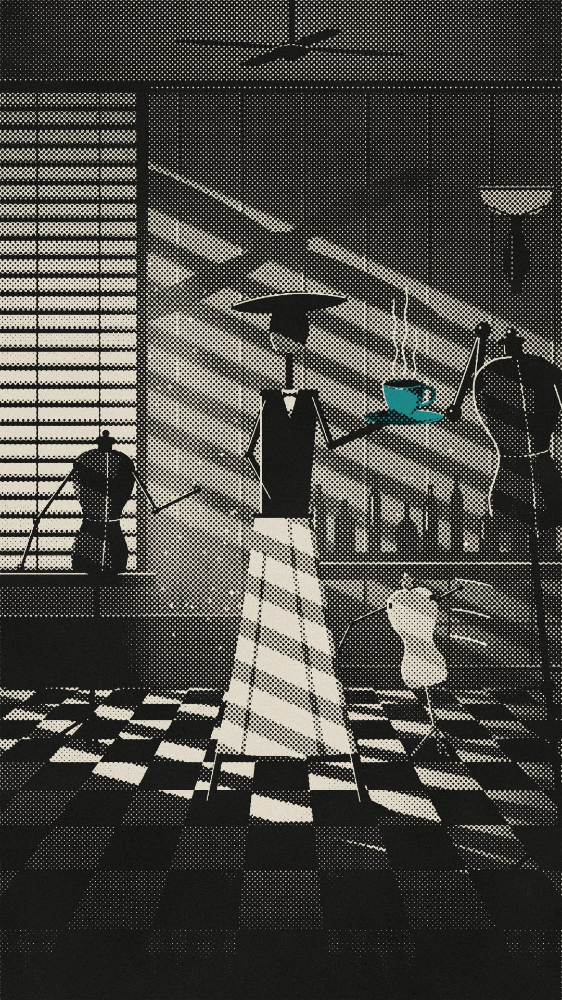

黒と骨色の版画に、色は青緑のカップ1つだけ。ブラインドの光の縞がすべてを横切る。

場面：BRIMFUL。深夜3時のラウンジを、BRIM がなみなみのカップを差し出したまま横切る。暗がりから、トルソーの木の腕がカップへのびてくる。

作る手間：2/5 ／ 子ども向け判定：とても低い。ノワールは大人っぽく、洒落た印象。

見た目

・黒と骨色（生成り）だけのシルクスクリーン版画。灰色は網点。
・窓のブラインドから入る光の縞が、床にも人物にもななめに落ちる。
・色は1つだけ。主人公が運ぶ青緑のカップ。
・主人公は形で描く。長い台形のエプロンと、平たい円盤の帽子。帽子のかたむきが表情の代わり。
・深夜のホテルのラウンジ。天井のファン、市松模様の床。
・オチで照明が消え、1拍だけ真っ黒（間）になる。

よく出た所

・本物のシルクスクリーン版画らしく見えます。黒は全部、網点（7pxのドット、45度）で刷っています。青緑は別の版で、わざと3pxずらしています。カップのふちに紙の色がのぞくので、手刷りの味が出ています。紙の目とフィルムの粒も入れました。
・ブラインドの光の縞が、左の窓から壁・床・人物までななめに走ります。人物の縞は壁の縞と半分ずらしました。明るい縞が暗い壁の上に重なるので、人物の形が背景にまぎれません。床では縞の角度が変わり、手前ほど太くなります。
・スマホの小さな画面でも、主人公は「黒い円盤の帽子＋黒いベスト＋縞の入った長い骨色のエプロン」とすぐ分かります。色がつくのは青緑のカップ1つだけなので、目が自然にそこへ行きます。
・3体のトルソーは、それぞれ見え方を変えました。B は光る窓のブラインドの前に黒いシルエットで立っています。A は右手前の黒い大きなトルソーで、木の腕を振り上げ、その先がソーサーの手前で止まっています。C は奥の小さな白っぽいトルソーで、ゆれを表す線を3本つけました。
・上（天井とファン）と下（暗い床）は静かにしてあり、字幕や操作ボタンを置けます。右上の壁ランプは、オチで「照明が消える」ための前ふりになります。

まだ弱い所

・空気の表現は弱めです。光の筋（もや）や浮かぶチリは、スマホの大きさではほとんど見えません。縞のふちのにじみと湯気で、なんとか補っている程度です。
・C は3体の中でいちばん読みにくいです。小さいうえに、ゆれの線がヒゲのようにも見えます。
・A の腕は「カップに手をのばす」より、「すみません、と手を上げている」ように見えるかもしれません（とぼけた笑いとしては使えます）。ソーサーとのすき間が小さいので、ハラハラ感は弱めです。
・カップは小さく、スマホでは青緑の点に近いです。主人公の足も細い棒なので、床の市松模様に負けています。
・画面の大部分が暗い灰色の網点です。重くて陰気に感じる人もいると思います。網点は、縮小や動画の圧縮でモアレ（しま模様のちらつき）が出るおそれがあります。動画にする前に、実機で確認が必要です。
・目の高さは腰の位置なのに、カップの中のお茶は上から見た形で描いています。遠近は正確ではなく、版画として見せるための約束ごとです。
・ファンの影は、壁の光の縞をところどころさえぎる程度で、はっきりとは見えません。

3つの企画で使うと

BRIMFUL：平たい帽子がそのまま BRIM の円盤帽子。エプロンは骨色の長い台形。カップだけ青緑。
NEVER DROP：エプロンが着物のような台形に変わり、背を丸めた老師になる。手毬が唯一の色。
SOJI：深夜のホテルの掃除番。ブラインドの縞がほうきを横切る。トルソーは壁ぎわの真鍮の台座に戻る。

敵（ザコ）

洋裁用のトルソー（胴だけのマネキン）に、木の棒の腕がついたもの。頭も顔もない。網点の灰色。当たると三脚の上でくるっと回り、メトロノームのように揺れて元に戻る。

よい所

白黒の強いコントラストは、スマホで一番読みやすいです。色が1つしかないと、目は必ずカップに行きます。「こぼさない1杯」が色だけで説明できます。ブラインドの縞は1枚重ねるだけで、平らな絵を一気に映画にします。無表情のユーモアに一番合います。

心配な所

円盤の帽子と長い服は、探偵やギャングに見えることがあります。銃とたばこは絶対に出しません（煙の代わりに茶の湯気）。Spy vs Spy のとがった帽子や、Saul Bass の有名なタイトルの図案には寄せません。色が冷たく感じられるかもしれません。差し色に赤は使いません（打撃の近くで血に見えるため）。真っ黒の暗転は、1秒に3回までの点滅の基準を守ります。

参考になる実在の作品

・TVLine：Batman: The Animated Series の黒い紙の背景 https://tvline.com/2091384/batman-the-animated-series-distinctive-look-simple-art-trick-black-paper（黒から光だけを描いていく考え方。造形やロゴはまねない）
・Paperman（2012, Disney） https://en.wikipedia.org/wiki/Paperman（台詞なし。白黒の画面に最小限の色で物語を運ぶ）
・Ghost of Tsushima：通常と黒澤モードの比較 https://www.youtube.com/watch?v=Zz41Nml3dA4（白黒と粒子だけで映画の空気が出る例）

## 3D の6案

### 3D-1 銅線の一筆人形（ハリガネ）（HARIGANE - One-Line Copper Wire Figure）

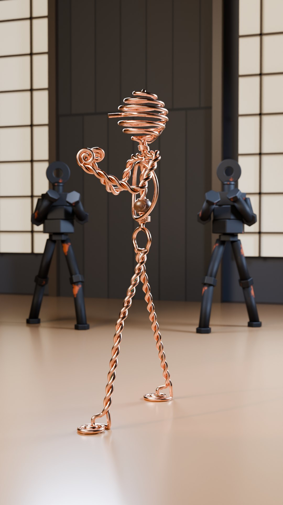

一本の銅線を曲げて作った、空中に描いた線画のような棒人間。

作る手間：2/5 ／ 子ども向け判定：低。素材が美術品寄りで、色も少ない。

見た目

体ぜんぶが、一本の太い銅線。
手足は、2本の線をねじり合わせた「より線」。
頭は、ぐるぐる巻いたバネの玉。動くと少し遅れて「ボヨン」と揺れる。
胸に、くるみの木の玉が1つ。
暖かい光で銅がきらっと光る。美術館の針金彫刻のよう。

よく出た所

銅らしい色とツヤが出ていて、手足の「より線」のねじれもはっきり見えます。
頭のバネ玉はスマホの小さい画面でも一目でわかり、このキャラの目印になっています。
胸のくるみ玉、首の巻き留め、渦巻きの手足など、手作りの針金細工らしい細かさがあります。
後ろのボルト男2体は黒い鉄とサビの色なので、主役の銅とぶつからず奥に下がって見えます。

まだ弱い所

体が細い線でできているので、画面の中で主役が小さく、軽く見えます。
足の渦巻きは、スマホサイズだと「丸い足」には見えますが、渦までは読み取りにくいです。
胴体は腕と胸の輪が重なって、少しごちゃっと見えます。鼻（前に出た線）も目立ちません。
床が明るい肌色なので、脚の銅色とのコントラストは弱めです。

3つの企画で使うと

BRIMFUL：針金の蝶ネクタイと銅の丸盆。本物の磁器の茶碗だけが針金ではないので、いちばん目立つ。
NEVER DROP：針金を丸めた猫背の老人。長い針金のひげ。頭のバネもゆっくり揺れる。
SOJI：ほうきの穂が細い針金の束。掃くたびに小さくきらめく。

敵（ザコ）

ボルト男。六角ナットを積んだ胴、ボルトの手足、座金（ワッシャー）の頭。
黒い鋳鉄に赤さび。顔なし、ずんぐり重い。
打たれるとコマのように片足で回り、拍に合わせて元の位置に戻る。
当たるたびに、ゴングやガムランのような金属音が1体ずつ違う高さで鳴る。

よい所

棒人間の読みやすさはそのまま。でも「仮の人形」ではなく「職人が曲げた銅の彫刻」に見える。
オーナーが好きな糸人間に、いちばん近い発展形。
細くて身軽な主人公と、ずんぐりした鉄の敵で、ひと目で差がつく。
金属どうしの音は「当たるたびに音が鳴る」に合う。
頭のバネが勝手に揺れるので、顔がなくても表情が出る。

心配な所

線が細いので、スマホで消えやすい。太い線、輪郭光、暗い背景が必須。
Calderの針金サーカスや、糸人間の作者の見た目に寄せすぎないこと。
極端なポーズで線が折れて見えるので、リグのテストが要る。
棒人間そのものが嫌いなら、この案も外れる（それを確かめる役でもある）。

参考になる実在の作品

・オーナー指定の糸人間作品 https://www.youtube.com/watch?v=GWWiBnp1zno（オーナーが気に入っている線の人形。この案はその「線」を銅線の工芸品にしたもの）
・Alexander Calder performs his "Circus" https://www.youtube.com/watch?v=t6jwnu8Izy0（針金人形が大人の美術品として通じる例。形はまねせず、手仕事の質感だけ借りる）
・High Wire: Calder's Circus at 100（Whitney Museum） https://www.youtube.com/watch?v=XXMtFOffSAE（針金人形が100年たっても人気という証拠）

### 3D-2 漆のデッサン人形（ウルシ）（URUSHI - Black-Lacquer Artist's Mannequin）

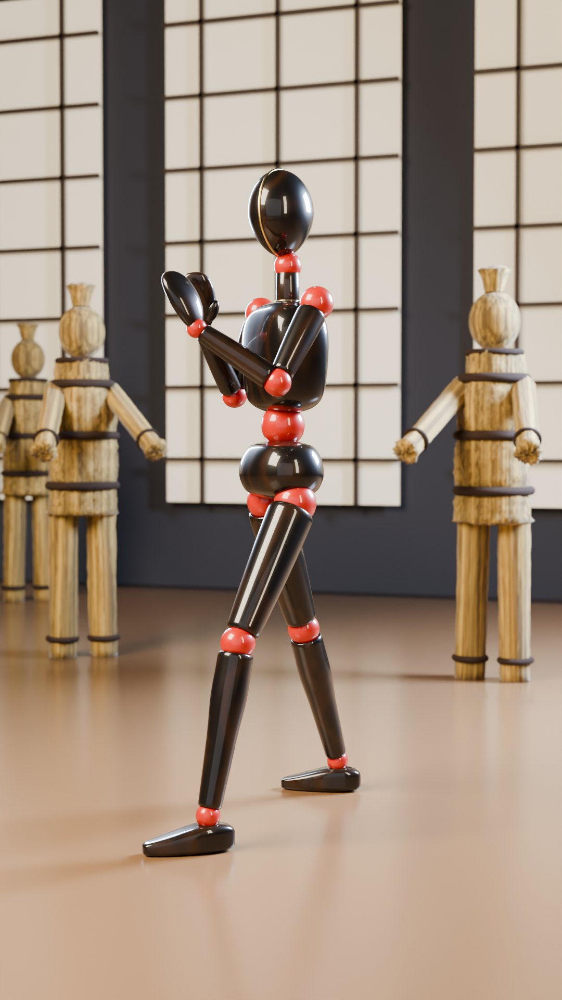

黒い漆塗りの木のデッサン人形。関節の玉だけが朱色。

作る手間：1/5 ／ 子ども向け判定：低。画材として大人の持ち物という印象がある。

見た目

画材店のデッサン人形を、漆塗りの工芸品にしたもの。
体は、つやのある黒漆。うっすら木目が透ける。
肩、ひじ、ひざなど12か所の関節の玉が、朱色の漆。
顔はない。頭の正面に金の細い線が1本だけ（向いている方向が分かる）。
ふつうの人の背格好。キックも突きもできる。

よく出た所

黒漆のつやがちゃんと黒に見えます。白い映り込みが細く入って、工芸品らしい質感です。
スマホの小さい画面でも、黒い体に朱の関節が点々と並ぶ形がはっきり分かります。顔の金の線も見えます。
手足は木を削り出したような形で、関節の玉がくぼみにはまって見えます。足も人形らしく丸くなりました。
わら人形は質素で色も地味なので、主役が自然に目立ちます。

まだ弱い所

手はまだ「しゃもじ」っぽさが少し残ります。人形の手としてはありですが、かっこよさは足りません。
胴の真ん中の朱の玉（腰）が大きくて、少し雪だるまやロボットっぽく見えます。
木目は1080pでもほぼ見えません。漆の下の木の感じは、写真ではほとんど伝わりません。
わら人形は少しきれいすぎて、丸太に縄を巻いたように見えます。ほつれ感はぼやけてほぼ見えません。

3つの企画で使うと

BRIMFUL：黒い体に白い前掛け1枚で、もう給仕に見える。黒、白、お茶の琥珀色で画がしまる。
NEVER DROP：漆がすり減って下の朱が透けた、古い師範の人形（根来塗の風合い）。関節が少しきしむ。
SOJI：竹ぼうきを持つ黒い人影。障子の前で、影絵のようにも撮れる。

敵（ザコ）

巻藁（まきわら）男。稲わらの束を縄で3か所しばった人形。
顔なし。つやがなく、粗い。
打たれると葦のようにしなって、太鼓の「ドン」と一緒に跳ね起きる。
わらくずが少し舞うだけで、中身は出ない。

よい所

今のジャンル（棒人間アクション）の動きを、全部そのままできる。キックも宙返りも。
白マネキンが安く見えた原因（仮素材っぽさ）を、漆と木目と朱の関節で消す。
誰もが知っている物なのに、特定の会社のキャラではない。
木と木がぶつかる音が、拍子木やウッドブロックの楽器になる。
黒い体に赤い点が12個。それだけで覚えてもらえる。

心配な所

形は前回と同じ「顔のない人型」。オーナーが嫌ったのが形そのものなら外れる（それを確かめる役）。
黒い体は暗い道場に沈むので、障子を背にして輪郭光を当てる必要がある。
灰色のつるっとした質感に寄ると、またUnreal Engineのマネキンのような仮素材に見える。

参考になる実在の作品

・Woody（2013, Stuart Bowen） https://www.thisiscolossal.com/2016/01/woody-stop-motion-short/（木製デッサン人形が主役で話題になった短編。人形の愛され方の参考）
・Artist's Mannequin stop motion animation https://www.youtube.com/watch?v=ZKZMa2nNBr4（デッサン人形の動き方と関節の見え方の参考）
・Shaolin Tiger Demonstration On Wing Chun Wooden Dummy https://www.youtube.com/watch?v=qR5flgJEclM（木の打撃音を楽器として使う参考）

### 3D-3 真鍮のぜんまい人形（トケイ）（TOKEI - Brass Clockwork Automaton）

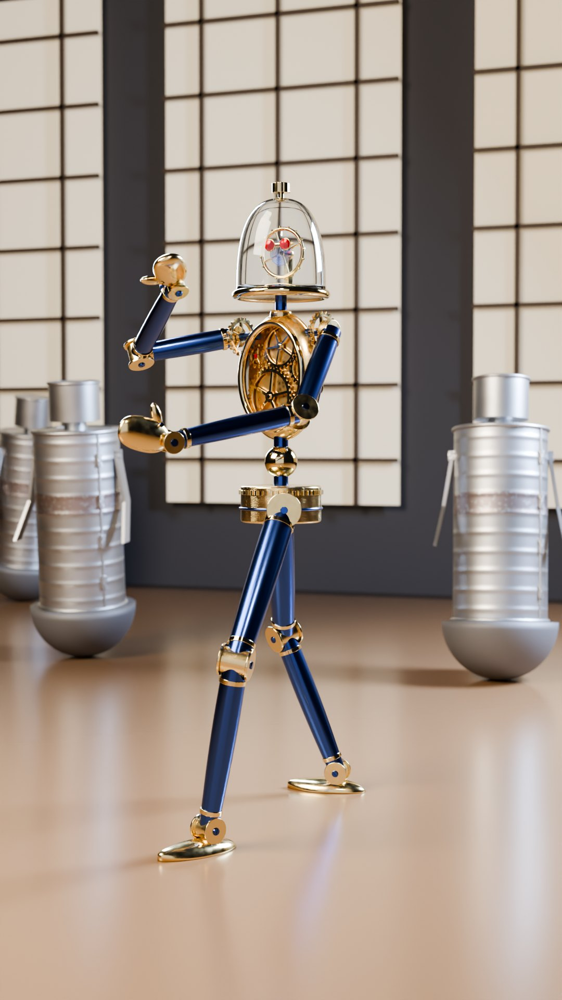

頭がガラスのドームで、中の歯車がチクタク動く、真鍮と青い鋼の機械人形。

作る手間：1/5 ／ 子ども向け判定：低〜中。ロボット＝おもちゃと見られる可能性はあるが、腕時計の機械のような大人の質感で下げられる。

見た目

腕時計の中身を、人の形にしたような機械人形。
頭はガラスのドーム。中で「てんぷ」（時計の心臓）がチクタク回る。
目は、中にある2つのルビー。口はない。
胸の窓から真鍮の歯車が見える。手足は深い青に焼いた鋼。
江戸の茶運び人形の子孫、という設定にできる。

よく出た所

ガラスのドームの頭と、中の金の輪（てんぷ）と赤い2つの目が、はっきり見えます。
金（真鍮）と深い青（焼いた鋼）の2色がきれいに分かれていて、高級な腕時計のような質感に見えます。
胸の窓から歯車がよく見えます。肩の歯車、関節の青いネジ、ゼンマイのうずまきも、最終サイズの画像で見分けられます。
足を大きく開いて、片手を高く上げ、もう片手を前に突き出しているので、「これから戦う」構えに見えます。

まだ弱い所

手足はまだ細めです。スマホの小さいサムネイルでは、少し「棒人間っぽさ」が残ります。
真鍮のミトンの手は、角度によっては電球かスプーンのような塊に見えます。前に出した腕が、胸の窓のいちばん下を少しかくしています。
赤い目は、サムネイルの大きさだと小さな点にしか見えません。
背景のブリキ缶の兵隊は、ただの缶に見えやすく、腕もほとんど見えません。キャラとしての面白さは弱めです。

3つの企画で使うと

BRIMFUL：真鍮の板の燕尾服。江戸の茶運び人形と同じ所作で、律儀にお茶を運ぶ（ご先祖へのオマージュ）。
NEVER DROP：くすんだ古い型。チクタクが遅く、ねじを巻き忘れて居眠りする。眠るとチクタクが止まりかける。
SOJI：夜勤。ほうきの一掃きが、頭の中のチクタクとぴったり合う。

敵（ザコ）

ブリキ缶男。背の高いブリキ缶の体に、おもりの入った丸い底。足はない。
くすんだ灰色で、へこみと継ぎ目がある。顔なし。
打たれると大きく揺れて、拍1つのうちに自分で起き上がる（おきあがりこぼしの仕組み）。
1体ずつ、カウベルやトライアングルの音で鳴る。

よい所

頭の中のチクタクがメトロノーム。動きがすべて拍に乗るので、音楽で振り付ける企画にいちばん合う。
真鍮、青い鋼、ガラス、ルビーは、写真に撮っただけで高そうに見える。
部品が全部硬いので、動かすのが安い。
江戸の茶運び人形の子孫という、本当の歴史につながる設定が作れる。

心配な所

スチームパンクのよくある見た目に寄りやすい。
ディズニーのコグスワース（時計のキャラ）に似ないよう、文字盤、時計の針、数字は絶対に付けない。
WALL-Eやちびロボのような「かわいいロボット」にもしない。
ガラスのドームのぶん、レンダリングが少し重い。
銅線のハリガネと色が近いので、青い鋼をはっきり見せて差をつける。

参考になる実在の作品

・Karakuri Ningyo (tea serving) Doll demonstration, Karakuri Museum, Aichi https://www.youtube.com/watch?v=9kSWI5hKOpM（ご先祖にあたる茶運び人形。律儀な機械の動きの参考）
・Karakuri Puppet/Tea Serving Doll by TAMAYA Shobei IX https://www.youtube.com/watch?v=7nonsKy1xcM（現役のからくり師の仕事。形はまねせず、仕組みの考え方だけ借りる）
・Boston Dynamics「Do You Love Me」（Boston Globe） https://www.bostonglobe.com/2020/12/30/metro/watch-these-boston-dynamics-robots-are-dancing-machines（機械が無言で音楽に合わせて踊ると世界で受ける、という例）

### 3D-4 ちょうちん人形（チョウチン）（CHOCHIN - Living Paper Lantern）

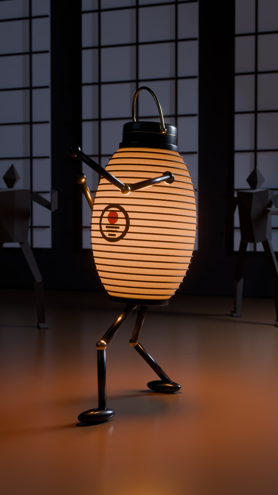

胴体が和紙のちょうちんで、自分で光る。夜の道場をひとりで照らす主人公。

作る手間：2/5 ／ 子ども向け判定：低〜中。夜の画と渋い色で大人っぽく見える。

見た目

胴体が、竹の骨と和紙でできたちょうちん。中からぽっと光る。
頭は黒漆の小さなふた。上に真鍮の持ち手の輪。
手足は黒漆の細い棒。
胸にオリジナルの家紋（黒と朱）。
本人が照明なので、どの場面も映画のような夜の画になる。

よく出た所

ちょうちんの胴が中からぽっと光り、竹の骨が黒い線で透けて見えます。スマホの小さい画面でも「光るちょうちん」だとすぐわかります。
胸の家紋（黒い輪と朱の丸）と、頭の上の真鍮の持ち手もはっきり見えます。
本人の光が床をオレンジに照らし、黒漆の手足や足先にも光が映り込むので、夜の映画のような画になっています。
足を前後に大きく開いて前の拳を突き出しているので、構えているように見えます。

まだ弱い所

カメラがほぼ真横から見ているため、前の腕が胴の前を斜めに横切ります。小さい画面だと時計の針や触角のように見えることがあります。
敵の紙人形2体はぼけていて暗く、折り紙というより角ばったロボットに見えます。
和紙の繊維の質感はアップにしないとわからず、スマホのサイズではつるっとして見えます。
背景の障子の格子が少し目立っていて、ややうるさいです。

3つの企画で使うと

BRIMFUL：夜の茶屋。本人の光で、お茶の水面が鏡のように光る。
NEVER DROP：黄ばんでつぎはぎした和紙の、古いちょうちん。光の明滅がゆっくり。
SOJI：夜の掃除番は、文字どおり道場の明かりそのもの。受けるたびに本人の光で照らされる。

敵（ザコ）

紙人形。黒いクラフト紙を折って作った、角ばった人形。顔なし。
ちょうちんの光が届くところだけ見える。
打たれると床にぺたんと折りたたまれ、飛び出す絵本のようにパッと立ち上がる。
音は紙の「パシッ」を、タンバリンのような打楽器に合わせる。

よい所

本人が照明なので、どのカットも暖かい光と深い影の、映画のような画になる。「安っぽい」から一番遠くへ行く近道。
着地で縮み、跳ぶと伸びる。変形のリグなしで、伸び縮みの笑いが作れる。
家紋がそのままチャンネルのロゴになる。
夜の見た目のアクションチャンネルは見当たらない。

心配な所

ちょうちんお化け（一つ目と舌）にしない。目も舌も付けない。
『千と千尋』の跳ねるランプや、Pixarのランプ（Luxo）と重ならないよう、2本足の人型を守り、首をかしげるランプの仕草はしない。
火は使わない（光の元は見せない）。
半透明の中の光はノイズが出やすく、レンダリングが少し重い。

参考になる実在の作品

・Die Abenteuer des Prinzen Achmed（1926, Lotte Reiniger） https://www.youtube.com/watch?v=eXG71sTbRgE（光と影だけで美しく見せる作り方の参考）
・Senbazuru: An Origami Stop Motion Short Film https://www.youtube.com/watch?v=TkQ0V06Ppn4（紙が光を透かす美しさと、紙の敵役の参考）
・The making of an origami Koi in stop motion（Sipho Mabona） https://www.youtube.com/watch?v=I700WYvOOM8（折り目のくっきりした紙の質感の参考（敵の紙人形））

### 3D-5 積み石の老師（イシ）（ISHI - Balanced River-Stone Master）

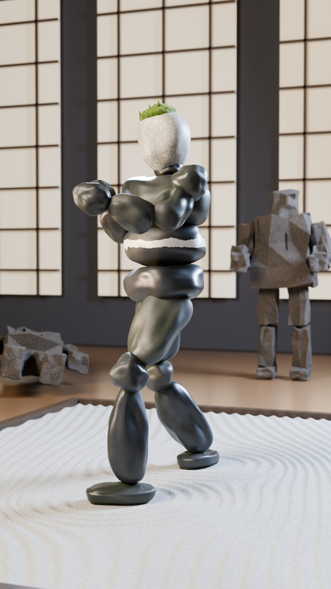

なめらかな川石を積んでできた人形。頭のてっぺんに苔がひとつまみ。

作る手間：1/5 ／ 子ども向け判定：低。

見た目

丸い川石を積み重ねてできた、どっしりした人形。
胴は平たい黒っぽい石が3枚。真ん中の石に白い石英の帯（ベルトのよう）。
頭は白っぽい花こう岩の丸石。てっぺんに苔がふさっと生えている。
手足も小石の連なり。少しカタカタ震えるが、絶対に崩れない。
枯山水の庭が似合う、「バランスそのもの」の主人公。

よく出た所

黒っぽい川石を積み上げたシルエットがはっきり読めます。スマホの小さいサイズでも「白いベルト」と「頭の緑の苔」が見えます。
石はしっとり濡れた川石の質感で、1個ずつ形も色味も少しずつ違います。頭はごま塩模様の花こう岩に見えます。
足元に枯山水の白い砂利（足のまわりに波紋）を敷いたので、サムネで目を引きます。奥に倒れた石男が1体、これから向かってくる石男が1体いて、話の流れも伝わります。

まだ弱い所

腕と太ももの石はまだ少し「ふくらんだ粘土」っぽく、本物の川石ほど硬く重そうには見えません。
この角度だと腕が胸の前で重なるので、上半身が少し団子のように見えます。後ろの手はほとんど隠れています。
頭が大きめでつるんとした卵形です。顔がないぶん、少し間が抜けて見えるかもしれません。
倒れている方の石男は、ただの瓦礫の山に見えてしまうかもしれません。

3つの企画で使うと

BRIMFUL：バランスでできた体が、なみなみのお茶を運ぶ。
NEVER DROP：いちばんはまる。苔むした太古の師範が、手まりを「もう1つの石」のように積んで落とさない。
SOJI：ほうきの代わりに熊手で砂紋を引く。敵が砂紋を乱すたびに、黙って引き直す。

敵（ザコ）

がれき男。石切り場から切り出したような、角ばったざらざらの花こう岩。
ひとかたまりの体に、角ばった手足。ドリルの跡が残る。顔なし。
打たれると丸ごと倒れて、ごろんと転がって起き上がる。
石どうしの「カチン」を、石琴（石のマリンバ）の音階で鳴らす。

よい所

3つの案はどれも「バランス」の話。この主人公はバランスそのもの。
石は本物らしく映りやすく、枯山水の庭は静かで高級に見える。
部品が全部硬いので、安く動かせる。
頭の苔ひとつまみで、顔がなくても「年寄りの師範」の人柄が出る。
なめらかな主人公と角ばった敵で、ひと目で区別がつく。

心配な所

ゲームの岩のゴーレム、マーベルのコーグ、イヌクシュク（イヌイットの石の人型、バンクーバー五輪のロゴ）に似ないよう、平たい石板ではなく丸い川石にする。
石が浮いて見えるとRayman（禁止）になるので、必ず接触させる。
重く遅く見えやすいので、動きはきびきびさせる。
積み石はお墓や供養を連想させる文化もある（弱い）。

参考になる実在の作品

・Sculpting a Roman Bust Statue in Blender（BlenderNation） https://www.blendernation.com/2026/09/03/sculpting-a-roman-bust-statue-in-blender/（Blenderで石の質感を手続き的に作る参考）
・特別展「はにわ」東京国立博物館 2024（Tokyo Art Beat） https://www.tokyoartbeat.com/events/-/Haniwa-Tomb-Sculptures-of-Japan/1-DC-8-EF-86/2024-10-16（素朴な造形物を大人が「愛でる」市場がある、という証拠）

### 3D-6 染付のひょうたん（ソメツケ）（SOMETSUKE - Blue-and-White Porcelain Gourd）

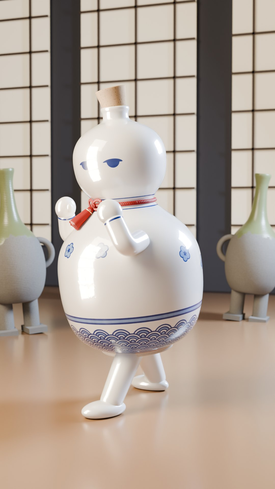

白磁に藍の絵付けをした、ひょうたん形の焼き物の主人公。ねむそうな目だけ描いてある。

作る手間：2/5 ／ 子ども向け判定：中〜高。丸い体と描いた目は幼児向けに寄る。茶屋の舞台、細かい絵付け、乾いた間の笑いで下げる。

見た目

ひょうたん形の、つやつやの白い磁器。上の玉が頭、下の玉が体。
体の下のほうに、藍色の波の模様（青海波）。
顔は、藍の筆で描いた半分閉じたねむそうな目だけ。
帽子はコルクの栓。くびれに赤い絹の紐と房。
短い手足。6人の中でいちばん「キャラクター」らしい。

よく出た所

白い磁器のツヤと、釉の下に描いた藍の絵付け（青海波・梅・ねむそうな目）が、本物の焼き物っぽく見えます。
ひょうたんの形と斜めのコルク帽子で、スマホの小さい画面でもシルエットがすぐわかります。白と藍の帯もちゃんと見えます。
赤い絹ひもと房が、白と藍の中でいい差し色になっています。目は半分閉じたねむそうな顔で、キャラクターらしさが出ています。
後ろの灰色の徳利のザコ（土もの）とも、素材の違いがはっきりしています。

まだ弱い所

背景の障子が明るいので、白い体が背景に少しなじみすぎます。スマホサイズだと全体が白っぽくて、メリハリが弱めです。
腕が短いので、構えが「ファイティングポーズ」より「ちょこちょこ歩きながら手を上げている」ように見えます。
目は仕様より大きくしましたが、スマホの縮小サイズでは小さな点2つくらいにしか見えません。
コルクの色が明るくて少し薄いです。手は白い玉、腕は白い管なので、少しシンプルすぎます。体の左側の「障子の映り込み」は、格子までは見えず、ぼんやりした光の帯です。

3つの企画で使うと

BRIMFUL：器が器を運ぶ。お茶が減ると、コルクの栓を抜いて自分からつぎ足す、というくり返しのギャグ。
NEVER DROP：貫入（ひび模様の釉薬）と金継ぎの線がある長老。仙人がひょうたんを持つ伝統にも合う。
SOJI：藍の前掛け。ちょこちょこした小股で掃く。

敵（ザコ）

素焼きの壺男。釉薬のかかっていない、灰色でざらざらの壺。
両わきの取っ手が腕。短い粘土の足。顔なし。
指で押した跡と、窯の灰が流れた跡がある。
打たれるとぐらぐら揺れて起き上がり、土鈴のような音で鳴る。厚くて重く、割れない。

よい所

藍と白の焼き物は、世界中で「高級」の記号（伊万里、デルフト）。本物の陶器の置物として売れそうな見た目。
ひょうたん形は、1cmの大きさでも読める。
描いた目の差し替えだけで、無表情もチラ見も安く作れる。
6人の中で唯一「顔がある」案。顔が欲しいかどうかの確認になる。

心配な所

6人の中でいちばんかわいい。POLICY 3-7 により、絶対に打たれない、ひびが入らない、割れない。3つの案とも主人公は打たれないので成立する。
焼き物は「割れるかも」と思わせるので、その手のギャグはしない。
手塚治虫のヒョウタンツギ（つぎはぎのひょうたん）に寄せない。
体が丸いので、技は回転、転がり、受け流しが中心になる。
白い焼き物なので、前回の白マネキンを思い出させるかもしれない。

参考になる実在の作品

・Damaged Goods（Barnaby Barford, 2008） https://vimeo.com/80353443（磁器の人形が主役の大人向け短編。焼き物キャラの品の出し方の参考）
・Porcelain War のアニメ挿話（Cartoon Brew） https://www.cartoonbrew.com/feature-film/fragile-figures-blublu-studios-on-the-haunting-animated-vignettes-of-porcelain-war-documentary-242082.html（陶器の人形の表面に絵が乗る見せ方の参考）
・Designing my first Art Toy Character in Blender https://www.youtube.com/watch?v=vJ3bhrx8wWk（大人向けアートトイの形をBlenderで作る手順の参考）

## 2D と 3D のちがい

| | 2D | 3D |
|---|---|---|
| 描く時間（このサーバーで測った値） | 静止画1枚 1.3〜5秒（Chromium） | 静止画1枚 約107〜111秒（Blender Cycles・CPU・40サンプル）。Mac の GPU ならもっと速いはずですが、まだ測っていません |
| 動かす手間 | パーツを関節で回す「切り絵アニメ」にすれば安い。影絵がいちばん安い（1）、墨と折り紙は高め（3） | 硬いパーツの人形なら安い。漆・時計・石は1、銅線・提灯・染付は2 |
| 見た目の強み | 雰囲気と色を「1枚の絵」として作りこめる。スマホで形が読みやすい | 素材の本物感（漆のつや、真鍮、ガラス）。カメラを自由に回せる。光が自動で正しく当たる |
| 苦手なこと | 振り向き・カメラが回る演出（向きごとに絵が要る） | 雰囲気を出すには照明と背景の作りこみが要る。1コマ描くのが遅い |
| あなたの好み（2D・雰囲気と色）との近さ | 近い | 素材の美しさは強いが、2D の好みからは遠い |

「僕の目で強い」：2D-5 影絵、2D-3 雪夜、3D-3 時計、3D-4 提灯。決めるのはあなたの好みです。

## Beanie Survives について

Beanie Survives は、このサーバーからは YouTube がブロックされていて、映像そのものは見られていません。検索で分かったのは次のことだけです。

手描きの棒人間（黄色いニット帽）が主役の、1日ずつ進むサバイバル物語（ゾンビ・核爆弾）

YouTube に8〜10分の本編、TikTok と Instagram に短い分割版

登録約4.85万人・総再生約150万回・21本（分析サイトの推定値）

あなたが好きと答えたのは「2D の平面の絵」と「雰囲気・色づかい」でした。なので 2D の6案は、色数をしぼって、時間・季節・光の仕掛けを全部ちがうものにしました。黄色いニット帽の棒人間や、あの絵柄はまねしていません。

「この場面のこの色が好き」というスクリーンショットがあれば、2D 案をあなたの好みにもっと寄せられます。

## 次の流れ

1. あなたが、好きな番号を1〜3つ選ぶ（「なし」も）。

2. 選んだ絵を直す：弱い所（メモに書いたもの）を直し、主役を BRIMFUL・NEVER DROP・SOJI のどれかの衣装で描き直す。

3. 5〜10秒の動きのテストを作る。2D ならこのサーバーですぐ作れます。3D はあなたの Mac で作ります。

4. 動きを見て、あなたが「これは好き」と言えたら、チャンネルの見た目として決める。

正直に：12案のうち多くが、和紙・漆・浮世絵など日本の素材です。世界向けに「日本っぽすぎる」かどうかは、選んだあとで確かめます。

## 外した案

・2D：サーベイ① 色面＋強い一灯：「一灯」の考え方は、ノワール（ブラインド）と折り紙（低い日差し）に入れた。夕焼けの色面だけだと Primal の画面に寄りやすく、リソの夕暮れとも色がかぶる。
・2D：DAWN MIST TIERS 朝霧の三遠：シルエットの主人公が影絵芝居とかぶり、霧の山水が「墨と朱」とかぶる。霧の中の影は Limbo/Inside に、平らな夜明けの丘は Alto に寄りやすい。
・2D：BRASS RING 真鍮の灯：壁に映る巨大な影が影絵芝居とかぶる。全体が暗く、スマホで沈みやすい。真鍮の輪の頭は強いので、どれかの案の主人公の頭として使える予備にする。
・2D：KIRIGAMI MOON 切り絵の月：黒い切り絵の主人公が影絵芝居とほぼ同じ。紙工作は子ども向けに見えやすい。手をつないだ紙人形の鎖の敵は面白いので、予備の敵案に残す。
・2D：MAKI-E 蒔絵：黒地がノワールとかぶる。装飾的で天気や空気が出にくく、高級品の広告に見えやすい。
・2D：NEON RAIN ALLEY ネオン雨小路／サーベイ⑩ ネオンの夜：サイバーパンクのネオンは使い古されている。雨と反射で画質を食い、作るのも重い。
・2D：COPPERPLATE FOG 銅版の霧：線のハッチングがスマホと圧縮でちらつきやすく、作るのが一番難しい。
・2D：KUROKO STAGE 黒子の舞台：敵が人間（黒子）なので、たたくと木の人形より暴力的に見える（POLICY 3-6）。
・2D：AFTERNOON CAFÉ LITHO 午後の喫茶リトグラフ：平らなミッドセンチュリーは企業の説明アニメに見えやすい。明るいからし色とトマト色は幼く見えやすい。
・2D：サーベイ⑪ トゥーン3D・コマ打ち（Blender 枠）：3D チームの領域で、2D 案として出すと見分けにくい。2D 側は6案とも SVG にそろえて比べやすくした。
・2D：サーベイ⑫ マンガのコマ・スクリーントーン：擬音の文字が言語に依存する。白黒反転の衝撃コマは点滅の基準にかかりやすい。
・2D：サーベイ⑬ ミッドセンチュリーのタイトルバック：Saul Bass や Catch Me If You Can の有名なタイトルに寄りやすい。ノワールと役割もかぶる。
・2D：サーベイ⑮ フラットシェーディングの舞台照明：Kentucky Route Zero の画面に寄りやすく、ノワールとかぶる。
・2D：サーベイ⑥ 切り絵の霧／⑦ 木炭・パステル／⑧ ガッシュ：絵本・クレヨン調で子ども向けに見えやすい。ノルシュテイン、Dudok de Wit、Cartoon Saloon など作家やスタジオの顔に寄りやすい。
・2D：サーベイ⑭ グラデーションの風景：Alto 風でありふれやすい。質感を足さないとスマホゲームの量産品に見える。
・2D：サーベイ⑯ 平塗り＋光のレイヤー（Klaus 風）：家族向け映画の印象に寄り、コストも中くらい。光を重ねる技は各案の中で部分的に使う。
・3D：TAKE（竹の棒人間、ししおどしの頭）：良い案だが、棒人間の枠は1体に絞った。糸人間に近いのは銅線のほう。ハリガネが気に入られたら次の候補にする。
・3D：SUMI（墨の筆線の棒人間）：黒い棒人間はAlan Beckerにいちばん近く、大神（カプコン）とも重なる。3Dの筆線は短時間で作ると安いフィルターに見えやすい。
・3D：NEON（ネオン管の棒人間）：光る棒人間は安いスマホ広告やLEDダンスの演目、Tronに似る。ガラス、発光、濡れた路面の反射でレンダリングも重い。
・3D：KOMA（江戸独楽の主人公）：足がないので構えのポーズが成り立たず、技が回転だけになる。ベイブレードやカポエラーにも寄りやすい。
・3D：YOSEGI（箱根寄木の箱の主人公）：箱の形はMinecraftやダンボーを連想させる。寄木の柄はスマホではノイズになりやすい。点の目でかわいく寄る。
・3D：KUMIHIMO（組紐の主人公）：曲がる紐のリグが高くつく。毛羽立つとSackboyやYarnyに寄り、赤い組紐は『君の名は。』を連想させる。
・3D：HANIWA（はにわの戦士）：どうぶつの森の「はにわ」、NHKのはに丸、ポケモンに近く、自分のキャラにしにくい。お墓の連想もある。
・3D：KIRIKO（江戸切子のガラスの主人公）：屈折とコースティクスで、6案中いちばん重い。群衆が出る毎回の制作に向かない。明るい障子の前では消える。ガラスは敵やフィナーレの素材として残す。
・3D：BONSAI（盆栽の師範）：葉の塊がレンダリングと二次動作で高くつき、幹のリグも難しい。グルートやエントにも寄る。
・3D：からくり茶運び人形（そのまま主人公に）：着物で足が隠れて構えが読めない。童子の顔は短時間で描くと不気味かかわいいに寄る。由来の話はトケイに引き継いだ。
・3D：クレイ、フェルト、ブロブ、動物キャラ：子ども向けに見えるリスクが高い。Aardman、Pingu、Fall Guys、モルカーなど禁止の作風にも寄りやすい。
・3D：ローポリの簡素な3D：オーナーが嫌う「安っぽい」にいちばん近い。Zack D FilmsやTABSのクローン扱いの恐れもある。
・3D：障子越しの影絵：主人公のデザインではなく演出。どの主人公とも組み合わせられるので、別に残す。
・3D：ブリキのぜんまいロボット：PixarのTin Toy、Astro Bot、WALL-Eに寄りやすい。ブリキはトケイの敵（ブリキ缶男）に回した。
・3D：こけしの師範：顔を描くとかわいく寄る。特定のこけし工人の図柄に似る恐れもある。おきあがりこぼしの仕組みだけ敵に借りた。
・3D：折り紙の主人公：ペーパーマリオやTearawayに寄る。紙は軽すぎて受けに重みが出ない。チョウチンの敵（黒い紙人形）に回した。

作り方：2D は SVG／HTML をヘッドレス Chromium で描画（`tools/nonverbal/prototypes/designs/2d/`）。3D は Blender 4.5 Cycles（CPU、40サンプル＋ノイズ除去、`tools/nonverbal/prototypes/designs/3d/`）。共通の舞台は `base.py`（3D）と `pose2d.py`（2D）。
