# 棒人間の体＋キャラの顔 6案（2026-10-17）

オーナーの案「体は棒人間、顔だけキャラっぽく」を、表情キャラ6案の顔で描いた版。1案ごとに、場面（1080x1920）と主役の3ポーズ（構え・アクション・リアクション、1080x1080）。

## 見比べた結果（レビュー担当）

結論：「棒の体＋キャラの顔」は使えます。ただし、合う頭と合わない頭がはっきり分かれました。

6案のうち3案（nose_to_nose、tall_order、sunday_nose）は、元の全身版より動きもギャグも良くなりました。残りの3案（heavy_lids、squint_house、jaw_drop）は、元の版より悪くなりました。

分かれ目は頭の形です。
・合う頭：角ばっていて、平たくて、輪郭がはっきりした頭です。横顔のくさび形の鼻、四角い頭と太い眉、インク線の卵形などがこれに当たります。シルエットだけで顔の向きと感情が読めるので、細い体に乗せても「顔」として立ちます。
・合わない頭：丸くて柔らかい大きな頭です（豆、ピーナツ、横長のパンケーキ）。細い体に乗ると「棒つきキャンディ」や「風船」に見えます。アゴ落ちのような大きな顔芸をすると、体が隠れてしまいます。座りっぱなしのキャラも、棒の体の良さが出ません。

一番のおすすめは、横顔の nose_to_nose です。
棒人間のアクションは横から見せるのが基本なので、横顔の頭とよく合います。さらに「顔は無表情でにらみ合ったまま、体だけが下で戦う」というギャグそのものが、この形式でしか作れません。South Park の「顔とテンポで笑わせる」面白さを、見た目は真似せずに出せます。
2位の tall_order は、眉1本で感情が読めるので、スマホで一番強いです。
3位の sunday_nose は線の勢いが一番ですが、既存の棒人間に一番近い見た目なので、そこだけ注意が必要です。

全案に共通する直し：
・頭を身長の約31%から25〜28%に縮める。今は頭が大きすぎて、腕が頭の上に上がりません。
・手足の色は、背景よりはっきり濃くする。
・大人らしさは、頭（ひげ、白髪、鼻）と小物1〜2個で出す。

どの案も Alan Becker、Henry Stickmin、C&H のそのままの真似にはなっていません。叩かれる役も、人形か大人です。

## 1位 S-6 横顔のにらみ合い

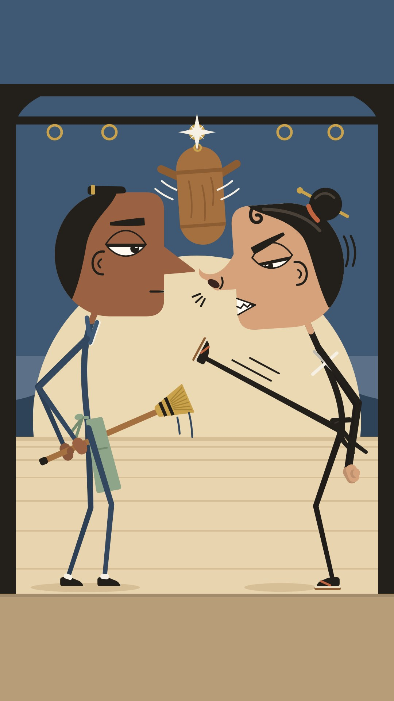

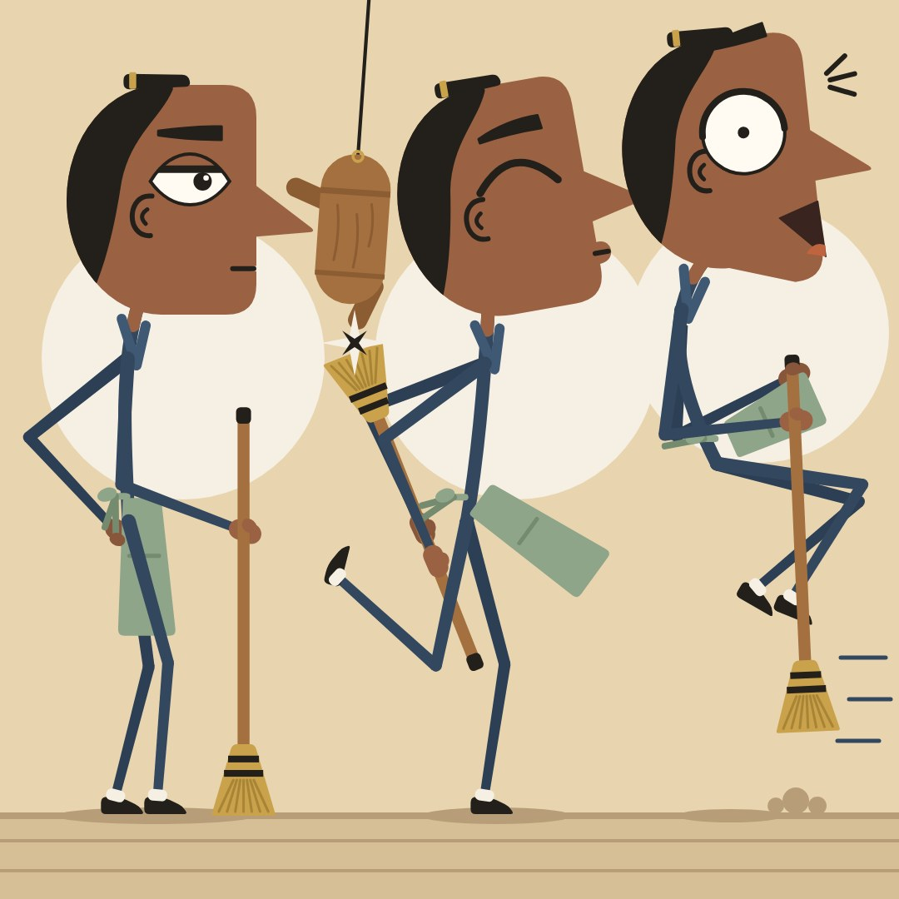

「顔は鼻先10pxでにらみ合ったまま、その下で体だけがケンカする」。これは棒の体でしか作れないギャグで、6案の中でいちばんこの形式に合っています。横顔の頭は横から見せるアクションと相性がよく、元の全身版よりも動きがずっと出ました。
135pxでも、鼻と鼻の距離、ソルのジト目、スヌートの歯むき出しが読めます。
弱いところ：スヌートの蹴りがソルの胴を狙っているように見えます。ほうきの「背中越し」も読めません。スヌートの黒い手足は、手前と奥の区別がつきません。

よく出た所

・頭は元のリグのコードをそのままコピーした（元ファイルの23〜572行と1文字も違わないことを diff で確認済み）。棒の体は共通のビルダー1つで描いている。入力は「首の付け根の座標＋ポーズ辞書」。シーンもポーズ表も、この同じ頭と同じ体で描いた。
・シーン：画面中央の「鼻先10pxのにらみ合い」が一番目立つ。顔はぴくりとも動かず、その下で体だけがケンカしている。このギャグが 360x640 の縮小でも読める。スヌートのまっすぐ伸びた蹴り脚と、ソルのほうきの穂先が中央の同じ場所に集まる。その真上で人形が輪に戻ってキラッと光る。上から下へ一本の縦線が通る構図になった。
・顔の感情がはっきりしている。スヌートは歯をむき、鼻の穴を広げ、鼻息の線と震えの線つき。ソルは半目でまっすぐな口の「またか」顔。
・明暗：月を大きくして下げた。ソルの紺の手足も、スヌートの黒い手足も、月か淡い床板の上に乗るので背景に溶けない。肘の位置は計算で月の内側にあることを確かめた。
・衣装は小物1〜2個だけ。ソルはエプロンの旗、紺の襟のV、ほうき。スヌートはたすきのX、黒帯の結び目と垂れ。胴体を服の色で塗っていないので、Cyanide & Happiness 風にならない。
・手はミトンに親指のこぶ付き。足はソルが黒い足袋靴に白い帯、スヌートが黒足袋にクリームの草履と赤い鼻緒。関節の点はなく、線の端は全部丸い。
・大人の比率になっている。頭は全身の約31.5〜32%。背骨は0.85〜0.87HU、脚は1.25HU、腕は1.07HUで、手足が長い。
・ポーズ表の3つは 270px に縮めても見分けられる。①構え：ほうきを杖のように立て、片手は腰。②背中越しパリィ：ウインク、後ろ足を跳ね上げ、エプロンが前に流れ、人形の腕と穂先が当たった所でキラッ。③後ろ跳び：丸い目、落ちたあご、膝を抱えて宙に浮き、エプロンがめくれ、床に影と砂ぼこり。
・他チャンネルとの違い：丸い頭なし、原色での色分けなし、PC画面なし、帽子で個性を出していない。

まだ弱い所

・「背中越し」がまだ伝わりにくい。完全な横向きだと、ほうきが背中の後ろを通っていると見せるのが難しい。シーンでは手をお尻の後ろに置き、ほうきが脚の後ろを通る形にした。それでも、ぱっと見は「腰だめにほうきを構えている」にも見える。ポーズ表のパリィも同じで、手は背骨より後ろにあるが、ほうきは指示の「水平」ではなく急な斜めになっている。
・ソルの手（肌色）とほうきの柄（木の色）の明るさが近い。握った手が柄に溶けて見えやすい。
・スヌートは手足が真っ黒なので、奥の脚・腕（12%暗くしたもの）と手前の区別がほとんどつかない。帯の垂れも黒いので、脚の付け根のあたりで線がごちゃっとする。
・スヌートの蹴り足は「人形を蹴った後の残りのポーズ」だが、ソルの胴を蹴りにいっているようにも見える。人形が飛んだ道筋は描いていない。そのため「蹴る→受ける→輪に戻る」の順番は、静止画では見る人の推測に頼っている。
・ポーズ表では、中央（パリィ）の鼻先が右（後ろ跳び）の後頭部の髪にほぼ触れている（接線）。8回の上限に達したので直していない。右のポーズを15pxほど右へずらせば直る。吊るした人形と中央の後頭部の隙間も約11pxで窮屈。
・シーンの上の空（y 0〜230）と下の地面（y 1626〜）が空いている。Shorts の UI がかぶる帯なので正しい配置だが、絵としては少しもったいない。
・蹴り足の草履は月と同じような色で、薄く見える。茶色の底の線でかろうじて読める程度。人形のまわりの揺れ線は「ひげ」にも見える。
・ポーズ表の手足の先は11pxで、1/3に縮めると約3.7px。「4px以上」をわずかに下回る（線の太さのルールの10〜12pxには入っている）。

## 2位 S-3 眉で語る縦長頭

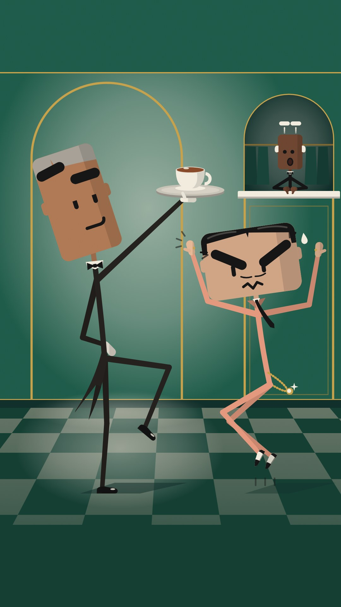

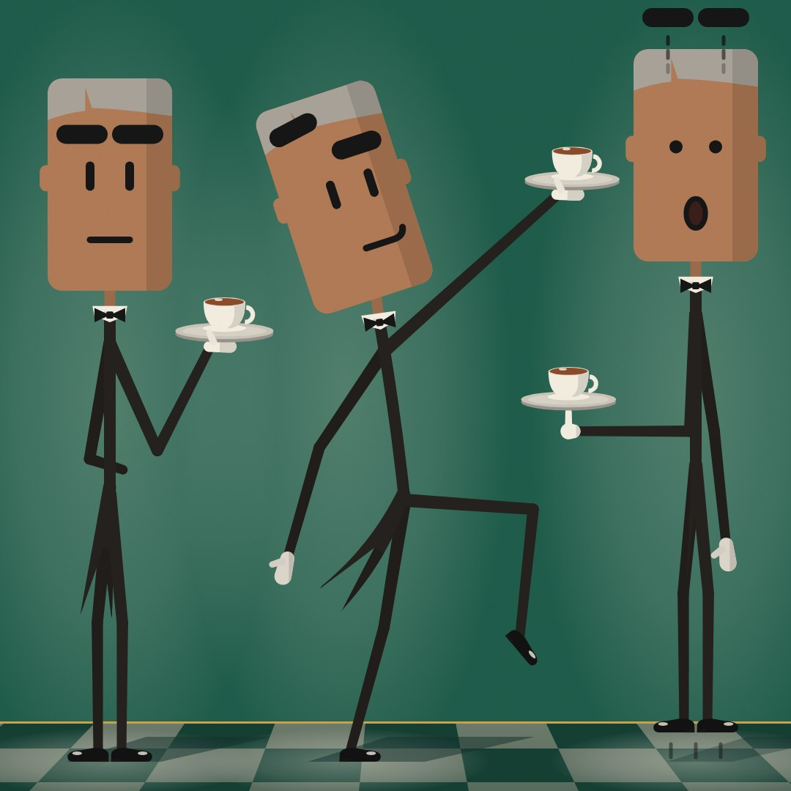

黒いピル形の眉は6案でいちばん強く、135pxでも感情が分かります。「涼しい顔の背の高い給仕」と「跳んでも届かないハスティ」の身長差ギャグも一瞬で伝わり、棒立ちだった元の版より大きく良くなりました。アールデコの配色で大人っぽさも十分です。
弱いところ：四角い頭が大きすぎて、腕が真上に上がりません。アクションのチャンネルでは致命傷になりかねません。ハスティのサーモン色の脚は明るい床に沈みます。

よく出た所

・パッと見て「棒人間の体＋キャラの顔」と分かる。いちばん強いのは眉（高さ32pxの黒いピル）。手足は輪郭なしの丸いピル（付け根20px→先14px）なので、顔より目立たない。
・身長差のギャグが通じる。レベル氏は約1090px（頭が身長の31%）、ハスティは約860px。ハスティは跳んでいるのに、トレイまで約150px届かない。
・スマホ縮小（135x240と360x640）でも、次の4つが読める：①レベル氏の上がった片眉と横目　②ハスティのV字眉とギザギザ口　③トレイとカップ　④ハスティの指先とトレイの間の空き。クラークの飛んだ眉も小さいけど見える。
・衣装は小物だけで見せている。レベル氏はウイングカラー＋蝶ネクタイ、燕尾（1枚が2本に割れる形で、半拍遅れて揺れる）、アイボリーの手袋、黒エナメル靴。ハスティはサーモンの襟先、なびく細い黒ネクタイ、光る金の懐中時計チェーン、白黒ツートンの尖った靴、小指の金の指輪。
・胴体は背骨1本だけで、シャツの塊は描いていない。関節の丸もない。手はミトン、足は靴。
・ポーズシートの3体はシルエットがはっきり違う。直立（片手でトレイ、片手は背中）／フラミンゴ立ち＋腕を斜め上にピンと伸ばす／板のように固まって40px跳ね、眉が頭の上に飛ぶ（トレイは指1本で水平のまま）。
・床の市松は、タイルの大きさと位置を自動で選んでいる。2人とも足の下は明るいタイル。ランプの光だまりで、黒い脚が床に沈まない。
・2枚とも、元のままの頭リグと共通の体リグ（pose dict）で描いている。体と頭は Char.draw(顔dict, ポーズdict) 1回で出るので、アニメにしても安く済む。

まだ弱い所

・頭が大きすぎて、腕を真上に上げると頭にぶつかる。なのでトレイは「真上」ではなく、斜め上に約45°で伸ばした腕の先にある（頭を-18°傾けてやっと当たらない）。仕様の y440 は無理で、y≈600 になった。
・レイアウトの都合で位置を動かした。レベル氏の頭は (360,640) ではなく (244,640)、ハスティは (796,828)。
・ハスティは頭が横に広いので、両腕を真上に上げられない。肘を横に張って前腕を立てる「ゴールポスト型」になる。左の前腕が左耳を少しかすっている（目と口にはかかっていない）。
・クラークの頭は仕様どおり110pxで、240pxの下限より小さい。口と目は小さく、読めるのは眉だけ。
・ハスティの手足のサーモン（明度約70%）は「明度35%以下」のルールに反している（ボディ仕様の色を優先した）。明るいタイルの上では脚のコントラストが少し弱い。
・燕尾は描き方が難しい。2本の細いリボンにすると「脚がもう2本」に見えた。なので1枚が割れる形にした。正面で立つポーズでは脚の後ろにほぼ隠れて、ほとんど見えない。
・ポーズシートは3体が詰まっている。ポーズ2のトレイとポーズ3の頭の間が狭い。ポーズ1の「背中に回した腕」は手を隠したので、「腰に手」に見えるかもしれない。
・トレイを支える平手の親指が、小さな白い突起に見える。
・モブ（他の客）とハスティの指パッチンは、この場面にないので描いていない。リグにもまだ作っていない。

## 3位 S-2 日曜版の鼻

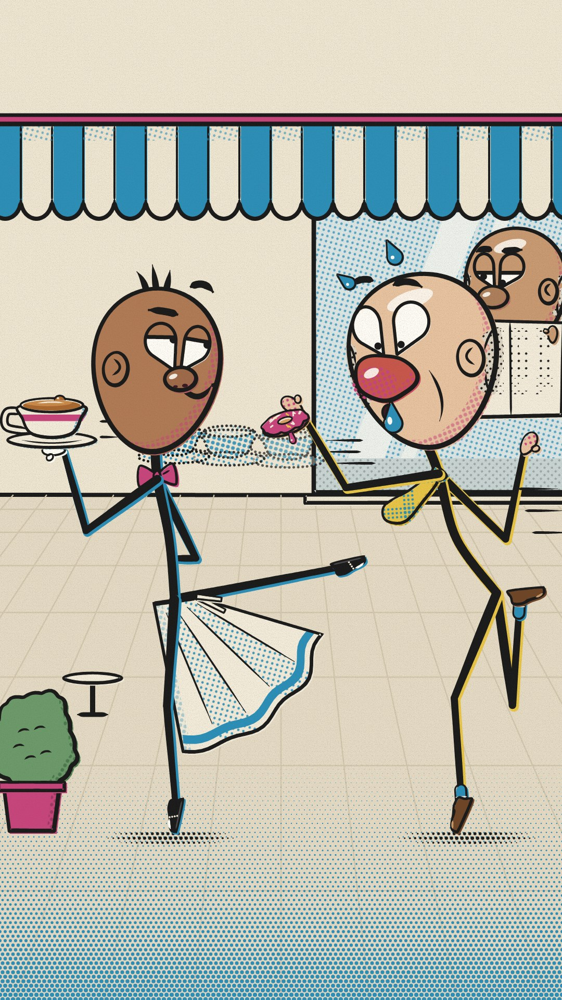

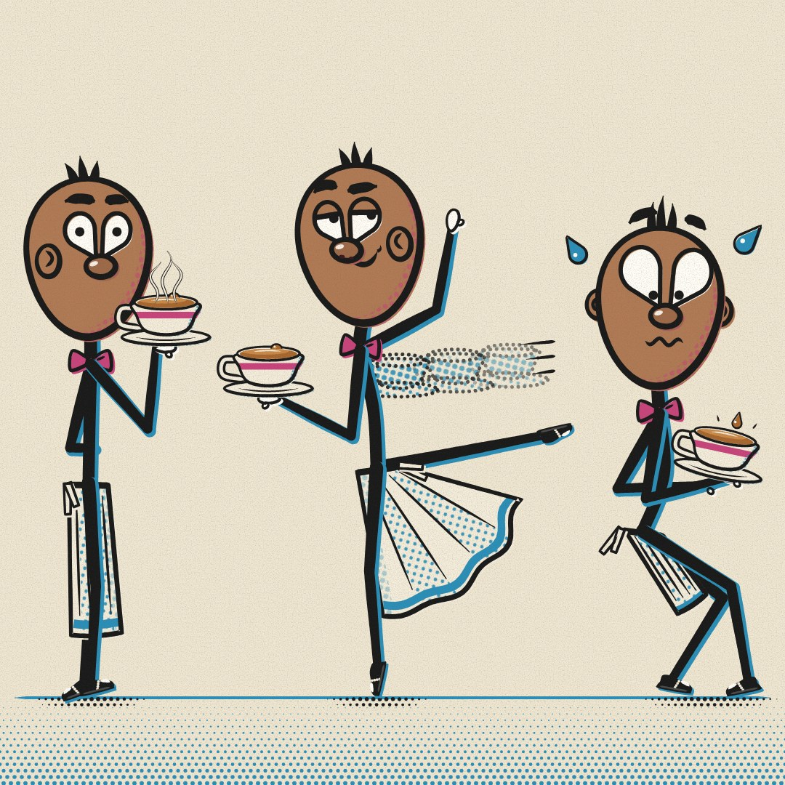

線に勢いがあり、色ズレの影とレトロな網点も効いていて、棒人間アニメとして一番「動きそう」に見えます。元の立ち絵からの伸びも大きいです。
弱いところ：ゴーストカップが灰色のブレにしか見えず、オチが伝わりません。アラベスクの脚はガスを蹴っているように見えます。
黒い細線と卵形の頭の組み合わせは、6案の中で既存の棒人間（Henry Stickmin、C&H）に一番近いシルエットです。色ズレの影と鼻・耳は絶対に外せません。

よく出た所

・顔は元の Face リグ（make_face_original.py）を import して、コードは一切変えずに使っています。体は1つの共通棒人間リグです。関節角度か手首・足首の目標位置を書いた pose dict を渡すと、丸い端の太さが変わるインク線になり、その下に3pxずれた色版（ビックスはシアン、ガスはマスタード）が敷かれます。シーンと3ポーズは同じ2つのリグで描いています。
・スマホサイズ（135x240に縮小）でも次の5つが読めます。ビックスのドヤ顔の流し目、ガスの真っ赤な鼻と寄り目、縁まで入った紅茶（奥の縁で表面が少し盛り上がる）、エプロンの扇形の広がり、ドーナツとカップの距離（約300px）。
・手足に版ズレの色の影が付くので、Alan Becker、Cyanide & Happiness、Henry Stickmin とは一目で違います。頭は卵形で、鼻・涙形の目・眉・耳があります。手はミトン（親指つき）、足はビックスが白い光沢つきのブローグ、ガスがシアンの靴下つきのローファーです。関節に点はありません。
・ギャグの見せ方：ガスのドーナツが、さっきまでカップがあった場所の「点線と網点のゴーストカップ」に浸かっています。本物のカップは左端でしずく1つ盛り上がったまま無事です。窓の奥の常連が新聞を鼻まで下げて横目で見ています。
・ポーズ表は3つです。①直立で、カップを肩の高さに載せ、片手は背中。②つま先立ちのアラベスクで、エプロンが扇形に広がり、点線のゴーストカップが3つ。③内股気味にしゃがみ、カップは12°傾いて、しずくが浮いています。並べると動きの差がはっきり出ています。
・大人に見える要素：手足が長く（脚1.26HU、腕1.03HU）、頭は身長の約31%です。ガスはハゲ、たるんだ頬、赤鼻、前のめりの背中。ビックスは蝶ネクタイとエプロンの給仕です。
・表情シートの「!」を削除し、汗のしずくとエマナタ（感情を表す線）に置き換えました。画像内に文字はありません（SVGに text、image、font は無し）。

まだ弱い所

・シーンのビックスの後ろ脚（アラベスク）がガスの方を向いているので、サムネだと「蹴り」に見えるおそれがまだあります。膝を曲げたアティチュードも試しましたが膝蹴りに見えたため、まっすぐに戻して長さを82%にし、ガスから約250px離しました。
・ゴーストカップは薄めで、スマホだと「灰色のブレ」程度にしか見えません。3つのうち2つはビックスの頭の後ろに半分隠れていて、指定の「3つのゴーストがはっきり並ぶ」状態にはなっていません。
・ガスの後ろ脚と後ろ腕が画面右端ぎりぎりで、Shortsのボタン帯にかかります。
・窓の常連の目がセーフエリア（x 960まで）から少しはみ出しています。左手のミトンはガスの頭に隠れています。
・ポーズ表は3ポーズを横に並べるため、頭の高さを224px（身長約714px）にしました。指定の870pxより約18%小さいです。②の足先が③の背中側に少し入り込んでいます。
・③の内股は、奥の脚がエプロンと手前の脚に隠れ気味で、「内股」より「腰を落とした」程度の読みにとどまります。
・ミトンは仕様どおり小さい（約0.13HU）ので、ソーサーの下の手は親指の粒くらいしか見えません。
・背景のタイルの目地と窓の網点がやや多く、手足と競り合う場所があります。
・ガスの「o」の口は鼻の汗の粒にほぼ隠れています。
・下描きは9回で、上限の8回を1回超えました。

## 4位 S-1 半目の夜勤

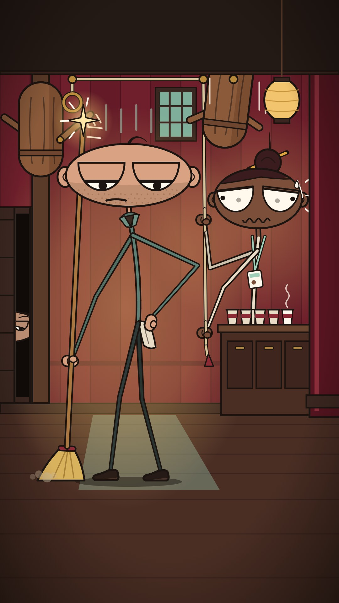

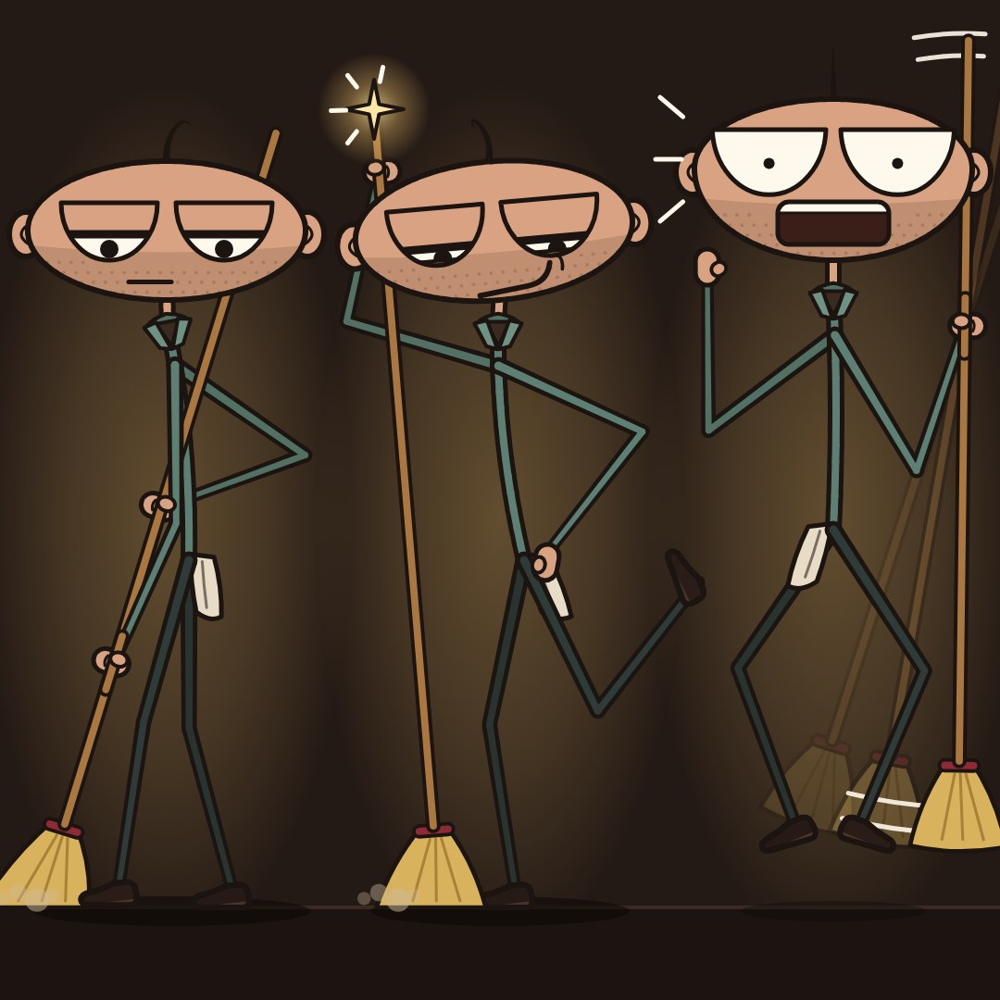

半目のジト目と無精ひげで、「大人の無表情」の強さはあります。
ただ、横長の平たい頭が細長い体に乗ると「棒つきキャンディ」に見えます。シーンも腰に手を当てて立っているだけなので、アクション感は弱いです。
ドットは体がほぼ消えていて、ほうきは身長と同じくらいの長さで不自然です。

よく出た所

・顔のリグ（face()・EXPRESSIONS・rope()・limb()）は元ファイルからそのままコピーしていて、照合で一致を確認済みです。そこにスティック体のリグ body(N, pose, C) を足しました。scene と poses の2枚とも、この同じ「頭リグ＋体リグ」で描いています。体はポーズ辞書で決まります（首の付け根アンカー、腰の位置、背骨の曲がり、手の目標位置または角度、膝の向き、小道具の状態）。
・線は頭と同じ扱いです。インクの縁取りの中に色の芯を入れた「縁取りスティック」で、太さは付け根19px→先端13px。端も関節もすべて丸め、関節の丸ポチは描いていません。肘と膝には常に7°以上の曲がりを残しています。手はミトン（握る時は柄に対して横向きの拳、親指は柄の手前）、足は平らな靴底のスリッポンです。
・ひと目で「棒人間の体＋キャラの顔」に見えます。平たいパンケーキ形の頭（重いまぶた・無精ひげ・耳・寝ぐせ）が長くて細い体に乗っているので、大人に見えて幼児っぽくなりません。AvA型（単色・のっぺら丸頭・手足なし）とも、C&H型（シャツの塊・丸頭）とも見た目がはっきり違います。
・シーンの掛け合いは言葉なしで伝わります。ルウは片手を腰に当て、顔は前を向いたまま、黒目だけドット側に流して半目のジト目、頭上に鬱線。ほうきは片手で、穂先を床につけたまま柄だけが頭の後ろを通って跳ね上がり、木人の腕に「チン☆」と当たっています。ドットは綱をたぐりながら、目が泳いで冷や汗。戸の隙間からはじいさんの片目が無表情でのぞいています。
・スマホ1/3縮小（360×640）で、指定の「必ず読めるもの」はすべて確認できました。半目と黒目の向き、ドットの大きな目と汗、光るチン☆と真鍮リング、床の穂先とほこり。手足の縁取りと背景のコントラストは実測で約3.1〜4.1:1です（足元の月明かりと人物の後ろのアンバー光で確保）。
・ポーズ3種は動きが読めます。①構え（ほうきを斜めに持つ、膝を軽く曲げる、猫背、無表情）、②ブラインド・バックフリック（後ろ足を蹴り上げ、柄先にチン☆、ドヤ顔で視線は反対側）、③驚きジャンプ（靴底が70px浮く、膝を開いて縮める、腕は「わっ」のV字、ほうきは残像付きで回転）。文字・記号・外部素材はありません。

まだ弱い所

・ほうきがかなり長いです（柄が身長の約0.98倍、穂先まで含めると約1.08倍）。「穂先は床、柄先は頭の上で当たる」という指定を満たすと、どうしても長くなりました。夜勤用の長柄ほうき、という設定でごまかしています。
・ポーズ③の「片手の上で縦回転するほうき」は、この長さだと枠に収まりません。右手で柄の上寄りを握り、残像2本と白い回転弧で「回っている」ことを見せる形に変えました。それでも「振り回している」寄りに見え、「真上で回っている」ようには見えません。
・ポーズシートは窮屈です。頭の幅300が列の幅360をほぼ埋めていて、耳どうしが近いです。
・シーンのルウは「片手でほうきを持ち、もう片手は腰」という静かなジト目の一拍なので、アクションの派手さは控えめです。「はじいた」ことは、チン☆、光、柄先の白い流線、木人の腕の弧で見せています。
・ドットの拳は肌が濃い茶色なので、綱の上だと結び目っぽく見えがちです。腕もクリーム色で細く、胴は背骨と名札だけなので存在感は弱めです。
・ドヤ顔（表情4）の口角の巻き上がりが右目の下の縁に触れています。元の表情シートと同じ形なので、そのままにしました。
・ルウの足は暗いスレート色です。月明かりの上ではよく見えますが、背景が暗い場所では縁取りと明るい背景に頼っています。

## 5位 S-4 糸目の茶屋

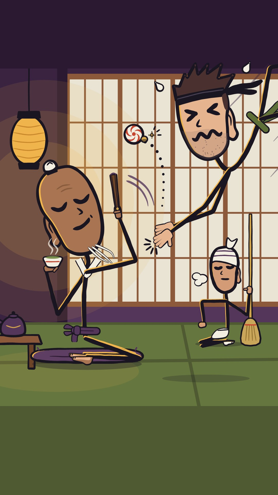

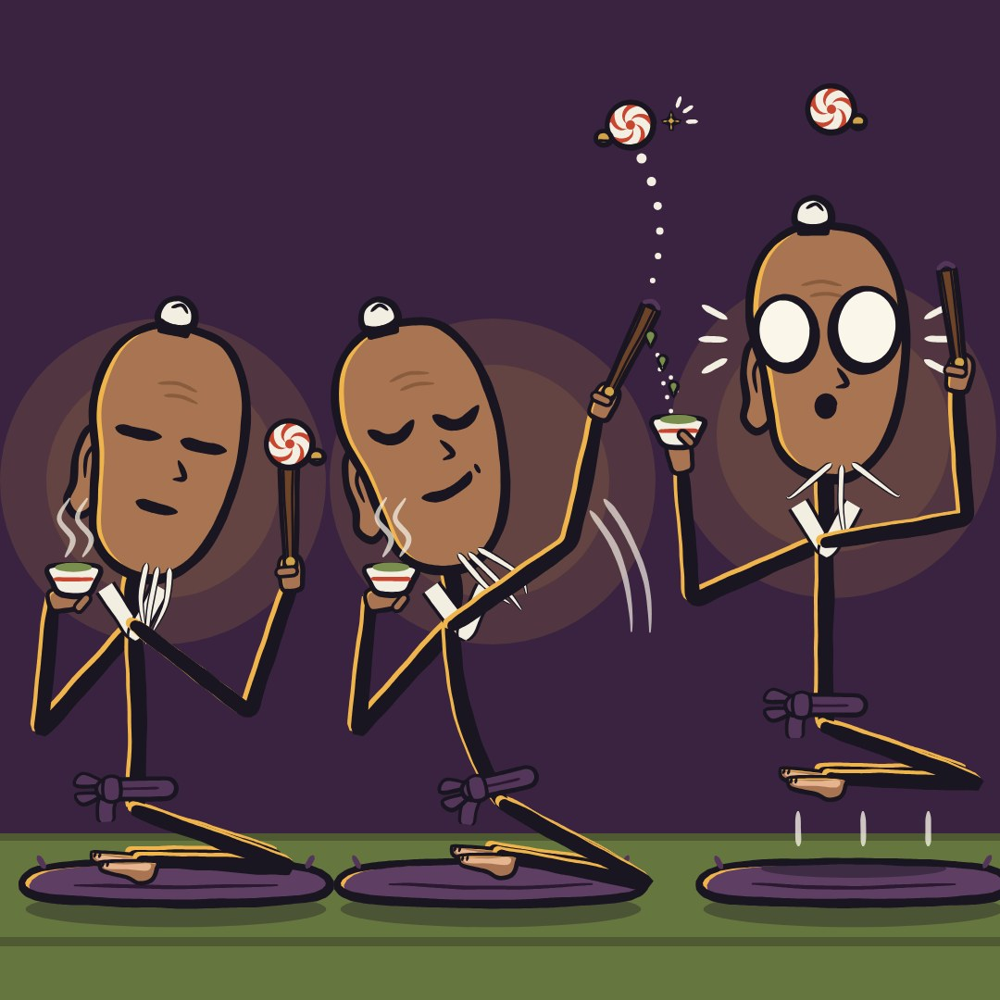

糸目のニヤリと「><」目の対比は、今でも面白いです。
ただ、正座の師匠は「巨大な豆に細い胴」に見え、畳んだ脚はただの線になっています。ヒコは脚が画面の外にあって、体のつながりが分かりにくいです。
着物の塊があった元の版のほうが魅力的でした。座りっぱなしのキャラは、棒の体にしても得がほとんどありません。

よく出た所

・パッと見て「棒の体にキャラの顔」と読めます。頭は元の豆型リグをそのまま使っていて、make.py の1〜620行目は make_face_original.py と1行も違いません。体は新しく作った Stick クラスで描いています。関節位置からIKで腕と脚を解き、筆のテーパー線を引き、ランタン側に琥珀色のリムを付ける仕組みです。シーンもポーズ表も、同じ頭リグと同じ体リグで描いています。
・首は頭リグ自身の回転軸に刺さっていて、頭の内側に約25px隠れています。背骨は腰から一本の線で首まで続きます。lift を上げたときは、その分だけ首が伸びます。
・体の線は頭と同じ言語です。INK の筆線は肩側が太く手首側が細く、少しかすれます。暗い壁の前でも琥珀のリムで縁が分かれ、湯呑みの腕が背景に沈みません。
・シーンの笑いは言葉なしで伝わります。師匠は糸目のU字とニヤリ口のまま、頭だけ20度傾けてかわしています。茶は水平で湯気も立っています。毬は高く上がり、点線の軌跡、鈴のきらめき、扇の振り抜き弧が付いています。ヒコは真上から飛び込んで ><目と波口と汗で空振りの拍手をしていて、拍手の線も付いています。女将はうんざり顔でため息をついています。毬と手のあいだは約300px空いています。
・ヒコの飛び込みは、手、肩、腰が一直線に並ぶ構図にしました。顔は起こしたまま首で支えています。腰ひもの帯と片膝は右上の角から画面外へ流れ、床に影を落として空中にいることを示しています。
・ポーズ3枚は「静→振り抜き→跳ね」と区別がつきます。跳ねでは足を正座に畳んだまま90px浮き、湯呑みは片手で直立したまま、滴が弧を描いて戻ります。ショック目と左右の汗線（エマナタ）も入っています。
・135x240、270x270、360x640 に縮めても、U字目、ニヤリ、><目、ショック目、水平の湯呑みが読めます。
・大人らしさは、師匠のしわと白ひげ、ヒコの無精ひげともみあげ、女将の茶屋の仕事で出しています。関節の玉、シャツの塊、帽子のアイデンティティ、文字、PC画面、外部素材はどれもありません。SVGにも text や image タグは0件です。

まだ弱い所

・座った師匠は、頭が体に対してかなり大きく見えます。HU比は仕様どおりですが、正座で脚が畳まれているため、ほぼ「巨大な豆に細い胴」に見えます。
・帯の蝶結びは小さいと「紫のプロペラ」っぽく見えます。素足の裏も「茶色い舌」に近く、正座の足として読むには少し弱いです。
・ヒコの脚は、太ももと膝が右上の角に少し見えるだけで、あとは画面外です。足袋は一度も画面に出てきません。
・ヒコの拍手の手（hand_open）は小さく、指がほぼ黒い線の束になっています。縮小すると「手が合わさった」程度にしか読めません。
・師匠の扇の腕とヒコの手のあいだは約80〜100pxで、少し窮屈です。
・ポーズ1と2の胴の差は控えめです。背骨の傾き、襟Vのずれ、帯の短縮で「ひねり25度」を表していますが、ひねりとしてはあまり読めません。
・シーン下部の約1/4は空の畳です。ShortsのUIで隠れる領域ではありますが、絵としては上に重心が寄っています。
・女将はスケール0.5で、頭は約175pxです。棒の脚と白い前掛けと足袋が重なって、白い塊に見えます。
・モブ（同じ鉢巻の弟子たち）は、今回の絵には入っていません。

## 6位 S-5 アゴで語るピーナツ頭

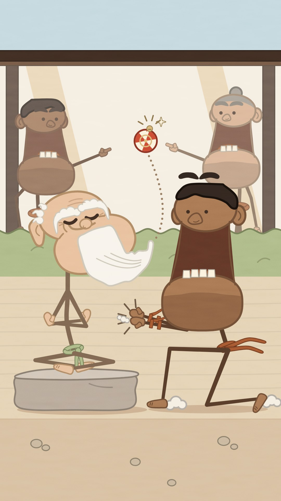

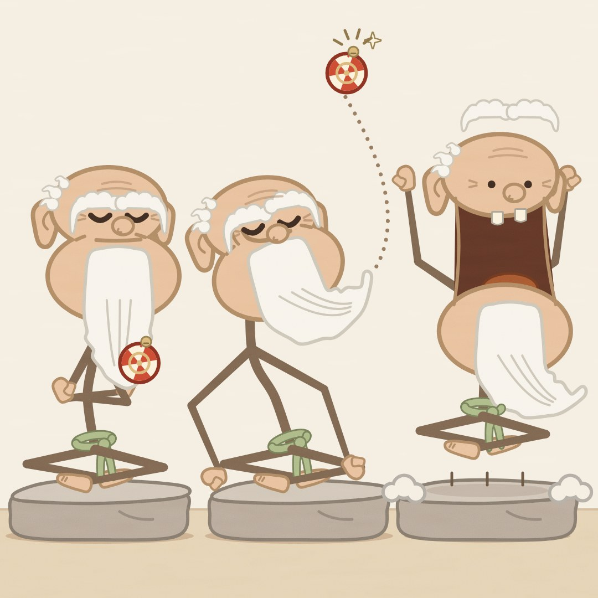

アゴが落ちると、頭で体が全部隠れてしまいます。スナップは「脚の生えた茶色い柱」に見えます。看板ギャグのアゴ落ちと棒の体がぶつかっている状態です。
薄い茶色の細い線はスマホで濁り、師匠の腕組みは三角形にしか見えません。
この頭は、元の道着版のほうがはっきり良いです。

よく出た所

・パッと見て「棒の体に、大きなピーナツ頭のキャラ顔」と分かる。アゴの下に首（約50px）と背骨（0.86頭身）がちゃんと見えるので、ピーナツは「頭」と読める。ピーナツが体全体になっているMr. Peanutの形にはなっていない。
・顔の描き方（rig）はまったく変えていない。make_face_original.pyの19〜676行目をmake.pyにそのまま写し、diffで同一と確認済み。体は新しく作った共通の棒人間rigで描き、scene.svgとposes.svgの両方をこの2つのrigだけで作っている。
・体の線は頭と同じ考え方で揃えた。黒は使わず、肌色を暗くした色（師匠 #745E4B、スナップ #503726）で、元ファイルのlimb()を使い、先細りで端と関節は丸め。手は肌色のミトンで親指つき、足は裸足のくさび形で指の線2本。関節の丸い点は描いていない。
・小道具も設定どおり。師匠はPISTの帯（輪と短い垂れ）で、道着は着ていない。スナップはCINNの帯（長い垂れがなびく）と手首の布バンド2本、弟子2人もCINNの帯でお揃い。
・セリフなしで笑いが伝わる。目を閉じてニヤリとする師匠がヒゲを跳ね上げ、玉は上空に飛んで点線の軌道と鈴の「チーン」マーク。スナップは何もない空中で両手をパチンと閉じ、手のあいだから空気がプスッと出ている。アゴは胸の下まで落ち、真っ暗な口が大きく開いて下の歯が見える。後ろの弟子2人も同時にアゴを落として玉を指さしている。
・スマホ縮小（360x640と135x240）でも、師匠の閉じ目とニヤリ、スナップの大きな黒い口、ヒゲのカーブ、空いた場所に浮かぶ玉が読める。閉じ目の線は12pxに太くした。
・スナップの深い突進は動きがある。前の太ももが水平で、後ろのひざは床すれすれ、後ろ足はつま先立ち。帯の垂れが後ろへ流れ、足元に土ぼこり。
・ポーズ表は3つの見せ場がはっきり分かれている。座禅で玉をヒゲの先に乗せて静か → 片手を後ろについて反り返り、ヒゲで玉を打ち上げる → 足を組んだまま60px跳び上がり、アゴが胸の下まで落ちて両腕が上がる。
・大人に見える。手足が長く、師匠はしわ・長い耳たぶ・白ヒゲ、スナップは無精ひげ・重いアゴ、弟子は白髪まじりのまげと無精ひげ。
・他チャンネルと見分けがつく。丸だけの頭なし、色分けなし、シルクハットやニット帽なし、PC画面なし、シャツの塊なし、文字なし（SVGにtext要素0件）。

まだ弱い所

・師匠の腕組みが、小さな蝶ネクタイか三角形のように見える。ひと目で「腕を組んでいる」とは伝わりにくい。腕の長さ1.06頭身を守ると、きれいにたたむのが難しかった。
・座った師匠は背骨が長く細いので、棒つきキャンディか台に刺さった頭のようにも見える。
・スナップの肩と胸は、落ちたアゴの後ろに全部隠れている。腕はアゴの左下からひじの曲がりが出てくる形なので、人によっては「アゴから腕が生えている」ように見える。パチンと閉じた手も、スマホでは小さい。
・弟子2人は頭が約240pxと大きい。24%の霞をかけて奥に下げたが、画面の上半分はまだにぎやか。135x240の縮小では弟子の顔がにごる。右の弟子の帯はスナップの頭に隠れて見えない。
・ポーズ3は「両腕を横に広げる」はずが、上向きのV字（バンザイに近い形）になった。ヒゲが胸と背骨を隠すので、棒の体は手足でしか見えない。
・ポーズ表は3つとも同じ大きさの頭と同じ石なので、少し単調。ポーズ1と2は遠目だとシルエットが似ている。
・足は小さく色が淡い。あぐらでは足がすねの下にほとんど隠れる。
・師匠が座った高さは約2.07頭身で、指定の1.8頭身より高い。

## 上位3案の直し（レビュー担当の提案）

・nose_to_nose：スヌートの蹴りの向き：今は足先がソルの首から胸のあたりを水平に指していて、人を蹴っているように見えます。足先を20〜30°上に向け、木人が飛んだ道筋に合わせてください。蹴りとほうきが当たった点から上の真鍮リングまで、点線の弧と木人の残像を2つ描き足すと、「蹴る→受ける→輪に戻る」の順番が静止画でも読めます。
・nose_to_nose：ほうきの「背中越し」：柄は腰の後ろから背中を斜めに横切るように通し、穂先は反対の肩の上（頭より高い位置）から出してください。当たる点にキラッを置きます。ソルの胴は奥に10〜15°ひねってください（ポーズ表のパリィのほうが近いので、それを基準にする）。
・nose_to_nose：スヌートの黒い手足：奥の腕と脚は、黒ではなく濃い茶灰色（今より25〜30%明るく）にしてください。手前の手足には細いクリーム色の縁を入れます。黒帯の垂れには赤いアクセントを1本入れて、脚の付け根の線から離してください。
・nose_to_nose：ソルの手とほうきの柄が溶けて見える問題：柄を一段濃い木の色にするか、手の輪郭を濃くして袖口に紺の帯を付け、握っている所を分けてください。ポーズ表は、右のポーズを15〜20px右へずらし、手足の先を12〜13pxにして、1/3縮小でも4px以上残るようにします。正面か3/4向きでも頭が読めるかを、ターンアラウンド1枚で確認しておいてください。
・tall_order：頭の大きさ：レベル氏の頭は身長の31%から約26%に、ハスティの頭は横幅を約15%縮めてください。そうすれば、頭を傾ける小細工なしで腕が真上に上がります。トレイを頭上に掲げる、受け止める、バンザイといった動きは、アクションでは必須です。腕を1.2HUくらいまで伸ばすのでも構いません。
・tall_order：ハスティの手足の色：サーモンを明度35%前後の深いコーラル／レンガ色に落としてください。サーモンは襟先と靴に残します。明るいタイルに乗る場面だけ細い暗色の縁を足すのでも構いません。
・tall_order：燕尾は、横向きのポーズだけ1枚の濃いくさび形で見せ、正面のポーズでは省いてください。ポーズ1の「背中に回した腕」は、肘が胴の反対側から少しのぞくようにして、腰に当てた手と区別します。トレイを支える白い親指の突起は、手袋のアイボリーに輪郭を付けて手の一部に見せてください。クラークは頭を180〜200pxに拡大するか、思い切って外してください（今は眉しか読めません）。
・sunday_nose：ゴーストカップのオチ：灰色のブレではなく、はっきりした点線の輪郭（不透明度60〜70%）にしてください。3つとも頭に重ならない位置に、ドーナツから本物のカップまで一列に並べ、奥ほど薄くします。速度線も2〜3本加えて、「浸けた瞬間にカップが消えた」ことが一目で分かるようにします。
・sunday_nose：ビックスのアラベスク：伸ばす脚とカップの腕を、両方ともガスと反対側（画面左）へ伸ばしてください。体はガスから逃げる向きに傾け、顔だけ振り返って流し目を送ります。こうすれば「蹴り」ではなく「かわし」に見えます。ガスは60pxほど左へ寄せ、Shortsのボタン帯から外してください。
・sunday_nose：他チャンネルとの距離を保つ：色ズレの影を4〜5pxに太くし、鼻と耳を毎フレーム必ず描いてください。丸だけの頭や、点だけの目には絶対にしないこと。ガスの赤鼻は、135pxだとピエロの鼻に見えます。彩度を少し落とした赤ら顔のローズ色にして、真ん丸から少し崩してください。背景のタイル目地と窓の網点は、手足と重なる場所だけ40%ほど減らします。

## 棒人間の体の決まり

・PROPORTION (adult, not chibi). Use HU = the head's larger dimension, max(W, H), measured without hair spikes, ears or emanata. Standing height = 2.6-3.2 HU, so the head's larger side is 31-38% of standing height. For tall heads (egg, bean, rounded rect, peanut, profile D) that means head height is 31-38%. For the two wide heads (Heavy Lids' Lou, Tall Order's Hasty) head height is only 19-26%, but head width is still 31-38%. Hard limits: never above 40% (reads as chibi, a storytime avatar or a kids' show) and never below 28% (the face dies on a phone).
・INTERNAL PROPORTIONS in HU: visible neck 0.05-0.12, spine from neck base to hip 0.85-1.05, legs from hip to sole 1.25-1.5, arms from shoulder to wrist 1.0-1.2, so the wrists hang at mid-thigh at rest. Long limbs are an adult signal; stubby limbs read as babies.
・PHONE TEST. Every key frame must survive a 1/3 downscale (360x640): pupils or eye dashes at least 4 px, brows at least 4 px thick, mouth shapes at least 10 px wide, limbs at least 4 px. In a 1080x1920 shot no head is smaller than 240 px on its larger side; hero heads on the main beat are 300-420 px.
・LINE WEIGHT for a 1080-wide frame. Limbs: 16-20 px at the root (shoulder or hip), tapering to 10-12 px at wrist and ankle (about 1.6% down to 1.0% of frame width), never under 9 px anywhere. Spine and neck: 16-18 px. Casings and outlines on body props: 4-6 px. Wooden dummy dowels: 22-28 px, heavier because they are a different material. Motion arcs: 4-6 px. The face's boldest mark (brow bar, eye stroke, lid line) must stay the heaviest or highest-contrast element of the figure; limbs never out-shout the face.
・CAPS AND JOINS. Every limb, spine and neck stroke gets round caps and round joins: stroke-linecap/linejoin round, or the rig's own tapered polygon with round ends (sunday_nose limb(), squint_house tube()/capsule(), jaw_drop limb()). No square ends, no mitred corners.
・ELBOWS AND KNEES appear only as the bend in a two-segment line. Keep a 5-12 degree bend even at rest so the joint position is always readable, and go fully straight only on extension beats (kick, reach, parry) for snap. Never draw joint dots, balls or circles (that is the Stick Nodes node look). Never let one rubber-hose curve run through a whole limb.
・HANDS are simple mitten silhouettes, never bare line ends or plain dots. A mitten is a rounded paddle 0.11-0.13 HU long and about twice the wrist width, in skin color (or glove color when the glove is a costume prop), drawn with the head's own edge treatment. Add a separate thumb nub drawn in front of whatever the hand grips (saucer, tray, broom, fan, cord). Fingers appear only on gesture beats (clap, snap, point, open 'stop' palm), and the hand returns to a mitten on the next pose.
・FEET are small shoe, sock or bare-foot shapes 0.17-0.20 HU long with a flat sole, so every landing reads as a note (sole flat on the floor line). The shoe type is a costume signal: patent oxfords, slip-ons, brogues, tabi with zori, bare feet in a dojo. Never bare line ends.
・NECK ATTACHMENT. One continuous stroke runs from the hip up through the shoulder point into the underside of the head. Its top ends at the rig's own neck/tilt pivot (per-design formulas are in body_spec), hidden 8-25 px inside the head silhouette, and the head is drawn after the body so it sits on top. That way each rig's existing tilt, lift and facing parameters rotate around the correct point and the head never floats. When a rig's 'lift' raises the head on a surprise, stretch the neck by the same amount. The shoulder point sits 0.12-0.18 HU below the visible neck base, and both arms leave from that single point.
・TORSO = SPINE + PROP, NEVER A BLOCK. The torso is only the spine line, which may curve into an S for posture (hunch, ramrod, lean). Never fill the torso with a shirt-colored block or wedge; that is the Cyanide & Happiness look. Costume lives in 1-2 small flat props hung on the spine (bow tie or collar V at the neck; apron, tailcoat tails or sash ring with tails at the hip; lanyard badge; tasuki cord across the spine) plus at most one hand prop (tray, cup, broom, fan, doughnut). Props are drawn in the head's own treatment and are the only places costume color appears in bulk.
・PROPS AS FOLLOW-THROUGH. Hanging props (apron, tails, sash tails, necktie, beard, headband tails) lag the body by 2-3 frames and settle half a beat later, and each settle can carry a soft secondary note, so the prop works as a free metronome. On contact frames, hand props must read clean: tea surface flat, ball aloft, broom-to-dummy contact marked.
・THE HEAD STYLE RULES THE BODY. The body copies the head's line language exactly. Outlined heads get outlined (cased) limbs in the same ink. Brush heads get brush-tapered limbs. Flat heads with no outline get flat limbs with no outline, in a garment tone, with depth shown by value (far limbs use shade(c, 0.12)). Heads with tinted outlines get tinted limbs and no pure black. Print/halftone heads get the same color-plate offset and halftone on props. Mapping: Heavy Lids = cased ink sticks via its limb(); Sunday Nose = variable ink stroke() plus a 3-px color-plate offset; Tall Order = flat pill strokes with no outline; Squint House = brush() taper plus amber rim; Jaw Drop = tinted limb() with no black; Nose to Nose = flat strokes with no outline, far limbs darker. Same ink hex, same light direction, same rim or shadow logic as the head.
・LIMB COLOR AND CONTRAST. Use dark or muted garment or ink tones only: HSL lightness 35% or less, or the design's own ink. No character wears one saturated hue head to toe. Never use pure primaries or secondaries such as #FF0000, #0000FF, #00FF00, #FFFF00 or #FF6600 for limbs, and never color-code identity by limb color (the Alan Becker color-gang look). Limbs need at least about 3:1 luminance contrast against what is directly behind them; in dark scenes add a lamp pool, moon disc or rim behind the bodies rather than lightening the limbs.
・THE FACE ALWAYS WINS THE BEAT. On the hit or landing frame the head is upright within 20 degrees and unobstructed (no limb or prop crosses the eyes or mouth), and its expression swap lands on that frame or exactly one beat later as the reaction. Flips and spins rotate the body around the hips first; the head arrives last and upright, with a 2-3 frame lag, to deliver the face. Heads never squash beyond what the rig already supports (jaw, puff, lift, tilt, drop).
・ACTION STAGING. Limbs act in clear negative space away from the face, and the silhouette must read when filled solid black. One contact point per beat, in the middle third of the frame, marked for 2 frames with the design's own impact mark (ting star, brush emanata, halftone burst, star4 glint). Every contact is one note; holds and face swaps sit on the rests.
・MOOKS, type A: wooden training dummies. Faceless capsule 'log' bodies (about 140x300 px) with 20-28 px dowel peg arms, wood-grain strokes, and a brass ring and cord at the top. No eyes, no mouth, no painted target that could read as a face. They swing, spin and clack back into their brass ring within the bar. At most 3 on screen at once.
・MOOKS, type B: stick mooks (rival disciples, grabby customers, guests). Same stick-body spec as the heroes, but with small heads from the same rig at 0.6-0.75 scale and simplified features: bar brows, heavy lids or squint, no shiny pupil highlights. They are unmistakably adult (stubble, sideburns, jowls, mustache, grey hair) and dressed alike through one shared prop (the same headband or sash). Never color-code them individually.
・HIT POLICY. Hits land only on wooden dummies or on non-cute adult rivals. Results are stylized (spin, slide, sit-down thump with a dust puff, hair flip, prop knocked askew), and the character is upright again within 2 s (48 frames at 24 fps). No injury marks of any kind: no bruises, bandages, blood or broken props on bodies. Characters with big glossy eyes or soft round faces (Dot, the old masters, the witnesses) never take hits.
・ADULT SIGNALS. Real adult jobs (night sweeper, night-desk clerk, waiter, head waiter, tea-house master, dojo master), stubble, jowls, mustaches and grey hair from the rigs, posture (hunch vs ramrod), muted mid-century palettes, and deliberate weight shifts. No children, no school props, no toy-bright colors.
・DISTINCTNESS CHECKLIST. (1) A head is never a plain circle; each keeps its original rig silhouette (pancake ellipse, egg, rounded rect, bean, peanut, profile D) with its ears, hair and feature set. (2) Always mittens and shoes, never bare line ends. (3) No joint nodes. (4) No hat, beanie or scarf as the main identifier: no knit beanie, top hat, porkpie or trailing scarf. (5) No PC desktop, cursor, animator's hand, pencil, eraser, ruled or notebook paper, white void, or 'drawn on paper' premise. (6) No emoticon faces. (7) Every shot lives in a full illustrated world taken from the original design. (8) Actions are sweeping, parrying, carrying, balancing and volleying, never punching flying objects in a karate gi.
・NO TEXT, NO EXTERNAL ASSETS. All art is code-drawn SVG built from the design's own make.py helpers: no AI generation, no downloaded images or fonts. No letters, digits or typographic glyphs anywhere, including '!' and '?' (replace Sunday Nose's '!' with emanata or drops). No signs, menus, badges or newspaper text; use abstract dot or line rows instead.
・SHORTS SAFE AREA. Keep faces and contact points inside x 60-960 and y 280-1500 of the 1080x1920 frame, because the Shorts UI covers the right edge and the bottom ~20%. The floor line sits at about y 1530-1610; below it is ground and cast shadow only.
・LAYER ORDER for each character: cast shadow, far leg, far arm, spine/neck, back props (apron back, tails), head (rig), front props (bow tie, beard, tie), near leg, near arm, hand prop with thumb nub, then marks/emanata.
・RIG REUSE. Keep each design's head code unchanged (make_face_original.py). Add one shared stick-body builder that takes the head's neck anchor in world coordinates plus a pose dict: shoulder, elbow, hip and knee angles, spine curve, and prop states such as apron swing, tails lag and beard swing. Every frame is then body(pose) + head(expression), the same pose-dict approach the face rigs already use, which keeps animation cheap.

## 似せないように見比べた作品

・Alan Becker: Animator vs. Animation (color-gang stick figures incl. The Second Coming) https://en.wikipedia.org/wiki/Animator_vs._Animation（Uniform-width stick figures in one saturated hue head to toe (red, blue, green, yellow, and orange #FF6600 for The Second Coming per https://animatorvsanimation.fandom.com/wiki/The_Second_Coming). Plain faceless circle heads, including a hollow one. No hands or feet. Color as the only identity. A PC desktop or screen setting, a cursor or 'the animator' fighting his creation. Our rule: big faced rig heads, muted cased/brush/pill limbs, mitten hands and shoes, real-world sets.）
・Henry Stickmin series (PuffballsUnited / Innersloth) https://tropedia.fandom.com/wiki/Henry_Stickmin（A plain round-headed stick figure with a small simple face. The top hat as clan identity (Toppat; see https://henrystickmin.fandom.com/wiki/Henry_Stickman, where the look-alike wears a black top hat and shoes). Choose-your-path freeze frames and fail-screen gags with on-screen text. None of our heads are circles, no top hats, no text.）
・Cyanide & Happiness (Explosm) https://en.wikipedia.org/wiki/Cyanide_%26_Happiness（Round heads with the eyes sitting low. Shorthand of bald men and long-haired women. Characters told apart by a colored shirt filling the torso. Thin black limbs with no hands. Dark shock humor. Our rule: torso = spine + 1-2 small props, never a shirt block; heads keep ears, noses, brows, lids and stubble.）
・xkcd (Randall Munroe): Cueball, Megan, Black Hat https://www.explainxkcd.com/wiki/index.php/Character（Thin uniform black lines on a white page. Empty circle heads with no face. Identity only through a hat or a hairstyle (Black Hat, Megan's hair). Our figures have colored worlds, faces that carry the joke, and job props rather than headwear identity.）
・Stick Nodes (stickfigure animation app and its community figures, inspired by Pivot) https://apps.apple.com/us/app/stick-nodes-animator/id932127902?l=en（Visible node dots or circles at the joints. Default uniform-width stickfigure proportions with small heads. Minecraft-skin heads. Copied fight-choreography templates from that community. Our joints are bends only, and our heads are 31-38% rig heads.）
・Beanie Survives (YouTube channel; analytics listing only, no official page verified) https://outlierkit.com/channel/beaniesurvives（A stick figure whose identity is a yellow knit beanie (as described in our POLICY), and the 'survive N days' what-if framing listed for the channel. No knit caps as identifiers and no survival day-count formats.）
・Don Hertzfeldt: World of Tomorrow / It's Such a Beautiful Day (Bill) https://www.sundance.org/blogs/oscars-preview-hertzfeldts-stick-figures-return-in-world-of-tomorrow-3/（Black-on-white wobbly line figures with tiny round heads and dot eyes. A single hat as the only identity (Bill's hat; see https://cinema.wisc.edu/2024/09/03/its-such-beautiful-day-philosophy-bill/). White void backgrounds and optical photo effects. Our heads are large, colored rigs in full sets.）
・asdfmovie (TomSka) https://www.dictionary.com/e/slang/asdfmovie/（White round heads with emoticon-style faces (custom MSN emoticons) on stick bodies, and the random non-sequitur sketch format. Our faces are rigs with lids, brows and noses, never emoticon glyph shapes.）
・Pencilmation (Ross Bollinger; Pencilmate) https://en.wikipedia.org/wiki/Pencilmation（Pencil-drawn stick figures and doodles fighting the animator's pencil and drawing tools, the ruled notebook-paper backdrop, and the round-headed Pencilmate look. It is also the closest format competitor: slapstick carried by energetic music and classic cartoon sound effects, about 20M subscribers. Sunday Nose's cream paper grain must never become ruled or lined paper; no pencil, eraser or hand ever enters frame.）
・Rhythm Heaven: Karate Man / Karate Joe (Nintendo) https://rhythmheaven.fandom.com/wiki/Karate_Joe（The closest overlap with our 'every hit is a note' premise: a pale, balding, big-nosed man in a skin-toned karate suit, barefoot, punching flying pots and barrels in time with the music, one object per beat. Jaw Drop's bald master must not wear a white or skin-toned gi, and no hero ever punches incoming objects on the beat. Our verbs are sweep, parry with a broom, carry level, balance and volley with a fan or beard.）
・YouTube storytime animators (Jaiden Animations, TheOdd1sOut) https://en.wikipedia.org/wiki/Jaiden_Animations（A round-faced avatar on a tiny body, super-deformed ratios, identity carried by hairstyle alone, plain white backgrounds (genre description: https://journal.animationstudies.org/article/id/135/). Our head never exceeds 40% of height, and we use full illustrated sets and adult job props.）
・South Park (studied earlier only for face-swap mechanics) https://southpark.cc.com/news/78zs1w/fan-question-do-you-hand-draw-every-scene（The round flat-bottomed head, two big touching oval eyes with dot pupils, construction-paper texture, and a child cast. Heavy Lids' Dot is the main risk: keep her eyes as flat-topped bowls with a visible gap (eye_gap of 20 or more) and lids, never two full touching ovals.）
・Mr. Peanut (Planters mascot) https://en.wikipedia.org/wiki/Mr._Peanut（A risk for Jaw Drop's peanut head on stick limbs. Avoid an anthropomorphic peanut whose whole body is the peanut with thin black arms and legs, plus monocle, top hat, cane, spats and white gloves. Our peanut is only the head: a visible neck of at least 30 px and a spine of at least 0.9 HU below it, skin color, no shell texture, none of those accessories.）
・Mr. Men / Little Miss (Roger Hargreaves) https://en.wikipedia.org/wiki/Mr._Men（One simple geometric shape that is both head and body, with limbs sprouting straight out of it, a single flat color per character, picture-book-for-kids tone. A risk for Tall Order's rect heads and Sunday Nose's egg if the neck and spine shrink. Always show a neck and spine, and keep color in props, not the whole figure.）
・Line Rider (Bosh the sled rider; music-synced track videos) https://en.wikipedia.org/wiki/Line_Rider（A stick rider whose identity is a scarf flapping behind him, sleds, and the drawn-line-track gag format that is already famous for music sync (e.g. https://www.classicfm.com/composers/tchaikovsky/line-rider-dance-sugar-plum-fairy/). No trailing scarves as identity and no ride-the-drawn-line visuals.）
・Stickin' Around (Nelvana, 1996-98) https://en.wikipedia.org/wiki/Stickin%27_Around（Crayon-textured, kid-drawn stick figures, elementary-school child heroes, and fantasy-doodle framing. No crayon textures, no kid characters.）

作り方：`tools/nonverbal/prototypes/faces_stick/` の各フォルダの `make.py` が、元の顔の仕組み（`tools/nonverbal/prototypes/faces/`）と棒人間の体の仕組みから、場面と3ポーズを SVG に書き出す。`tools/nonverbal/prototypes/faces/render.js` で PNG にする。
