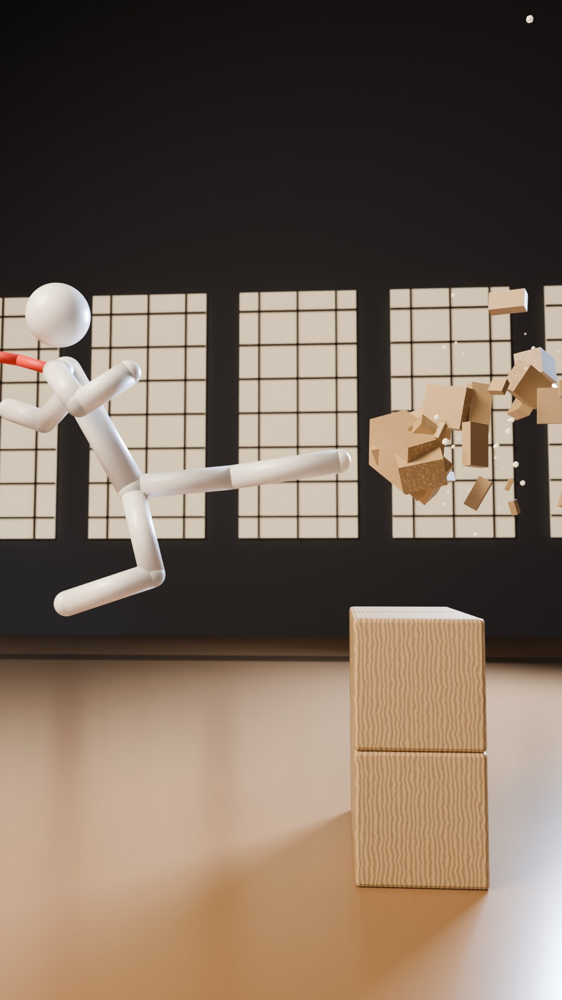
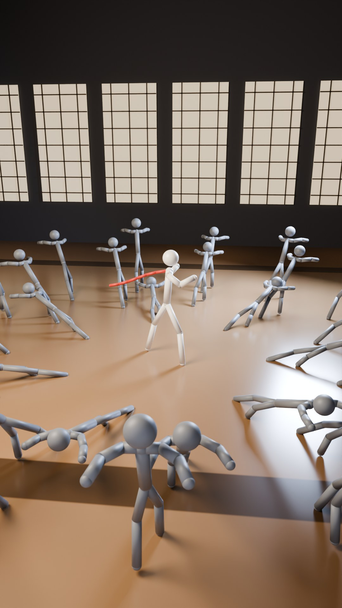

# 棒人間アクション3案（2026-10-17）

## 選んでほしいこと

決めてほしいことは2つです。

1. どの案にするか
・1つでも、迷ったら2つでも大丈夫です。2つなら、両方の主役の静止画を作って比べます。

2. L0 か L1 か（戦いで体に当てるかどうか）
・先に YouTube の公式ページを開いて読んでください：https://support.google.com/youtube/answer/6162278
・僕らのおすすめは「しぼった L1」です（下の「暴力レベル」の章）。

迷ったら、この1問で選んでください。
「最初の0.5秒に、何が見たい？」

・ふちまで盛り上がった紅茶と、伸びてくる木の手 → BRIMFUL
・落ちてくる手毬と、あくびの老人のつま先 → NEVER DROP
・ほうきの「シャッ」と、見ずにはじく一発 → SOJI

| | BRIMFUL | NEVER DROP | SOJI |
|---|---|---|---|
| 中身 | 1滴もこぼさない給仕 | 手毬の老師モク | 夜のそうじ番 |
| 点数 | 7.65 | 7.63 | 7.45 |
| ルール | なみなみの1杯は、1滴もこぼれない | 手毬は、ぜったいに地面に落ちない | 何がおそってきても、そうじをやめない |
| 当たり | 主役が自分の手足で当てる（一番 Alan Becker に近い） | 主役は殴らない。手毬が頭に「ポン」 | ほうきで木人をはじく。はじくほど片づく |
| 作る重さ | Shorts 1本 7〜12日 → 慣れて5〜7日 | Shorts 1本 6〜9日 → 慣れて4〜5日 | Shorts 1本 4〜6日 → 慣れて2〜3日 |
| 暴力 | L1（L0 版もできるが、気持ちよさは下がる） | L1 のいちばん弱い形（L0 版あり） | L1（L0 では成り立たない） |

## はじめに

「Bが好き」、ありがとうございます。
棒人間アクションでいきます。

前の KAKU & RONDO は「微妙」でした。
理由は3つでした。見た目が安っぽい。笑えない、気持ちよくない。企画が刺さらない。
これを受けて、作り方を変えました。

・点数表から考えるのをやめました。あなたが好きと言ったものから考えました。
　（Alan Becker の戦い、糸人間作品の1対大勢、S3dV、球から始まる音ハメ、ピタゴラ・ドミノ、シュール）
・ルールは1本に1つだけ。音を消しても、1秒で分かるもの。
・頭で考える面白さより、体で気持ちいいこと。拍ぴったりの当たり、こわれる物、流れ。
・見た目は、陶器・大理石・木などの素材と、映画のような光で「安っぽい」をなくします。
・笑いはルールからではなく、真顔と間（シュール）から作ります。

このページの見方
・10案を、4つの目（あなたの好み・指が止まる力・100万人の基準・作りやすさ）で採点しました。
・上位3つを、24秒の絵コンテにしました。横に並べて読んでください。
・3つの点数はほとんど同じです（7.65 / 7.63 / 7.45）。
　なので、点数ではなく「どれを一番見たいか」「どれを作りたいか」で選んでください。
・3つとも、暴力レベルは L1（デフォルメした当たり）です。L0 か L1 かも、一緒に決めてください。
・動画はまだ作っていません。Blender で質感テストの静止画を2枚だけ描きました（「見た目テスト」の章）。

## BRIMFUL（ブリムフル）— 1滴もこぼさない給仕 BRIM（仮）

### 一言で

無表情の給仕 BRIM（ブリム）が、なみなみの紅茶を届けに行く。
カップをねらって、木のデッサン人形の群れが押し寄せる。
BRIM は敵を一度も見ず、1滴もこぼさずに全員をさばく。
当たりは全部、曲の音になる。
ルール：「なみなみの1杯は、1滴もこぼれない」

### 主役

・背の高い、細い墨色の棒人間。大人の体型。
・頭に平たい丸い帽子（円盤の形）。手にソーサーと紅茶のカップ（ふちが藍色）。
・腰から下に白い長いエプロン。回るとふわっと広がる。
・目は点が2つ。口はなし。目はいつもカップだけを見ている。
・性格：完璧主義のプロ。あわてない。敵を一度も見ない。驚くのは1本に1回だけ。
・決め技「満月まわし」：側転しながら、カップが縦に1回転。速く回せば中身は落ちない（バケツを振り回すのと同じ、本当の物理）。
・音のロゴ：カップをソーサーに置く「チン・チン・チーン」。

### 絵コンテ

第1話「Not One Drop」（縦24秒・120BPM・ジャズ）

1. 0.0〜1.0秒：BRIM の胸から上の寄り。ふちより盛り上がった紅茶が、ぷるぷる震えている。「チン」。右から木の手がにゅっと伸びる。BRIM は見もせず、カップを15cm横へすべらせる。木の指は空をつかんで「コン」。
2. 1.0〜3.0秒：カメラが引く。青灰色の大理石のホール、昼前の日ざし。12体の木の人形が輪になって、ピョコピョコはねている。1体（7番）だけ、手を後ろに組んで立っている。奥に、日ざしの当たるテーブル＝ゴール。
3. 3.0〜5.0秒：連打。指2本で人形の手首をピッとはじく。人形はコマのように回って床をすべり、となりにぶつかる。次はかかとが頭の上まで上がる後ろげり。人形は後ろ向きにすべって、ワゴンにトン。
4. 5.0〜7.0秒：ワゴンのカップの塔が倒れて、6個割れる。割れる音が音階になる。紅茶のアップ：小さな波がふちまで来て…こぼれる直前で戻る。BRIM は水面をのぞいて、小さくうなずくだけ。
5. 7.0〜10.5秒：3回よける。カップを背中の後ろへ。足の下へ。最後はピルエットで、エプロンが花のように広がる。「ド・ミ・ソ」と音が上がっていく。
6. 10.5〜13.5秒：7番が前に出て、おじぎ。両手を差し出す。「ください」。BRIM が初めて止まり、首をかしげる（この動画でただ1回の反応）。予備のソーサーを1枚、その手にのせる。7番は固まる。
7. 13.5〜16.0秒：残り11体が輪になって道をふさぐ。紅茶のアップに細かい波。「これはさすがに無理だ」。全員がしゃがんで、ため。
8. 16.0〜18.0秒：決め技「満月まわし」。側転で輪をこえる。カップだけスロー。逆さまになっても、1滴も落ちない。
9. 18.0〜20.5秒：BRIM の着地と同じコマで、11体の手が真ん中でつかみ合い、星の形にからまる（一番強い音）。星が花びらのように外へ倒れて、マリンバの駆け上がり。最後の1体は、7番の1cm手前で止まる。
10. 20.5〜23.0秒：11体はピョンと立って、なぜか一列に整列。7番がテーブルに座る。BRIM がカップを置く「チン・チン・チーン」。紅茶をもらえたのは、頼んだ1体だけ。
11. 23.0〜24.0秒：11体が半拍おくれて、同じ礼をする（少し学んだ）。鏡のような水面に BRIM の目。最初の「チン」へループ。

### なぜこの案

・主役が自分の手足で当てる。3つの中で一番 Alan Becker に近い。
・1対大勢（8体→100体）。糸人間作品の気持ちよさ。
・0秒目の「ふちまで盛り上がった紅茶」だけで、音なしでもハラハラが伝わる。
・まわりは大混乱なのに、水面だけ鏡のように静か。このシュールで笑える。
・大理石・陶器・ガラスは、映像で一番「高く」見える素材。「安っぽい」を直しやすい。

### 暴力レベル

L1（デフォルメした当たり）
・BRIM が人形にふれるのは3回だけ。指で手首をはじく、胸に軽く後ろげり、つま先で手をはじく。
・顔と頭には当てません。足をすくう・押し倒す動きはなし。
・相手は顔のない木の人形。カップがほしくて手を伸ばすだけなので、「取り合い」に見えます。
・人形は壊れない。2秒以内にピョンと立つ。音は木琴とウッドブロックだけ。体のスローなし。
・決着は、人形どうしが手をつかみ合って「からまる」形。
・ふれている時間は、24秒のうち合計1秒未満。
・L0 にもできます（3回の当たりを「よけるだけ」に変える）。ただし気持ちよさは下がります。

### 正直なリスク

・3つの中で、一番作るのが重いです（作りやすさの審査で5点）。人形が大勢・当たりあり・布のエプロン・こわれる物、が重なります。
・目安（推定）：Shorts 1本に7〜12日 → 慣れて5〜7日。週1本を続けるのはきびしい。最初は8体までにします。
・BRIM の演技がいまいちだと、全部が安っぽく見えます。
・「戦うウェイター」は映画でよくある型です。
・運ぶ物のネタが2〜4年もつか。作る前に30本分のネタ表で確かめます。
・L1 の広告リスクがあります（下の「暴力レベル」の説明を見てください）。
・名前（BRIM、BRIMFUL）がほかとかぶっていないかは、まだ調べていません。

### シリーズの広がり

運ぶ物と部屋が毎回変わります。ルールは同じです。
・紅茶 × 大理石のホール（第1話）
・7段のケーキ × 図書館：本棚がドミノのように倒れる
・シャボン玉 × 温室：速く動くと割れるので、全部ゆっくりのワルツ
・15個のグラスのピラミッド × 舞踏会の間：最後に水を注ぐと、グラスが音階を鳴らす
・スプーンの上の生卵 × 長い廊下：最後は目玉焼き「ジュッ」
・ろうそく × 真っ暗な美術館：戦いは壁の影で見せる
・トランプの塔 × 麦畑：最後に自分の「チン」で崩れる
・皿20枚 × 厨房：ライバルの給仕が登場
長尺「The Grand Service」：7品のコースを7つの部屋で運ぶ。最後は100体。

### ほかの作品との違い

・Alan Becker（https://www.youtube.com/@alanbecker）：色分けの棒人間、パソコン画面、Minecraft、ノートブロックは1つも使いません。こちらは1人の墨色の給仕と木の人形。照明のある3Dの部屋です。
・糸人間作品（https://www.youtube.com/watch?v=GWWiBnp1zno）：あちらは灰色の空間で棒人間どうしの戦い。こちらは名前と目的（届ける）のある主役と、毎回ちがう部屋。
・S3dV（https://www.youtube.com/watch?v=8uTxLjeFcEE）：あちらはラグドールの物理と他社キャラ。こちらは振付が主役で、他社キャラなし。
・注意：「飲み物を持ったまま戦う」は映画でよくある型です。新しさは「静かな水面 × 音ハメ × 木の人形」で出します。

## NEVER DROP（仮）— 手毬の老師モク

### 一言で

背中の曲がった、眠そうな老師モク。
鈴の入った手毬（てまり）を、一度も地面に落とさない。
取りに来る大勢の門下生を、手毬だけでさばく。
手毬が何かに触れるたびに、曲の1音が鳴る。
ルール：「手毬は、ぜったいに地面に落ちない」

### 主役

・名前：モク（仮。「黙」から。しゃべらない、驚かない）。
・墨色のマットな棒人間。背中がはっきり曲がっている。頭に白い小さなちょんまげ。顔はなし。
・小物は1つだけ：朱色と金の刺繍の手毬「リン」（鈴入り）。
・性格：おだやか。いつも眠そう。囲まれても伸び（あくび）をする。でも動くと一瞬で速い。
・弱点：居眠り、よそ見。
・決め技①「ラストコマ受け」：手毬が地面の1コマ手前まで落ちた瞬間、つま先でぴたっ。
・決め技②「三つ頭」：けった手毬が3人の頭に当たって、足に戻ってくる。
・音のロゴ：鈴の「チン」→ 1拍の無音 → 曲が全部の楽器で戻る。
・シリーズの印：曲がった背中がピンと伸びるのは、1話に1回だけ。

### 絵コンテ

第1話「最初の一球」（縦24秒・120BPM）

1. 0.0〜0.5秒：夕方前の寺の中庭。モクは両手を上げて伸び（あくび）の途中。上から朱色の手毬が落ちてくる。影が足もとへすべってくる。「落ちる！」
2. 0.5〜2.0秒：伸びのまま、右足だけすっと出して、つま先でぴたっ。上半身は少しも動かない。「トン」が曲の1音目。足の上で手毬を3回ける。
3. 2.0〜4.0秒：カメラが引く。奥に、門下生12人が一列で待っている。先頭が礼をして、飛びこんでくる。モクはかかとで手毬を浮かせて半歩よける。相手は和紙の衝立に飛びこんで、人の形の穴がスポッ。
4. 4.0〜6.0秒：3人がそろって礼、突進。モクは足首だけでける。手毬が3人の頭に「ポン・ポン・ポン」（ド・ミ・ソ）。頭がくるっと1回転。手毬はつま先に戻る。
5. 6.0〜8.0秒：負けた人は礼をしてベンチへ。正座して、そろってお茶をすする。残りの8人は頭を寄せて円陣（作戦会議）。そして全員で「そろりそろり」。
6. 8.0〜11.0秒：モクが手毬を真上へ高くける（約11m）。そのまま立って居眠り。8人がそろりそろりと囲んでいく。手毬の影が戻ってくる。
7. 11.0〜12.0秒：寝たまま、足だけ出して受ける。8人の手は真ん中で閉じて、つかんだのはおたがいの手（円陣の握手）。モクが遅れて首をかしげる（この動画でただ1回の反応）。
8. 12.0〜14.0秒：8人が大きな輪に広がる。ちょうちんと柱も見えている。全員が深くしゃがんで、ため。太鼓のロールがだんだん上がる。
9. 14.0〜17.5秒：8人が一斉に跳びかかる。モクの曲がった背中が、初めてピンと伸びる（実は誰より背が高い）。空中の回し蹴り。手毬が頭→頭→ちょうちん→頭→柱→頭→頭→頭と8回跳ね返る。8回の当たりが、サビの8音。最後の1人で、衝立に2つ目の人の形の穴。
10. 17.5〜20.0秒：また手毬が落ちてくる。この動画で1回だけ、カメラが寄る。地面の1コマ手前で「ラストコマ受け」。「チン」→ 世界が止まる → 0.5秒の無音。
11. 20.0〜22.0秒：曲が全部の楽器で戻る。全員がベンチで正座。座布団12枚が満席。
12. 22.0〜24.0秒：12人そろってお茶。モクが深く礼をすると、手毬が曲がった背中の上に「ちょん」と乗る。本人は気づかない。12人だけが首をかしげる。起き上がった勢いで手毬が空へ。最初にループ。

### なぜこの案

・あなたが好きな「球から始まる音ハメ」が、そのまま主役。手毬が足に当たった瞬間に曲が始まる。
・あなたの鼻歌の音符が、そのまま手毬の飛び方になる。
・糸人間作品の1対大勢（1人→3人→8人）。
・頭に「ポン・ポン・ポン」（ド・ミ・ソ）と当たって戻ってくる、ピタゴラの連鎖。
・眠そうなのに世界一うまい。真顔のシュール。「最強のおじいさん」は世界で通じる型。

### 暴力レベル

L1 のいちばん弱い形
・当たるのは「柔らかい布の手毬が、頭にポン」と「門下生どうしの頭ごっつん」だけ。
・モクは誰の体にも触れません。門下生もモクを殴らず、手毬に手を伸ばすだけ。
・攻める前に必ず礼をします（道場の稽古だと分かる）。
・当たった人は1秒以内に座り直し、礼をしてベンチへ。ドッジボールの「アウト」と同じ扱い。血・けが・痛がる場面なし。
・L0 にもできます：頭ではなく「頭の上の小さな鈴の的」を落とす形に変える。迫力は少し下がります。

### 正直なリスク

・殴り合いではありません。Alan Becker の「打撃そのもの」の迫力を求めるなら、3つの中で一番物足りないかもしれません。
・大勢の振付が一番むずかしいです。誰が何をしているか見えないと、ただのごちゃごちゃになります。最初は12人までにします。
・目安（推定）：Shorts 1本に6〜9日 → 慣れて4〜5日。
・ボール遊び＋おじいさん＋棒人間で、子ども向けと判定されるリスクが中〜高。大人っぽい光と質感、童謡っぽくない曲で下げます。
・ちょんまげとお寺が「日本みやげ」っぽく見える危険があります。
・「取り合い→ラストコマ受け」が毎回同じに見える危険。結末を毎回変えます。
・名前（モク、リン、ギン）がかぶっていないかは、まだ調べていません。

### シリーズの広がり

舞台と、手毬が最後に止まる場所が毎回変わります。
・最初の一球（第1話）：石の中庭に12人
・竹林：竹の1本1本が木琴の音。最後は竹林全体が波のようにゆれる
・朝のルーティン（相手なし）：顔を洗う、湯をわかす、掃く。家事の音が全部曲になる
・二つの玉：銀の手毬を持つライバル「ギン」登場。二つの玉がぶつかって和音
・ドミノの大広間：ドミノ5,000枚。最後の1枚の上に手毬がちょこんと止まる
・卵の日：手毬の代わりに卵を守る。最後は自分で割って朝ごはん
・風の日（悪役なし）：風で飛ばされた手毬を、鈴の音だけを頼りに追う
長尺「100人抜き大会」：これまでの回の物が全部戻ってくる。最後はギンと2人で鐘を鳴らす。

### ほかの作品との違い

・Alan Becker（https://www.youtube.com/@alanbecker）：2D、色分けの棒人間、パソコン画面、楽器や音符ブロック。こちらは3Dで、色分けなし、老人1人と手毬1つ、寺の中庭。勝ち方は殴ることではなく「落とさないこと」。
・糸人間作品（https://www.youtube.com/watch?v=GWWiBnp1zno）：白い背景で、決まった主役も物語もなく、23本で止まりました。こちらは同じ主役が毎回出て、手毬という目的があり、曲と1コマ単位で合います。
・S3dV（https://www.youtube.com/watch?v=8uTxLjeFcEE）：あちらの棒人間は物理に巻きこまれる役。こちらの主役は、物理をあやつる達人。他社キャラなし。
・注意：映画「少林サッカー」や、サッカーのトリックショット動画と比べられる可能性があります。

## SOJI（ソウジ）— 夜のそうじ番 / The Night Sweeper（仮）

### 一言で

夜の道場を、そうじ番のソウジがはいている。
目をさました木人（もくじん）10体が、輪になっておそってくる。
それでもソウジは、ほうきを止めない。
はじかれた木人は、自分の定位置に「カチッ」と戻る。
たたくほど、部屋が片づいていく。
ルール：「何がおそってきても、そうじをやめない」

### 主役

・名前：ソウジ（仮。「掃除」から）。
・やせて背の高い、炭色の棒人間。少し猫背。顔はなし。
・目印：自分の背より高い竹ぼうき。枝が扇のように開いていて、遠くからでも分かる形。
・頭に生成りの手ぬぐい。頭のうしろの結び目で、どっちを向いているか分かる。
・性格：あわてない、怒らない、ちょっと眠そう。戦うつもりはない。技は全部「はく・はたく・片づける」。
・弱点：きれい好きすぎる。戦いの途中でも、かたむいた物を直しに行く。
・唯一怒るとき：集めたゴミの山を踏まれたとき。
・音のロゴ：「シャッ、シャッ、チン」（ほうき2回＋ちりとりのふち）。

### 絵コンテ

第1話「木人の輪」（縦24秒・120BPM・ジャズ）

1. 0.0〜1.0秒：夜の道場を、少し上から見下ろす引きの絵（ほぼ固定）。ソウジはもうはいている途中。はいた所だけ、檜の床が飴色に光る。0.5秒、手前の木人がなぐりかかる。ソウジは見もせず、はく返しのほうきで「パシッ」。
2. 1.0〜2.0秒：はじかれた木人は、床の真ちゅうの輪（自分の定位置）にぴたりと止まる「カチッ」。ちりとりの「チン」と同時に、残り9体が一斉に「ジャキッ」と腕を構える。1対10の輪。奥の梁には青銅の鐘。
3. 2.0〜4.0秒：柄のお尻で、うしろの木人の胸の的に「コン」。ちりとりを上げて、拳を「ボン」。どれも見ない。はくリズムも崩れない。戻るたびに「カチッ」。たたく＝片づく。
4. 4.0〜6.0秒：新しい白木の木人が、振りかぶりすぎて20度かたむいている。ソウジが初めて顔を上げる…見ているのは「かたむき」。指1本で、家具のようにまっすぐ立て直す。肩のほこりも払う。白木は、どうしていいか分からない。
5. 6.0〜8.0秒：2体が同時にかかってくる。ソウジは床の汚れを見つけてかがむ。2体はソウジの頭の上で相打ち「カコン」。自分たちで片づいた。残り全員が大きくのけぞる＝総攻撃の合図。
6. 8.0〜12.0秒：全員で来る。ほうきを8の字に回して、4秒で約12回の当たり。マリンバの速い旋律。光る床がどんどん広がる。最後の1発で、白木だけ強くはじかれて、大きなカーブですべっていく。
7. 12.0〜14.0秒：ゴミがきれいな円すいの山に。ソウジはしゃがんで、ちりとりを置く。うしろから白木がすべってくる…見ている人だけが気づいている。
8. 14.0〜16.0秒：白木がゴミの山のてっぺんに「ボフッ」。ほうきの音がぴたっと止まる。全員が固まる。ソウジがゆっくり立ち上がる（この動画でただ1回の反応）。
9. 16.0〜18.0秒：ソウジが竹ぼうきを、頭の上まで高く持ち上げる。月明かりに扇のシルエット。木人たちはカタカタふるえる。振り下ろして…竹の枝1本で、白木の頭を「ちょん」。
10. 18.0〜21.0秒：白木は自分の輪に戻る。そこから、左右対称の波が輪を回っていく。だれも倒れず、1体ずつぴったり整列。バラバラに鳴っていた音が、1つの曲につながる。
11. 21.0〜22.25秒：奥の最後の1体が、ぐらぐら…0.6秒の無音…小節の頭ぴったりで、腕が鐘に「ゴォォン」。全部が止まる。
12. 22.25〜24.0秒：10体がまっすぐ整列。鏡のような床。ソウジはずっと背を向けて、ちりとりにゴミを入れていた。「シャッ、シャッ、チン」。わらくずが1本、ぽとり。また次の夜へループ。

### なぜこの案

・最近気に入った「棒人間ルーティン」のいい音が、そのまま戦いになる。ほうきの「シャッ」、木の「カコン」、ちりとりの「チン」。
・糸人間作品の1対大勢を、流れるようにさばく。
・最後は左右対称の波（ドミノ）で、全員がぴったり整列して、鐘が鳴る。
・散らかる→片づく。見終わってスッキリする。
・3つの中で一番作りやすい（作りやすさの審査で8点）。毎週出しやすい。

### 暴力レベル

L1（いちばんおだやかな L1）
・ほうき・柄・ちりとりで、顔のない木の稽古柱をはじくだけ。
・木人は割れない、欠けない、腕も外れない。1秒以内に自分の輪に戻って、まっすぐ立つ。倒れたままの絵はなし。
・足をすくう動き、人に向けてほうきを振る動きはなし。
・ソウジは1回もたたかれません。
・はじいている時間は、24秒のうち約4秒。
・この案は L0 では成り立ちません（木人に当てないと話にならない）。L0 を選ぶなら、BACHI か KARABURI になります。

### 正直なリスク

・相手が木の人形なので、こわさ・ハラハラは3つの中で一番弱いです。殴り合いが好きなら、物足りないかもしれません。
・「用事→木人がおそう→波」の型どおりになる危険が、3つの中で一番大きいです。波は2本に1本までにして、結末を毎回変えます。
・ほうき・人形・ドタバタで、子ども向けと判定されるリスクが中〜高。大人っぽい光とジャズで下げます。
・「そうじ係が最強」はよくある型です。新しさは「たたく音が曲になる」「たたくほど片づく」で出すしかありません。
・目安（推定）：Shorts 1本に4〜6日 → 慣れて2〜3日。3つの中で一番続けやすいです。
・名前（SOJI）は、海外ドラマのキャラ名にもあります。かぶりはまだ調べていません。

### シリーズの広がり

用事と相手の素材が毎回変わります。季節の回もあります。
・木人の輪（第1話）
・落ち葉とわらの稽古台（秋）：はたくたびにわらが散る。最後は完ぺきな円すいの山
・百のなべ：なべをかぶった兵。なべがスチールパンの音階になる
・竹林の夜：竹の兵の「コン」。最後は風で竹林が今夜の曲をひき直す
・大きなひとり：相手は石の巨人1体。足の下をはきたいだけ。戦わずに終わる
・モップのライバル：若いモップ係と、広間の取り合い。最後は2人で二重奏
・休みの日：ソウジが昼寝。木人たちがかわりにそうじする（へた）
・雪かき：雪の大玉が転がって、木人をボウリングのように倒す
長尺「THE NIGHT SHIFT」：ひと晩で5つの場所。最後は5種類の木人が1つの楽団になる。

### ほかの作品との違い

・Alan Becker（https://www.youtube.com/@alanbecker）：2D、パソコン画面、色分けの棒人間。こちらは3Dの木の道場、灰色1色の主役と竹ぼうき1本。画面もゲームも出ません。
・糸人間作品（https://www.youtube.com/watch?v=GWWiBnp1zno）：あちらは相手も棒人間で、音ハメも物語もなし。こちらは相手が顔のない木人、殺陣は全部拍の上、主役に性格と目的（そうじ）があります。
・S3dV（https://www.youtube.com/watch?v=8uTxLjeFcEE）：あちらは物理実験が主役。こちらはキャラの演技と曲が主役です。
・注意：「そうじ係が実は最強」は、中国語圏では有名な型（掃地僧）です。伝わりやすい反面、「見たことある」と思われる心配があります。少林寺の「木人巷」の伝説にも寄せすぎないようにします。

## おすすめ

点数はほとんど同じです。
BRIMFUL 7.65、NEVER DROP 7.63、SOJI 7.45。差は誤差くらいです。
KAKU & RONDO は、点数で選んで「微妙」でした。
なので今回は、あなたの心が動いた方を正解にしてください。

迷ったら、この1問で選んでください。
「最初の0.5秒に、何が見たい？」
・ふちまで盛り上がった紅茶と、伸びてくる木の手 → BRIMFUL
・落ちてくる手毬と、あくびの老人のつま先 → NEVER DROP
・ほうきの「シャッ」と、見ずにはじく一発 → SOJI

もう1つの目安：「当たる」アクションの強さ
・一番 Alan Becker に近い：BRIMFUL（主役が自分の手足で当てる）
・次：SOJI（ほうきで木人をはじく）
・一番遠い：NEVER DROP（主役は殴らない。手毬が当たる）
正直に言うと、3つとも「殴り合い」そのものではありません。

僕らの一押しは、BRIMFUL です。
・あなたが B を選んだのは「当たる気持ちよさ」が好きだから、と受け取りました。主役が自分で当てるのは BRIMFUL だけです。
・0秒目の満杯のカップは、音なしで世界中に伝わる一番強い絵です。
・ただし、一番作るのが重い案です。なので最初は「人形8体・紅茶だけ・10秒」で小さく始めます。

ほかを選ぶ理由もはっきりあります。
・鼻歌と音ハメに一番ワクワクするなら → NEVER DROP（あなたの好み目線の審査で、ただ1つ8.5点）
・毎週ちゃんと出し続けたいなら → SOJI（一番作りやすい）

2つで迷ったら、2つとも「見た目の静止画」だけ先に作って比べられます。静止画は軽いので、そこで決めても大丈夫です。

最後に正直に。
100万人は約束できません。前の見立てでは、2028年末までに届く確率は約2%です。
この選び直しで上げられるのは「当たる確率」と、あなたが作り続けたくなるかどうか、です。

## 暴力レベル（L0 か L1 か）

決めてほしいこと：戦いで「体に当てる」かどうか。

L0（当てない）
・戦う人どうしは触れません。こわれるのは周りの物だけ。
・よい所：広告はいちばん安全。今の POLICY のままでいける。
・弱い所：Alan Becker の「当たる」気持ちよさが出にくい。「結局当たらないの？」と、スカされた気分を残しやすい。
・上位3案への影響：SOJI は成り立ちません。BRIMFUL と NEVER DROP は、弱めた版（よけるだけ／頭の上の鈴の的）になります。
・L0 で一番強い案は BACHI（太鼓の上の決闘、7.35）と KARABURI（空振りで後ろがこわれる決闘、7.18）です。

L1（デフォルメして当てる）
・当てます。でも血なし、けがなし。当たったら漫画のように反応して、2秒以内に立ち上がります。音は木琴やウッドブロックなどの楽器。Alan Becker や糸人間作品くらいです。
・よい所：B の気持ちよさがそのまま出ます。上位3案は全部これです。
・弱い所：広告のリスクが少しあります。今の POLICY 3-6 に1行足す必要があります。

広告の話（正直に）
・YouTube の公式ページ（https://support.google.com/youtube/answer/6162278）で確認できた抜粋では、「血がほとんどない軽い暴力」は広告がつく例です。
・いっぽうで、「暴力やけがが、ほかの文脈なしに見どころになっている」ものは、黄色アイコン（その動画の広告が減る）になります。
・黄色は違反（ストライク）ではありません。その動画の収入が減るだけです。朗読チャンネルに飛び火する話でもありません。ただ、続けば収入は落ちます。
・アニメの暴力が、どこから黄色になるかの細かい表は、まだ確認できていません。

黄色を避ける作り方（L1 でも守ること）
・当たる場面だけをつながない。
・当たりのスローを使わない（スローにするのはカップや手毬だけ）。
・当たる瞬間をサムネにしない。
・タイトルに kill / brutal / destroy / vs を使わない。
・主役の目的（届ける・落とさない・そうじ）を、いつも真ん中に置く。
・相手は顔のない木の人形か、柔らかい玉。顔は殴らない。
・冒頭7秒に一番強い当たりを置かない。
・同じ形式で2本続けて黄色になったら、その形式を止める（POLICY 8-5）。

L2（血、けが、リアルな格闘）は提案しません。

僕らのおすすめ：L1。ただし範囲をしぼります。
・「顔のない木の人形・柔らかい玉への、デフォルメした当たりは可。顔は殴らない。当たった相手は2秒以内に立つ」
・今の POLICY 3-6 にも「バトルは相手を無傷で無力化する」とあります。けがをさせない L1 なら、この考え方の中に入ります。前の調査では、これを「体への打撃ゼロ」と読んでいたので、その読み方を変えることになります。
・決める前に、上の公式ページをあなた自身で開いて読んでください。それから POLICY に1行足します。

## 見た目テスト（Blender の静止画2枚）

前の KAKU & RONDO は「安っぽい」でした。
なので、本番で使う Blender で、質感だけ先に試しました。
どの案の主役でもありません。仮の白い棒人間です。

【よくなった所】
・白い体が陶器のように見える。前の試作のプラスチック感がへった。
・木の床に光が映りこむ。障子の光と、背景のぼけで、部屋に空気が出た。
・1枚目：飛びげりで、積んだ木の箱がはじける瞬間。
・2枚目：主役のまわりで、灰色の人形が外向きに倒れている「1対大勢」の絵。

【まだダメな所（正直に）】
・木の箱の木目が、段ボールのように見える。
・赤いマフラーが、布ではなく棒に見える。
・ポーズがかたい。1枚目は、足と箱の間にすき間がある。
・主役に顔も小物もないので、だれなのか分からない。
・ここは、選んだ案の主役（帽子・エプロン・手毬・ほうき）を作るときに直します。

【時間】
・このサーバーの CPU で、1枚約95〜100秒（縦1080×1920）。
・あなたの M5 Max の GPU なら、もっと速いはずです（まだ測っていません）。
・動画は1秒に24〜30枚いるので、本番の描画はあなたの Mac でやります。

作ったスクリプト：`tools/nonverbal/prototypes/looktest/look.py`（Blender 4.5 の bpy、Cycles CPU、40サンプル＋ノイズ除去）

## 全10案の点数

全10案の点数（4つの審査の平均。あなたの好み・指が止まる力・100万人の基準・作りやすさ）

1. BRIMFUL（満杯の紅茶を守る給仕）7.65：ハラハラは一番。作るのは一番重い。L1
2. NEVER DROP（手毬の老師モク）7.63：音ハメとあなたの好みに一番合う。殴らない。L1（L0版あり）
3. SOJI（夜のそうじ番）7.45：一番作りやすい。こわさ・ハラハラは弱め。L1
4. BACHI（太鼓の上の決闘）7.35：音は一番強い。約束ごとが多め。L0
5. KARABURI（空振りで後ろがこわれる決闘）7.18：破壊は気持ちいい。でも体には一度も当たらない。L0
6. NOD（何も当たらないヘッドホン男）6.73：ルールは一番シンプル。主役が戦わない。L0
7. KIRI（一撃で家事を片づける）6.15：ためと一撃は気持ちいい。相手がいない。L0
8. PON（紙風船を落とさない）6.07：子ども向けと判定されるリスクが一番高い
9. TIMBER（コツンで巨人を倒す庭師）5.70：アクションがほとんどない
10. CUE（見えない裏方）5.60：前提が多すぎる（KAKU & RONDO と同じ落とし穴）

上位3つの差は0.2点だけです。点数より、あなたの「見たい」で選んでください。

## 次の流れ

選んだあとの流れです。

1. あなたが決めること（2つ）
・どの案にするか（2つで迷ったら、2つのままでも大丈夫）。
・L0 か L1 か（公式ページを読んでから）：https://support.google.com/youtube/answer/6162278

2. あなたの Mac で準備すること
・Blender（無料）を入れる：https://www.blender.org/download/
・Mac で Claude Code を起動して、このリポジトリを開く。その Mac のセッションが Blender を動かします（M5 Max の GPU を使います）。
・ディスクの空きに余裕を持たせておく（描画した画像が大きくなります）。
・できれば、鼻歌を4小節、スマホで録音（なくても大丈夫。仮の旋律で試作して、公開前に人が作った旋律に差し替えます。AI 作曲はしません）。

3. 見た目テスト（静止画だけ）
・主役・部屋・光の静止画を3〜5枚作ります。動きはまだ付けません。
・Kawaken（https://www.youtube.com/watch?v=3ll5jzjNIcs）と、前の KAKU & RONDO の試作と並べて見ます。
・スマホの大きさと白黒でも、主役の形が分かるか確かめます。
・あなたが「安っぽくない」と言えるまで直します。

4. 10〜15秒の試作（音つき）
・BRIMFUL なら：紅茶だけ・人形8体・約10秒。
・NEVER DROP なら：約12秒・門下生は少なめ。
・SOJI なら：はく→木人をはじく→「カチッ」→鐘、を短く。
・当たりと音のずれは0コマにします。

5. 合格の決め方
・音を消して、初めて見る3人に見せる。「こぼさずに戦う給仕」「玉を落とさない老人」「囲まれてもはく男」のように、1文で言えるか。
・「もう一回見たい」と言うか。
・あなたが「これは好き」と言えるか。
・「微妙」なら、そこで止めます。本格的な仕組みを作りこむ前に引き返します。

正直な時間の話
・ちゃんと続けて作るための共通の仕組み（棒人間の骨組み、技の辞書、曲から動きを打つ仕組み）に、約4〜8週かかる見込みです（推定）。
・描画にかかる時間は、まだ測っていません。
・あなたの確認は、1日1〜2時間くらいを見ています。
・AI 動画は使いません。vidIQ のクレジットも使いません。
