# 表情キャラ6案（2026-10-17）

## 選んでほしいこと

前回までの案は、主役に顔がありませんでした（無表情のシュールを狙っていました）。今回は6案とも、顔と表情が主役です。

1案ごとに2枚あります。左は場面（2人が言葉なしでやりとりしている瞬間）、右は同じ顔の表情6つです。2枚は同じ顔のパーツから描いているので、このまま動かせます。

好きな番号を1〜2つ教えてください（例：「F-2 が好き」）。「顔はこれ、色はあれ」のような組み合わせでも大丈夫です。

## F-1 半目の夜勤（Heavy Lids）

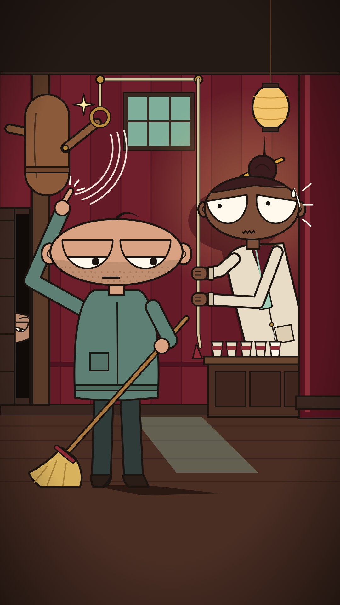

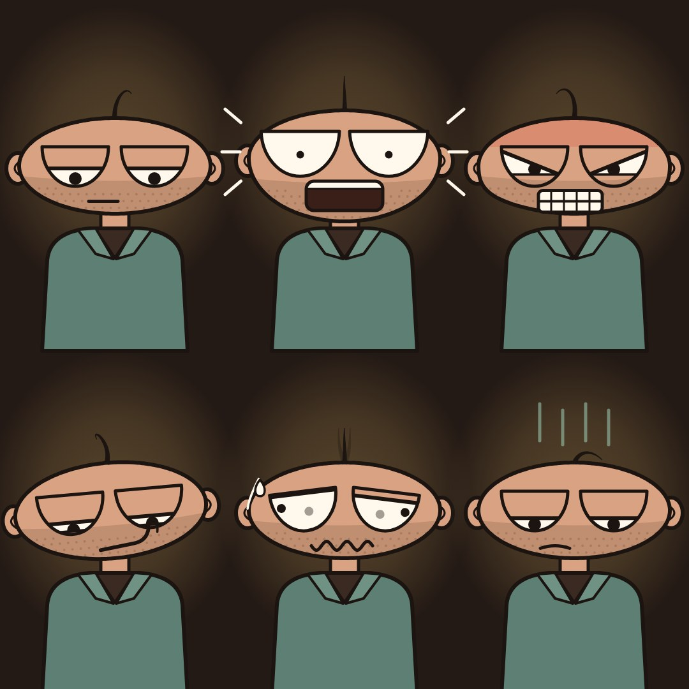

まぶたの上げ下げだけで“言い返す”、夜勤の大人たち。

この場面

ルーが振り向きもせずに人形をはじく。半目のまま、横目で柱の陰のドットを見る。ヒモを握ったまま目をむいて固まるドット。
「お前だろ」「バレた」の一瞬。

作る手間：1/5 ／ 子ども向け判定：低い。疲れた大人の夜勤、コーヒー色、少ない動き、乾いた笑い。おもちゃっぽさがない。

見た目

頭は横長の楕円（お皿を立てたような形）。肩より広い。
目は大きな半円。上から“まぶた”が下りてきて気持ちが変わる。
ふだんは半目。本当に驚いた時だけ全開になる。
細くてきれいな黒い線と、平らな色。
色は深夜の道場やダイナー：コーヒー色、えんじ、ミント、ランプの黄色。
頭のてっぺんの1本の毛が、立つ・しおれるで気持ちを足す。

登場人物

主人公 ルー：道場の夜番の掃除係。いつも半目。落ち着くほどまぶたが下がる。無精ひげと頭の1本毛が目印。
相棒 ドット：眠れない夜警の女性。目はいつも全開で、コーヒーは5杯目。ルーを驚かせたくて練習人形のヒモを引く。
目撃者：引き戸のすき間から“まぶただけ”見える管理人のおじいさん。
木の練習人形：顔なし。はじかれると真ちゅうの輪に戻る。

言葉なしの「会話のテンポ」

ドットが目を見開く（明るい和音）→ルーがまぶたを1段下げる（低いベース1音）。
これを4往復。最後はルーの目が完全に閉じたまま人形をはじく（シンバル）。
片方のまぶたが少しだけ開いてカメラを見る（音が止まる）。
まぶたの段数を数えられるので、言葉なしでも“言い返し”が伝わる。

よく出た所

・「上から下りてくるまぶた」1つで、ほとんどの感情が出せました。顔の違いを作っているのは、まぶたの高さと角度、黒目の位置、口の形の3つだけです。シートを270pxまで縮めても、驚き・怒り・あせり・うんざりは1秒で分かります。
・シーンの笑いどころは、ルーが振り向きもせず、ほうきを片手で動かしたまま指1本で人形をはじいているところです。半目の横目はもう柱の陰のドットに向いています。ドットはヒモを両手で握ったまま固まっています。ヒモは天井の滑車を2つ通って人形の真ちゅうの輪までつながっているので、セリフがなくても犯人が分かります。
・ドットにはまぶたがありません。代わりに目のふちの内側を少し持ち上げて、「やばい、バレた」という困り顔にしました。
・大人っぽく見せる小物も入れました。ルーの無精ひげ、ドットの首から下げた警備員の名札、カウンターに並んだ紙コップ5個（最後の1個だけ湯気が出ている＝5杯目）、まげに刺したエンピツです。
・おまけで、左の引き戸のすき間から管理人のおじいさんの片目（垂れたまぶた）がのぞいています。
・表情シートもシーンも、同じ顔の仕組み1つから描いています。パーツを数字で動かすだけなので、そのままアニメにできます。
・サウスパークには似せていません。頭は横長のお皿形、目は上が平らな半円、線は細くて均一、色は深夜のダイナーの色（コーヒー色・えんじ・ミント・ランプの黄色）です。

まだ弱い所

・「ふつう」「どや顔」「うんざり横目」は、どれも半目です。小さくすると似て見えて、見分けは口と小物（頭の1本毛、どんより線）に頼っています。目だけでは区別しにくいです。
・どや顔は目が細いすき間なので、スマホサイズでは黒目がほとんど見えません。
・ドットの目は上のふちが平らなので、最初は「にらんでいる」ように見えました。内側を持ち上げて困り顔に直しましたが、驚きの強さはルーの驚き顔には届きません。
・ルーは「つるっとした卵頭のおじさん」で、かなりシンプルです。かわいさではなく、とぼけた味で勝負するキャラなので、好みが分かれると思います。
・ドットのカーディガンは丈が長く、白衣っぽく見えます。
・管理人のおじいさんは小さく、スマホではほぼ見えません。気づいた人だけが楽しめるおまけ程度です。
・床の月明かりが灰色っぽく、ミント色があまり出ていません。

3つの企画で使うと

掃除（SOJI）：この絵の本命。深夜の道場で、ルーは半目のまま人形をはじく。一番ずるい最後の人形にだけ、目が全開になる。
満杯（BRIMFUL）：深夜のダイナーで、ルーが満杯のコーヒーを運ぶ。寝ぼけた客たちは、カップに触れた瞬間だけ目がパッと開く。
落とさない（NEVER DROP）：師匠はずっと目を閉じたまま手まりを落とさない。弟子が近づくたびにまぶたが少しずつ開く。何回目で開くか数えられる。

よい所

サウスパークで好きな「表情」を、白目とまぶたの大きな変化で出せる。6案の中で一番“目で演技する”案。
まぶたを1段ずつ下げる“言い返し”が、言葉なしの会話のテンポになる。
半目のとぼけた顔は大人の笑い。夜の灯りと色は、Beanie Survives で気に入った空気感に近い。
パーツが少なく、一番安く動かせる。

心配な所

半目キャラは前例が多い（ボブズ・バーガーズ、ダリアなど）。メガネ＋おかっぱ、点の目は使わない。
横長の頭がUFOやパックマンに見えないよう、口を扇形にしない。
まぶたの変化が小さいとスマホでは見えない。大きな段で動かす。
主人公が落ち着きすぎると地味になる。相棒の大きな顔で笑いを作る。

参考にした作品

・The Pink Panther shorts (DePatie-Freleng) https://metv.com/stories/it-took-more-than-100-different-character-designs-to-perfect-the-pink-panther（半目で動じない主人公と、顔が大きく動く大人の相手役。この組み合わせのお手本。）
・South Park (studied only for its mechanics) https://southpark.cc.com/news/78zs1w/fan-question-do-you-hand-draw-every-scene（落ち着いた顔から、少しのパーツ差し替えで大きく見せる仕組みだけを借りる。見た目はまねしない。）
・Wallace & Gromit and Shaun the Sheep (Aardman) https://maximumfun.org/transcripts/bullseye-with-jesse-thorn/transcript-bullseye-with-jesse-thorn-wallace-gromit-creator（口が動かなくても、目の小さな変化だけで返事ができる。）

## F-2 日曜版の鼻（Sunday Nose）

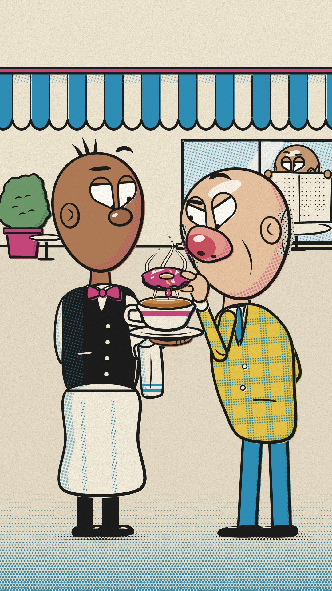

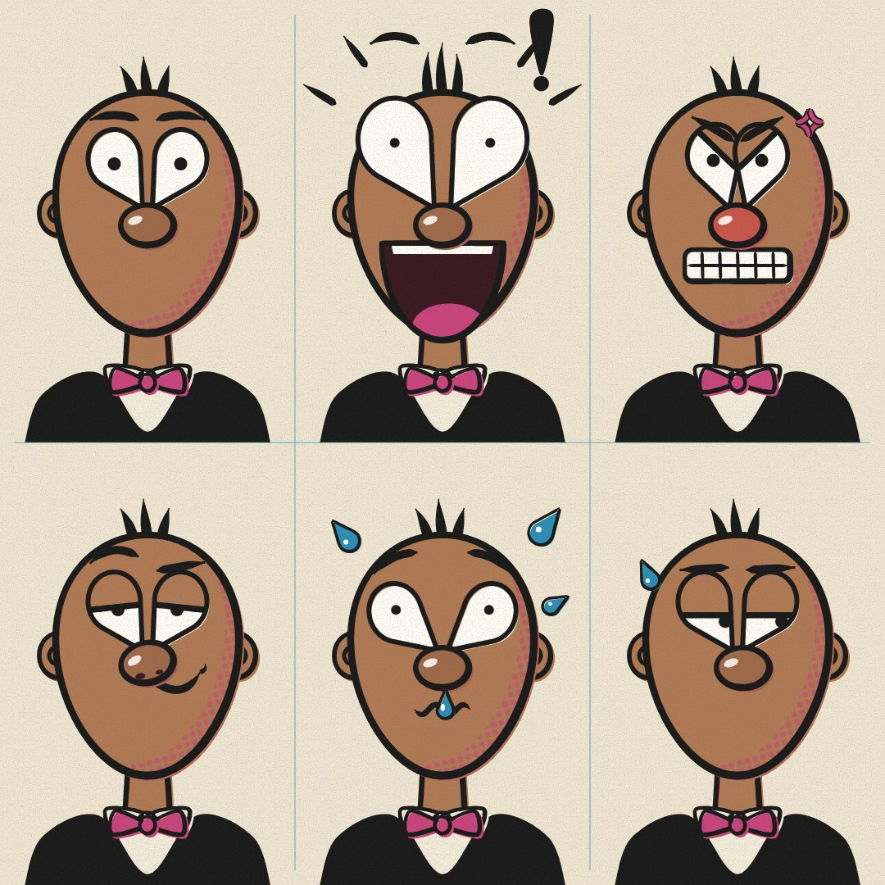

新聞の日曜版マンガの色。大きな鼻と、傾く涙形の目で気持ちを出す。

この場面

満杯の紅茶の真上に、ガスのドーナツがぴたりと止まる。ガスはドヤ顔で鼻をつんと上げる。
ビックスは片方の眉だけ上げて、無言でドーナツを見下ろす。奥では新聞の男が目だけ出して見ている。

作る手間：2/5 ／ 子ども向け判定：低〜中。新聞マンガは全年齢だが、新聞・カフェ・大人の冷めた反応・印刷の色で大人寄りに見える。原色を広い面で使わない。

見た目

頭はたまご形。真ん中に大きな鼻。鼻の形がキャラごとに全部ちがう。
目は白い涙の形で、鼻の上にのっている。傾け方で気持ちが変わる。
口はふだん鼻に隠れている。大きく驚いた時だけ、鼻の下から大きな口が落ちてくる。
筆ペンの黒い線。色が少しずれた昔の新聞印刷、影は大きめの網点。
色はクリーム色の紙、水色、ローズ、黄色。明るい昼の空気。

登場人物

主人公 ビックス：落ち着いたカフェのウェイター。小さなボタン鼻。涙形の目はいつもまっすぐ。
ライバル ガス：大きなじゃがいも鼻の企み屋。目はいつも怒り傾き。ドーナツをその紅茶にひたしたくてたまらない。
客たち：鼻の形がバラバラの大人たち。順番に飛びかかってくる（鼻ごとに音の高さがちがう）。
目撃者：隅の席で新聞を読む男。新聞の上から目だけ出して判定する。

言葉なしの「会話のテンポ」

客が失敗するたびに、隅の男が新聞をパッと下ろして（スネアの“バサッ”）、目だけで判定して、また上げる。
失敗3回、のぞき3回、同じリズム。4回目でその流れを裏切る。
ビックスが宙の紅茶をカップに戻した瞬間、新聞の男の口がはじめて鼻の下から落ちる（ホーンの一発）。
鼻が赤くなる・上を向く・汗をたらす、でも“返事”ができる。

よく出た所

・6つの表情は、270pxに縮めても全部見分けられます（ふつう／びっくり／怒り／ドヤ顔／あせり／あきれた横目）。
・目が鼻の上にのっているので、気持ちは目の傾き・まぶた・眉だけで変わります。口が出るのは、びっくりした時のような特別な時だけです。この決まりがキャラの「顔芸」としてよく効いています。
・シーンは一目で笑いどころがわかります。満杯の紅茶の真上にドーナツがぶら下がっていて、砂糖がけが一滴いまにも落ちそうです。ガスは鼻をつんと上げた企み顔で、ビックスは片方の眉だけ上げて黙って見下ろしています。窓の奥では、新聞の男が目だけ出して見ています。誰が何をしたいのか、誰が誰に反応しているのかがはっきりしています。
・昔の新聞マンガのような手ざわりがあります（筆の黒い線、網点の影、少しずれた色、クリーム色の紙）。丸い顔でも紙工作でもないので、サウスパークとは見た目がまったく違います。
・大人っぽく見えます。ベストに蝶ネクタイのウェイター、はげ頭に白髪とたるんだ頬のガス、新聞を読む男。子ども向けには見えません。
・シーンと表情シートは、同じ「顔の仕組み」（目・まぶた・眉・鼻・口を数字で動かすプログラム）で描いています。なので、そのままアニメにできます。

まだ弱い所

・2つの目がハートの形に見えます。かわいいですが、好みは分かれるかもしれません。
・ビックスは鼻から下（あご）が広くて、少しのっぺり見えます。
・怒り顔は、指定どおり目を20度傾けると2つの目がぶつかって「×」のようになってしまいました。そのため傾きを14度に弱めて、まぶたを斜めに切って怒りを出しています。
・ガスの目も同じ理由で、傾きを弱めてまぶたを斜めにしました。企み顔には見えますが、指定ほどは目が寄っていません。
・色ずれの表現は、線が太いのでほとんど見えません。網点の影が少しずれているので、なんとなく感じる程度です。
・顔にくらべると体は単純で、ポーズが少し固いです（ビックスの棒立ち、ガスの腕）。
・空の部分が大きく空いています。指定どおりですが、さびしく見えるかもしれません。
・小さく縮めると、ビックスの上げた眉は頭の上に浮いた短い線になって、少し弱く見えます。
・鼻の大きい昔の新聞マンガの伝統には近いです（特定の作品のまねではありません）。

3つの企画で使うと

満杯（BRIMFUL）：この絵の本命。晴れたカフェで、ビックスが鼻のちがう客たちをかわす。一人ずつ鼻の形と音の高さがちがう。
落とさない（NEVER DROP）：大きな白いヒゲの師匠。目はほとんど閉じたまま。弟子は鉢巻をした“鼻の行列”。
掃除（SOJI）：網点の月明かりの道場。木の人形は鼻だけ描いた棒で、はじくと鼻がくるっと回る。

よい所

白い目と鼻と口がはっきり大きく、スマホでも表情がすぐ分かる。
“鼻の下から口が落ちる”が毎回のオチになる。
新聞マンガのコマのような「ふり→反応→オチ」のテンポ。
昼の明るい色なので、夜の案と並べても印象がちがう。

心配な所

大きな鼻はアステリクスやMAD誌、昔の新聞マンガ（B.C.など）に寄りやすい。ヘルメットや、団子鼻＋ヒゲの組み合わせを主人公に使わない。
鼻は形として作り、実在の民族の特徴にしない（3-22）。
細かい網点はYouTubeの圧縮でちらつくので、粗くする。
レトロすぎて「懐かしい」で止まる恐れがある。

参考にした作品

・Silent newspaper strips: The Little King (Otto Soglow) and Henry (Carl Anderson) https://www.tcj.com/otto-soglow-and-the-little-king-the-silent-runs-deep/（セリフなしの新聞マンガ。オチの直前に“無言のコマ”を置くテンポを借りる。）
・Comic emotion symbols: Mort Walker's Lexicon of Comicana and manga manpu https://en.wikipedia.org/wiki/The_Lexicon_of_Comicana（汗・びっくり線などのマンガ記号。一般的な伝統なので使ってよい。）

## F-3 眉で語る縦長頭（Tall Order）

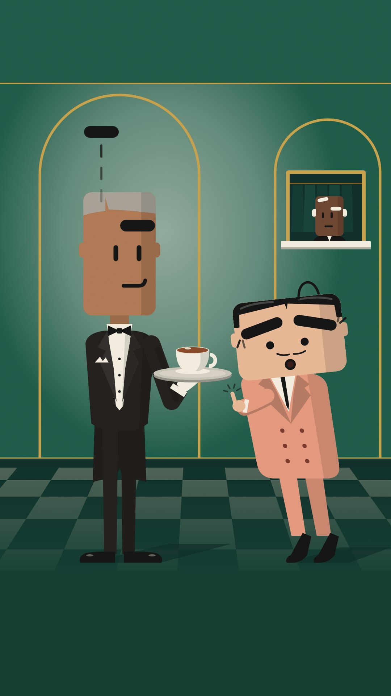

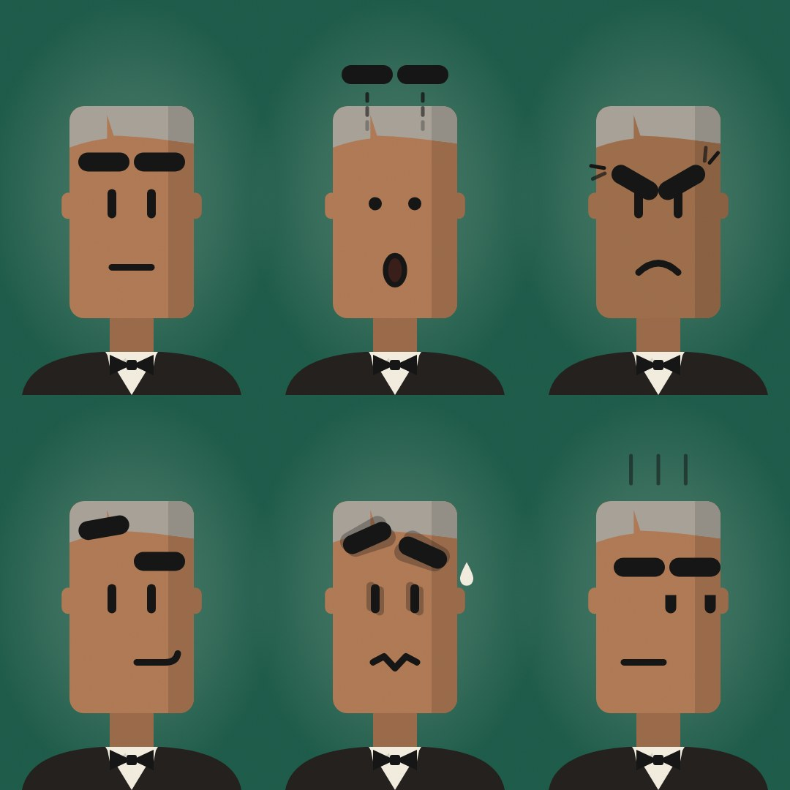

目は小さな縦線だけ。太い黒い眉が飛んだり傾いたりして、全部しゃべる。

この場面

ヘイスティの挑発に、ミスター・レベルの片眉が頭の上まで浮き上がって、そのまま止まる。
ヘイスティの眉はしおしおと下がり、目は点に。満杯の紅茶は一滴もこぼれていない。

作る手間：2/5 ／ 子ども向け判定：低〜中。目は小さな線で、大きなマンガ目ではない。スーツ・山高帽・落ち着いた宝石のような色・控えめな笑いで大人向けに見える。原色とおもちゃのような体型は避ける。

見た目

頭は背の高い角の丸い長方形（ドミノを立てた形）。背の高さと幅で役が分かる。
目は短い縦線2本だけ。主役は太い黒い眉。頭の上まで飛んでいく。
口は短い線1本で、顔のどこへでも動く。端に寄るとニヤリ。
輪郭線なしの平らな色。影の側だけ一段暗くする、昔のアニメの手法。
色は古いホテルのロビー：エメラルドの壁、金の縁、象牙色、漆黒、サーモン。
スーツ、山高帽、長い脚の大人の体。

登場人物

主人公 ミスター・レベル：いちばん背が高い給仕長。眉を少ししか動かさない。だから一回の大きな反応が効く。
ライバル ヘイスティ：背が低くて頭が横長。細いちょびヒゲ。眉がいつも忙しい企み屋。毎回ちがう手（つけヒゲ、おとりのお盆）で来る。
常連たち：山高帽の同じ顔ぶれ。眉がそろって合唱のように動く。
目撃者：クローク係の年配の男性。何が起きても、白い片眉をゆっくり上げるだけ。

言葉なしの「会話のテンポ」

ヘイスティが片眉を上げる（木魚の“コッ”）→レベルも片眉（コッ）→ヘイスティが両眉（コッコッ）。
レベルの片眉がぐーんと上がって頭から離れ、宙で止まる（上がっていく鉄琴、そして1拍の沈黙）。
眉が一音ずつ下りてくる間に、ヘイスティの眉がしおれる（弱音器のトロンボーン“ワワー”）。
最後にレベルの口が顔の端へすべって、カメラをちらっ（休符）。眉の言い合いがそのまま会話になる。

よく出た所

・6つの表情（ふつう・びっくり・怒り・したり顔・あわて・あきれ横目）は、縮小した画像でも全部見分けられます。顔の部品は「縦線の目」「太い眉」「口の線1本」の3つだけなのに、眉の位置と角度だけで感情が伝わります。
・場面の見どころは、ミスター・レベルの片眉が頭の上まで浮いて止まっているところ。縮小しても黒い横棒が浮いて見えます。顔に残った眉1本と、右端に寄ってニヤッとした口で「無言のドヤ顔」になっています。
・ヘイスティは眉がハの字に垂れて、目は点、口は小さな「o」。髪の毛が1本だけ抜けてしおれていて、「しょげた」感じが出ています。指は紅茶のお盆の手前で止まったまま。満杯の紅茶（表面が少し盛り上がっている）は1滴もこぼれていません。「仕掛けた側がしょげて、仕掛けられた側は眉ひとつで勝つ」という掛け合いが1枚で分かります。
・奥の小窓にはクローク係のおじいさんがいて、白い片眉を上げています。
・色はエメラルド、金、象牙色、黒、サーモンだけ。輪郭線を使わず、どの頭にも右側に一段暗い影の帯があります。燕尾服、白手袋、ダブルのスーツなど大人向けの記号でそろえていて、サウスパークの丸顔や白目とは別物です。
・場面も表情シートも同じ1つの顔の仕組みで描いています。眉や目の数値を変えるだけで表情が変わるので、そのままアニメにできます。

まだ弱い所

・顔の作りがとてもシンプルなので、眉が動いていない「ふつう」の顔は少し無表情で地味に見えます。キャラクターとしての愛嬌は、動いてはじめて出るタイプです。
・ヘイスティが何を仕掛けたのか（お盆をはじこうとした）は、指の形と小さな線でしか伝えていません。人によっては「ちょっと待って」と指を立てたようにも見えます。
・「あきれ横目」は、小さく見ると「しらけ顔」に近く見えます。
・ヘイスティの体は四角い箱っぽく、つま先立ちの靴も少し硬い印象です。床の影は暗い床に溶けてほとんど見えません。
・縦長の画面の上の約230pxと下の約345pxは、指定どおり何もない平らな帯です（字幕を入れる場所を想定）。1枚の絵として見ると、少し間延びして見えます。

3つの企画で使うと

満杯（BRIMFUL）：この絵の本命。ミスター・レベルが満杯の紅茶を持って常連の中を進む。かわすたびに常連の眉が一斉にはねる。レベルの眉は最後まで動かない。
落とさない（NEVER DROP）：師匠は背の高い老人。白い太い眉がカーテンのように目にかかる。弟子が近づくたびに眉が少しずつ上がる。
掃除（SOJI）：夜のエメラルド色の道場。顔のない木の人形を見ないではじき、そのたびに眉だけが反応する。

よい所

太い黒い眉2本で表情が出るので、スマホの小さな画面でもよく読める。
眉と眉の言い合いが、そのまま会話のテンポになる。
誰の目のまねにもならない、オリジナルな顔。
平らな色と古いホテルの色で、気に入っていた「平らな絵と色の雰囲気」も残る。

心配な所

眉だけでは大きな感情が出しにくい。ここぞの時だけ目を丸にする。
縦長の頭がフランケンシュタイン、スポンジボブのイカルド、ブロックのゲームキャラに見えないよう、肌の色・スーツ・長い頭を守る。
ホテルロビーの色はウェス・アンダーソン映画に近いので、構図はまねしない。
長い脚の歩きは、顔より手間がかかる。

参考にした作品

・UPA studio, mid-century cartoon modernism (Gerald McBoing-Boing, Mr. Magoo) https://animationobsessive.substack.com/p/what-the-upa-style-actually-is（1950年代の平らでモダンな絵。少ない線で顔を記号のように描く考え方。）
・The Pink Panther shorts (DePatie-Freleng) https://metv.com/stories/it-took-more-than-100-different-character-designs-to-perfect-the-pink-panther（クールな主人公と、怒りっぽい大人の相手役の組み合わせ。）
・Wallace & Gromit and Shaun the Sheep (Aardman) https://maximumfun.org/transcripts/bullseye-with-jesse-thorn/transcript-bullseye-with-jesse-thorn-wallace-gromit-creator（眉を太い1本の棒にして、傾きと高さだけで演技させる。）

## F-4 糸目の茶屋（Squint House）

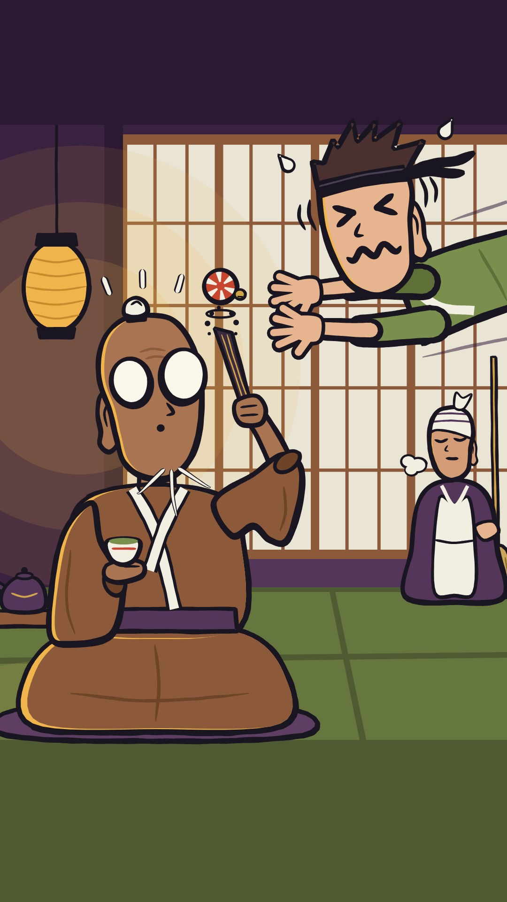

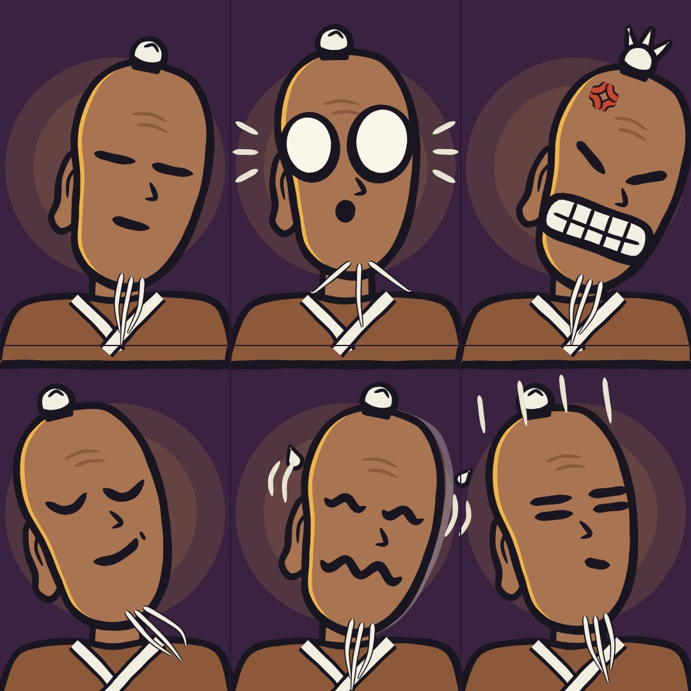

目は筆のひと筆だけ。そのぶん口が大きく動く、茶屋の大人たち。

この場面

ヒコが空中から手まりに手を伸ばした、その瞬間。ずっと糸目だった師匠の目が、まんまるに開いてヒコをじっと見る。
ヒコは空中で固まり、＞＜ の目で汗をとばす。

作る手間：1/5 ／ 子ども向け判定：中。漫符は親しみやすい分、子ども寄りに見えやすい。大人の体、暗く落ち着いた色、間の取り方、茶屋の文化で大人に寄せる。

見た目

頭は少し前に傾いた、背の高いそら豆の形。張り切ると前へ、ドヤると後ろへ傾く。
目は筆のひと筆だけ（ー ー、＼ ／、＞ ＜、＝ ＝）。本気で驚いた時だけ、大きな白い丸になる。
口が主役。歯を食いしばる、大きく笑う、波線であわてる、点でむくれる。
太い筆の線が少しふるえる手描きの味。汗や怒りマークも使う。
色は夜の茶屋：深いぶどう色、ちょうちんの琥珀色、木の茶色、月のクリーム色。
体はちゃんと大人（頭5つ分の背）。ちびキャラにはしない。

登場人物

主人公 師匠：いつも ー ー の糸目の老師匠。小さな白いまげと細い白ひげ。お茶を持ったまま手まりを落とさない。
ライバル ヒコ：張り切りすぎの兄弟子。目はいつも ＼ ／ の怒り目。
弟子の七人：みんな ＝ ＝ の目で、ぴったりそろって動く。
目撃者：掃除のおばさん。目は ︶︶ で「また始まった」という顔。

言葉なしの「会話のテンポ」

弟子が4回仕掛ける（4つの音）。師匠の糸目はピクッとするだけ（チッ）。
5回目は7人そろってジャンプ（ドラムロール）。師匠の目が大きな丸に（キメの一音）。1拍の沈黙。
目は ー ー に戻り、ひと動きで7人をいなして、お茶をすする（やわらかい一音）。
目の形を拍ごとに差し替えるだけなので、音にぴったり合わせやすい。

よく出た所

・師匠の6つの顔（ねむそう／びっくり／怒り／ドヤ／あわて／あきれ）は、270×270に縮めても1秒で見分けられます。目はほぼ「筆のひと筆」だけで、線の角度と口の形を差し替えるだけで感情が変わるので、アニメにしやすいです。
・笑いどころは落差です。師匠は湯のみを水平に持ったまま体は平然としていて、目だけがまんまるに開きます。ヒコは空中で ＞＜ の目・波線の口・汗のまま固まっています。「誰が何を取ろうとして、誰に見つかったか」が一目でわかります。
・右奥に掃除のおばさん（︶︶ の目、ため息のけむり、ほうき）を足しました。「また始まった」という3人目の反応が入って、会話のようなテンポが出ています。
・背の高いそら豆の頭、ふるえる太い筆の線、夜の茶屋の色（ぶどう色・ちょうちんの琥珀色・木の茶色・月のクリーム色）で、サウスパークには似ていません。
・正座の師匠にも肩幅・大きな袖・手・湯のみがあり、白いまげとひげ、長い耳たぶで「おじいさんの大人」に見えます。ちびキャラ感はありません。
・シーンと表情シートは同じ顔のしくみ（make.py）で描いているので、そのまま動かせます。

まだ弱い所

・頭5つ分の大人の体型と、スマホで顔が読めることを両立するため、シーンの師匠の頭は仕様より小さく（220×350、表情シートと同じ大きさ）しました。それでも正座姿は「頭が大きめの大人」くらいで、きっちり5頭身ではありません。
・目は瞳のない白い丸なので、「ヒコを見ている」ことは顔の向きでしか伝わりません。玉の位置をずらして工夫しましたが、小さい画面では「玉を見ている」ようにも見えます。
・びっくり目は、真ん丸だと丸メガネに見えたので、大きさの違う縦長の楕円に変えました。今も少しゴーグルっぽいです。
・ヒコは大きな頭を画面に収めるため腕が短めで、両手が顔の近くに集まっています。手と玉のすき間は約100pxで、仕様の「腕一本分」より近いです。
・師匠のあごひげ（白い3本線）は、大きく見ると爪やキバのように見えることがあります。
・扇子は細く、縮小すると棒に見えます。扇子の先の墨のしぶきも、ただの点に見えがちです。
・表情シートの上の段と下の段の境目で、上の段の着物のすそが少しはみ出し、横のおびのように見えます（直していません）。
・下の畳のふち（仕様どおり無地）が画面の約18%を占めていて、少し空いて見えます。

3つの企画で使うと

落とさない（NEVER DROP）：この絵の本命。糸目の師匠と七人の弟子。
満杯（BRIMFUL）：︶︶ の目の給仕が、にぎやかな茶屋を進む。つかみ損ねた客の目が ＼／ から ＞＜ に変わる。
掃除（SOJI）：＝＝ の目の夜の掃除係。人形の顔に描かれた ＞＜ が、輪に戻るとくるっと無表情に戻る。

よい所

糸目と漫符（汗・怒りマーク）は世界中の人がすぐ読める。日本人の感覚にも合う。
目の形を拍ごとに差し替えるだけで、音にぴったり合った反応が作れる。
“ずっと糸目の人が一回だけ目を開ける”が、最高のオチになる。
ぶどう色とちょうちんの夜の色で、雰囲気も出る。

心配な所

糸目と漫符は、量産型のちびアニメや「クレヨンしんちゃん」「ポプテピピック」に寄りやすい。大人の体と、傾いた豆形の頭で離す。
豆形はOddbodsや、YouTubeの体験談アニメ風（丸い豆の体＋点の目）にも近い。筆の線・頭の傾き・線だけの目で区別する。
丸い目は1本に1回だけ。使いすぎると効かなくなる。

参考にした作品

・Comic emotion symbols: Mort Walker's Lexicon of Comicana and manga manpu https://en.wikipedia.org/wiki/The_Lexicon_of_Comicana（怒りマーク・汗・縦線などのマンガ記号。拍に合わせてポンと出す。）
・UPA studio, mid-century cartoon modernism (Gerald McBoing-Boing, Mr. Magoo) https://animationobsessive.substack.com/p/what-the-upa-style-actually-is（マグーの細目のように、一つの目の状態がそのままキャラの性格になる。）

## F-5 アゴで語るピーナツ頭（Jaw Drop）

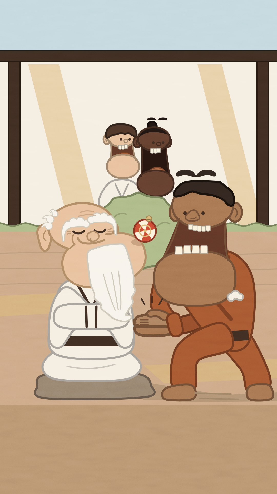

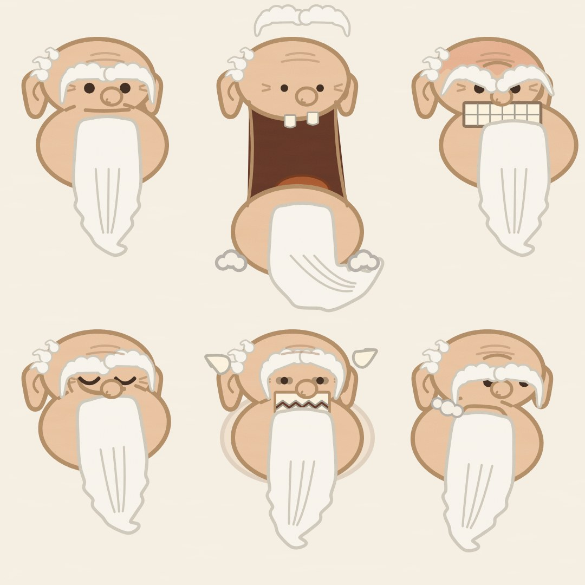

驚くとアゴが胸まで落ちる。古典のギャグを顔の主役にした。

この場面

スナップが飛びついた手の中は空っぽ。アゴが胸まで落ちて固まる。
その横で、目を閉じた師匠が手まりをアゴの先にのせて、片方の口角だけニヤリ。後ろでは弟子2人のアゴも落ちている。

作る手間：2/5 ／ 子ども向け判定：中〜低。大人の道場、色付きの線の上品さ、冷めた間の取り方で大人寄りに見える。原色と、弾むようなかわいさは避ける。

見た目

頭はピーナツのような上下2つのかたまり。上が目と眉、下がアゴ。
目は小さな黒い点。太い眉が気持ちを足す。
驚くとアゴが胸までガクン（くっついたまま、次の拍で戻る）。怒るとアゴが前に出て歯を食いしばる。
線は黒ではなく、それぞれの色を濃くした色。やわらかい紙の質感。
色は朝の道場の庭：こげ茶、カフェオレ、ミルク、シナモン、ピスタチオ、淡い空色。

登場人物

主人公 老師匠：長い白ひげと、ふさふさの白い眉。アゴを動かさないのが芸で、最後の一拍だけ動く。
ライバル スナップ：大きな受け口の兄弟子。企む時にアゴをカチカチ鳴らす。
弟子たち：失敗するたび、ドミノのように順番にアゴが落ちる。
目撃者：厳しいお茶係の女性。動くのは片眉とアゴの片端だけ。

言葉なしの「会話のテンポ」

弟子3人が続けて失敗し、アゴが順番に落ちる（マリンバが3音下がる）。
スナップが一番派手な技で失敗、アゴが一番大きく落ちる（低いファゴット）。
師匠はわざとゆっくり自分のアゴを胸まで下ろし、カメラに「あらら」（のばした一音）。
カチッと閉じる（リムショット）。落ちる順番が、そのまま言い合いのリズムになる。

よく出た所

・表情シートの6つは、270pxに縮めても見分けがつきます。驚きはアゴがガクンと落ちる、怒りは歯をむく、ニヤリは目を閉じて片方の口角だけ上がる、焦りはギザギザの歯と汗、ジト目は目が横に寄ってへの字口。顔の形そのものが変わるので、一瞬で分かります。
・アゴが落ちても、左右の頬の線でつながったままです。ちぎれたようには見えません。
・師匠は、垂れた白い長眉、口の下から伸びるひげ、目じりのしわ、長い耳たぶ、だんご鼻で「老師匠」だとすぐ分かります。子ども向けの絵には寄っていません。
・場面ではスナップの大口（上下の歯と舌）が一番大きく、スマホサイズでも「ガーン」が伝わります。後ろの弟子2人も順番に口が開いていて、ドミノの連鎖になっています。
・師匠は目を閉じたまま腕を袖にしまい、突き出したアゴの先に手まりをのせて片頬だけでニヤリ。「師匠は動いてもいない」という対比はできています。
・色は朝の道場の庭の6色に、朱色の手まり1点だけ。線には黒を使わず、それぞれの色を濃くした色で描いています。
・表情シートと場面は同じ部品の仕組みで描いています。アゴの落ち方、突き出し、横ずれ、ひげが一拍遅れて揺れる動きは数値で変えられるので、このままアニメにできます。

まだ弱い所

・手まりが「アゴの先にのっている」より「顔の横に浮いている」ように見えやすいです。玉が80pxと大きく、アゴの上面が口の高さにあるため、どうしても目や鼻の高さに来ます。接地の影をつけて少しはましになりました。
・スナップの落ちたアゴは、肌と道着が同じ茶系の色なので胸と一体に見えます。大口は伝わりますが、「アゴが胸まで落ちた」形のおかしさは弱めです。
・スナップの空っぽの両手（パチンと閉じた手）は、サムネだと小さな茶色のかたまりです。「つかんだつもりで空振り」というオチの半分が伝わりにくいです。
・歯をむいた大口が3人分あるので、「驚き」より「叫んでいる」と受け取る人もいそうです。
・弟子2人は首の長い瓶のような形で、かわいげが足りません。
・師匠はアゴのほうが頭より大きく、ひげも合わさって縦長です。顔というより、かたまりに見える瞬間があります。
・画面下の約350pxは、仕様どおり平らな茶色だけなので、下が寂しく見えます。紙の質感もほとんど見えません。
・南の公園（サウスパーク）との似方：丸い頭や大きな白目はないので、見た目はかなり離れています。ただ「口のところで頭が上下に割れてパカパカする」発想は、向こうのカナダ人キャラ（テレンスとフィリップ）を思い出させるかもしれません。下アゴが落ちる、ピーナツ形、3/4向き、鼻とひげ、という点では違えています。

3つの企画で使うと

落とさない（NEVER DROP）：この絵の本命。師匠はアゴの先やひげで手まりを受ける。弟子が失敗するたびにアゴが落ちる。
満杯（BRIMFUL）：朝の食堂車やカフェで、アゴを動かさない給仕と、アゴが次々落ちる客たち。
掃除（SOJI）：夜の掃除係は集中するとアゴが前に出る。顔のない人形が輪に戻る“カチッ”と、アゴの“カチッ”をそろえる。

よい所

アゴが胸まで落ちる顔は、世界中どこでも笑える古典の反応。
形の変化が大きいので、スマホの小さな画面でも一発で分かる。
アゴがドミノのように落ちる順番が、言い合いのリズムになる。
朝のやわらかい色で、夜の案とはちがう空気になる。

心配な所

アゴ芸は昔のアメリカのアニメの伝統。カップヘッドの1930年代風の目や、レン&スティンピーの汚さ（よだれ・血管）は避ける。
アゴは外れたり壊れたりしない（3-6）。必ずくっついたまま戻る。
ピーナツ頭にモノクル＋シルクハット（ミスター・ピーナッツ）、突き出たアゴ＋パイプ＋水兵帽（ポパイ）はやらない。
アゴのバネの動きは、他の案より少し手間。

参考にした作品

・Tom and Jerry (MGM, Hanna-Barbera, music by Scott Bradley) https://openaccess.city.ac.uk/id/eprint/30838/1/Audiovisual%20Architecture.pdf（驚きの顔の大きなリアクションと、音で一拍前に予告するやり方。暴力の部分は借りない。）
・Wile E. Coyote and the Road Runner (Chuck Jones) https://austinkleon.com/2005/09/09/rules-of-the-roadrunner/（気づいてから結果が来るまでの“間”で笑わせる。）

## F-6 横顔のにらみ合い（Nose to Nose）

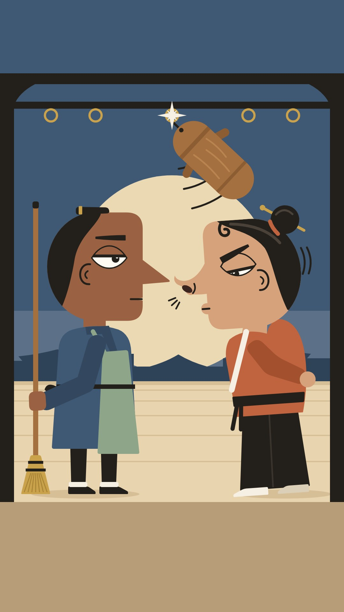

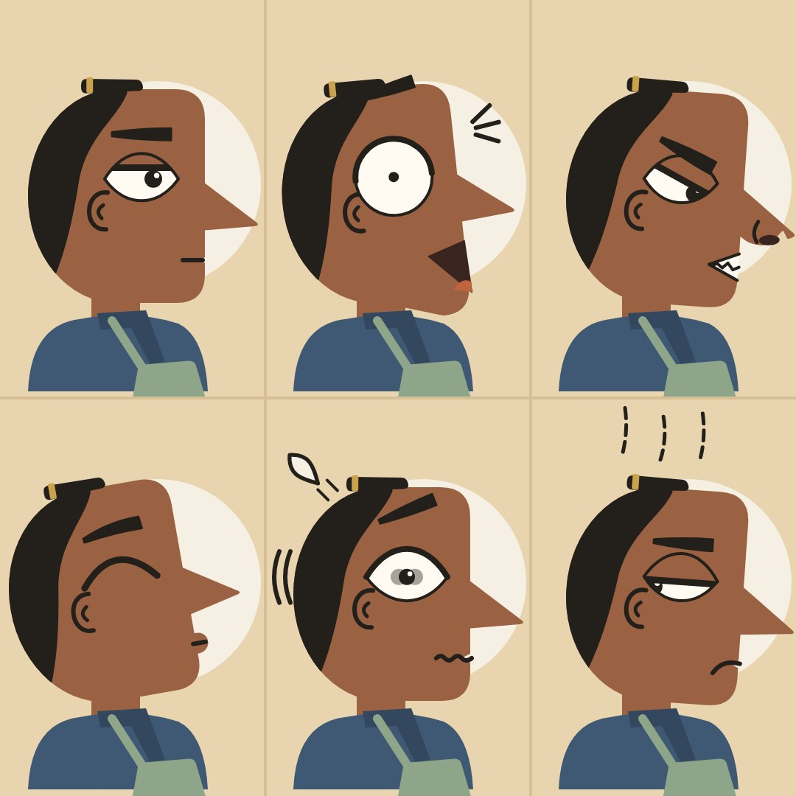

全員が真横顔。向かい合うだけで、鼻と鼻のにらみ合いになる。

この場面

はじかれた人形が、頭の上で輪に戻っていく。その下で、ソルとスヌートが鼻先1センチでにらみ合い。後ろには大きな月。
スヌートは眉をぐっと下げて鼻の穴をふくらませ、ソルは目を細めて平然としている。

作る手間：1/5 ／ 子ども向け判定：低い。美術ポスターのような見た目、大人の演出、土っぽい落ち着いた色。

見た目

全員が真横を向いた横顔。頭は半月形で、鼻の形でキャラが分かる（三角・スキー台・四角・ボタン）。
横顔なので目は1つ。大きなアーモンド形の目と、くさび形の眉で表情を出す。
ここぞという時だけ、くるっと正面を向いてカメラを見る。
輪郭線なしの平らな色。目と眉と耳だけ細い墨の線。
色は夕暮れ：砂色、テラコッタ、夕暮れの青、セージ、大きな月。

登場人物

主人公 ソル：三角の鼻の掃除係。落ち着いていて、最後の一拍まで横顔をくずさない。
ライバル スヌート：スキー台のような鼻をいつも上に向けた、うぬぼれ屋の兄弟子。人形を放ってソルをあわてさせたい。
弟子の行列：横顔の列が足並みをそろえて進む。
目撃者：窓辺のおばあさん。判定する時だけ正面を向く。
木の練習人形：顔なし。レールに吊られ、はじくと真ちゅうの輪に戻る。

言葉なしの「会話のテンポ」

1拍目スヌートが目を細める、2拍目ソルも細める、3拍目スヌートの鼻が前へ、4拍目ソルの鼻も前へ。
鼻先がふれて「チン」。2小節の沈黙、そのあいだにまばたき1回ずつ。
最後に二人そろってパッと正面を向き、カメラを見る（キメの一音）。そして横顔に戻る。
向かい合わせが基本なので、にらみ合い・言い返し・カメラ目線が自然に入る。

よく出た所

・月の真ん中で鼻先どうしがほぼくっついていて、2人の横顔のすき間が「つぼ」の形に抜けています。スマホの小さいサイズでも、ひと目で「にらみ合いだ」と分かります。
・顔だけで2人の性格がちがって見えます。ソルはまぶたが半分下りて眉はまっすぐ。「はいはい」という無表情です。スヌートは眉を急角度で下げ、目は細いすき間だけ。上を向いた鼻の穴をふくらませて、鼻息まで出しています。
・ギャグが一つ入っています。スヌートが放った人形がはじき返され、本人の頭の上へ戻ってくるところです。本人は怒るのに夢中で気づいていません。ソルはほうきを槍のように立てたまま、微動だにしません。「次の一拍でゴン」が想像できる絵です。
・シルエットで見分けがつきます。ソルは三角の鼻に、頭頂へ折りたたんだ小さなまげ。スヌートはスキー台の鼻に、真ちゅうのかんざしを挿したおだんごと、前髪のカール（キザな男の記号）です。
・表情シートの6つ（ふつう／びっくり／怒り／得意げ／パニック／うんざり横目）は、270pxまで縮めても全部見分けられます。目の形、まぶた、眉の角度、口の切れ込みを入れ替えるだけで作っています。
・場面と表情シートは同じ顔のしくみ（リグ）から描いているので、そのままアニメにできます。
・サウスパークには似ていません。全員が真横の横顔で、輪郭線のない平らな塗り、色は夕暮れです。

まだ弱い所

・横顔だけで進めるので、表情の幅は正面の顔より狭くなります。特に「ふつう」と「うんざり横目」の差は、黒目の位置と口角、上の点線くらいです。小さい画面では少し似て見えます。
・木の人形は、真横に近い角度だと「たる」や「ソーセージ」に見えがちです。今は斜め45度の振り子にして、何とか人形に見える状態です。顔がないので、人形らしさは弱めです。
・和の道場、輪郭線のない平らな塗り、横顔という組み合わせなので、雰囲気が「サムライジャック」や昔のアメリカの平面アニメ（UPA）を思い出させるかもしれません。キャラの形そのものは別物です。
・スヌートの肌（明るいベージュ）は、背景の月のクリーム色と色の差が小さめです。鼻先の輪郭は、ソル側ほどくっきりしません。
・体はまだ簡単なつくりです。とくにスヌートの「手を後ろで組む腕」と、ソルの「後ろのほうきをつかむ腕」は、形がやや記号的です。
・正面を向いてカメラを見る顔や、窓辺のおばあさん・弟子の行列は、今回はまだ描いていません。

3つの企画で使うと

掃除（SOJI）：この絵の本命。人形は左右に走るレールに吊られている。はじくたびに、掃除係がくるっと正面を向いてカメラを見る。
満杯（BRIMFUL）：つかみに来る客は左か右からだけ。一人ずつ、カップをはさんで鼻と鼻のにらみ合いになる。
落とさない（NEVER DROP）：横顔の師匠の頭の上を、手まりが弟子から弟子へ、飾り模様のように弧を描いて飛ぶ。

よい所

にらみ合い・言い返し・カメラ目線が、絵の作りそのものに入っている。「会話のテンポ」を一番そのまま絵にした案。
横顔の大きな目1つと眉で、表情ははっきり読める。
夕暮れと大きな月で、色と空気感も強い。
横向きだけなので、動かすのが安い。

心配な所

横顔だけだとカメラの変化が少ない。正面の顔は別に1つ作る必要がある。
鼻は形として作り、肌の色や民族と結びつけない（3-22）。
スパイvsスパイ（くちばしの横顔・帽子・黒と白の対決）やエジプト壁画の衣装には寄せない。
目が1つなので、表情の幅は他の案より少しせまい。

参考にした作品

・Laurel & Hardy: 'the Hardy look' (the look to camera) https://www.flowjournal.org/2025/04/camera-looks/（ここぞでカメラを見る“目線”。1本に1〜2回だけ、音が止まる所に置く。）
・South Park (studied only for its mechanics) https://southpark.cc.com/news/78zs1w/fan-question-do-you-hand-draw-every-scene（二人の素早い言い合いと、無言でじっと見る間。仕組みだけ借りて、見た目はまねしない。）

## 言葉なしで「会話のテンポ」を作る決まり

・「でも」「だから」でつなぐ：場面と場面を「そして」でつながない。仕掛け→でも失敗→だから仕返し、の連鎖にする（サウスパークの作り手の決まり）。
・1小節が1往復：2拍で仕掛け、1拍で相手の顔のアップ、1拍で返し。ジャズの掛け合いのように交代する。
・顔が変わる直前に音で予告：グリッサンドや太鼓で1〜2拍前に予告して、表情が「答え」として決まる（トムとジェリーの音楽のやり方）。
・沈黙は音楽を止めて顔だけ：気まずい間は、バンドを1〜2拍止めて顔を見せる。笑いが起きるのはここ。
・二度見は4拍：ちらっ（1）→作業に戻る（2）→バッと振り返る（3）→固まる（4）。音は「チッ、チッ、ドン、休み」。
・気づきの間：仕掛けが裏目に出る前に一瞬止めて、顔を2〜3段で変え、カメラを見てから結果（コヨーテのやり方）。
・動じない主役と、顔が大きく動く相手：主役は小さな反応（ゆっくりまばたき、眉1段）。相手は大きく変わる。小ささが笑いになる。
・全員が同じ拍でふり向く：群れが同じ拍で首を回す。1人だけ半拍おくれるのがオチ。
・声のかわりに楽器：キャラごとに楽器を決める（主役＝ミュートトランペット、相手＝ファゴットやチューバ、師匠＝鐘）。反応は1〜3音のフレーズ。もごもご声は使わない。

## 調べた作品

・South Park (studied only for its mechanics; its look must not be copied) https://southpark.cc.com/news/78zs1w/fan-question-do-you-hand-draw-every-scene
・Tom and Jerry (MGM, Hanna-Barbera, music by Scott Bradley) https://openaccess.city.ac.uk/id/eprint/30838/1/Audiovisual%20Architecture.pdf
・Wile E. Coyote and the Road Runner (Chuck Jones) https://austinkleon.com/2005/09/09/rules-of-the-roadrunner/
・The Pink Panther shorts (DePatie-Freleng) https://metv.com/stories/it-took-more-than-100-different-character-designs-to-perfect-the-pink-panther
・UPA studio, mid-century cartoon modernism (Gerald McBoing-Boing, Mr. Magoo) https://animationobsessive.substack.com/p/what-the-upa-style-actually-is
・Lamput (Vaibhav Studios for Cartoon Network India/Asia) https://en.wikipedia.org/wiki/Lamput
・Oggy and the Cockroaches / Zig & Sharko (Xilam) https://www.cnc.fr/series-tv/actualites/oggy-et-les-cafards--retour-sur-une-incroyable-reussite-a-la-francaise
・Mr. Bean: The Animated Series (Banijay / Tiger Aspect) https://www.banijay.com/blog/2025/08/13/mr-bean-reaches-35-million-youtube-followers-in-35th-anniversary-year/
・Wallace & Gromit and Shaun the Sheep (Aardman): the silent straight man https://maximumfun.org/transcripts/bullseye-with-jesse-thorn/transcript-bullseye-with-jesse-thorn-wallace-gromit-creator
・Simon's Cat (Simon Tofield) https://www.guinnessworldrecords.com/world-records/436544-most-subscribers-for-an-animated-animal-on-youtube
・Larva (TUBA Entertainment) https://www.koreatimes.co.kr/www/art/2025/03/398_131676.html
・Pencilmation (Ross Bollinger) https://en.wikipedia.org/wiki/Pencilmation
・Frame Order / Cartoon-Box (Joost Lieuwma, Utrecht) https://skwigly.co.uk/joost-lieuwma
・Silent newspaper strips: The Little King (Otto Soglow) and Henry (Carl Anderson) https://www.tcj.com/otto-soglow-and-the-little-king-the-silent-runs-deep/
・Comic emotion symbols: Mort Walker's Lexicon of Comicana and manga manpu (漫符) https://en.wikipedia.org/wiki/The_Lexicon_of_Comicana
・Laurel & Hardy: 'the Hardy look' (the look to camera) https://www.flowjournal.org/2025/04/camera-looks/

## 外した案

・GLINT (glasses do the acting)：目を描かないので、前回と同じ“顔のない主人公”の失敗になる。メガネが光る表現はアニメでよく見る定番でもある。
・UNDER THE BRIM (eyes in hat shadow)：目が帽子の影に隠れて、肝心の表情が見えない。画面が暗くスマホで読みにくい。スパイvsスパイにも寄る。
・SWOOP (one eye under the bang)：片目が前髪で隠れるので、表情の幅が半分になる。アニメやエモ系でよく見る見た目。
・WHISKER & BROW (moustache acting)：ふだん目が眉に隠れる。師匠役には強いが、老師匠は「糸目の茶屋」と「アゴ」の案で十分に出せる。マリオや仙人キャラにも寄りやすい。
・HEADLIGHTS (half-moon whites, pinpoint pupils)：大きな白目に小さな点の瞳は、サウスパークやリック・アンド・モーティに一番近い。大きな目は子ども向けにも見えやすい。白目の魅力は「半目の夜勤」で安全に出す。
・PERISCOPE (eyes on stalks)：目が触角の先についた生き物っぽさが、子ども向けやスポンジボブのプランクトンに寄る。曲がる首は作る手間も大きい。
・DIAMOND TURN (square heads that tilt)：四角い頭がマインクラフトやロブロックスに見えやすく、子ども向けの印象になる。表情も顔より頭の傾き頼み。
・LOPSIDED (mismatched eyes)：左右でちがう目が、障がいをからかっているように見えるおそれがある（3-22）。UPA の有名キャラにも近い。

作り方：Python で顔のパーツ（頭・目・まぶた・黒目・眉・口）を数字で動かす仕組みを作り、場面と表情一覧を同じ仕組みから SVG に書き出して、ヘッドレス Chromium で描画（`tools/nonverbal/prototypes/faces/`）。
