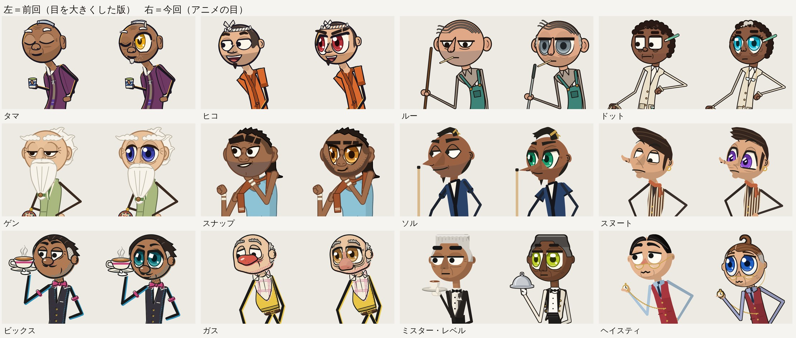
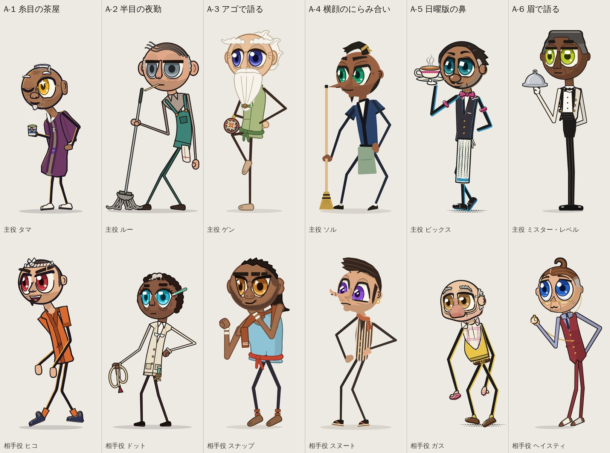
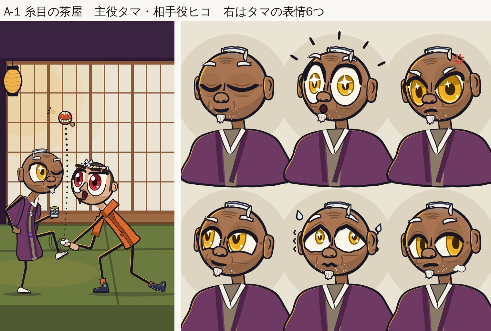
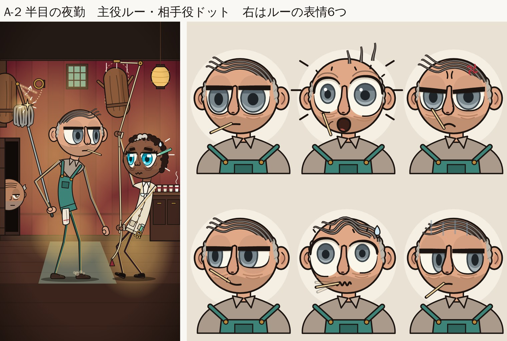
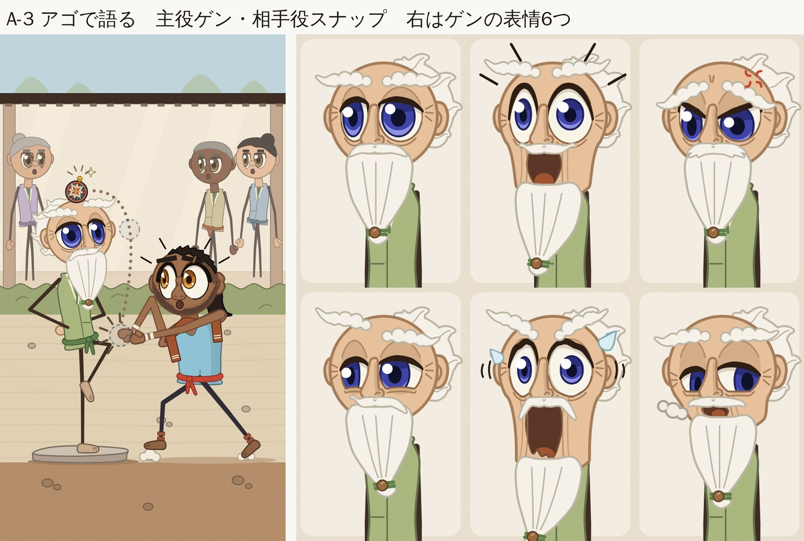
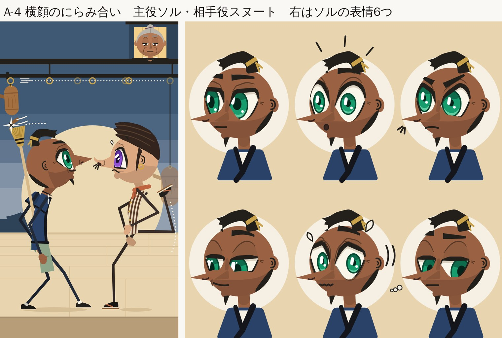
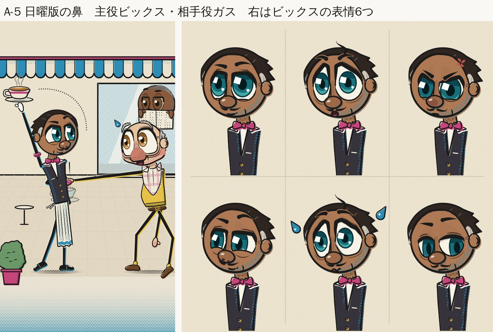
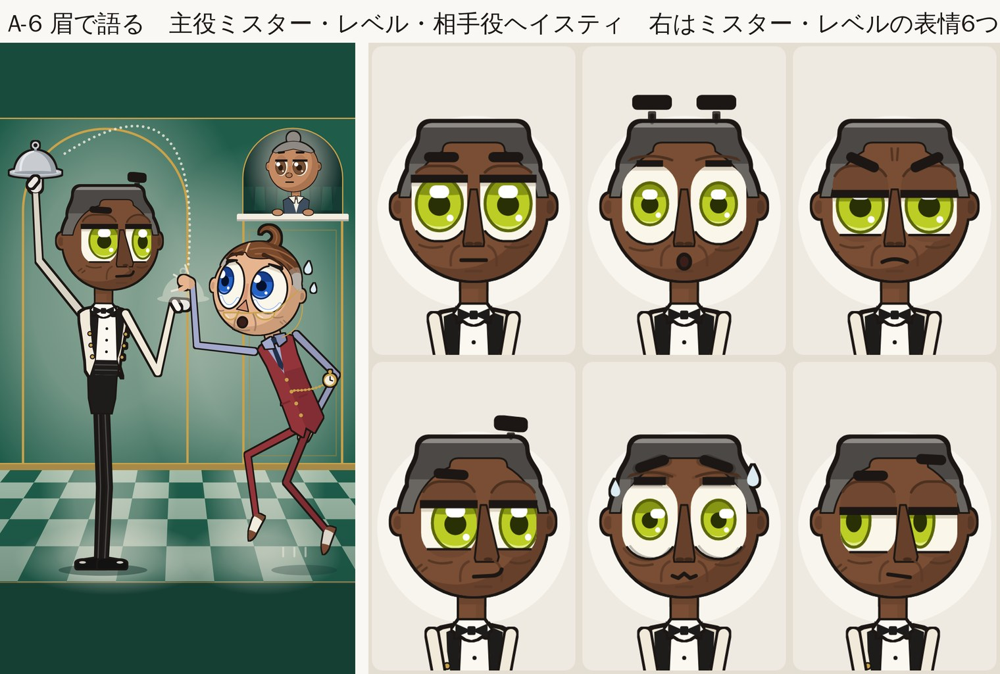

# アニメのような大きな目（2026-10-18）

オーナーの指示「目はもっともっと大きくして特徴的にして。アニメとかも目がおっきいでしょ。」を受けて、12人の目をアニメ風に大きくした版。1回目で枠は約1.5倍になったが、ふだんの顔でまぶたがかぶって見える目が細かったため、2回目でまぶたを上げ、瞳を目の高さの72〜85%にした。

## 1回目のレビュー（大きさ・見分け・大人らしさ）

【結論】
12人とも、前回よりはっきり大きくなりました。
ただ、オーナーの「もっともっと」に届いたのは半分くらいです。

【測り方】
before_after.png と同じ縮尺で、手前の目の「見えている白目の高さ」をピクセルで測りました（前→今）。
枠の数字（D＝頭の直径）は、作った人のメモからです。
- Lou：26→62px（約2.4倍）。枠は0.30D→0.50D。いちばん伸びました。
- Gen：約20→約58px（虹彩の高さ、約2.5倍）。枠は0.34D→0.52D。
- Hiko：53→95px（1.8倍）。枠は0.30D→0.50D。
- Snap：53→88px（1.7倍）。枠は0.46D。
- Gus：48→74px（1.5倍）。枠は0.34D→0.50D。
- Sol：43→64px（1.5倍）。枠は0.34D→0.46D。
- Dot：61→89px（1.5倍）。枠は0.34D→0.515D。
- Bix：46→67px（1.5倍）。枠は0.32D→0.50D。
- Level：41→56px（1.4倍）。でも見えているのは横長の細い帯（約0.24D）のままです。
- Hasty：61→74px（1.2倍）。青い虹彩が大きくなった分、見た目はもう少し大きく感じます。
- Snoot：白目は52→53pxで、ほぼ同じです。紫の虹彩と太いまつ毛で、大きく見せているだけです。
- Tama：前回は閉じ目だけでした。今回は片目を開けると、高さ約0.49Dの金色の目が出ます。
見えている目は、平均で前回の約1.5倍です。

【指定の「頭の45〜55%」に届いたか】
- 目の枠は、全員0.45〜0.54Dで届いています。
- でもふだんの顔では、まぶたが目の上をかなり隠します。見えている部分は0.24〜0.41Dです。
- Level、Snoot、Sol、Gen は、驚きやあせりの顔でしか大きく見えません。

【アニメっぽいか】
アニメの目の描き方は、全員そろいました。
- 色のついた3色の虹彩
- 純白のハイライト
- 顔でいちばん太い上まつ毛
並べると「アニメっぽくなった」とすぐ分かります。

ただ、日本のアニメそのものではありません。「アニメ風の目をした海外のアニメ」に近いです。理由は3つです。
1. 虹彩が目の高さの6〜7割しかなく、白目が多い。日本のアニメは、虹彩が目の高さいっぱいに近いです。
2. 横長の目が多い（Level、Sol、Lou）。
3. 大きな鼻、しわ、棒の体が、海外アニメ寄りです。

世界向け・大人向けのチャンネルとしては、むしろちょうどいいバランスです。
- いちばんアニメらしい：Hiko（熱血の目）、Tama が目を開けたとき、Gen、Snoot
- いちばんアニメらしくない：Level（ゴーグルに見えます）

【見分けられるか】
目の形、まぶた、ハイライトは12通りに分かれました。目だけ切り抜いても、ほぼ全員を当てられます。

目の形：
- Lou：横一直線のジト目（半目）
- Dot：三白眼のレモン形
- Sol：切れ長のアーモンド形
- Snoot：下が平らなガムドロップ形
- Level：横長のカプセル形
- Hasty：まん丸
- Tama：閉じた弧（開くと金色の目）
- Hiko：熱血のU字
- Bix：しずく形
- Gus：たれ目
- Gen：ドーム形の眠り目
- Snap：つり目

ハイライト：
- 無し：Lou
- 白い四角：Dot
- 縦の刃：Sol
- 平行な2本線：Snoot
- 横長の泡：Level
- 丸と涙の光：Hasty
- 星：Tama
- 丸2つ：Hiko
- 傾いた四角：Bix
- 横長の楕円：Gus
- 下の弧：Gen
- 三角：Snap

【かぶっているところ】
1. 虹彩の色が近いグループが3つあります。
　・緑：Sol（エメラルド）、Hiko（緑）、Level（黄緑）
　・青：Dot（水色）、Hasty（青）、Gen（藍）
　・オレンジ茶：Tama（金）、Gus（キャラメル）、Snap（朱）
　同じ案の2人どうしは、全部ちがう色です。1案だけ使うなら問題ありません。12人を並べると、少しまぎらわしいです。
2. 白黒にすると、Bix（ローズ）と Gus（キャラメル）が同じ明るさになります。
3. 目じりの黒いはね（羽のようなまつ毛）が、Sol、Snoot、Tama、Bix、Gen の5人にあります。絵柄はそろいますが、男性が化粧をしているように見えて、個性も少し薄まります。
4. Bix と Level の服と持ち物は、ちゃんと分かれました（紺のベストとティーカップ／生成りの給仕服と銀のクロッシュ）。ただシーンでは、2人とも「持ち物を頭の上に上げて逃がす」同じポーズです。

【前回の直しの確認】
- Lou の道具：直りました。T字のモップになり、Sol のわらぼうきとはシルエットで分かれます。ただ、小さく表示するとデッキブラシに見えます。
- Level と Bix：直りました。
- Dot の若さ：よくなりました（白い一筋の髪、くま、しわ）。でも大きな白目と上を見る虹彩で、まだ「驚いた若い人」に見えやすいです。
- Gus の鼻：ピエロっぽさはかなり減りました。ただ、Bix の怒り顔で鼻が赤い丸になり、赤い鼻が別のキャラに移っています。
- Hasty のシルエット：強くなりました。でも、後ろへ流れる黒いトゲトゲ髪が、ゲーム『逆転裁判』の主人公（成歩堂龍一）にかなり似てきました。似ていないことは絶対のルールなので、直す必要があります。

【大人に見えるか】
全体としては、大人のままです。
- 頭の大きさと棒の体は前回と同じです。目だけが頭の中で大きくなったので、ちびキャラにはなっていません。
- 大人のしるしも残っています。
　・Lou：無精ひげ、つまようじ
　・Gen：白いひげ
　・Tama：はげ頭、しわ
　・Gus：はげ頭、垂れたほお
　・Bix：口ひげ、白髪
　・Sol：ちょんまげ、あごひげ
　・Level：しわ
　・Snoot：もみあげ、イヤリング

【若く見えるようになった人】
- Hasty：丸い顔にまん丸の青い目で、30代くらいに見えます。
- Dot：小さな虹彩が上に浮いて白目が大きいので、「びっくりした若い人」に見えやすいです。
- Snap：無精ひげを細い帯に減らしたので、20代前半くらいに見えます。
- Bix：ピンクの虹彩はかわいい色で、少しおもちゃっぽく見えます。

【子ども向けと判定されるリスク】
前回より少し上がって、いまは中くらいです。
理由は3つあります。
- 色のついた大きな目
- ピンク、水色、黄緑などの明るい虹彩
- キラキラしたハイライト
もともと「セリフなしの2Dドタバタ」は、子ども向けと見られやすいジャンルです。

リスクを下げる方法：
- キラキラは Tama の星だけにして、ほかのハイライトは小さく控えめにする。
- 夜勤、茶屋、給仕などの大人の場面と、大人のしるしを毎回画面に入れる。
- タイトル、サムネ、説明文で、子ども向けの言葉を使わない。
- 背景と服は、くすんだ大人の色のままにする。いまの6シーンはこれができています。

【見た目の差別表現のリスク】
- 肌の濃いキャラの口、くちびる、歯は、すべて控えめです。ルールは守れています。ゴムのように伸びるアゴも Gen だけです。
- 新しく気をつける点が1つあります。「肌が濃い」「白目が大きく虹彩が小さい」「おびえ・驚きの顔」の3つがそろうと、昔のミンストレル（黒塗り芸）のギョロ目に近づきます。
- いまこれに当てはまりかけているのは、次の3つです。
　・Dot：上目づかいの三白眼
　・Snap：驚いて見開いた目
　・Level：驚き・あせりの白い四角の目
- 全員の目が大きいので、危険は小さめです。それでも肌の濃いキャラは、虹彩を目の高さの55%以上に保ち、「白目だけがギョロッ」をふだんの顔にしないでください。
- Snap の「朱色の目と怒り眉」も気になります。肌の濃いキャラでただ一人の攻撃役なので、悪役っぽく見えます。色か眉を、少しやわらげたいです。

## 2回目で直したこと

・ふだんのまぶたを20〜25%まで上げた（ルーは30〜35%、タマは閉じ目のまま開くと特大）。瞳を目の高さの72〜85%に。
・ヘイスティの髪が『逆転裁判』の主人公に似てきたので、茶色の七三分けと頭の上のくせ毛に変えた。
・男性の目じりの黒いはね（化粧に見えた）を消した。ドットの三白眼（白目に小さな黒目）をやめた。
・ミスター・レベルのゴーグルに見える目、ビックスの怒り顔の赤い鼻、ルーの驚き顔のメガネ見えを直した。ヒコの瞳は赤に。

## A-2 糸目の茶屋（1回目のレビュー 1位）

1位。閉じた糸目がパッと開いて、金色の大きな目になる。目そのものがオチになっていて、目を大きくした意味がいちばんあります。Hiko の熱血の緑の目は、12人でいちばんアニメらしいです。2人の目は色も形も正反対で、スマホでもすぐ分かります。Tama は、はげ頭・しわ・白い眉で大人に見えます。弱いところ：星はスマホでただの点に見える。Tama の閉じ目はまつ毛が多く、おばあさんにも見える。Hiko の緑が、ほかの案の2人とかぶる。

### 主役 Tama の目

ふだんは閉じた目（糸目）です。大きな下向きの弧で、目じりに笑いじわがあります。弧のうしろに、目の大きさぶんの、ほんのり暗いくぼみの色を入れます。だから、閉じていても大きな目に見えます。
本気で驚いた一瞬だけ、目がまん丸に開きます（8コマ以内）。開いた目は、キャストで一番大きい目です。
開くと黒目は金色（ゴールド #F0B01A）です。ふだん隠している「達人の本気」の色で、プラム色の羽織ともよく合います。
光は、4本の角がある星形のきらめき。キャストで星を使うのはタマだけで、しかも目が開いている時だけです。「かくれた達人が目を開いた」決め場面のしるしになります。
ウインクの時は、片目だけ少し開いて、金色がちらっと見えます。
まゆは短い白いふさで、目が開くとピョンと上がります。

### 相手役 Hiko の目

熱血目です。たて長の大きな楕円で、上のまつげが太い一本の棒になり、鼻の方へ少し下がっています。やる気満々で、思いこんだらまっしぐらの目つきです。
黒目は若葉の緑（リーフグリーン #4CAE35）です。まだ青い見習いのしるしです。黒目の大きさはキャストで一番です。
光は、大きい丸と中くらいの丸の2つ。元気で前向きな目です。
下まつげも全部描いて、いつも目を見開いています。
まゆは太く、はちまきの下で内側に寄っています。目のすぐ上にあって、左のまゆには小さな切れ目があります（大人っぽい、ちょっとワイルドなしるし）。
飛びかかる時はまゆがグッと下がり、空振りすると目が「＞＜」になります。すぐにまん丸に戻って、ケロッと立ち直ります。

2回目の数値

Measured from the actual eye geometry at the centre of each eye, in D (skull diameter). "Footprint" is the fully open eye; "visible" is what shows below the upper lid.
HERO = Tama lineup (his rest is closed arcs by design, so this is the one open eye of the wink/peek):
- BEFORE: footprint 0.50D, lid 40%, visible 0.28D, iris 0.33D = 66% of footprint.
- AFTER: footprint 0.58D, lid 14%, visible 0.48D, iris 0.45D = 78% of footprint (iris covers 87% of the visible eye). The other eye is a closed arc.
PARTNER = Hiko lineup (rest):
- BEFORE: footprint 0.50D, lid 10%, visible 0.41/0.43D (near/far), iris 0.36D = 72%.
- AFTER: footprint 0.54D, lid 12%, visible 0.44/0.45D, iris 0.43D = 80% (87-90% of the visible eye).
SCENE:
- Tama open eye BEFORE: visible 0.15D (lid 54%), iris 66%. AFTER: footprint 0.58D, lid 15%, visible 0.45D, iris 78%.
- Hiko (awe) BEFORE: visible 0.46/0.48D, iris 55%. AFTER: 0.58D pop, visible 0.54/0.56D, iris 0.40D = 69%.
FACES SHEET (Tama, after):
- surprised: 0.60D pop, iris 0.31D = 52%. Shock beat, at or above the 50% floor.
- angry: lid 30%, visible 0.41D, iris 78%.
- smug: lid 27% + lower lid, visible 0.30D, iris 78%.
- panic: wide eye 0.47Dw x 0.37Dh, ハの字 lid, iris 0.22D = 59%.
- side-eye: lid 38%, visible 0.33D, iris 78%.
- neutral: closed arcs.
CATCHLIGHTS AND OTHER CHECKS:
- Tama's star: 4 arms, each 0.112D long; 0.068D thick at the root and 0.027D at half length. On a 360-wide phone frame, D is about 85px, so each arm is about 9.6px.
- Hiko's main dot: 0.104D diameter (about 8.8px on the phone frame); second dot 0.052D.
- Head/height: hero 0.283 (780px tall), partner 0.260 (900px tall).
- Output sizes: 1080x1920, 1080x1080, 540x1080, 540x1080.

2回目でよくなった所

・目は前回よりはっきり大きくなりました。タマが目を開けた時は目の高さ0.58D、虹彩はその78%です。ヒコは0.54Dで虹彩80%です。シーンのタマの開いた目は、まぶたの下に見える高さが0.15Dから0.45Dになり、約3倍です。
・タマの星のハイライトは腕を太く長くしました（各腕0.11D）。位置を瞳の上に移したので、スマホの360px幅でも4本の腕が見える星として読めます。
・タマの閉じた目のまつ毛は、目尻の下向きの短い線1本だけにしました。開いた目の目尻の跳ね（アイライナー風）も外して、線を細くすぼめるだけにしています。メイク感やおばあさん感は消えました。
・タマに白いあご髭を足しました。小さなやぎ髭と、あご周りの白い無精髭の点々です。135x240の縮小でも「おじいさん（男性）」と読めます。
・パニックと驚きは目の形で区別できます。驚きは縦長の丸い目、パニックは横長で波打つ目にハの字のまぶたです。
・ヒコの目は緑から深紅（#B8323A系）に変えたので、Sol/Mr. Levelの緑とかぶりません。縮小しても赤い目がすぐ分かります。
・頭身、体、衣装、背景はそのままです。きらきらは使っていません。

まだ弱い所

・タマのやぎ髭は形が決まるまで4回描き直しました。最初は舌や歯に見え、無精髭も縫い目の点線に見えました。今は口の下に肌のすき間を空けて、あごの線からぶら下げる形にしたので髭に見えます。ただ、白い小さな形なので、見る人によってはまだ少し「牙っぽい」と感じるかもしれません。
・タマの開いた目は横顔の奥側にあり、0.58Dの大きさで頭の輪郭ぎりぎりまで来ます。立ち絵では片眼鏡（モノクル）っぽく見える瞬間があります。
・驚きの顔は、虹彩が目の高さの52%で白目が広いです（ショック表現なのでルールの50%以上は守っています）。他の表情より虹彩が小さく見えるのは意図した演出です。
・ヒコの深紅の目は、太い眉と笑顔と合わさって少し「悪役っぽい」強さが出ます。熱血キャラとしては成立していると思いますが、好みが分かれるかもしれません。
・ヒコの黒いあご髭とタマの白いあご髭は、色は正反対ですが「どちらもあご髭」という点は共通です（師匠と弟子のおそろいとも読めます）。
・ラウンドは上限の5回を使い切りました。レンダリングは6回で、5回目の中で星の位置を直して描き直しています。
・ファイル：/tmp/claude-0/-home-user-AI/a8d01661-3d44-5b73-963d-5c11d7fedaad/scratchpad/faces_anime/squint_house/make.py（scene.png, faces.png, hero.png, partner.png は上書き済み。途中経過は *_fix1〜5.png、前回は *_pass1.png、数値の計測は _measure.py）

## A-3 半目の夜勤（1回目のレビュー 2位）

2位。Lou の「巨大なジト目」は、無表情ギャグの王道です。つまようじと無精ひげも合わせて、12人でいちばんキャラが立ちました。目の伸びも約2.4倍で最大です。6つの表情も、目で演じ分けられています。モップにして、ほうきのかぶりも解決しました。弱いところ：驚き・パニックの丸い目がメガネに見える。Dot の上目の三白眼は白目が目立って若く見え、差別表現のギョロ目にも近い。モップがデッキブラシに見える。

### 主役 Lou の目

ジト目（まぶたが半分おりた目）です。でも目そのものは、頭の高さの半分ある大きな目です。
まぶたは、定規で引いたような真っすぐな水平線です。線の太さはキャストで一番です。左右のまぶたがそろうと、顔に横一本の線ができます。ただし、鼻のすき間で必ず切れています。
黒目はくすんだ灰色（#7A878D）で、目の底にどっしり沈んでいます。「何が起きても、どうでもいい」夜勤明けの色です。
光（ハイライト）は入れません。いつも無表情の「死んだ目」です。
ただし1本の動画に1回だけ、本気で驚いた瞬間に、小さな光の点がポッと入ってまぶたが跳ね上がります。これ自体がギャグになります。
まゆ毛はありません（まぶたの線がまゆの代わりです）。目の下にクマが2本あります。

### 相手役 Dot の目

三白眼（さんぱくがん）です。大きく見開いた白目の中に、小さな黒目がぽつんと浮いて、黒目の左右と下に白目が見えます。コーヒー5杯目で目がギンギンにさえている感じです。
目の形は、両はしが少しとがったレモン形です。前の角丸四角はメガネに見えたので、やめます。
黒目はあざやかな水色（アクア #19BBD6）です。夜の警備で、ずっと監視モニターを見ている光の色です。
光は、小さな横長の四角が1つ。モニターが目に映りこんだ形です。
上まつげのはしに、ぼさっとした短い毛が3本あります。目の下にはコーヒーのクマが2本と、目じりのしわがあります。
まゆは短く太い一直線で、片方がいつも少し上がっています。
たくらむと下まぶたが上がってニヤリ顔、バレるとまぶたがストンと落ちて黒目が縮みます。

2回目の数値

D = skull diameter. Measured from the drawn geometry (open part at its tallest point; iris height / eye footprint height). Pass1 numbers come from the pass1 lid and eye settings.
HERO Lou (jitome, flat lid):
- BEFORE pass1, at rest: footprint 0.50 D, lid 40%, visible 0.30 D (0.29 D in the scene at lid 42%), iris 66%, no catchlight.
- AFTER, at rest (hero card, faces neutral): footprint 0.52 D x 0.42 D wide, lid 33%, visible 0.348 D. In the scene: lid 34%, visible 0.343 D. Iris 75% of the eye height (0.39 D), pupil 0.165 D. The iris fills 95-100% of the open slit, so almost no white shows. No catchlight (his identity).
- Surprised: lid 7%, eyes 0.572 / 0.497 D (1.15x), visible 0.53 / 0.46 D, iris 55%, 0.045 D pinprick.
- Panic: lids 10/14%, eyes 0.567 / 0.494 D (1.15x), visible 0.51 / 0.43 D, iris 50%.
- Angry visible 0.27 D, smug 0.25 D, side-eye 0.30 D, iris 72-75%.
PARTNER Dot (rounded lemon eye, dark skin):
- BEFORE pass1, at rest: footprint 0.515 D, lid 5%, visible 0.49 D, iris 56% floating high in a big white, monitor glint 0.075 D. Caught (scene): lid 50% flat, visible 0.26 D, iris 45%.
- AFTER, at rest (partner card): footprint 0.53 D x 0.40 D, lid 17%, visible 0.44 D, iris 76% and centred (fills 86% of the opening), pupil 0.165 D. Square monitor catchlight 0.105 D near / 0.094 D far, about 8.6 px wide on a 360-wide phone frame, plus a small 0.036 D square second glint.
- AFTER, caught (scene): lid 32% flat, visible 0.36 D, iris 64% (shock floor is 50%).
Cameo gramps unchanged: 0.32 D eye, 60% lid, by the cameo rule.
Card heights unchanged: hero 900 px, partner 820 px (the Dot spec value from pass 1), soles on y=1010.

2回目でよくなった所

・ルー：目の高さを頭の0.52倍にして、まぶたは33%まで上げました。ふだんの顔でも、頭の0.35倍ぶんの目が見えています（前は0.30倍）。黒目は目の高さの75%で、瞳孔もはっきり見えます。真っすぐなまぶた、灰色の黒目、光なしという「ジト目」の個性はそのまま残しました。
・ルーの驚き顔とパニック顔は、丸メガネに見えないように直しました。点線のふるえ線をやめて、目の外の上側に短い線を2〜3本入れました。まぶたの線は細くして残しています。左右の目の大きさを1.15倍ちがえました。目の上のくすんだふくらみ（まぶたの色）も消しました。小さいサムネイルでも、もうメガネには見えません。
・ルーのモップは、灰色の毛糸が7本たれた「本物のモップ」にしました。毛糸は頭の0.25倍ぶん下にたれています。立てた絵では毛先が床に広がります。シーンでは逆さに持っているので、毛が上からたれ下がる形です。135×240の小ささでも、ちゃんとモップに見えます。
・ドット：小さい黒目が上に浮いていた三白眼をやめました。黒目を真ん中に置いて、目の高さの76%にしました。まぶたは17%です。レモン形の目と四角い光（モニターの光）はそのまま、光を大きくしました（頭の0.105倍）。スマホ画面でも約9pxあります。
・ドットの「バレた顔」でも、黒目は64%あります。まぶたが落ちても、目は頭の0.36倍ぶん見えています。白目ばかりの顔にはなりません。
・ドットに大人のしるしを1つ足しました。金のビーズチェーンで首から下げた、半月形の老眼鏡です。胸の位置にあります。もともとあった白髪のメッシュ、クマ、目じりのしわ、ピアスも残しています。

まだ弱い所

・ドットは黒目が大きい水色になったので、前より少しかわいく、若く見えます。老眼鏡、白髪、クマで大人っぽさを足していますが、老眼鏡は小さいサムネイルではほぼ見えません。
・ルーはジト目なので、ふだんの顔で見える目の高さは頭の0.35倍です。他のキャラの基準（0.38倍以上）より小さいのは、指示どおりの例外です。黒目の上側は、まぶたでいつも少しかくれます。
・ルーの怒り顔とニヤリ顔は、まぶたを下げる表情なので、見える目が頭の0.25〜0.27倍まで細くなります。
・驚き顔は、ふるえ線、頭の外の線、逆立った髪が重なって、線が少し多めです。パニック顔の黒目の「ぶれ（残像）」は、レンズのように見えたので消しました。
・立てた絵のモップは、右はしの毛先がルーの靴に少し重なっています。シーンのモップは、木人が当たった星マークと重なっています。
・のぞき見しているおじいさん（カメオ）の目は、カメオの決まりどおり小さいままです。

## A-4 アゴで語る（1回目のレビュー 3位）

3位。Gen の藍色の大きな目と、ゴムのように伸びるアゴの組み合わせ。表情シートは6案でいちばん笑えます。シーンも、一瞬で状況が分かります。弱いところ：ふだんの Gen が「眠そうな達人」ではなく、うるんだ子犬の目に見える。この案の中心になるキャラが弱まっています。目の上の薄い2本線が、メガネや2本目の眉に見える。Snap はひげが減って若く見え、朱色の目と怒り眉が悪役っぽい。

### 主役 Gen の目

眠り目です。大きな丸い目の上に、重いまぶたがドームのように丸くかぶさっています。まぶたの両はしは、眠そうに垂れています。
前はまぶたが目の65%をかくしていましたが、45%に上げます。うとうとしていても、大きな目と黒目がはっきり見えます。
黒目は深いあい色（インディゴ #3D42A8）です。底が知れない老師の、静かで深い色です。手まりのあい色ともそろいます。
光は、上の点がまぶたにかくれていて、黒目の下の方にうすい弧の光だけがあります（手まりや地面からの照り返し）。
アゴがビヨーンと伸びる瞬間に、まぶたがパッと上がって目がさらに大きくなり、上に光の点がポンと入ります。
まぶたの上にしわ2本、目じりにしわ3本、目の下にたるみがあります。
まゆは白い雲のようなもこもこで、頭の外まではみ出しています。

### 相手役 Snap の目

つり目です。目じりがキュッと上がって、とがった角になっています。せっかちで、やる気満々の目です。
上まぶたは鼻の方へ下がり、いつもにらむような顔です。
黒目は朱色に近いオレンジ（バーミリオン #E4521B）です。すぐカッとなる、燃えるような色です。
光は、とがった三角のかけらが1つ。かどばった、けんかっ早い光です。
上まつげは、目じりでするどいカギ形にはね上がります。
まゆは太い一直線で、内側が目のすぐ上まで下がっています。
悔しい時は、アゴを伸ばすかわりに目で見せます。黒目がギュッと縮み、三角の光が白く光り、まゆがグッと下がって、こめかみから湯気がプシュッと出て、足をドンとふみ鳴らします。
空振りすると目が一瞬まん丸になり、ずっこけると「＞＜」の目になります。

2回目の数値

Measured from geometry, D = head diameter, eye at rest (hero.png / partner.png).
GEN (hero), pass1 to now: eye footprint 0.52 to 0.52 D tall (width 0.40 to 0.42 D). Upper lid coverage 45% to 26%. Visible eye height 0.286 to 0.386 D. Iris 0.338 to 0.390 D, which is 65% to 75% of the footprint. About 95% of the open eye's height at the iris column is iris. Catchlight was a teary lower arc, now one clean dot of 0.10 D (8 px on a 360-wide phone frame). Lash end changed from a droop flick to a plain taper. One crease (the lid-dome edge) where there were two lines.
GEN in the scene: lid 25%, visible 0.390 D, iris 75%.
SNAP (partner), pass1 to now: footprint 0.46 to 0.52 D tall (width 0.42 D). Lid 20% tilted 12 deg, which read as a glare, to 17% at the centre with a 2 deg tilt. Visible eye height 0.350 to 0.394 D. Iris 0.322 to 0.406 D, which is 70% to 78% of the footprint. About 94% of the open eye's height at the iris column is iris. Triangle catchlight 0.085 x 0.056 D to 0.10 x 0.08 D, plus a 0.035 D second dot. Iris colour vermilion to amber/copper (#C98227). Outer hook flick 0.075 to 0.04 D.
SNAP shock in the scene: pop to 0.56 D, iris 0.302 D = 54% of the footprint (rule: at least 50%).
Cameos: eye 0.32 to 0.48 D, lid 60% to 20%, visible 0.128 to 0.384 D, iris 76%.
Head ratios unchanged: Gen 25.1%, Snap partner 28.8%. Solo heights: hero 960 px, partner 900 px, both on y = 1009/1010.

2回目でよくなった所

・目は休んでいる顔でもはっきり大きくなりました。見えている目の高さは、ゲンが0.29Dから0.39D、スナップが0.35Dから0.39Dです（Dは頭の直径）。虹彩は目の高さの75〜78%あり、開いている部分の約95%が虹彩なので、アニメっぽく見えます。
・ゲン：涙っぽく見えていた下の弧の光をやめて、白い丸の光を1つにしました。目の上の二重線は1本のしわにまとめました。まぶたは26%で、両端が下に垂れる形です。眠そうだけど開いている目になりました。目尻の黒い跳ね（アイライナーに見えたもの）は取って、細くすぼめるだけにしました。
・スナップ：虹彩を朱色から琥珀・銅色に変えました。眉はまっすぐのまま、少し上げて水平に近くしたので、休んでいる顔では睨んでいません。三角の光は0.10×0.08Dに大きくして、小さな丸も1つ足しました。あごに沿って短いひげを戻しました。口のまわりは楕円で空けてあり、もみあげは耳の方へ細くなって消えます。口・唇・歯は大きくしていません。あごが伸びるギャグはゲンだけのままです。
・場面のスナップの驚き顔は虹彩54%で、50%未満にはしていません。背景の3人も目を大きくしました。そのせいで眉が髪に隠れていたので、目を少し下げて眉を見えるようにしました。
・スマホ幅360pxでも顔と光が読めます。ゲンの光は8pxです。頭の比率と体は変えていません。hero 960px、partner 900pxです。

まだ弱い所

・決めていた往復は最大5回でしたが、6回作りました。6回目は背景の人の眉の修正です。そのあとゲンの光を0.09Dから0.10Dに変えて、最終版をもう一度描き直しました。
・ゲンの虹彩は横にも大きいので、内側の白目がほとんど残りません。斜めを向いて奥にある方の目は、ほぼ虹彩だけになり、少し人形っぽく見えます。「眠そう」はまぶたの垂れだけで出しているので、小さいサムネでは「大きい目」の印象の方が強いです。
・スナップのひげは色が濃くて、頬まで広く入っています。口のまわりの肌の部分が、少し口輪（マズル）のように見えます。
・スナップは、つり目の尖った形とまっすぐな太い眉のせいで、休んでいる顔でも少しだけきつく見えます。外側の跳ねは0.04Dに短くしましたが、残しています。スナップは「男性の跳ねを取る」リストに入っていなかったためです。
・場面のスナップの驚き顔は白目が多いです。ルールの範囲内ですが、ぎりぎりです。
・背景の3人は目が大きくなったので、前より主役と目立ち合います。スマホサイズでの光は5pxしかありません。
・go.shを使ったので、前回の途中画像（scene_draft1-6、thumbs1-6、sil1-6など）を上書きしてしまいました。前回の完成版（*_pass1.png）とmake_pass1.pyは残っています。今回の最終版は scene_fix6.png / faces_fix6.png / hero_fix6.png / partner_fix6.png で、scene.png / faces.png / hero.png / partner.png にも上書き保存しました（フォルダ: /tmp/claude-0/-home-user-AI/a8d01661-3d44-5b73-963d-5c11d7fedaad/scratchpad/faces_anime/jaw_drop/）。

## A-5 横顔のにらみ合い（1回目のレビュー 4位）

4位。Sol の切れ長でエメラルド色の目はかっこよく、横顔のにらみ合いもスマホで読めます。大人のしるしも十分です。ただ、目の伸びは約1.5倍で控えめです。Snoot は白目の高さがほとんど変わっていません。表情シートは6つのうち4つが半目で、似て見えます。Snoot の太いまつ毛は、女性にも見えます。

### 主役 Sol の目

切れ長（きれなが）の目です。目じりが長くスッと後ろへのびる、鋭いアーモンド形です。
上まぶたが少しかぶさり、鼻の方へ下がっています。すわった、にらむ目つきです。
黒目はエメラルドの緑（#179C6E）です。獲物から目をそらさない、ネコ科の鋭い目の色です。
光は、たて長の細い一本線。刀の刃が光ったような、冷たいきらめきです。
横顔では、大きな目が1つだけ見えます。黒目は、いつも相手のいる前の方に寄っています。
まゆは太いくさび形で、目のすぐ上にあります。
にらみ合いでは絶対に先にまばたきしません。スヌートがまばたきしてから、やっとまばたきします（お決まりのギャグ）。

### 相手役 Snoot の目

見下し目（みくだしめ）です。上は丸いドーム、下まぶたは真っ平らで少し持ち上がった、ガムドロップ形です。
平らな下まぶたの線が太く、ツンと人を見下ろす表情になります。これが彼のしるしです。
黒目はむらさき（バイオレット #9150D6）です。気取り屋で、自分大好きな色です。
光は、ななめの細い線が2本並んだ形。みがいた鏡のつやで、ナルシストのしるしです。
上まつげのはしに、きれいに整えたまつげが2本ピンと立っています。
まゆは細く高いアーチで、片方だけクイッと上がります。
あせると、平らな下まぶたが消えて目がまん丸になり、黒目が縮み、鏡の光がぷるぷるゆれます。

2回目の数値

Measured in head-local geometry from make.py metrics, with D = head diameter. The footprint is the eye white plus the upper lash line. "Visible" is the tallest column of open eye between the upper and lower lid. "Iris" is the drawn iris height divided by the footprint height.

HERO, SOL (3/4 rest: hero.png and faces.png neutral)
- Before (pass1): footprint 0.46 D, visible 0.279 D, iris 0.30 D = 65%, pupil 0.12 D, lid 30%.
- After: footprint 0.53 D, visible 0.397 D, iris 0.40 D = 75%, pupil 0.17 D, lid 17%.
- Profile at rest: before visible 0.266 D, 65%; after visible 0.388 D, 75%.
- Scene profile (stare-down beat): before visible 0.234 D, 65%; after visible 0.410 D, 75%.

PARTNER, SNOOT (3/4 rest: partner.png)
- Before: footprint 0.46 D, visible 0.258 D, iris 0.32 D = 70%, pupil 0.13 D, lid 22% plus lower lid 14%.
- After: footprint 0.54 D, white 0.50 D (was 0.405), visible 0.407 D, iris 0.41 D = 76%, pupil 0.17 D, lid 15% plus lower lid 3%.
- Profile at rest: before 0.257 D, 70%; after 0.405 D, 76%.
- Scene profile: after visible 0.396 D, 76%.

FACES SHEET (Sol)
- Neutral: visible 0.397 D, iris 75%.
- Surprised: footprint 0.58 D, visible 0.521 D, iris 54%.
- Angry (open, 36-degree slant): visible 0.425 D, iris 72%.
- Smug (half-lid 1 of 2): visible 0.187 D, iris 75%.
- Panic: footprint 0.56 D, visible 0.48 D, iris 51%.
- Side-eye (half-lid 2 of 2): visible 0.238 D, iris 75%.
- Shock beats stay at 50% or more, as required for dark skin.

CATCHLIGHTS
- Sol: blade 0.112 x 0.046 D, plus a 0.038 D dot.
- Snoot: main streak 0.112 x 0.044 D, plus a 0.062 x 0.030 D streak.
- Main highlight on the 360-wide phone frame: about 11 px (Sol) and 10.9 px (Snoot).

ROUGH PIXEL CROSS-CHECK (screen columns, so tilt and catchlights affect it)
- Hero near eye: 0.34 D before, 0.43 D after.
- Partner near eye: 0.32 D before, 0.46 D after.
- Scene Sol: 0.25 D before, 0.38 D after (head tilted 17 degrees).
- Scene Snoot: 0.33 D before, 0.45 D after.

FORMAT AND FILES
- Head ratio: hero 0.264, partner 0.252.
- Solo figures: 900 px tall, feet on y=1010.
- Saved: /tmp/claude-0/-home-user-AI/a8d01661-3d44-5b73-963d-5c11d7fedaad/scratchpad/faces_anime/nose_to_nose/scene.png, faces.png, hero.png and partner.png in that same folder (same as *_fix3.png there). Code: make.py in that folder.

2回目でよくなった所

・目を大きくしました。開いて見えている目の高さは、ソルが頭の直径の0.28→0.40、スヌートが0.26→0.41です（約1.5倍）。上まぶたがかぶる量は、ソル30%→17%、スヌート22%→15%に減らしました。スヌートは下まぶたの持ち上がりも14%→3%です。
・黒目を大きくしました。目の高さに対する黒目の割合は、ソル65%→75%、スヌート70%→76%です。瞳孔もはっきり見えます。黒目が上下のまぶたに触れるくらい大きいので、アニメらしく見えます。横顔では、黒目を鼻側の目頭にくっつけました。
・ハイライト（目の光）を大きくしました。ソルは太い縦長の光と小さな丸、スヌートは斜めの太い光と細い光です。スマホ幅（360px）でも約11pxあります。
・男性の目尻のアイライン（黒いハネ）は、二人とも消しました。まつ毛の線は、目頭と目尻が細くなるふつうの線にしました。スヌートの太いまつ毛と目尻の毛先も、ふつうの線に置き換えています。
・スヌートの「上が丸く、下が平ら」な目の形と、太い平らな下まぶたの線は残しました。
・表情シートは6つの違いをはっきりさせました。半目は「得意げ」と「呆れの横目」の2つだけです。「ふつう」と「怒り」は目を開けたままで、怒りはまぶたを鋭く斜めにした睨みにしました。「驚き」は丸い目に小さめの黒目、「パニック」は目尻が垂れて黒目が泳ぎ、震え線と汗も入れています。
・肌の濃いソルでも、驚きやパニックで黒目が目の高さの50%を下回らないようにしました。平常時は75%です。
・小さいサムネイル（135×240、270×270）でも、緑と紫の大きな目が読めます。頭の大きさ、体、全身の高さ（900px）は変えていません。

まだ弱い所

・ソルの目は3/4の向きで縦長になり、もともとの「切れ長」らしさが弱まりました。いまは目尻の傾き、縦長の光、緑の色で個性を出しています。
・「怒り」は目を開けたまま斜めのまぶたで表しているので、目だけ見ると「ふつう」との差は小さめです。違いの多くは眉と口と鼻息マークが担っています。
・「驚き」と「パニック」は、どちらも目を大きく見開いています。目尻の垂れ、黒目の向き、震え線、汗で区別していますが、近い印象は残ります。
・シーンのソルは頭を17度傾けているので、画面上でまっすぐ測ると、見えている目の高さは0.38くらいになります（頭の向きに沿って測ると0.41）。
・横顔の黒目は、もともと幅が細くなります。シーン全体の小さいサムネイルだと、目はまだ小さめに見えます。
・窓のおばあさん（脇役）の目は、地味な脇役として半目のまま変えていません。
・ピクセルでの測定は色の判定によるおおよその値です。報告の数値は、主にコード上の形から計算したものです。

## A-6 日曜版の鼻（1回目のレビュー 5位）

5位。目は1.5倍になり、Gus のピエロのような鼻もかなり直りました。でも Bix は、ピンクの虹彩・重いまぶた・赤っぽい目のふちのせいで、眠そう・酔っている・悲しそうに見えます。「余裕のある給仕」に見えず、ふだんの顔が困り顔です。怒り顔では鼻が赤い丸になり、赤い鼻が別のキャラに移りました。白黒にすると、2人の虹彩が同じ明るさになります。

### 主役 Bix の目

しずく形の目です。丸い下側が団子鼻の上にちょこんとのり、とがった先は上のまゆの方を向いています。
上まぶたが少しかぶさり、外側へ少し下がっています。何でもお見通しの、余裕のある目つきです。
黒目はラズベリーのような濃いバラ色（#C93A7C）です。ローズ色の蝶ネクタイとそろえた、キザでおしゃれな色です。
光は、少しかたむいた四角が1つと、小さな点が1つ。みがき上げた銀食器のような、ダンディなつやです。
上まつげの先は、1本だけクイッと上にはねています。目の下にしわの線と、目じりのしわがあります。
ふだんは涼しい顔ですが、決めポーズの時だけ下まぶたが上がって、目がニコッと笑います。その時、四角い光がキラッと光ります。

### 相手役 Gus の目

たれ目です。大きな丸い目で、目じりがしょんぼり下がっています。食いしんぼうで、どこか憎めない人のよい目つきです。
黒目はキャラメル色の茶色（#95602B）です。甘いもの好きの色です。
光は、ぬれたような横長の丸が1つと、小さな点が1つ。人のカップを見つけると光がふくらみ、小さな点がもう1つ増えて、目がうるうる輝きます。さらに黒目がカップの方へ寄り目になります（1本に1回だけ）。
上まつげの線は、やわらかく丸く、目じりで垂れます。目の下にぷっくりしたクマが2本と、目じりのしわがあります。
まゆは、もじゃもじゃの灰色で、目の上に少しかぶさります。
見つかると目がまん丸に開き、顔全体がほんのり赤くなります。

2回目の数値

D = head diameter. "Before" is pass1 (make_pass1.py), "after" is the final version (make.py = make_fix5.py; PNGs copied from *_fix5.png).
BIX at rest (hero standing pose and the neutral on the faces sheet): eye footprint 0.50 -> 0.54 D. Visible eye height 0.376 -> 0.407 D. Upper-lid coverage 24% -> 20%. Iris/footprint 0.64 -> 0.76, iris height 0.32 -> 0.41 D. Iris/visible eye 0.85 -> 1.01 (the iris shown is 91% of the visible eye height). Pupil 0.131 -> 0.172 D. Main catchlight is a square, 0.075 -> 0.10 D on a side (15.7 px on a 360-wide phone frame; 8.7 px for the near eye in the scene, 8.0 px for the far eye), plus a 0.044 D secondary dot.
GUS at rest (partner pose): eye footprint 0.50 -> 0.54 D. Visible eye height 0.374 -> 0.417 D. Lid coverage 23% -> 21%. Iris/footprint 0.64 -> 0.75, iris height 0.32 -> 0.405 D. Iris/visible eye 0.86 -> 0.97. Pupil 0.131 -> 0.170 D. Main catchlight is an oval, 0.09x0.06 -> 0.112x0.08 D (16.5 px on a phone frame; 9.2 px in the shocked scene face).
Scene: Bix (confident glance) visible eye 0.264 -> 0.369 D, iris/footprint 0.76. Gus (shock) visible eye 0.537 -> 0.580 D, iris/footprint 0.50 -> 0.57.
Shock faces (Bix, dark skin): surprised iris/footprint 0.50 -> 0.58, panic 0.49 -> 0.56. Both stay above the 0.50 minimum.
Other Bix faces: angry visible eye 0.350 D, smug 0.286 D, side-eye 0.302 D. These are acting beats; all keep iris/footprint at 0.76.
Background extra (the man with the newspaper): lid 60% -> 22%, visible eye 0.359 D, iris/footprint 0.76.
Iris brightness from the renders (average gray value): Bix deep teal 90 vs Gus honey brown 134 (Bix's skin is 134). Bix is the darker iris, Gus the lighter.
Head/height unchanged: hero 0.261, partner 0.284, scene Bix 0.264, scene Gus 0.278.

2回目でよくなった所

・目はちゃんと大きくなりました。じっとしている時でも、見えている目の高さはビックスが顔の幅の0.376倍から0.407倍に、ガスが0.374倍から0.417倍になっています。上まぶたがかぶっている割合は約20%まで減らしました。黒目（虹彩）は目の高さの75〜76%を占めるようになりました。以前は64%です。瞳孔もハイライトも大きくしたので、アニメっぽい目になっています。
・ビックスの目の色をピンクから深いティール（青緑）に変えました。目の周りに残っていたピンクや赤も全部なくしています。鼻と耳の影もピンクの網点から青の網点に変えました。目尻の黒いはね（アイライナーに見えていた部分）も消しています。
・眠そう・悲しそうに見えていた原因を二つ直しました。一つは、目の上にあった「への字」の二重線で、眉が八の字に見えていました。これを短い平行な線にしています。もう一つは眉の高さで、少し下げました。下まぶたもほんの少し持ち上げ、ちょっと口角を上げています。これで普段の顔は「落ち着いて、少し楽しんでいる大人のプロ」に近くなりました。
・怒った顔の鼻は、赤い丸にならないようにしました。いつもの茶色のまま、少し濃い色がにじむ程度です。
・白黒にすると、ビックスの目は暗いグレー（90）、ガスの目は明るめのグレー（134）になり、見分けがつきます。ガスの鼻の赤みは抑えたままにしています。
・驚いた顔やパニックの顔でも、黒目は目の高さの56〜58%あります。肌の濃いキャラの決まり（50%以上）を守っています。小さいサムネイル（135x240、270x270）でも目の色と大きさは読み取れます。
・背景の新聞のおじさんも、まぶた60%で眠そうだった目を開けて大きくしました。

まだ弱い所

・ビックスの普段の顔は、「楽しんでいる」というより「穏やかでにこやか」に見えます。口の笑みが小さく、サムネイルではヒゲとくっついて見えにくいです。
・シーンでのビックスは、自信ありげな目つきにするため下まぶたを少し上げています。そのせいで、見えている目の高さは0.369D（顔の幅の0.369倍）で、基準の0.38Dにわずかに届いていません。背景の新聞のおじさんも0.359Dで、基準より少し下です。
・ビックスの近い方の目は、黒目が横幅いっぱいに近く、白目は少ししか見えません。目の内側の黒い縦線も太いので、重たい印象が少し残っています。
・ガスの目の下は、二重のたるみ線とカラスの足跡で線が多いです。年齢を出すための線ですが、小さく表示するとごちゃつきます。
・二人の目の明るさの差は数値で44（約17%）です。はっきりはしていますが、すごく大きな差ではありません。
・ティールは、キャスト一覧にいる鼻の長い男の緑目や、水色の目の女性と色味が少し近いです。こちらはかなり暗い青緑なので明るさでは区別できますが、cast12の並びで一度確認したほうが安心です。
・最終の画像は/tmp/claude-0/-home-user-AI/a8d01661-3d44-5b73-963d-5c11d7fedaad/scratchpad/faces_anime/sunday_nose/scene.png、faces.png、hero.png、partner.pngです。コードは同じフォルダのmake.pyで、同じ内容をmake_fix5.pyにも保存しています。前の版はmake_pass1.pyと*_pass1.pngです。

## A-7 眉で語る（1回目のレビュー 6位）

6位。服と持ち物の直し（生成りの給仕服と銀のクロッシュ）は成功です。でも Level の目は横長の細い帯のままで、「大きくなった」感じがいちばん弱いです。上下の太い線と鼻のせいで、ゴーグルかサングラスに見えます。宙に浮く四角い眉と、帽子に見える灰色の平らな頭で、ロボットっぽくもあります。Hasty は丸い青い目で若く見えます。黒いトゲトゲの後ろ髪が、『逆転裁判』の主人公に似てきました。

### 主役 Mr. Level の目

水平カプセル形の目です。横に長い角丸の形で、上まぶたも下まぶたも、定規で引いたように真っ平らです。
上まぶたは何があっても絶対にかたむきません。顔はいつも無表情で、気持ちは全部、顔から離れて浮くまゆ毛に出ます。
黒目は黄緑（シャルトリューズ #BCCD25）です。大工さんが使う「水平器」の中の液の色です。
光は、横長のカプセル形が1つ。水平器の「泡」です。
ふだん泡は黒目のまん中にあります。お茶がこぼれそうになると、泡が片側へスーッとずれます。立て直すと、まん中にピタッと戻ります。言葉なしで伝わるギャグです。
目じりに細いしわが2本あります。

### 相手役 Hasty の目

まん丸の大きな目です。いつも心配そうで、上まぶたが鼻の方へ上がった「ハの字」の目つきです。
黒目はあざやかな青（アズール #2F7DE4）です。あせって出る汗と同じ、すずしげで落ちつかない色です。
光は、大きな丸い点が1つ。それと、下まぶたの内側に沿った細い白い線です。いつも少し涙目に見えます。
上まつげの線はキャストで一番細く、気が弱い感じを出します。目の下に小さなクマがあります。
まゆは、内側が上がった心配そうな形です。
あわてると、黒目がギュッと縮み、目のふちがぷるぷるふるえ、涙の光が太くなり、汗が飛びます。
半月形の老眼鏡は、目の下の鼻先にずり落ちたままです。目を囲みません。

2回目の数値

D = skull diameter. "Visible eye" is measured at rest at the eye centre. Geometry figures come from the rig; px figures are measured in the rendered images, between the inner edges of the ink lines.

MR. LEVEL (hero, at rest)
- BEFORE (pass1): eye footprint 0.42 W x 0.45 H, a horizontal capsule. Lid covered 30% and a lower bar covered 8%, leaving 0.279 D visible (px: 0.264 D). Iris 0.29 D = 64% of eye height.
- AFTER: footprint 0.38 W x 0.52 H, a tall rounded rectangle. Lid coverage 20%. The heavy bar is gone; a thin 0.016 D lower line hugs the rounded bottom. Visible eye 0.416 D (px: 0.396 D). Iris 0.39 D = 75% of eye height; the part below the lid is 0.34 D = 86% of the visible eye. Pupil 0.15 D.
- Catchlights: bubble 0.135 x 0.088 D (about 13 x 8.4 px at 360-wide phone size in the scene), plus a 0.048 D secondary dot.
- Shock beats (dark skin): surprised iris 55%, panic 52% (rule: no lower than 50%). Angry, smug and side-eye keep the iris at 75%.
- Scene: smug half-lid, 0.354 D visible. This is an expression, not rest.
- Head 25.3% of standing height; resting eye 13.2% of standing height.

HASTY (partner, at rest)
- BEFORE: footprint 0.42 x 0.45. Lid 15%, visible eye 0.394 D (px: 0.377 D). Iris 0.31 D = 69%.
- AFTER: footprint 0.43 x 0.53, still round with the worried tilt. Lid 12%, about 10% at the centre because of the arc. Visible eye 0.478 D (px: 0.457 D). Iris 0.40 D = 75% of eye height; the visible part is 0.343 D = 75% of the visible eye. Pupil 0.15 D. Deeper blue iris (#2463C8).
- Catchlights: dot 0.112 D, plus a 0.044 D secondary dot and the tear shine. Scene shock: iris 58%, catchlight about 8.4 px at phone size.
- Head 27.1% of standing height; resting eye 14.4% of standing height.

CLERK CAMEO
- Footprint 0.32 -> 0.42 D, lid 60% -> 30%, iris 62% -> 74%.

LINEUP HEIGHTS (measured)
- Hero 960 px, partner 900 px, both with feet on y=1010.

2回目でよくなった所

【ミスター・レベル】
- 目を「横長のカプセル」から「縦長の角丸の四角」に変えました。高さは0.45Dから0.52Dです。
- 下の太い黒バーは外して、細い下まぶたの線だけにしました。ゴーグルやサングラスには見えにくくなったと思います。
- 普段の顔で見えている目の高さは0.28Dから0.42Dに増えました。実測でも0.26Dから0.40Dで、約1.5倍です。
- 黒目は目の高さの64%から75%に広げ、瞳孔もはっきり見えます。
- 横長の泡のようなハイライト（スマホ幅で13×8px程度）と小さな2つ目の点を入れ、アニメらしい目になりました。
- まっすぐ水平な上まぶたと、浮いている眉はそのまま残しています。
- 驚き顔とパニック顔でも黒目は52〜55%までしか小さくしていないので、「白目だらけで黒目が点」にはなりません。

【ハスティ】
- 後ろへ流れる黒いトゲトゲ髪は全部やめました（逆転裁判の成歩堂に似ていた件）。
- 新しい髪は栗色の七三分けです。分け目のラインが見え、頭のてっぺんから1本の大きなくせ毛が前へくるんと跳ねています。シルエットがはっきり別物になりました。
- 大人らしさとして、こめかみの白髪、口元のほうれい線、目尻のしわ、目の下のたるみ、少し後退した生え際を足しました。
- 丸くて不安そうな目はそのまま、さらに大きくしました。見えている目は0.39Dから0.48Dで、黒目は75%です。黒目の青は一段深くしています。

【全体】
- 小さいサムネイル（135×240、270×270）でも、緑の大きな目と青い大きな目で2人を見分けられます。
- 頭の比率（25.3%と27.1%）、体、衣装、銀のクローシュは変えていません。

まだ弱い所

【ハスティ】
- 大きな目、丸顔、頭の上のくせ毛1本がそろっているので、少し幼く、かわいく見えます。白髪やしわなど大人の目印は足しましたが、まだぎりぎりのラインです。
- 頭の上の一本カールは、赤ちゃんキャラの定番（キューピー風）に寄る危険があります。そこで閉じた輪にはせず、「？」のような開いたフックにしました。
- 生え際の後退は小さすぎて、ほとんど見えません。
- カールの黒い輪郭線は、ほかの線より少し太く見えます。
- 普段の目の大きさは立ち姿の身長の14.4%で、以前の上限14.5%ぎりぎりです。

【ミスター・レベル】
- 横から見た立ち姿などで、眉の外側が横の髪にくっついて見えます。
- 四角い上まつ毛と、その上の少し暗いまぶたの帯のせいで、小さいサイズではまだほんの少し「フレーム」っぽさが残ります。
- 目が顔の横幅のほとんどを占める（0.85D）ので顔が混んでいて、ほうれい線が目のすぐ下に来ています。
- 黒目が目の横幅ほぼいっぱいなので、横目をしても黒目があまり動きません。端で少し切れるようにして補いました。
- シーンの中ではニヤリ顔の半目なので、見えている目は0.35Dです。普段の顔の目標0.38Dより小さいですが、表情としてわざとそうしています。

【作業回数】
- 修正は上限の5回を使い切りました。

【最終ファイル】
- 最終画像は次の4つに上書きしました。
  - /tmp/claude-0/-home-user-AI/a8d01661-3d44-5b73-963d-5c11d7fedaad/scratchpad/faces_anime/tall_order/scene.png
  - /tmp/claude-0/-home-user-AI/a8d01661-3d44-5b73-963d-5c11d7fedaad/scratchpad/faces_anime/tall_order/faces.png
  - /tmp/claude-0/-home-user-AI/a8d01661-3d44-5b73-963d-5c11d7fedaad/scratchpad/faces_anime/tall_order/hero.png
  - /tmp/claude-0/-home-user-AI/a8d01661-3d44-5b73-963d-5c11d7fedaad/scratchpad/faces_anime/tall_order/partner.png
- コードは /tmp/claude-0/-home-user-AI/a8d01661-3d44-5b73-963d-5c11d7fedaad/scratchpad/faces_anime/tall_order/make.py です（同じ内容のコピーが make_fix5.py）。

## アニメの目の決まり

・SCALE AND FIT (front view). D is the skull diameter, without hair, ears or nose. Each eye's footprint is the fully opened eye shape including the upper lash line. At rest it is 0.45-0.52 D tall (set per character). It reaches 0.54-0.56 D only on a pop or shock lasting 8 frames or fewer. Width is 0.36-0.43 D. The gap between the eyes is 0.08-0.10 D and never under 0.06 D. The nose top or bridge is drawn inside the gap up to at least the eyes' mid-height, so the gap is never an empty strip. Two widths plus the gap stay within 0.92 D, and outer corners stay at least 0.02 D inside the head rim (a pop may touch it). Eye centers sit 0.46-0.48 D below the skull top, so eye tops are at 0.21-0.25 D, with room for brows above and hair above them. Never put the eyes low under a big forehead (baby schema). Phone math: in a 1080-wide frame D is about 270 px, which becomes about 90 px on a 360 px phone, so a 0.50 D eye is 45 px tall there.
・THE HEAD DOES NOT GROW. The eyes grow inside the head; the head stays the same size. Heads stay at 25-29% of standing height (H 3.45-4.0 D), and stick limbs keep their current lengths. Resting eye height stays at or under 14.5% of standing height (0.50 D on a head that is 27% of H gives 13.5%). No chibi heads, short limbs, or oversized hands or feet.
・ONE EYE CONSTRUCTION FOR ALL SIX DESIGNS, drawn back to front. (1) Sclera in warm off-white #FBF6EA, never #FFFFFF. (2) A lid shadow band 0.04-0.05 D tall under the upper lash line: #DCD3C3 over the white, and the iris shadow shade over the iris. (3) Iris in three flat tones: a base, a darker top third, a lighter bottom crescent, plus a limbal ring 0.015-0.02 D wide in the darkest shade. (4) A pupil disc of a darker shade of the same hue, 40-50% of the iris height. (5) Catchlights in pure #FFFFFF, the only pure white on a face. (6) Upper lash line. (7) Lower lash or lid line, creases, bags and crow's-feet. (8) Brow. Use flat fills only, with no gradients, glow or bloom. Tall Order gets the same ink lash lines as the other five designs so the eyes match across the cast.
・IRIS. Iris height is 55-75% of the footprint height. In front view its width is 85-90% of its height; it narrows to about 60% on a hard side glance and in profile. The cap depends on age: at most 68% for characters over 40 (Bix, Gus, Lou, Gen, Tama, Mr. Level), so more white shows and they read mature; up to 75% only for younger adults. At rest the upper lid always cuts the iris top by 0.02-0.06 D; an iris floats fully free only during a shock. Each character's iris color is unique, saturated and mid-value; the cast spreads around the hue wheel, plus two neutrals (Lou grey, Gus brown). Gaze reads from iris position: on a side look the iris touches the corner, and both irises converge on one target point.
・CATCHLIGHTS. Use one light direction per shot (default: upper-left of the screen), and put every catchlight in that shot on that side. The main catchlight is 0.06-0.10 D (at least 5 px on a phone) and overlaps the iris and pupil edge in the upper quadrant. An optional secondary is 0.025-0.04 D on the opposite lower side. At rest an eye has at most two highlight shapes; no sparkle clusters, as an adult restraint. The highlight style is part of each character's identity, and all 12 differ: blade sliver, mirror streaks, level bubble, big dot plus tear shine, star, two dots, square plus dot, wet oval, lower arc, triangle shard, monitor rectangle, and none. The star belongs to Tama only, and only while his eyes are open. Never use heart pupils, star pupils, ring, ripple or tomoe patterns, cross pupils or slit pupils. Switching the highlights off is the shared 'dead inside' deadpan beat for anyone.
・LASH LINES AND LIDS. The upper lash line is 0.05-0.07 D thick (4.5-6.3 px on a phone) and is the darkest, thickest line on the face; brows may be bigger filled shapes. It tapers toward the inner corner and ends at the outer corner in that character's own ending: wing tail, flick, hook, square cut or droop. The lower lash or lid line is 0.015-0.025 D, drawn full or on the outer half, per character. Every eye has an upper lid line in every frame. At rest, the lid covers 5-45% depending on the character: Dot 5, Hiko 10, Hasty 15, Snap 20, Snoot 25 (plus a 15% flat lower lid), Bix 25, Gus 25, Sol 30, Mr. Level 30 (plus 8% lower), Lou 40, Gen 45, Tama closed. A shock never erases the lid: the lash line stays on top and the lower line stays.
・LIDS ON EXPRESSIONS. Neutral: the character's rest coverage. Surprise or pop: the upper lid rises to 0-5%, the footprint may grow to 0.54-0.56 D, and the iris shrinks to 45-55% of eye height (the anime shock shrink) for 8 frames or fewer, with brows jumping 0.06-0.10 D. Anger: the upper lid straightens and slants 15-25 degrees down toward the nose, adding 15% coverage, and the inner brow drops to touch the lash line. Smug: the lower lid rises 15-25% in an upward curve and the upper lid adds 10%. Worry or sadness: the inner lid ends lift into a ハの字 slant, with a thin white tear shine along the lower lid. Sleepy or bored: add 20% coverage and let both lid ends sag. Joy or laughter: closed upward arcs (^). Deadpan: highlights off and lid plus 10%. Panic: shrunken iris, a 2-frame wobble of the eye outline, and a sweat drop.
・CLOSED AND HALF-LIDDED EYES STAY BIG. A closed eye is a lid line as thick as the upper lash line. It spans at least 90% of the footprint width (at least 0.38 D) and sits at 55-65% of the footprint height. It keeps the character's corner flick, a crease line 0.05-0.07 D above, crow's-feet on anyone over 40, and, for Tama, a soft socket tone that fills the footprint. It is never a short thin slit, because thin slanted slits read as an ethnic caricature. A half-lidded eye at rest keeps a visible opening of at least 0.27 D (at least 55% of the footprint) and shows at least 60% of the iris disc. The lid is drawn as a clear cut across a big eye, never as a squinted small eye.
・PROFILE AND 3/4. In profile there is one eye per head. It keeps the front-view height (0.45-0.50 D) and is 0.22-0.28 D wide, drawn as a wedge open toward the front. The front edge of the white is a point or open; the iris is a vertical ellipse at 55-60% of its front-view width, pinned to the front edge; the upper lash line sweeps back from the front corner into the character's flick or tail. The front corner sits 0.08-0.12 D behind the face rim, so the brow ridge and nose come first. In 3/4 view the near eye is full width. The far eye is 55-70% width, placed beyond the nose bridge, and at least 60% visible, never buried in the nose shadow. The pair shifts 0.08-0.15 D toward the facing side. In Nose to Nose two-shots both irises are pinned to the front corners and aimed at the other's eye; the difference in eye height shows who is dominant.
・ANTI SOUTH PARK, C&H AND STICKMIN CHECK before every export. Do the eyes touch, or does a line join them? Are they lidless vertical ovals? Dot pupils with no iris? Missing lash line? A flat-bottomed head with no neck? Eyes low near the chin? Any yes means redraw. Every eye in this cast has a lash line, an iris, a lid and a nose in the gap.
・NOT ANY SPECIFIC ANIME CHARACTER. Use flat three-tone irises only. Never use signature eye patterns: tomoe, ripple rings, star or heart pupils, cross pupils, multicolor 'jewel' gradients. Never copy a known character's combination of hair, eye color and costume. Each iris color comes from that character's personality and the design's palette.
・KEEP ADULTS ADULT (made-for-kids guard). Big eyes are fine; the baby schema is not. Never combine an iris over 75%, several big sparkles, a tiny nose, a tiny mouth, an empty jaw, a big forehead, a short body and a pastel candy palette. Every character carries at least four adult cues: at least one at the eye (a crease above the lash line, a lower-lid crease or bag, crow's-feet, a heavy lid line); at least one on the lower face (stubble tone, beard, mustache, jowl, nasolabial line, or a nose at least 0.12 D wide); at least one in the hair (grey, receding, barcode, sideburns, a styled adult cut); plus an adult job, costume and posture. Everyone over 40 shows crow's-feet or bags under at least one eye. Brows sit close (0.03-0.06 D above the lash line) and are thick; thin high brows over fully open eyes appear only during a take. No pink blush stickers: a flush is a flat ruddy band. Costume palettes stay muted and adult, and the iris is the one saturated accent on the face.
・EYES DO THE ACTING; MOUTHS STAY MODEST. The wordless comedy is carried by lids, irises, catchlights and brows. Mouths stay small and simple: a line, a small 'o', a short wavy line, with an open mouth at most 0.30 D wide. Dark-skinned characters (Sol, Bix, Dot, Snap, Tama, Mr. Level) never get exaggerated mouths, lips, teeth or muzzles: no gritted-teeth grimaces, no gold tooth, no stretched jaw, and stubble stays a thin flat tone along the jaw edge. The rubbery jaw gag belongs to Gen only.
・EYES CARRY THE TEMPO. Blinks take 2 frames (3 for the sleepy ones, Lou and Gen). A side glance is a 2-frame iris move, then a hold. A double take is the iris away and back (4 + 4 frames) with a lid jump. A pop is 1 frame open, a 6-frame hold and a 3-frame settle. Catchlight events (on or off, the level bubble sliding, the star flashing) land on music hits.
・PHONE TESTS at 360x640 before approval. (a) Crop to the eyes and brows: each of the 12 is identified by shape, lid and highlight. (b) The same crop in grayscale: still identified, because iris values and highlight shapes differ (safe for color-blind viewers). (c) Black silhouette: identified by hair or headgear, nose, prop and posture. Cameos (window grandma, clerks, onlookers) use one generic eye: 0.30-0.34 D, a 60% lid, a plain brown iris and a single dot. They are smaller and plainer, so they never compete with the 12.

作り方：`tools/nonverbal/prototypes/faces_anime/` の各フォルダの `make.py` が、場面・表情6つ・主役と相手役の立ち姿を SVG に書き出す。`tools/nonverbal/prototypes/faces/render.js` で PNG にする。
