# 丸い顔＋棒人間 6案（2026-10-18）

オーナーの指示「顔は丸い感じが好み。修正」を受けて、棒人間の体の6案を、全部丸い顔で描き直した版。1案ごとに、場面（1080x1920）、主役の3ポーズ（1080x1080）、並べ用の立ち姿（540x1080、全員900pxの同じ身長）。

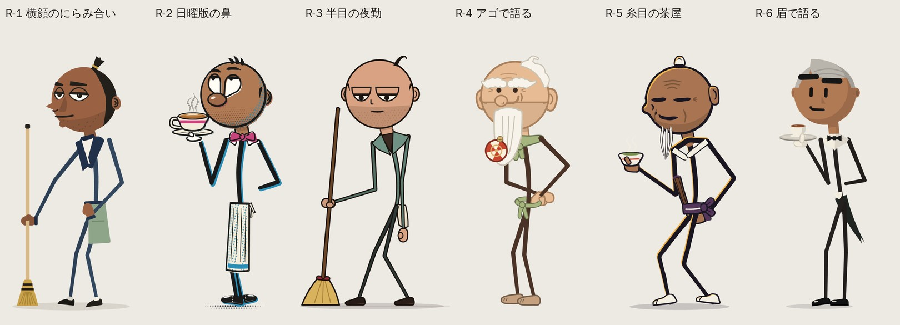

## 「棒つきキャンディ」問題は直ったか（レビュー担当）

8割がた解決しています。ただし完全ではありません。

効いた理由は4つです。
・頭が身長の31%から25〜28%に小さくなりました。
・肌色の太く短い首と、あごの下の影が入りました。
・襟の両端がそのまま肩になり、「T」の形ができました。
・耳・髪・鼻・ヒゲで丸の輪郭を何か所も崩しています。

この結果、動きや小道具のあるシーンでは、6案とも「人」に見えます。

まだ残っている所もあります。何も持たずに無地の背景で立っているときです。胴が細い一本線だけの案（tall_order、squint_house、heavy_lidsの立ち姿）は、黒いシルエットにすると一瞬「丸い玉が棒に刺さっている」ように見えます。

いちばん効いていたのは、顔の前側から丸の外へ大きく飛び出すものです。nose_to_noseのくさび鼻、sunday_noseの大きな鼻、jaw_dropのヒゲがそれに当たります。耳や毛の小さな出っぱりだけでは弱いです。もう一つ効くのは、胴に面（ベスト・エプロン・前掛け）があることです。

皮肉な点も一つあります。squint_houseとjaw_dropの手まりが赤白のうずまき模様なので、見た目がキャンディそのものです。手まりらしい糸の幾何学模様に変える必要があります。

## まとめ（レビュー担当）

【結論】丸顔は6案ともちゃんと入りました。前の棒人間版と比べると、頭が小さくなって腕が頭の上まで届くようになり、手足が背景に沈む問題もほぼ直っています。人の体を蹴っている絵もなくなりました。

おすすめ順は次のとおりです。
1位 nose_to_nose（横顔のにらみ合い）
2位 sunday_nose（日曜版の鼻）
3位 heavy_lids（ジト目の夜勤）

・丸顔のかわいさを最優先するなら、sunday_noseがいちばんです。
・笑いの取りやすさ、他作品との違い、キャンディに見えない度合いでは、nose_to_noseがいちばんです。
・heavy_lidsのジト目は、顔だけで笑いが取れる強い看板になります。

【外したほうがよい2案】
・jaw_drop：仕掛けは面白いのですが、頭の割れ方がサウスパーク（テレンス＆フィリップ）に近いです。続けるなら、閉じた顔の継ぎ目線を消し、アゴがゴムのように伸びて落ちる形に作り直す必要があります。
・tall_order：丸くしたことで持ち味の縦長頭を失い、顔も小さすぎて読めません。

【全案共通の直し】
・手まりの柄は、キャンディに見えない糸の模様にします。
・画面下1/4の空き地は、ショート動画の操作ボタンがかぶる場所なので、空けておくのは正解です。ただ、無地の帯ではなく床の続きとして見せます。
・胴が一本線だけだとキャンディ感が戻ります。ベストや前掛けなど、面のある服を必ず1つ着せます。

【次の一手】にらみ合いの「間」や二度見は、止め絵では判断できません。上位2〜3案で5秒の動きのテストを作って比べるのがおすすめです。

比較用のスマホサイズ画像はここに置きました。
/tmp/claude-0/-home-user-AI/a8d01661-3d44-5b73-963d-5c11d7fedaad/scratchpad/review_round/scenes_old_vs_new_360.png（上が前の版、下が今回）
/tmp/claude-0/-home-user-AI/a8d01661-3d44-5b73-963d-5c11d7fedaad/scratchpad/review_round/new_scenes_a.png
/tmp/claude-0/-home-user-AI/a8d01661-3d44-5b73-963d-5c11d7fedaad/scratchpad/review_round/new_scenes_b.png
/tmp/claude-0/-home-user-AI/a8d01661-3d44-5b73-963d-5c11d7fedaad/scratchpad/review_round/poses_360.png
/tmp/claude-0/-home-user-AI/a8d01661-3d44-5b73-963d-5c11d7fedaad/scratchpad/review_round/lineups.png
/tmp/claude-0/-home-user-AI/a8d01661-3d44-5b73-963d-5c11d7fedaad/scratchpad/review_round/lineup_sil_filled.png

## R-1 横顔のにらみ合い（レビュー 1位）

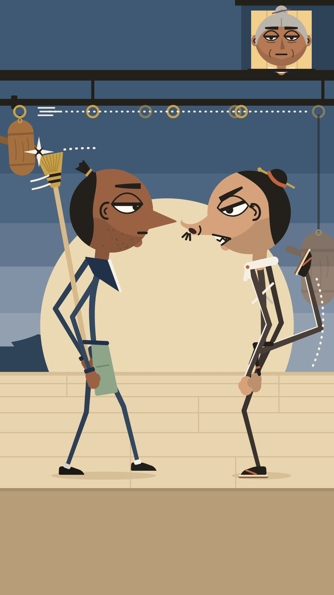

丸い頭からくさび形の鼻とちょんまげが飛び出しているので、6案の中でいちばん「棒付きキャンディ」に見えません。鼻先が10pxで止まったにらみ合いは、言葉なしでいちばん笑える絵です。顔は相手から一切そらさず、背中ごしの箒と後ろ足だけで木人と戦う。この形がチャンネルの芯（無言の間とテンポ）にぴったり合っています。顔の作りもC&Hやヘンリー・スティックミンとは別物です。大人らしさ（無精ひげ、おばあさんの無表情）も十分あります。弱い所は3つです。(1) 後頭部の黒髪が大きく、丸が半月形に削られて見えます。(2) スヌートが蹴る先の木人が半透明で当たった感じがなく、腰まわりで腕と脚が重なってごちゃつきます。(3) ポーズ3の正面顔では鼻が消えて、普通の顔になります。

よく出た所

・頭は全員ほぼ真円です（輪郭線なし、肌色で塗り）。直径は場面270px、ポーズ200px、ラインナップ232px（全身900pxの27%）。円を破る要素は横顔ならちょんまげ（茶筅髷）・くさび鼻・あごの小さな出っ張りの3つ、正面なら左右の耳と髷が加わります。黒塗りで縮小しても「丸い頭に鼻と髷」と読めて、ボールや風船には見えません。
・顔の仕組みは元デザインのまま円に載せ替えました。横顔のアーモンド目1つ、まぶたの肌マスク、くさび形の眉、口元の切り欠き（6種類）。顔の下部には12%暗い平塗りの影を入れて、あごの重さを出しています。ツヤやハイライトは入れていません。
・首は細い棒ではなく、太い肌色の短い首です（0.17D幅、上部にあご影）。後頭部側から10°前傾で出ています。その下に襟（ソルは紺の半纏衿＋白い襦袢の縁、スヌートは生成りの手ぬぐいの結び目＋たすき）、腰に前掛けや帯の結びを置いて、頭・襟・腰の3つの塊で「人」として読めるようにしました。棒付きキャンディ感は消えています。
・場面で読ませたい4点（鼻先の10px前後の隙間、ソルから外れて右後ろの人形を蹴るスヌートの足、背中越しの箒と肩上の「チン」、スヌートの剥き出しの歯）は、360x640に縮小しても読めます。
・腕・脚と背景のコントラストは全部3:1以上です（計測済み）。月の外に出る蹴り脚には、空を下ほど明るい段の色にして生成りの縁取りを付けました。
・ポーズ3は正面向きの「カメラに振り向く」ワンテイクにしました。肩幅±0.30Dで、両腕が頭に当たらず真上にV字で上がります（頭蓋から0.064〜0.07D、耳から0.05〜0.056D離れています）。正面顔（アーモンド目2つ、鼻は影のくさび、両耳）もこれで実際に見せられています。
・ラインナップは3/4向き（画面左向き）で、箒を杖のように立てた立ち姿です。足元y=1010、髷の先まで正確に900pxです。
・おまけで heads.png を作りました。表情7種、スヌート、3/4、正面、おばあさんの正面と横顔を1枚にまとめた参照用です。

まだ弱い所

・ソルが背中で箒を持つ腕は、肘が後ろへ大きく「く」の字に張り出します。腕1.38Dで手を腰の高さに置く以上、どうしても曲がる幾何です。読めはしますが、少しうるさいです（場面とポーズ2の両方）。
・スヌートの手前側の手足には生成りの縁取りが付くので、近くで見ると二重線っぽく見えます。腕・帯の垂れ・腰まわりが重なって、腰の位置はやや混雑しています。
・ポーズ3を正面にしたので、このデザインの売りである横顔のくさび鼻がシートの1枠で消えています。
・場面の左端（ダミー人形、チンの星、箒の扇、軌跡の点線）は詰まっています。人形は小さめ（s=0.62）で、左の縁ぎりぎりです。
・あごの無精ひげの点は小さすぎて、スマホサイズでは消えます。実際に重さを出しているのは平塗りの影のほうです。
・場面下の345pxは仕様どおり無地の帯なので、画面としては下が重く空いて見えます。
・ポーズ3の箒は右端まで12pxの余白しかなく、窮屈です。
・試作は9回で、上限の8回を1回超えました。

## R-2 日曜版の鼻（レビュー 2位）

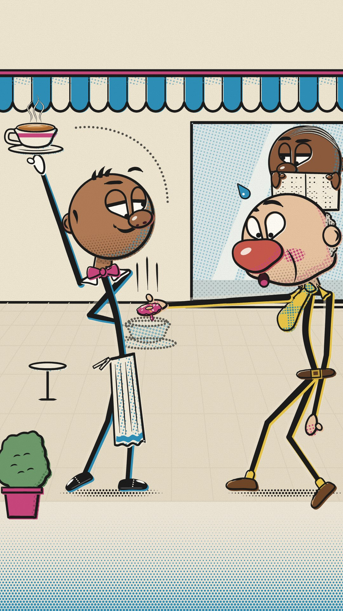

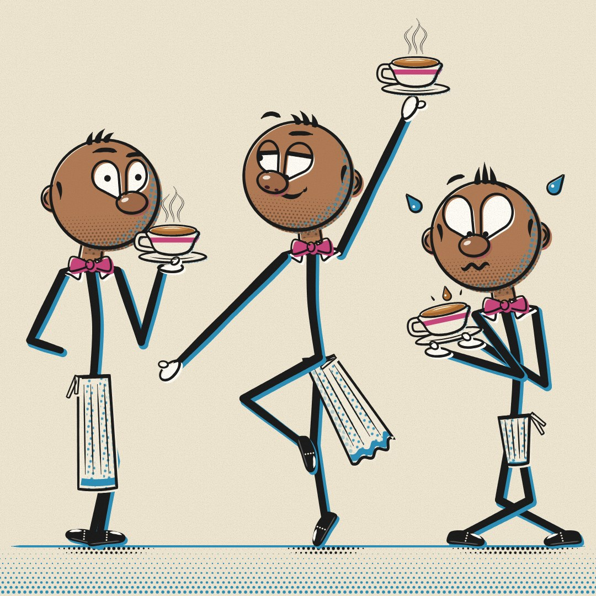

丸顔のかわいさと表情の読みやすさは6案でいちばんです。大きな鼻、しずく形の白目、網点と色ずれの「昔の新聞マンガ」風がよく合っていて、スマホの大きさでも全員の顔がはっきり読めます。ポーズ2の片足立ちでカップを高く掲げる姿はいちばんきれいです。蝶ネクタイ・襟・エプロンで、頭がちゃんと体につながって見えます。弱点は4つです。Bixはツンツン髪と大きな目で若く見え、「仕事を持つ大人」の感じが弱いです。シーンのBixはほぼ棒立ちで、動きが少ないです。Gusの腕が異様に長く、ドーナツが何なのか一瞬わかりません。Gusは右端で窮屈です。

よく出た所

・頭は全員まん丸（幅と高さが同じ）。顔の大きさ（直径D）は、シーンのBixで270px、ポーズ表で200px。身長はBixが3.7D（頭が身長の27%）。前の版より頭が小さくなり、腕を頭の上まで上げても頭にぶつかりません（すき間は0.06〜0.10D）。頭上のソーサーは頭のてっぺんより0.23〜0.25D上にあります。
・「棒付きキャンディ」に見える問題は直せたと思います。頭から順に、肌色の短い首（幅0.18D、見えている長さ0.12D、あごの下に影）→ 白い襟先とローズ色の蝶ネクタイ（合わせて幅0.55D）→ 肩 → 細い背骨 → エプロン、とつながっています。襟の両端がそのまま肩の位置になり、体の「T」の形ができています。黒く塗りつぶした1/4サイズのシルエットでも、キャンディではなく人に見えました。
・丸の輪郭は小さく何か所も崩しています。後ろ側に半円の耳、頭頂に前向きの短いハネ3本、もみあげ。斜め向きでは鼻が輪郭から少しはみ出します。Gusは後頭部の灰色の髪、両頬のたるみ、ジャガイモ鼻で崩しています。
・顔の下1/3に網点（ドット）のあご影を入れ、影側にはシアンの網点。頭にツヤやハイライトは入れていません。
・顔の表情の仕組みは元のデザインのままです。大きな鼻の上に乗るしずく形の白目、まぶたのカット、浮いた眉、口はふだん鼻の下に隠れています。
・線の太さは、手足が18→12px の墨で、その下にシアン（Gusはマスタード）の色版を4〜5pxずらしています。頭の輪郭（平均7〜8px）より体の線のほうが太いので、体の上に頭が乗って見えます。
・スマホ縮小（360x640）でも、次の4つが読めました。高く水平に持ったカップ、ドーナツの下の点線のゴーストカップ、Bixの上がった眉、Gusの寄り目と赤くなった鼻。
・Gusは大人らしく見えます（はげ頭に後ろの灰色の髪、頬のたるみ、ジャガイモ鼻、頬の赤み、ベルト）。叩かれる人はいません。Gusは手を伸ばしすぎているだけです。
・ラインナップ画像は、足の裏（y=1010）から髪の先までちょうど900pxです（D=237）。ピクセルで測って確認しました。

まだ弱い所

・シーン右側のGusが窮屈です。奥の腕と後ろの靴が x≈1065 まで来ていて、画面の端ぎりぎりです。背骨が長くまっすぐなので、猫背の「C」の形が弱いです。頭が大きい（D290）ぶん、頭が重そうにも見えます。
・まっすぐ伸ばした腕でドーナツをBixの胸の前に届けるため、Gusの頭を指定位置より右（x 906、指定は800）に動かしました。それでもゴーストカップの高さは胸ではなく肘〜腰のあたり（中心 y≈1045）です。ゴーストカップの左端はBixの背骨に少しかかっています。
・点線の軌跡は、Bixの頭の右上から途中で始まっています。ドーナツの上の縦の勢い線とはつながっていません。
・斜め向きの顔では、鼻を輪郭からはみ出させるために、目と鼻を大きく前側に寄せました（約0.22〜0.25D）。奥の目は横幅65%につぶしています。奥の眉は輪郭で切れて、短い弧しか見えません。
・目の位置が少し高めです。黒目は頭のてっぺんから約0.33〜0.36Dのところで、ルールの「40〜50%」より上です。
・あわてるポーズ：前より深く膝を曲げましたが、体はまだまっすぐ気味です。両腕が体の前で交差していて、少しごちゃっとしています。
・待機ポーズ：後ろに回した腕が、「背中の後ろ」というより「腰に手」に見えます。
・シーン上半分は、日よけのシアンと窓の網点で少しにぎやかです。手足の下の背景を薄める処理は、ほとんど目立ちません。
・新聞を読む人は、新聞の上から鼻の頭が少し見えています。わざとそうしましたが、指定は「目から上だけ」です。
・常連のモブキャラ（その他の客）はシーンに描いていません。

## R-3 半目の夜勤（レビュー 3位）

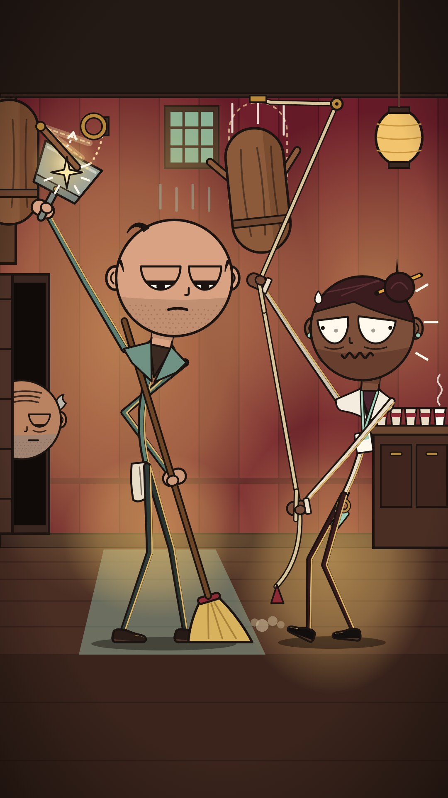

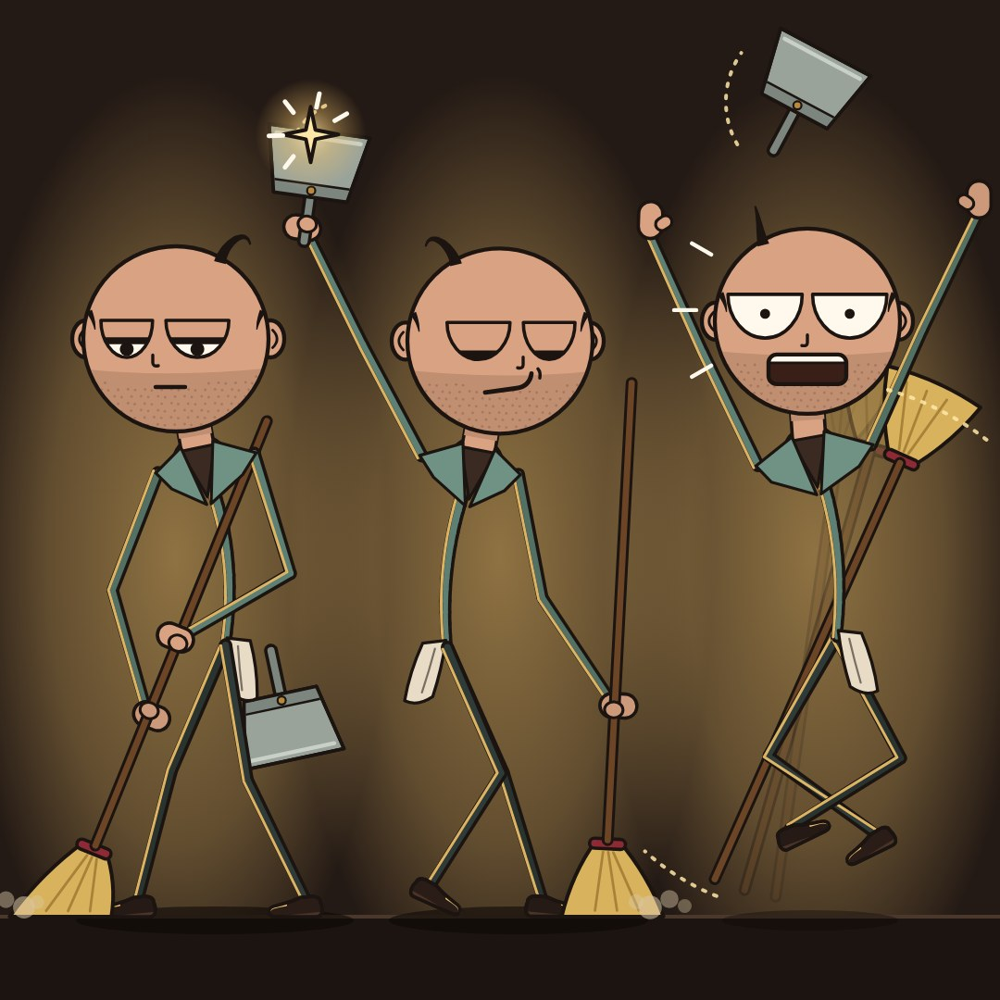

まん丸の頭に水平のまぶたが一本線で乗る「ジト目」は、顔だけで笑いが取れる強いマークです。「見もしないでちりとりで受けた」というギャグもはっきりしていて、ドアの陰から片目だけのぞくじいさんも効いています。無精ひげの帯で大人らしさも十分です。弱点は4つです。はげ頭に毛が1本くるんという形は、チャーリー・ブラウンを連想させやすいです。シーンはロープが何本も画面を横切ってごちゃつき、木人とちりとりが左上の端に押し込まれて小さいです。Dotの腕がたすきのように見えます。ポーズ3は腕と耳がほぼくっついています。

よく出た所

・頭は全員まん丸の円です（幅:高さ1.00）。Lou の頭は身長の27〜28%で、シーン27.6%、ポーズ27.6%、ラインナップ27.8%です。前回は31%でした。
・棒付きキャンディーに見えない理由：肌色の太く短い首（頭の直径の0.18倍の幅、0.12倍だけ見える、上にあごの影）があり、ティール色の襟Vの両端がそのまま両肩になっています。耳2つと後ろ向きにカールするつむじの毛で円を3か所崩し、顔の下1/3を無精ひげの帯にして「あご」の重さを出しました。黒塗りシルエットを1/4に縮めても、丸い頭・耳・毛・首のくびれ・肩のT・開いた足で「人」に見えます。
・顔の仕組みは元のままです。上が平らな白目のおわん形の目に、肌色のまぶたが上からかぶさります。まぶたが水平だと2本の線がそろい、丸い顔に横一本の「バイザー」ができます。これがこのキャラのサインです。新しく小さなJ字の鼻を足しました。
・腕を長くしたので、頭上までちゃんと届きます。腕と頭の間はシーンで頭の直径の0.14倍、ポーズ2で0.13倍あります。
・手足と背景のコントラストは、キャラ抜きの背景画像で自動測定しました。全部の手足が3.2:1以上です（Lou 3.5〜4.1、Dot 3.3〜4.0）。ランタン側には3.5pxのアンバーのふち光を入れました。
・シーンの笑いは「見てもいないのに防いだ」です。Lou はほうきで床を掃いたまま、Dot を半目でジトっと横目に見ています。頭上に上げたちりとりに木人の腕が当たって星が出て、腕は真鍮のリングへ戻っていきます（点線の矢印）。Dot はパニック顔でロープを引き、次の木人が落ちてきます。じいさんはドアの陰から片目だけで無表情に見ています。当たるのは木人→ちりとりだけで、人の体に向いた攻撃はありません。
・スマホ想定の360x640でも、Lou の水平まぶたと黒目の向き、ちりとりの星、床についたほうき、Dot の大きな白目と汗、じいさんの片目が読めます。
・ラインナップは描画を実測して、靴底から毛の先までちょうど900pxです。
・他作品との違い：肌色の頭、耳と鼻、無精ひげの帯、まぶた付きのおわん目、インクでふち取った色付きの棒、襟と腰のぞうきん、ミトン手と靴。C&H、Henry Stickmin、Alan Becker、South Park のどれとも違います。

まだ弱い所

・ポーズ3（びっくりジャンプ）は、腕と耳の隙間が4〜10pxしかありません（頭の直径の0.02〜0.05倍）。25°のV字で頭が身長の27%だと、幅360pxの列に収めるにはこれが限界でした。
・ポーズ3のほうき（577px）は列の幅に収まらないので、頭の上ではなく体の後ろを斜めに飛ばしました。腕や脚と少し重なり、読みやすさは一段落ちます。
・Dot の手前の腕は「左上へ伸ばす」にできませんでした。斜め向きの顔を横切ってしまうためです。代わりに下へたぐる腕にしましたが、体の前を斜めに横切るので、たすきのようにも見えます。
・Dot の上げた腕と自分のあごの隙間は12px（頭の直径の0.05倍）で、ぎりぎりです。
・シーン左上（木人・ちりとり・星）は画面の端で窮屈です。木人の腕の残像（点線）は、小さい画面ではほとんど見えません。
・Lou の奥の腕（ほうきを持つ側）は、ひじが外に張って少し「腰に手」っぽく見えます。
・ポーズ2のニヤリ顔はまぶた0.85なので黒目がほぼ隠れ、目を閉じているようにも見えます。
・画面の下1/4はスペック通り無地の床なので、空いて見えます。
・驚き顔の目の幅は円の86%あり、ルールの80%を超えています（スペックの「目1.18倍」に従った結果です）。

## R-4 アゴで語る（レビュー 4位）

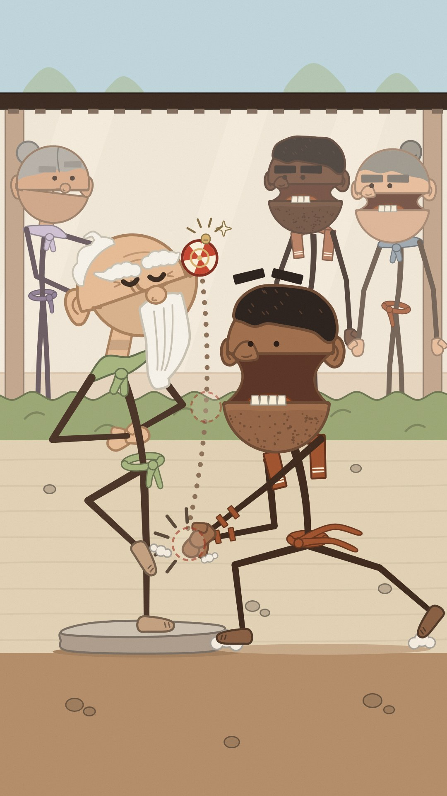

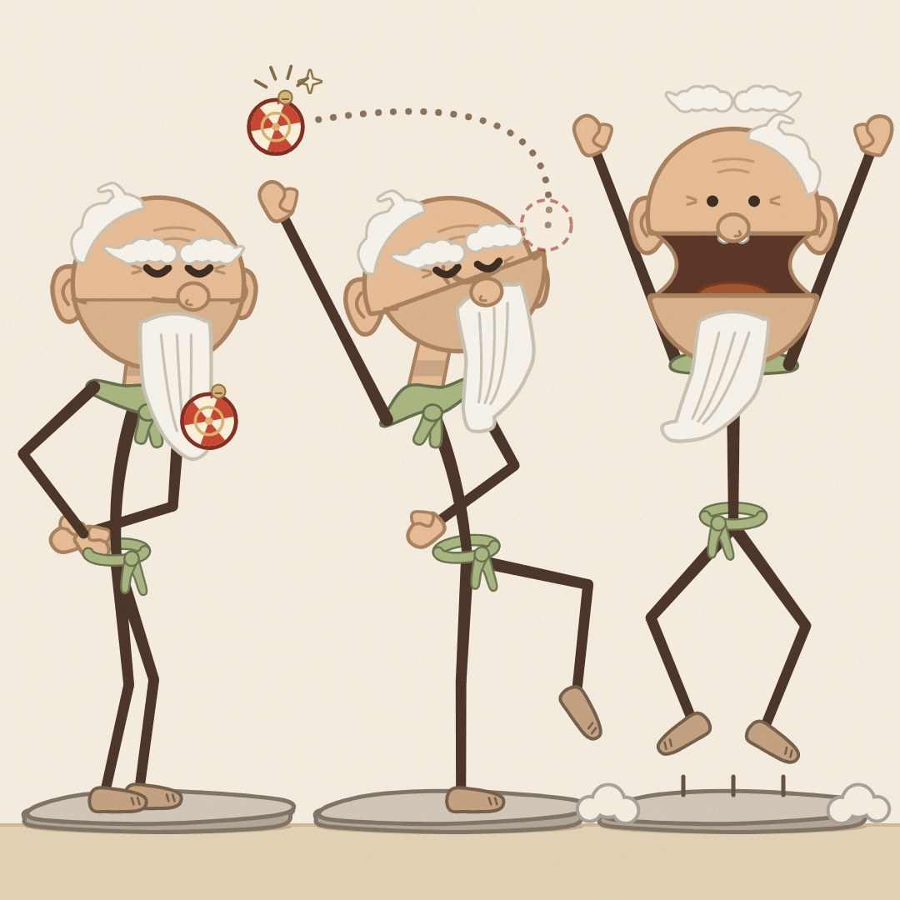

アゴがストンと落ちる顔は、言葉なしでいちばん大きな笑いが取れる仕掛けです。師匠の長いヒゲも丸を崩していて、ちゃんと人に見えます。大人らしさも強いです。ただし大きな問題があります。閉じた顔にも横一本の「継ぎ目」が見えていて、開くと頭の上半分がフタのように持ち上がります。これはサウスパークのテレンス＆フィリップの頭の割れ方にかなり近く、ルール上いちばん危ない案です。背景の弟子2人とおばあさんも同じ割れ顔で、画面の上半分がうるさいです。手まりはアゴの上ではなく鼻の前に浮いて見え、Snapの手は師匠の足首をつかみに行っているようにも見えます。

よく出た所

・頭は真円です。口の継ぎ目（上から0.60D）で、上の頭蓋と下のアゴに分かれます。閉じると完全な丸、開くとアゴがストンと落ちます。このデザインならではの「アゴで語る」仕組みは丸い頭でもそのまま使えます。
・丸の輪郭を3か所以上崩しています。師匠は耳たぶ付きの大きな耳、後頭部の白い雲のような髪（＋くるっと一房）、雲形の眉の房、長い白ヒゲ。Snapは角刈りの盛り上がり、耳、幅広の鼻、受け口の歯です。黒く塗りつぶしたシルエットでも、ボールや風船ではなく「人の頭」に見えます。
・顔の下側に重みを入れました。師匠はアゴ部分を6%暗く、Snapは無精ひげの点描です。ツヤのハイライトは入れていません。
・棒の体でもキャンディには見えません。肌色の短い首、首元の布（師匠はピスタチオ色のスカーフ、Snapはシナモン色の汗ふきタオル）の両端がそのまま肩の位置になっています。腰の帯、親指付きのミトン手、素足もあります。
・頭は身長の約27%です（師匠は3.68D、ラインナップでは身長900pxで頭237px）。腕は頭の上まで届きます。チンバレーのポーズでは、拳が頭頂より0.09D上まで上がり、耳にも当たりません。
・手足は濃いこげ茶（#4A3326 / #3E281C）、太さ12〜20pxです。背景とのコントラストは大半が4.5〜9:1あります。
・場面：師匠は目を閉じた涼しい顔で、突き出したアゴの棚に鈴の手まりを乗せています。Snapは長い踏み込みで、何もない所で手を打っています（破線のボールの残像あり）。口はひょうたん型に伸び、アゴが落ちて下の歯が4本見えます。点線の弧が、手を打った位置から師匠の顔までつながっています。Snapの手は師匠の胴から約30度外れ、地面のほうを向いています。
・360×640に縮めても、落ちたアゴと歯、師匠の閉じた目、手まりは読めます。
・肌色の頭、耳と鼻、ヒゲ、継ぎ目で割れる顔、黒を使わない色付きの輪郭線、仕事を持つ大人らしさがあります。C&H、Henry Stickmin、Alan Becker、South Park、Beanie Survivesとははっきり違います。

まだ弱い所

・手まりは「アゴの先」というより「顔の前（鼻の高さ）」に乗っているように見えます。割れた丸の構造では、アゴの前の端が継ぎ目と同じ高さに来るためです。アゴを前に出して角度を付け、その棚に乗せて読めるようにはしましたが、完全ではありません。
・アゴを0.5D落とすと頭が縦1.5D近くになり、Snapは頭でっかちに見えます。アゴが肩の線で止まるよう、頭蓋を首ごと少し持ち上げる処理を入れました。そのため「フタがパカッと上がる」見え方が少しあります。South ParkのTerrance & Phillipの開く頭に近づかないよう、今後も注意が必要です（こちらは上下にずれるだけでちょうつがいはなく、耳・鼻・歯・舌もあります）。
・跳び上がりポーズのアゴ落ちは0.55Dではなく0.40Dです。腕のV字も21度、拳は頭頂より0.08D上までで、仕様の0.2Dには届きません。
・背景に弟子2人とお茶のおばあさんが入って、画面上部がにぎやかです。弟子の黒い口も少し目立ちます。
・Snapの合わせた手は、ミトンが2つ重なっているだけで、「パン」と打った形としてはまだ弱いです。破線のボールと効果線で補っています。
・場面では、師匠の後ろ手（羽のように張ったヒジ）が点線の弧に近いです。
・下の平らな影の帯（y1575〜1920）は仕様どおりですが、空いて見えます。
・跳び上がりポーズは正面向きで、背骨が頭の真下にまっすぐ通っています。ヒゲとV字の腕で「I」の形には見えませんが、ルールの文字どおりではありません。

## R-5 糸目の茶屋（レビュー 5位）

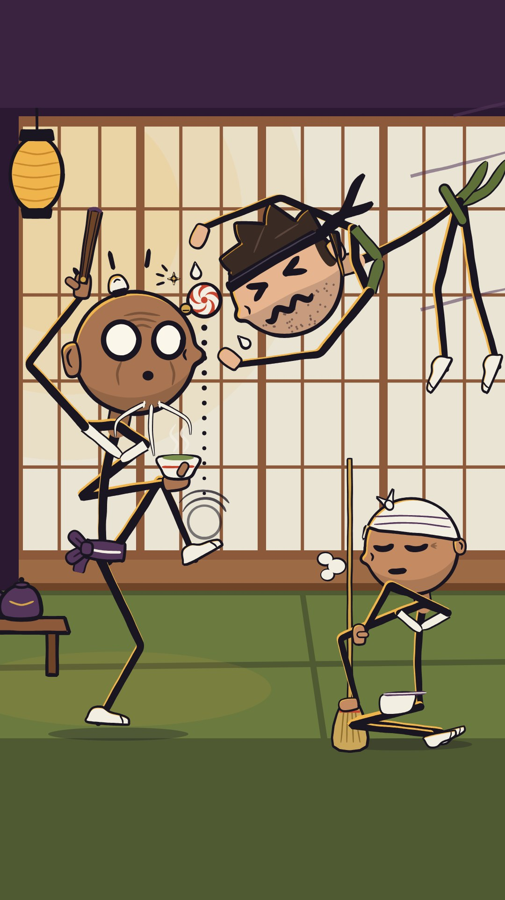

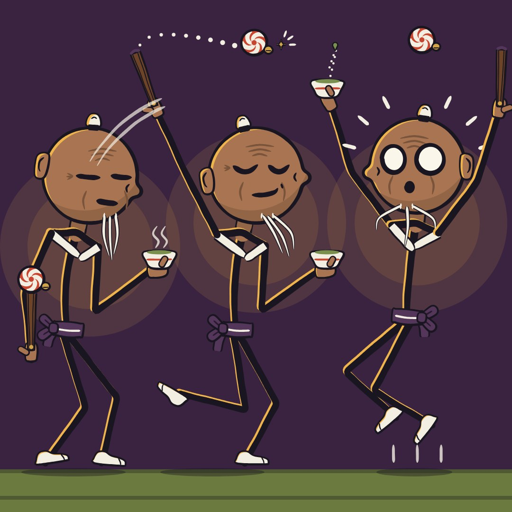

動きの量は6案でいちばんです。師匠のまん丸の驚き目、明るい障子の前の墨色の手足、目を閉じたまま掃く女性はよく読めます。ただ、空中のヒコは腕と脚が頭のまわりで絡まっていて、スマホでは何の形なのか分かりません。お茶碗を持つ師匠の腕もZ字に折れて絡まって見えます。手まりは赤白のうずまき模様で、ペパーミントキャンディにしか見えず、「キャンディ問題」を別の形で呼び戻しています。「眠そうな老師がボールを落とさない」が面白さの元なのに、驚き顔にしたことでそこから外れています。

よく出た所

・頭は全員まん丸（幅と高さの比は1.00）にしました。直径は老師260px、ヒコ240px、女性200pxで、老師の頭は身長の27.8%です。円は4か所で崩しています（耳たぶの長い耳、白いちょんまげ、鼻先、白い細いあごひげ）。そのため黒く塗りつぶしても「棒付きキャンディ」や「風船」ではなく「人の頭」に見えます。シルエット確認でもそうなりました。
・首は肌色の太く短い円柱にし、上にあごの影を入れました。その下でクリーム色の襟のVが肩のラインになります。頭→首→襟→背骨→紫の帯が一本の流れとしてつながります。
・腕を長くしました（1.4D＋手袋0.2D）。ポーズ2の頭上の扇も、ポーズ3のY字バンザイも頭に当たらず、すき間は0.07〜0.2Dあります。
・顔の仕組みは元のままです。眉と瞳はなく、目は筆の一本線、表情は口の差し替えで出します。開くのは驚いたときの「中が空っぽの丸い目」だけです。360x640に縮めても、老師の丸い目でにらむ様子、足の真上のボール、水平なお茶碗、ヒコの「><」と波線の口が読めます。
・背景を明るい障子にしたので、墨色の手足がはっきり見えます。暗い所は琥珀色の縁取りで分けました。測ると、全部の手足で背景とのコントラストが3:1以上です。
・おとな感は、しわ、カラスの足あと、白ひげ、ヒコの無精ひげともみあげ、女性の目じりのしわで出しています。
・ラインナップは足の裏から髷の上まで900px（y110〜1010）で、指定通りです。片手を後ろに回し、もう片手でお茶を持つ、ゆったりした老師の立ち姿です。

まだ弱い所

・ヒコは指定と大きく違います。「両腕を伸ばしきってボールへ」を本当の体の比率でやると、腕が自分の顔を横切るか、体が画面からはみ出します。そこで腕を頭の周りを囲む輪の形にしました（ひじは約15°曲がっています）。頭も-30°傾けました。足は上に曲げず、下にぶら下がる「空中で固まった」形です。首のまわり（耳、緑の襟、ハチマキの尾）が少しごちゃついています。
・老師がお茶碗を持つ腕は、ひじを背中側に折りたたむZ字になっていて、少しからまって見えます（ボールの縦の通り道を空けるためです）。
・ヒコの2つ目の汗のしずくが老師の頭とボールの間にあり、老師の汗に見えるかもしれません。
・驚いたときの「点の口」は、スマホサイズに縮めると10px未満になります（もともと小さい記号なので）。
・頭の輪郭線は7〜10pxにして、指定の10〜12pxより細くしました。「輪郭線は手足の太さの0.45倍まで」のルールを優先したためです。
・帯の蝶結びが小さく、花のようにも見えます。
・ポーズ2の頭上の扇が、ポーズ1の列の頭の上まで伸びています（すき間は30px以上あります）。

## R-6 眉で語る（レビュー 6位）

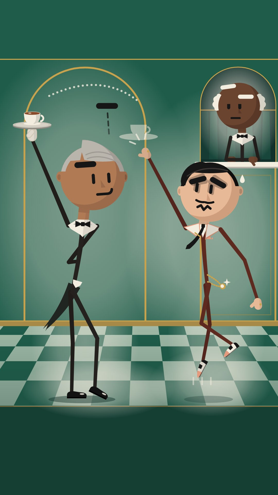

丸い頭にしたことで、このデザインの売りだった「縦に長い頭」がなくなりました。残った顔（細い点の目と線の口）は、スマホの大きさだと小さすぎて表情が読めません。頭上に浮かせた眉の棒や半透明の「残像トレイ」も、ぱっと見では黒い棒とカップ2つにしか見えません。体は6案でいちばん細く、胴も黒い一本線なので、「丸い頭が棒に刺さった」印象がいちばん強く残っています。顔の作りが単純なぶん、C&Hやヘンリー・スティックミンの単純な顔にもいちばん近いです。灰色の髪と上品な配色は良いです。

よく出た所

・頭は3人とも正円にしました。輪郭線はなく、肌色はベタ塗りです。左から光が当たる設定で、右下に影の三日月を入れ、これが顎の重さになっています。円は耳・髪の山・分け目の切れ込みで3か所以上欠けています。黒塗りのシルエット確認では、頭・首の切れ込み・襟・肩のTがつながって「人」に見え、棒付きキャンディや風船には見えませんでした。
・眉で語る仕組みは前のままです。黒い錠剤型の眉、縦ダッシュの目、横にスライドする口に、動かない鼻の三角を足しました。この鼻のおかげで、C&H系の「点と線の顔」になりません。画面の主役は、ミスター・レベルの頭上0.6Dに浮いた片眉と3本の点線です。360×640に縮めても読めます。
・頭身は25〜25.5%です（シーンD250で身長980px、ポーズ表D200、ラインナップはD223で髪込みちょうど900px）。トレイを上げる腕は頭から0.08〜0.11D離れていて、どの絵でも顔を横切りません。トレイは指先に乗って頭頂の0.27D上にあり、カップの水平も保っています。
・首は肌色の短い首で、顎下の影があります。アイボリーのウィングカラーの両端がそのまま肩になり、腰には燕尾の一枚くさびとアイボリーのベストの先を置きました。頭・首・襟・背骨が1本の鎖としてつながって見えます。手袋のアイボリーが襟とそろっているので、手と体も同じ人のものとして読めます。
・コントラストは自動で測りました。手足の背後の色を拾って比べると、レベルの手足はすべて3:1以上です（最低3.6）。ハスティは88点中84点が3:1以上でした。
・ギャグの読み：ハスティの手は「さっきまでトレイがあった空中」（半透明の残像トレイ）をつかみ、点線の弧で、トレイがレベルの頭上を越えて左上へ逃げた軌跡を見せています。誰も触れていません。腕はどれも人の胴を向いていません。クローク係は片眉だけ上げた無表情です。
・大人の記号として、銀髪と櫛目、口ひげ、ホテルの職業小道具を入れました。白い頭・黒い頭・ニット帽・白黒の大きな楕円目は使っていません。

まだ弱い所

・ハスティの腕は仕様と違います。仕様は「両腕とも左上へ25°と40°」でしたが、頭1Dに対して肩幅が±0.27Dしかないため、奥の腕が必ず顔か頭を横切ってしまいます。そこで、片腕を28°で左上へ伸ばし、もう片腕は右下へ流す「片手リーチの跳躍」にしました。両手で必死に伸ばす感じは弱くなっています。
・同じ理由で、ハスティだけ首を後ろへ14°反らせ、見上げる形にしています（通常の3/4は前傾8〜15°）。
・残像トレイはギャグを読ませるために入れましたが、ちらっと見ただけだと「カップが2つある」と取られる恐れがあります。指先とトレイの差は約1.45Dで、仕様の「約1D」より広めです。
・ハスティの手足は、仕様のレンガ色#8E4A3Aだとエメラルドの壁と明るさがほぼ同じで沈みました。そこで濃いオックスブラッド#5E2A20に変えています。レベルの黒と並ぶと少し似て見えます。後ろ腕の2点は2.85:1で、3:1をわずかに下回りました。
・ランプの光だまりは仕様の25〜35%では足りず、42〜52%まで強くしました。床に映り込みの光だまりを足し、幅木も暗い帯から真鍮色に変えています。全体がやや明るい舞台照明っぽくなりました。
・ハスティの頭上の欠けは、仕様どおり0.06Dの前髪ウェーブだけです。シルエットで見ると、頭上の欠けは他のデザインより弱めです。
・体はとても細く、背の高さがギャグなので脚も長いです。かわいさより「細長いおじさん」寄りの印象です。
・クローク係の耳は白い横髪に隠れて見えません。ポーズ1は真っすぐ立つ仕様ですが、「頭の真下に垂直な棒」を避けるため、わずかに左右へS字にしています。

## 上位3案の直し（レビュー担当の提案）

・nose_to_nose：1. 後頭部の黒髪を小さくする。今は頭の約4割を覆っているので、うなじ側の細い帯（2割ほど）にして、丸い輪郭がはっきり見えるようにする。ちょんまげはそのまま残す。
2. スヌートの後ろ蹴りを直す。木人を半透明から普通の濃さに戻し、大きさを0.62倍から0.8倍にして、画面の内側へ40〜60px寄せる。足先に当たりの星と、リングへ戻る点線を足す。両こぶしを腰で重ねるのはやめ、片腕は下へ、もう片腕は後ろへ振って、脚と重ならないようにする。生成りのふち取りは蹴る脚だけに残し、腕からは外す。
3. ポーズ3は真正面をやめて斜め3/4向きにし、くさび鼻を輪郭から少しはみ出させる。このデザインの看板が1枠でも消えないようにする。
4. ソルが背中で箒を持つ腕は、箒を肩にかつぐ持ち方に変え、ひじが「く」の字に飛び出すのをなくす。
5. 左端の木人・星・効果線を内側へ寄せ、効果線を1本減らす。おばあさんの窓は少し下げて、枠いっぱいに詰まって見えないようにする。
6. 無精ひげの点はスマホで消えるので、点を大きく数を少なくするか、やめて平塗りの影だけにする。
・sunday_nose：1. Bixを大人に見せる。頭のツンツン毛3本をやめ、なでつけた髪にして、こめかみに白髪を入れる。細い口ひげと、ほおの下にたるみの線を1本足す。白目は今より1割小さくする。目の位置は今の高めのままでよい（高いほうが大人っぽく見える）。
2. シーンのBixに動きをつける。前の版のような片足立ちか、体を後ろへ反らせてカップを逃がす形にする。今はほぼ棒立ちになっている。
3. Gusの「つかみ損ね」をはっきりさせる。手は空っぽにして、点線のゴーストカップの形に指を丸める。ドーナツを使うなら、もう片方の手で「おとり」として差し出す形にする。Gusを左へ80〜120px寄せて腕の長さを普通に戻し、背中をCの字に丸める。
4. 下1/4の網点の帯は、操作ボタンがかぶる場所なので空けておいてよい。ただし床のタイルを下まで続けて「床」に見せる。日よけと窓の網点を少し弱めて、上半分を静かにする。
5. 待機ポーズの後ろに回した手は、背中の後ろに手先を少し見せるかナプキンを持たせて、「腰に手」に見えないようにする。
・heavy_lids：1. 頭の毛1本くるんをやめる（チャーリー・ブラウンを連想させるため）。代わりに、後頭部に耳から耳までの灰色まじりの馬蹄形の髪か、3本のバーコード髪にする。大人らしさが上がり、丸の崩しも残る。
2. シーンのロープを1本に減らす。Dotは胸の前で両手でたぐる形にして、たすきに見える斜めの腕をなくす。
3. 木人がちりとりに当たる場所を画面の内側へ移し、左端から120px以上離す。木人を全部画面の中に入れ、腕の点線の残像は太い「ぶれ」の形に替えて、スマホでも見えるようにする。
4. ポーズ3は腕のV字を25°から35°に開くか、列の幅を広げて、ほうきが頭の上を飛ぶ位置に戻す。耳と腕のすき間は、頭の直径の0.08倍以上にする。
5. ポーズ2のニヤリ顔は、まぶたを0.85から0.7に下げて黒目を見せる（今は目を閉じているように見える）。驚き顔の目の幅は、円の80%以内に収める。
6. Louの奥の腕は、ほうきの柄を低めに握らせて、「腰に手」に見えないようにする。

## 丸い頭を棒人間に乗せる決まり

・MEASURE AND KEEP IT ROUND. D = diameter of the skull circle, measured without ears, hair, nose or beard. Every head is a true circle: width:height 1.00 ±0.04, no flat bottom (South Park), no egg, bean, peanut or pancake. Standing height H (sole to skull top, hair excluded) = 3.45-4.0 D, so D is 25-29% of H; the default is 27% (3.7 D). In 1080x1920 scenes hero D is 250-290 px (H about 930-1075 px), never under 240 px except cameos (at least 160 px). On 1080x1080 pose sheets D is 200 px (H about 740 px; 800 px for the 4.0 D Mr. Level), head centers x 190/540/880, floor y 990, at least 30 px between silhouettes, nothing crossing the frame edge.
・VERTICAL STACK in D: skull 1.0; visible neck 0.10-0.15 (0.20 for the ramrod Mr. Level); shoulder yoke 0.05-0.08 below the neck base; spine from yoke to hip 0.95-1.05; legs from hip to sole 1.45-1.65. Arms from shoulder to wrist are 1.35-1.45 (upper 0.68, fore 0.70) plus a 0.2 mitten, so at rest the mittens hang at mid-thigh. Long limbs are an adult signal, and they fix the old 31% problem where arms could not clear the head.
・OVERHEAD CLEARANCE. The shoulders are two points on a yoke ±0.26-0.30 D from the spine, about 0.72 D below the head center. A straight arm raised 25-30° out from vertical clears the skull by at least 0.06 D, and the mitten ends at least 0.2 D above the skull top (the banzai V). For a one-hand lift (tray, saucer, dustpan, fan), the upper arm goes 35-45° outward with the elbow at least 0.7 D from the head center, then the forearm angles back in so the palm lands 0.2-0.3 D above the skull top over the head's outer third. Never tilt the head to make room, and never let an arm cross the face. On pose sheets, full-extension arms point up or diagonally into empty space (V within 30° of vertical); horizontal T-arms do not fit a 360 px column.
・THE NECK IS A STUB, NOT A STICK. Draw a skin-colored neck 0.16-0.20 D wide (always wider than the spine stroke), visible for 0.10-0.15 D, with a flat 12%-darker chin shadow across its top. It tucks 8-20 px inside the head, and the head is drawn after the body. In 3/4 and profile views the neck axis sits 0.08-0.12 D behind the skull's vertical center line and leans 8-15° forward, so the head rides ahead of the shoulders. In front view the neck is centered, but a chin shadow, beard, jowls or collar always covers the junction. The lollipop cue is a thin line touching the exact bottom of a circle at one point; never draw that.
・COSTUME ANCHOR AT THE NECK. Every figure wears one neck piece 0.45-0.65 D wide: a collar V, wing collar plus bow tie, eri cross, hanten collar band, tenugui knot, neckerchief, sweat towel, lanyard V, or a beard or jowls overlapping a collar. It sits on the neck base, and its outer corners or wings ARE the two shoulder points, so the costume forms the shoulder line. Beards, jowls and stubble overlap it from above. Head, neck stub, anchor and spine must read as one unbroken chain. No long flowing scarves (Line Rider) and no hats as identity.
・BREAK THE CIRCLE AT LEAST 3 TIMES, BUT SMALL. At least one break on top (cowlick, topknot, bun, hair flicks, fringe or crest 0.12-0.22 D tall), two at the sides (ears 0.06-0.12 D beyond the rim at 0.48-0.55 D height), and, where the design allows, one at the front or bottom (a nose tip 0.04-0.34 D past the rim in 3/4 or profile, jowls, chin bump, beard, dropped jaw). The breaks stay small enough that the head still reads as a circle first. Black-fill silhouette test: the head must read as a head (round plus ears plus tuft), never as a ball, balloon or coin.
・WEIGHT AT THE BOTTOM OF THE DISC. The lower 25-35% of every face carries a jaw value: a stubble band, flat shadow crescent, jowls, beard root, jaw seam or halftone cheek shade. That gives the circle a chin that sits on the neck. Never put a specular highlight dot or gloss band on any skull; that is the balloon and bowling-ball cue. If there is volume at all, it is a flat crescent on the shadow side.
・FEATURES BIG AND OFFSET. Eyes sit 40-50% of D down from the top (never low, as in C&H). The feature cluster spans 55-80% of the disc width, and in 3/4 view it shifts 0.08-0.15 D toward the facing side. Small features centered in a big disc read as a balloon or an emoticon (asdfmovie). A circle shows no rotation, so head tilt and turn must be carried by the features, ears, hair break and neck angle moving together.
・LINE WEIGHT. Limbs are 0.065-0.075 D at the root, tapering to 0.045-0.05 D, and never under 12 px in a 1080 frame. The spine is 0.08 D at the chest, tapering to 0.06 D at the hip: a slim wedge, never a filled torso. Where a style outlines the head, the outline is 0.02-0.03 D (brush swell up to 0.04 D) and at most 0.45x the limb root. The body must look heavier than the ring around the face, so the disc reads as a head on a body, not candy on a stick. The face's key mark (lid line, brow, eye stroke) wins by value contrast (darkest ink on the lightest ground), not by stroke width.
・POSTURE. Never put a vertical stick under the head center. The spine follows a C or S line of action. The head center sits 0.1-0.3 D off the hip vertical: forward for hunches and lunges, slightly back for ramrod pride. Head tilt, shown through the features, follows the spine tangent ±10°. Elbows and knees keep a 5-12° bend, except on full-extension beats, where they lock straight for snap.
・BASE AT LEAST AS WIDE AS THE HEAD. In every pose the legs (stance width, knee bend) or the arms span at least 0.9 D horizontally, so the silhouette is an A, X, T, Y or K shape. An 'I' under an 'O' is a lollipop.
・THREE MASSES ON THE LINE OF ACTION: the head (largest), the neck anchor (medium) and a hip prop (apron, sash or obi ring with tails, tailcoat wedge, dust rag, belt knot, key tag). Together they carry the eye from the head down the spine. Costume color appears at both the neck and the hip. The head's skin repeats in the mittens (or the gloves echo the collar), so the eye joins head, hands and body into one person.
・HANDS AND FEET READ AT PHONE SIZE. Mittens are 0.18-0.22 D long x 0.12-0.14 D wide (about 45-60 px in a scene), in skin or glove color with the head's edge treatment, and every grip gets a thumb nub in front of the prop. Shoes or feet are 0.28-0.34 D long with a flat sole. Hand props are at least 0.5 D in their longest dimension. A prop must differ from the mitten by at least 3:1 in value, or one of them carries an outline or cuff band, so a grip never melts into a handle.
・CONTRAST. Limbs keep at least 3:1 luminance contrast against whatever is directly behind them. In dark scenes, put the figure over a light pool (lamp, moon, backlit shoji) or add the design's 3-5 px rim on the lantern side. In light scenes, limbs are dark garment tones (HSL lightness 35% or less). Dark-skinned heads in dark rooms get a pool or rim the same way.
・ACTION TARGETS. Every strike, kick or reach points at a prop or a dummy (cup, tray, ball, dummy arm, or the empty air where the prop just was), angled at least 20° away from any person's torso. Mark the path with a dotted arc and 1-2 ghost outlines at 50-70% opacity, so cause, contact and result read in a still frame.
・MOTION. Heads squash or stretch at most 4% on landings, lag 1-2 frames on stops, and the neck bends; never translate the head rigidly with the spine. Hanging props (apron, tails, sash tails, beard, headband tails, tie) lag 2-3 frames and settle half a beat later.
・PHONE TEST. Every scene must survive a 1/3 downscale (360x640): pupils, eye dashes and eye strokes at least 4 px, brows and lid lines at least 3.5 px, mouth shapes at least 10 px wide, limbs at least 4 px.
・SILHOUETTE CHECK BEFORE COLOR. Render each figure solid black at 1/4 size. It must show a neck notch or anchor, a shoulder T, at least 3 head breaks and a base at least 0.9 D wide. If it reads as a lollipop, a balloon on a string, a pin, or a Mr. Men ball with legs, fix the proportions before adding color.

## 似せないための決まり

・SKIN-TONE HEADS, NEVER BLANK. Every head is filled with a design-specific skin tone (#D9A383, #7B4F3A, #B07A55, #E8C3A0, #E8B996, #6B4430, #A87452, #E6B48E, #C48A62, #E7BC95, #A06E4C, #9A6243, #D6A27C ...). No white, empty or hollow circles (C&H, Henry Stickmin, Alan Becker, xkcd, Hertzfeldt), and no black faceless heads (Xiao Xiao, Mr. Game & Watch).
・THE FACE SYSTEM IS THE IDENTITY. Each design keeps its own emotion machine: lid masks over flat-topped bowl eyes (Heavy Lids); teardrop eyes resting on a big nose (Sunday Nose); pill brows over dash eyes (Tall Order); brush eye strokes plus a mouth library (Squint House); dot eyes, cloud brows and a dropping jaw bowl (Jaw Drop); a profile almond eye, wedge brow and notch mouth (Nose to Nose). Never two plain dot eyes and a curve mouth (C&H, Henry Stickmin), never emoticon-glyph faces (asdfmovie), never two big touching white ovals with dot pupils (South Park).
・EYES AT OR ABOVE THE EQUATOR. C&H eyes sit near the bottom of the head; ours sit 40-50% of D down from the top.
・EVERY HEAD BREAKS ITS CIRCLE AT LEAST 3 TIMES with ears, hair (cowlick, topknot, bun, crest, fringe, flicks), noses (in 3/4 and profile), jowls, beards or chin bumps. None of the reference stick works gives its round heads ears and noses.
・LINE LANGUAGE PER DESIGN. Ink-cased colored sticks (Heavy Lids); ink brush with a 4-5 px cyan or mustard print-plate offset and halftone (Sunday Nose); outline-free flat pills with a shadow-side tone (Tall Order); wobbly brush with an amber rim (Squint House); tinted outlines with no black (Jaw Drop); flat profile strokes with darker far limbs (Nose to Nose). Never uniform thin black lines (C&H, xkcd, Henry Stickmin, Hertzfeldt), never one saturated hue head to toe or color-coded gangs (Alan Becker), never joint dots (Stick Nodes).
・TORSO = TAPERED SPINE + NECK ANCHOR + HIP PROP. Never a shirt-colored block or squarish body (C&H). Never a round body with limbs stuck on it (Mr. Men, Dumb Ways to Die beans). Never a block body under a detached floating sphere (Tokyo 2020 pictograms, South Park).
・HANDS AND FEET ON EVERYONE: mittens of at least 0.18 D with thumbs, and real shoes or tabi (Alan Becker figures have none; C&H and Henry Stickmin limbs end bare). White gloves have no cuff roll, and nobody wears a monocle, top hat, cane or spats (Mr. Peanut, classic rubber hose).
・ADULTS WITH JOBS. Stubble, jowls, grey or silver hair, beards, wrinkles, eye bags, mustaches, posture, and work props (broom, dustpan, tray, cup, fan, apron, lanyard). No kids or kid-shaped casts (South Park, Charlie Brown), no storytime avatars (Jaiden Animations, TheOdd1sOut), no oversized-head, tiny-body proportions (Brewstew): our heads are 25-29% of height.
・NO HEADWEAR IDENTITY: no top hats (Henry Stickmin's Toppats, Mr. Peanut), no knit caps or beanies (Beanie Survives), no single signature hat (Hertzfeldt's Bill), no flying scarf (Line Rider's Bosh). Only work-wear hair ties, tenugui, headbands and buns.
・NO SIGNATURE SHAPES OF OTHERS. No forehead squiggle and no zigzag stripes (Charlie Brown): Lou's cowlick grows from the crown and curls backward. No spiky, choppy crown over colored triangular pants (Fancy Pants Man): Bix's three flicks are short, tapered, forward-swept brush strokes on a skin-toned head with ears and a nose. No bald, pale, big-nosed man in a skin-toned gi punching objects on the beat (Rhythm Heaven's Karate Joe): Jaw Drop's master wears no gi, and nobody punches incoming objects.
・WORLDS, NOT VOIDS. Every scene is a full flat-color set with a stated palette: night dojo, café terrace, deco hotel lobby, night tea house, morning garden dojo, rooftop at dusk. No white voids (xkcd, Hertzfeldt, Henry Stickmin fail screens). No ruled notebook paper, and no pencil, eraser or hand entering the frame (Pencilmation). No PC desktop or animator meta (Alan Becker). No construction-paper cutout texture (South Park); paper or newsprint grain of 4% or less is allowed only on Sunday Nose and Jaw Drop.
・FORMAT. Wordless: no on-screen text, glyphs, choice screens or fail screens (Henry Stickmin), no 'survive N days' framing (Beanie Survives), no shock or death humor (C&H, Dumb Ways to Die), no fight-on-fight choreography (Xiao Xiao, Animator vs. Animation). Our verbs are carry level, parry with a household tool, and balance or volley a ball. Every contact lands on a prop or a faceless wooden dummy, locked to the music.
・PALETTE. Muted world palettes with one accent; limbs in dark garment tones. Never pure primaries or secondaries such as #FF0000, #0000FF, #00FF00, #FFFF00 or #FF6600, and never identity by limb color.

## 見比べた作品

・Cyanide & Happiness (Explosm) https://en.wikipedia.org/wiki/Cyanide_%26_Happiness（Kris Wilson's template, which the other artists adapted: round heads on squarish bodies with the eyes near the bottom of the head, big heads with tiny arms that cannot reach the head, four flat colors, and dark shock humor. Now that our heads are round, this is the main risk. Keep eyes 40-50% of D down from the top, ears and a nose on every head, the torso as spine + neck anchor + hip prop (never a shirt block), arms 1.35-1.45 D long, and no shock humor.）
・Henry Stickmin series (PuffballsUnited / Innersloth) https://tropedia.fandom.com/wiki/Henry_Stickmin（Choose-your-own-adventure stick-figure games: a plain round head with a simple expressive face on a plain stick body, plus choice menus and fail screens. Our round heads carry skin tones, ears, noses, hair breaks and design-specific face rigs, on bodies with collars, mittens and shoes. No choices, no fail screens, no text.）
・Henry Stickman (the Toppat look-alike in the Henry Stickmin wiki) https://henrystickmin.fandom.com/wiki/Henry_Stickman（A stick figure described as nearly identical to Henry, identified by a black top hat and black shoes. No top hats or clan headwear on any of our characters.）
・Alan Becker: Animator vs. Animation https://en.wikipedia.org/wiki/Animator_vs._Animation（Faceless stick figures color-coded in one saturated hue head to toe (see also https://animatorvsanimation.fandom.com/wiki/Green_Stick_Figure), hollow circle heads, no hands or feet, and a PC-desktop, animator-versus-creation setting. Ours have faces that carry the joke, muted cased, brush or pill limbs, mittens and shoes, and real-world sets.）
・xkcd (Randall Munroe) https://www.explainxkcd.com/wiki/index.php/Character（Empty circle heads on thin, uniform black lines on a white page, with identity carried only by a hat or hairstyle (Black Hat, Megan). Our heads are filled with skin tone, faces carry the joke, and the sets are in full color.）
・Beanie Survives (YouTube channel; analytics listing) https://outlierkit.com/channel/beaniesurvives（Per our POLICY, a stick figure identified by a yellow beanie, plus the listed 'what-if' survival format organized by Day 30 / 60 / 120 milestones. No knit caps as identifiers, no survival day counts.）
・South Park https://southpark.cc.com/news/78zs1w/fan-question-do-you-hand-draw-every-scene（Paper textures scanned from the stop-motion pilot, symmetric eye pairs with a dividing line (https://southpark.wiki.gg/wiki/Animation_Changes), flat-bottomed round heads with no neck, mitten hands on block bodies, and a child cast. Our heads are full circles on necks. Dot's bowl eyes and the Squint House shock circles always keep a gap of at least 0.07 D and are never two touching white ovals with dot pupils. No cut-paper edges, no kids.）
・Xiao Xiao (Zhu Zhiqiang) https://en.wikipedia.org/wiki/Xiao_Xiao（Black stick figures with disproportionately large round heads and small limbs, performing Hong Kong-style fight choreography. Zhu won a 2004 copyright suit over his stickman style (background: https://animationobsessive.substack.com/p/when-stick-figures-fought). Squint House, Jaw Drop and Nose to Nose are dojo worlds, so: no black faceless heads, no fighter-versus-fighter choreography, contact only with props and wooden dummies.）
・Fancy Pants Adventures (Brad Borne) https://en.wikipedia.org/wiki/Fancy_Pants_(video_game_series)（A stick figure drawn with almost no detail besides spiky, choppy hair and colored triangular pants. Sunday Nose's three hair flicks stay short, tapered and forward-swept, always with ears, a nose and the print offset. Nobody wears colored triangular pants.）
・Line Rider (Bosh) https://en.wikipedia.org/wiki/Line_Rider（A little stick rider on a sled with a scarf flying behind him. Our neck anchors are short knots, collars and bands; never a long scarf trailing in the wind, and no sled.）
・Mr. Men (Roger Hargreaves; Mr. Tickle) https://webcf.waybackmachine.org/web/20220416045350/https://en.wikipedia.org/wiki/Mr._Men（A round orange figure with long bendy arms: the circle is the whole body. This is the worst-case lollipop. Our circle is only ever a head, on a neck, over a spine at least 0.95 D long, and limbs never attach to the circle.）
・Dumb Ways to Die (Metro Trains Melbourne / McCann) https://mediashower.com/blog/four-reasons-why-dumb-ways-to-die-is-a-great-marketing-campaign/（Bean-shaped characters with dot eyes and stick limbs dying in absurd ways to a bouncy song. No head-body beans, no dot-eye-only faces, no death or injury gags. Our misses end upright within 2 s, and only wooden dummies take hits.）
・Mr. Peanut (Planters mascot) https://en.wikipedia.org/wiki/Mr._Peanut（Black arms and legs, white gloves, top hat, monocle, cane and white spats. This is a risk for our waiters, who have bow ties, white gloves and dark thin limbs. So: no monocles, top hats, canes or spats, gloves without cuff rolls, and round skin-toned heads with ears and noses (never a shell shape).）
・Charlie Brown (Peanuts, Charles Schulz) https://en.wikipedia.org/wiki/Charlie_Brown（A round-headed kid with a small curl of hair and a zigzag shirt. This is a risk for Lou, who has a round head and one hair curl. Lou's cowlick grows from the crown and curls backward; he has a stubble band, lids and a work jacket. No zigzags anywhere.）
・Rhythm Heaven: Karate Joe (Nintendo) https://rhythmheaven.fandom.com/wiki/Karate_Joe（A pale, balding, big-nosed man in a skin-toned karate suit, punching flower pots and barrels to the music. This is a risk for our round bald heads with big noses (Gus, Jaw Drop's master). No skin-toned or white gi on them, and nobody punches incoming objects on the beat.）
・asdfmovie (TomSka) https://www.dictionary.com/e/slang/asdfmovie/（Stick figures whose heads are the creator's custom MSN emoticons, in a random sketch format. Our round faces are rigs with lids, brows, noses and ears, offset in 3/4 view, never centered emoticon glyphs.）
・Pencilmation (Ross Bollinger; Pencilmate) https://en.wikipedia.org/wiki/Pencilmation（The round-headed Pencilmate doodle fighting the animator's pencil on notebook paper, with slapstick and cartoon sound effects. It is the closest format competitor. Sunday Nose's cream grain must never become ruled paper, and no pencil, eraser or hand enters the frame.）
・Tokyo 2020 Olympics opening ceremony: kinetic pictogram performance https://www.today.com/today/amp/tdna226352（Mime performers in white and dark blue with large round head masks and mitten gloves, posing with props to techno-pop: round heads, props and music. Avoid two-tone blue/white suits, faceless sphere heads floating on block bodies, and pictogram poses. Our heads have faces and skin tones, sit on necks, and the props are job tools.）
・Brewstew (Brewstew Films) https://trending.knowyourmeme.com/editorials/guides/what-is-the-realistic-brewstew-meme-the-viral-ai-trend-of-hyper-realistic-brewstew-characters-and-thumbnails-explained（A crude style with oversized heads, tiny bodies and stick-like limbs: the balloon-on-a-string proportion. Our heads are capped at 29% of height, with long limbs, necks and costume anchors.）
・Mr. Game & Watch (Nintendo) https://www.mariowiki.com/Mr._Game_%26_Watch（A flat 2D figure based on the generic Game & Watch characters, drawn as a solid black silhouette. Never render our profile figures (Nose to Nose) as solid black: Snoot's limbs move to brown-grey with a cream edge, and every head stays skin-toned with ink features.）
・Stick Nodes (stick-figure animation app) https://apps.apple.com/us/app/stick-nodes-animator/id932127902?l=en（Visible joint dots or circles, default uniform-width stick proportions, and copied fight templates. Our joints show only as bends.）
・Don Hertzfeldt: World of Tomorrow / It's Such a Beautiful Day https://www.sundance.org/blogs/oscars-preview-hertzfeldts-stick-figures-return-in-world-of-tomorrow-3/（Wobbly black-on-white figures with tiny round heads, dot eyes and a single hat as identity, in white voids. Our heads are large, colored, faced rigs in full sets.）
・YouTube storytime animators (Jaiden Animations, TheOdd1sOut) https://en.wikipedia.org/wiki/Jaiden_Animations（A round-faced avatar on a tiny body, super-deformed ratios, identity by hairstyle, and plain white backgrounds. Our heads are 25-29% of height on adult bodies, in illustrated sets with job props.）

作り方：`tools/nonverbal/prototypes/faces_round/` の各フォルダの `make.py` が、丸い顔の仕組みと棒人間の体の仕組みから、場面・3ポーズ・立ち姿を SVG に書き出す。`tools/nonverbal/prototypes/faces/render.js` で PNG にする。
