# 目を大きく＋12人それぞれの特徴（2026-10-18）

オーナーの指示「目をおっきくしてそれぞれのキャラに特徴作って」を受けて、丸い顔＋棒人間の6案を描き直した版。主役6人と相手役6人の、名前・性格・特徴を決めた。

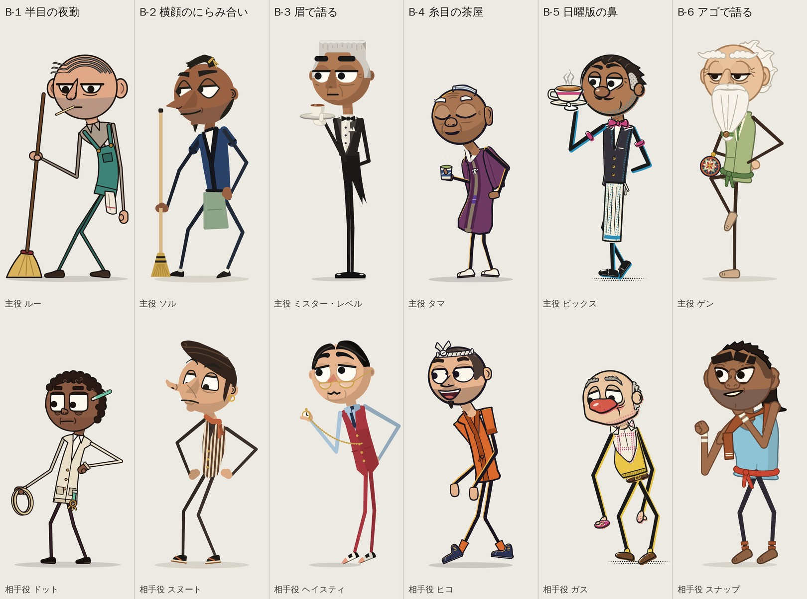

## 見分けられるか（レビュー担当）

結論：12人とも見分けはつきます。ただし、似ているペアが4組あります。

確認したもの：
- カラーの並び：/tmp/claude-0/-home-user-AI/a8d01661-3d44-5b73-963d-5c11d7fedaad/scratchpad/faces_big/lineup12.png
- 黒シルエット：/tmp/claude-0/-home-user-AI/a8d01661-3d44-5b73-963d-5c11d7fedaad/scratchpad/faces_big/lineup12_sil.png

どちらも上の段が主役、下の段が相手役で、元の大きさのまま並べています。シルエットは、腕と脚のすき間など閉じた背景も白く抜いて、正しい形にしてあります。

【シルエットだけでもすぐ分かる人（8人）】
- ソル：ちょんまげ＋長い鼻
- スヌート：リーゼント＋腰に手
- ルー：大きな耳＋浮いた毛＋つまようじ
- ゲン：雲みたいな髪＋片足立ち
- タマ：小さい丸い背中
- Mr. Level：平らな頭＋一番高い背
- ドット：もこもこ頭＋ペン
- スナップ：トゲ頭＋マレット＋こぶし
- （ヒコも、頭の上の結び目で分かります）

【似ているペア・弱いところ】
1. ソルとルー（どちらも、そうじのSOJI案）
   ほうきを前の手に持って、斜めに立てている形がまったく同じです。頭を見れば分かりますが、持ち物がかぶっています。
2. ビックスとMr. Level（どちらも、お茶を運ぶBRIMFUL案）
   黒い服の給仕が、カップを高く持っています。仕事・色・持ち物の3つが同じです。違いは背の高さと頭の形だけです。
3. ハスティとガス
   シルエットにすると、ただの丸い頭に耳が付いているだけです。ハスティは懐中時計で、ガスはガニ股と小ささで、かろうじて分かる程度。12人の中で一番弱いシルエットはハスティです。
4. 「メガネっぽい目」が3人
   ドットの角丸四角の目と、ルーの驚き顔は、どちらも四角いメガネに見えます。ハスティは本当にメガネをかけているので、3人がまぎれます。

【色でかぶっているところ】
- 緑が3人：ソルの前掛け（セージ）、ゲン（ピスタチオ）、ルー（ティール）
- 黒い服が2人：ビックスとMr. Level
- 水色：スナップのシャツとハスティの袖
- オレンジ系：ヒコの柿色とスヌートのテラコッタの手ぬぐい（小さいので問題は軽め）

肌の色は幅があって良いです。ただ、ソル・ビックス・Mr. Level・タマはほぼ同じ茶色です。

「目の形＋髪」の組み合わせは12人とも別で、かぶりはありません。

## 目の大きさと大人らしさ（レビュー担当）

【大きさ】
全体として、目ははっきり大きくなりました。スマホ縮小（シーンを横330px）にしても、6つのシーン全部で「誰がどこを見ているか」が読めます。
大きく見えるのは、ビックス、ドット、スナップ、ヒコ、ハスティ、スヌート。それと、ゲンとMr. Levelの驚き顔です。

ただし、ふだんの顔が半目か閉じ目の人が4人います：ルー（まぶた55%）、ゲン（65%）、タマ（閉じ目）、Mr. Level（35%）。
目の枠は大きいのに、見えている白目は細いので、オーナーが「目が大きくなってない」と感じるおそれがあります。

【大人らしさ】
ほぼ大丈夫です。キラキラのハイライトはどこにもありません。12人全員に、大人のしるしが入っています：
- ひげ・無精ひげ：ソル、ビックス、スナップ、ヒコ
- しわ・白髪：ルー、ゲン、タマ、ガス、Mr. Level
- ほうれい線や二重あご：スヌート、ハスティ

ビックスは、生えぎわ・口ひげ・あごのたるみで、30〜40代に見えるようになりました。前回の「若すぎる」問題は解決です。

注意が必要なのは3人です。
- ドット：小柄＋丸顔＋四角い大きな目なので、10代か子どもに見える瞬間があります。
- タマ：丸くて閉じ目の「かわいいおじいちゃん」です。たたかれる役にしなければ問題ありません。
- ガス：赤い団子鼻でピエロに見えます。

【サウスパークやC&Hとの違い】
ちゃんと別物になっています。全員、次の点を満たしています：
- 頭が丸い（下が平らではない）
- 首がある
- 両目のあいだに鼻がある
- まぶたとまゆがある
- 胴に服の面がある
サイアナイド&ハピネスやヘンリー・スティックミンには見えません。

いちばん近づくのは驚き顔です。ビックス、タマ、ゲン、Mr. Level、ルーの驚き顔は、「まぶたのない白い丸が2つ、ほぼくっついて、点の黒目」になります。8コマ以内の一瞬なら許せますが、ここが一番あぶない場所です。

ヒコ、ハスティ、ドットのふだんの顔は、サウスパークではありません。むしろ「カートゥーンネットワーク系のよくある顔」に寄っていて、個性はやや弱めです。

## まとめ（レビュー担当）

まとめ：「目を大きく」と「それぞれに特徴を」は、両方ともかなりできています。12人はカラーでもシルエットでも別人に見え、目の形と髪の組み合わせも全部ちがいます。サウスパークやC&Hにも見えません。前回の宿題（ビックスの若さ、チャーリー・ブラウンっぽい1本毛、割れ頭、ペパーミント柄のてまり、小さすぎる顔、後ろ髪、棒付きキャンディーに見える胴）も、ほぼ全部直っています。

おすすめの順位：
1. heavy_lids（ルー＆ドット）
2. nose_to_nose（ソル＆スヌート）
3. tall_order（Mr. Level＆ハスティ）
4. squint_house
5. sunday_nose
6. jaw_drop

残っている課題は5つです。
1. 似ている人：同じ案どうしで持ち物と仕事がかぶっています（ほうきのソルとルー、黒服の給仕のビックスとMr. Level）。それと、ハスティとガスのシルエットがただの丸い頭です。
2. 目が大きく見えない人：半目・閉じ目の4人（ルー、ゲン、タマ、Mr. Level）は、ふだんの顔だと大きな目が伝わりにくいです。
3. 若く見える・ピエロに見える：ドットは若く見え、ガスはピエロに見えます。
4. 危ない絵：jaw_dropのスナップのあご伸ばしは、差別的な似顔絵に見えるおそれがあります。
5. 絵柄のちがい：網点のsunday_noseと線なしのtall_orderは、他の案と絵柄がそろっていません。

作ったファイル：
- 12人のカラー並び：/tmp/claude-0/-home-user-AI/a8d01661-3d44-5b73-963d-5c11d7fedaad/scratchpad/faces_big/lineup12.png
- 黒シルエット：/tmp/claude-0/-home-user-AI/a8d01661-3d44-5b73-963d-5c11d7fedaad/scratchpad/faces_big/lineup12_sil.png
- 確認用の縮小画像や顔の切り抜き：/tmp/claude-0/-home-user-AI/a8d01661-3d44-5b73-963d-5c11d7fedaad/scratchpad/review12/

## 送る前に直したこと

アゴで語る案の場面で、相手役スナップ（肌の色が濃いキャラ）のアゴを大きく伸ばし、金歯と大きな前歯をのぞかせていた。差別的な似顔絵の型に見えるおそれがあるため、ふつうの驚いた口に直した（アゴの伸びは0.52→0.16、金歯と前歯はなし）。アゴが伸びるギャグは師匠ゲンだけにする。

## B-1 半目の夜勤（レビュー 1位）

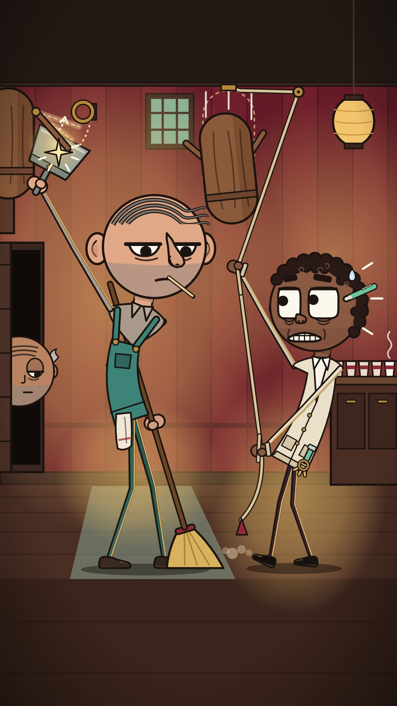

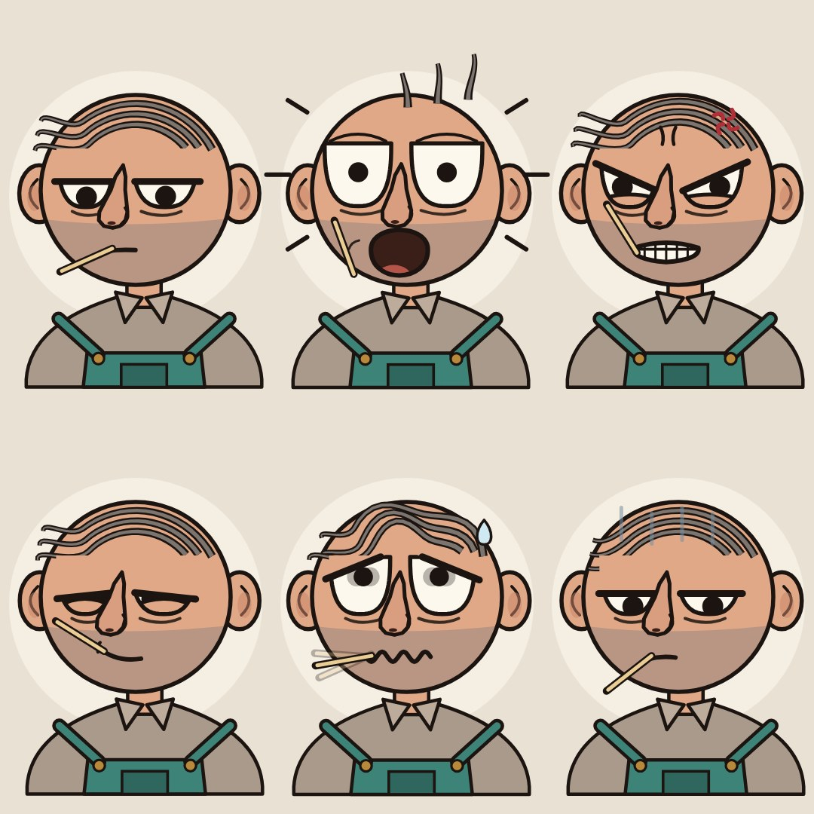

一番いい案です。ルーの半目＋つまようじの無表情と、ドットの四角い目の「バレた」顔は、正反対の性格がひと目で分かります。表情シートは6つとも一番読みやすく、とても大人っぽいです。シーンも分かりやすいです（ドットを見たまま、ダミーを見ずにちりとりで受ける）。弱いところは3つ。ルーの驚き顔が四角いメガネに見えること、ドットが若く見えること、ほうきがソルとかぶることです。

### 主役 Lou

夜勤の清掃員。
いつも眠そうで、何が起きても表情が変わらない。
でも木人の攻撃は、見もしないで全部受け流す。

上が平らなおわん形の大きな目。重いまぶたが水平にかぶさる「ジト目」
左右のまぶたの線がそろうと、顔に横一本の線ができる
まゆ毛なし（まぶたの線がまゆの代わり）
はげ頭に3本のバーコード髪。毛先が反対側でぴょんと浮く
大きく張り出した耳
口にくわえたつまようじ。気分で角度が変わる
顔の下1/3は無精ひげ（平塗り）
ティールのつなぎの胸当て、腰にぞうきん
ねこ背で、足を引きずるように歩く

### 相手役 Dot

夜間の警備員で、いたずら好き。
コーヒーは今夜5杯目。
Lou を驚かせようと仕掛けを引くが、あわてるのはいつも自分。

角の丸い四角い大きな目（テレビ画面みたい）。いつも見開いている
目の下に二重のクマ
短い太めの直線まゆ。いつも上がりぎみ
細かいカールの短い髪
耳の上にミント色のボールペン
小さな上向きの鼻
クリーム色のカーディガン、ミント色のストラップと鍵の束
小柄。後ろにそってロープを引き、ちょこまか動く

よく出た所

【ルー】目は上が平らなおわん形です。大きさは高さ0.30D・幅0.34D（Dは頭の円の直径）。ふだんはまぶたが55%かぶさり、左右のまぶたの線が横一直線にそろいます。まぶたの線はいちばん太い線で0.036D、まゆ毛の代わりです。黒目は0.11Dでおわんの底にとまります。目の下にしわを1本入れました。頭ははげで、3本のバーコード髪の毛先が反対側でぴょんと浮きます。前回のチャーリー・ブラウンっぽい1本カールはやめました。ほかに、大きく張り出した耳、たれた洋なし形の鼻（幅0.15D）、顔の下1/3の無精ひげ（点々をやめて平塗り）、つまようじがあります。つまようじは気分で角度が変わり、驚くと口から落ちます。服はティールのつなぎの胸当てで、腰にぞうきんをさげています。ねこ背です。
【ドット】目はテレビ画面のような、角の丸い四角です（高さ0.34D、まぶた10%）。目の下に二重のクマ、短く太い直線のまゆ。髪は細かいカールの短髪で、頭の輪郭がでこぼこになります。耳の上にミント色のボールペンをさしていて、シルエットでは頭の後ろに突き出ます。小さな上向きの団子鼻（幅0.135D）、口の両わきにしわ。クリーム色のカーディガンに、ミントのストラップと鍵の束。小柄で、少し後ろにそって立ちます。
【表情6つ】口だけでなく、まぶたの角度・下まぶた・黒目の位置で目の形を変えています。怒りは目頭側のまぶたが下がり、下まぶたも上がります。心配（パニック）は目頭側のまぶたが上がり、黒目がぶれます。ドヤ顔は細目で横目、うんざり横目は黒目を端に押しつけます。驚きはまぶたが消えて目が少し大きくなり、毛が3本とも立ちます。270pxの縮小でも6つとも区別できます。
【シーン】ルーは壁のダミーを見ないまま、ちりとりで受けます。半目の視線はドットに固定したままです。ドットはロープを引いたまま固まり、四角い目とむき出しの歯で「バレた」顔をしています。二人の黒目はお互いの目に向いています。135x240の縮小でも二人の目と表情は読めます。
【見分け】黒シルエットでも見分けられます。ルーは耳・浮いた毛先・つまようじ・ねこ背・ほうき。ドットはもこもこ頭・ペン・小ささ・腰に手。胴には胸当てとカーディガンの面があるので、棒つきキャンディには見えません。
【サイズ】hero（ルー）は900px、partner（ドット、小柄）は780pxです。描画したシルエットで実測し、上端110/230、足裏 y=1010 に合わせました。

まだ弱い所

・ルーの驚き顔は、上が平らなおわん目が2つ並び、その間に鼻筋が上がっているので、一瞬「四角いメガネ」に見えます。目の上にまぶたのしわの弧を足して弱めましたが、ゼロにはなっていません。
・ルーはふだん半目なので、見えている白目は高さ0.135Dだけです。目の枠は大きくなりましたが、「目が大きくなった」といちばん感じられるのはドットと、ルーの驚き・心配の顔です。
・ドットの太いまゆは髪の生えぎわのすぐ下にあります。スマホくらいの大きさだと、髪と少しくっついて見えます。
・ほうきはR-1のソルも持っています。12人を並べると「ほうきの人」が2人になります（ただし耳・ねこ背・つまようじで別人とは分かります）。
・カードのドットが持つロープの輪は、シルエットにすると黒い丸のかたまりになります。
・シーンの構図は前回と同じです（新しい場面ではなく、顔と体を描き直しました）。
・ルーの怒り顔に、マンガ的な赤い「怒りマーク」を小さく入れています。気になる場合は消せます。

## B-2 横顔のにらみ合い（レビュー 2位）

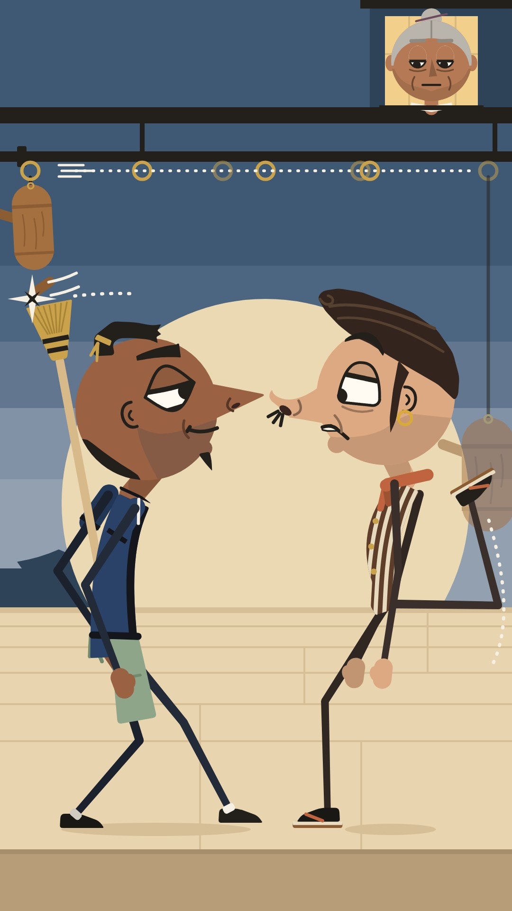

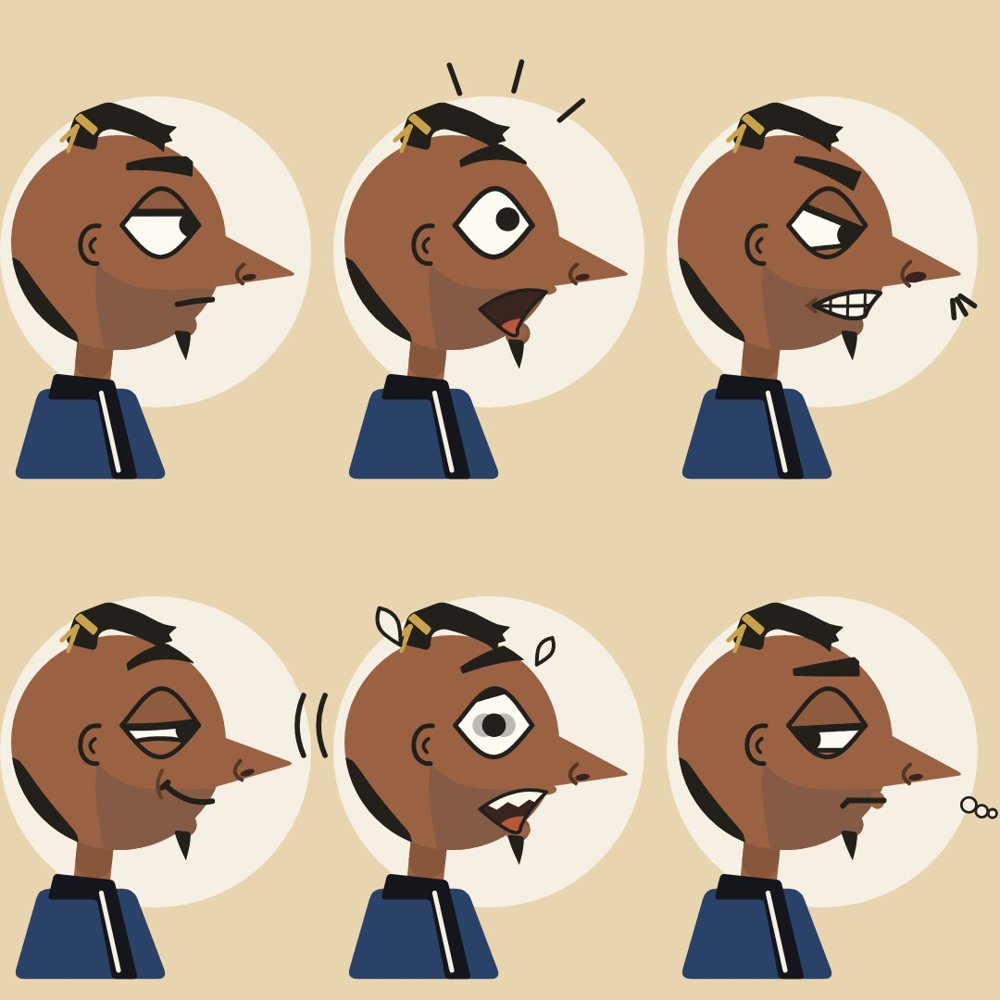

お笑いの設定は一番強いです。鼻をつき合わせてにらみ合ったまま、後ろのダミーを見ずにさばくので、言葉なしでも世界中で通じます。シルエットも構図もとても読みやすいです。弱いところは4つ。顔がほぼ横向きと3/4だけで、正面の大きな目の魅力をまだ見せていないこと。スヌートの腕が棒立ちで、気取った性格が出ていないこと。3/4の顔がごちゃっとすること。ほうきがルーとかぶることです。

### 主役 Sol

無口で負けず嫌いな夜の掃除番。
にらみ合いになったら、絶対に先に目をそらさない。
顔は相手に向けたまま、背中ごしのほうきだけで木人をさばく。
ちょっと見栄っぱりな職人。

横顔が基本。くさび形の長い鼻が丸い頭から大きく飛び出す
大きなアーモンド形の目。黒目はいつも相手のほうへ寄っている
上まぶたが少しかぶさった、すわった目つき
黒いちょんまげを真ちゅう色のひもで結ぶ
後ろ髪はうなじの細い帯だけ。頭の丸がはっきり見える
あごの先に小さなひげの房
紺の半纏に、セージ色の前掛け
低く構えたガニ股。相手に向かって少し前のめり

### 相手役 Snoot

気取り屋のライバル。
鼻をツンと上げて、相手を見下ろすのが得意。
自信満々に見えて、実はすぐ焦る。
焦るほどポーズが大げさになる。

上を向いたスキージャンプ形の鼻
前に張り出した短めのリーゼント
下まぶたが平らな「ガムドロップ形」の目。見下す目つき
細く高いアーチ形のまゆ。片方だけクイッと上がる
長いもみあげと、金の輪っかのイヤリング
こげ茶と生成りのしまのベスト、首にテラコッタの手ぬぐい
胸をそらし、あごを上げて歩く。脚が長い。草履

よく出た所

・目を大きくした。ソルは頭の直径の0.32倍のアーモンド目、スヌートは0.30倍のガムドロップ目（下がまっすぐ）。目の形は変えずに、まぶた・まゆ・黒目の位置で表情を出している。表情シートの6つ（ふつう・びっくり・怒り・したり顔・パニック・あきれた横目）は、270pxに縮めても見分けがつく。
・にらみ合いの場面：ソルは低く構えて下から見上げ、スヌートはあごを上げて上から見下ろす。黒目はおたがいの目に向いている。二人とも後ろの木人を見ないままさばいている（ソルはほうきを背中に回して、スヌートはかかとでけって）。窓のおばあさんが無表情でそれを見ている。
・見分けやすさ：黒いシルエットだけでも分かれる。ソルは「ちょんまげ・くさび形の鼻・ほうき・ガニ股・前掛け」、スヌートは「リーゼント・上向きの鼻・金の輪っかのイヤリング・長い脚・腰に手」。目とまゆだけを切り抜いても、ソルは「アーモンド目・重いまぶた・くさび形の太いまゆ」、スヌートは「ガムドロップ目・軽いまぶた・細いアーチまゆ（3/4では片方だけ上がる）」で分かる。
・前回の指摘への対応：後ろ髪は、ソルはうなじの細い帯だけ、スヌートは頭の上だけにして、頭の丸がはっきり見えるようにした。胴には半纏（衿が交差するV字と白い下着）と前掛け、スヌートにはしまのベストとテラコッタの手ぬぐいを着せたので、頭が棒付きキャンディに見えない。手ぬぐいは横で結んで、蝶ネクタイ（Bix）に見えないようにした。
・大人らしさ：ソルは無精ひげ（点ではなく平塗り）とあご先のひげの房。スヌートは長いもみあげ、目の下のたるみ線、ほうれい線、鼻で笑う口元。白目は真っ白ではなく生成り色で、ハイライトや星は入れていない。サウスパーク・C&H・ヘンリー・スティックミンのチェックは全部通っている（目がくっつかない、たて長の楕円ではない、まぶたがある、首がある）。
・サイズ：単体の2枚は、足の裏から頭のてっぺん（まげ・リーゼント込み）まで実測900.1px、足の裏はy=1010。頭の割合はソル27%、スヌート25.2%。目の高さは身長の8.6%と7.6%。まぶたの線はスマホ（横360px）で3.5pxの太さになる。

まだ弱い所

・スヌートのリーゼントは、黒シルエットにすると角度によってはまだ少し「帽子のつば」っぽく見える（とくに3/4）。
・3/4の顔は、遠い方の目が鼻と鼻の影に半分かくれるので、少しごちゃっとして見える。
・シーンの右端がきゅうくつ。スヌートのけり足のひざが画面の右端ぎりぎり（x=1051）にある。けっている動きは読み取れる。
・シーンのスヌートは両腕をまっすぐ下ろしているだけで、気取った性格が手に出ていない（髪をなでるポーズを試したら、けり足と線がからまったのでやめた）。
・ソルは横向きだと、半纏が細い板のように見える。半纏らしく見えるのは3/4の方。
・表情シートの「パニック」は、黒目の震えを薄い残像で描いているので、静止画だと少し弱い。
・二人とも40歳以下の想定なので、年齢のサイン（しわ・たるみ）はスヌートの目の下の線とほうれい線だけで控えめ。白髪はいない（窓のおばあさんだけ）。
・ちょんまげは前より太くしたが、小さく縮めたシルエットでは頭の上の小さなでっぱりにしか見えない。

## B-3 眉で語る（レビュー 3位）

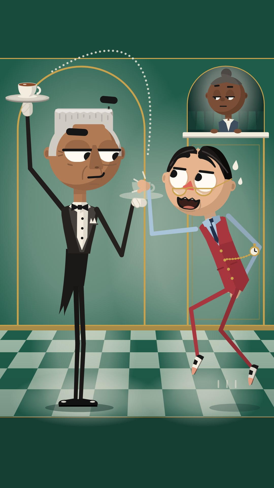

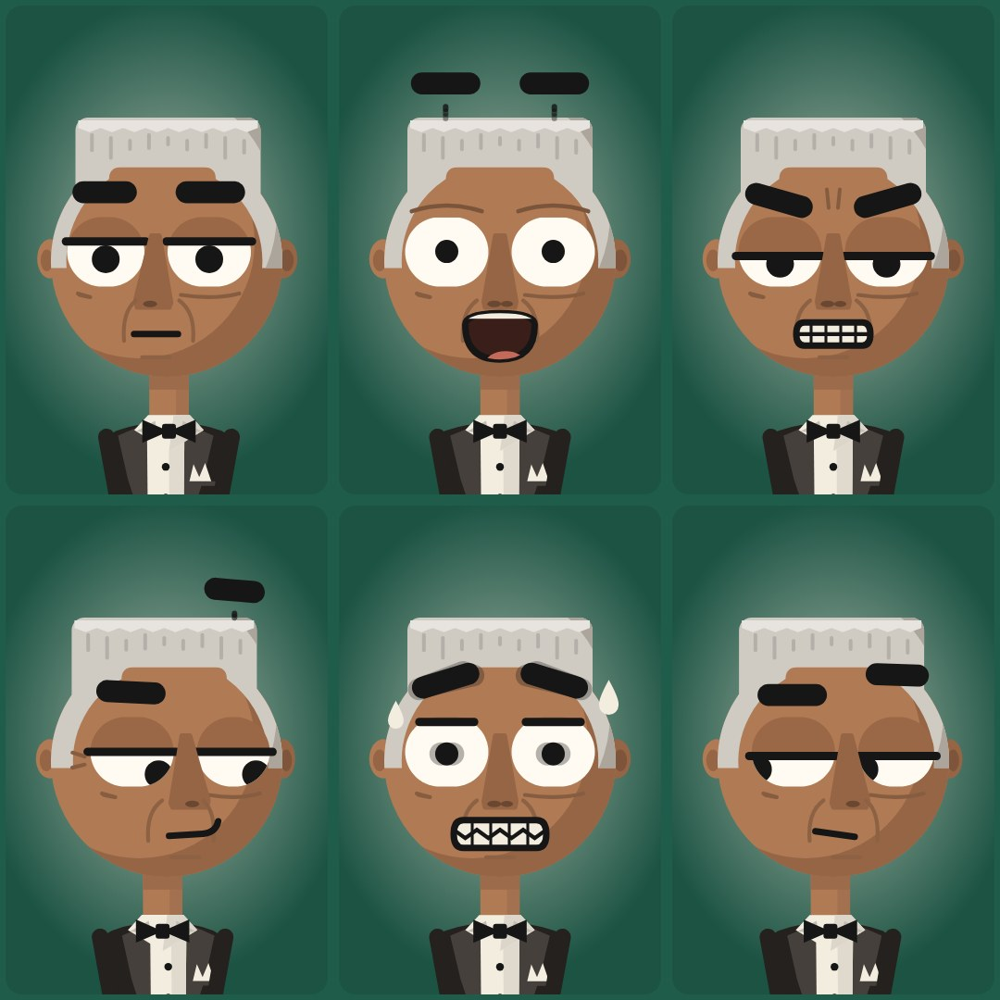

Mr. Levelの、顔から離れて浮くまゆは、12人の中で一番おもしろい仕掛けです。背の高さのギャグと、あわてるハスティのメガネ顔も、すぐ伝わります。ただし、灰色のフラットトップが「コック帽・紙の帽子」に見えるのは大きな問題です。ほかに、ビックスと仕事も服の色もかぶること、ハスティのシルエットが弱いこと、線なしの平塗りで他の5案と絵柄が合わないことも気になります。

### 主役 Mr. Level

一流ホテルの給仕長。
顔はいつも水平で、無表情。
気持ちは全部まゆ毛に出る。
トレーのお茶は一滴もこぼさない。

横長のカプセル形の大きな目。上まぶたはいつもピタッと水平
顔から離れて動く太い棒まゆ。ギャグの時は頭の上まで浮く
銀髪のフラットトップ。定規で引いたように真っ平ら
長くまっすぐな鼻
ひげなし。銀のもみあげも水平にカット
黒い燕尾服に白い胸当てと蝶ネクタイ、白手袋、胸ポケットに三角のチーフ
キャストで一番背が高い。背すじピン、かかとをそろえて立つ

### 相手役 Hasty

いつも急いでいる、せっかちな客。
トレーのお茶を取ろうと飛びつくが、いつも一歩おそい。
あせると、すぐ汗が出る。

まん丸の大きな目。心配そうに八の字に上がったまゆ
鼻先にずり落ちた半月形の老眼鏡
まん中分けで、ぴったりなでつけた黒髪
小さくとがった鼻。あせると赤くなる
えんじ色のスリーピースのベスト、金の懐中時計の鎖
いつも15度前のめり。つま先で走り、ひじを張る

よく出た所

【Mr. Level】目を横長のカプセル形にして、幅を頭の0.36まで大きくしました。上まぶたは定規で引いたように、いつも水平です。ふだんは上の35%がまぶたでかくれるので、目は横長のすき間のように見えます。感情は、顔から離れて動く太い棒まゆと、黒目の位置と、まぶたの高さ（水平のまま上下するだけ）で出しています。表情シートの6つ（ふつう、びっくり、怒り、得意げ、あわて、あきれた横目）は、口をかくしても目とまゆだけで見分けられます。びっくりと得意げでは、まゆが頭の上まで浮きます（眉で語るギャグ）。髪は銀のフラットトップで、てっぺんは真っ平らです。床屋で整えたような角ばった生えぎわが、こめかみを通ってもみあげまでつながり、もみあげの下は水平に切りそろえています。前の版のように髪が帽子っぽく見えないよう、この形にしました。長くまっすぐな鼻、ほうれい線、あごの水平なしわ、目の下のたるみ、目じりの小じわで、大人に見えるようにしています。体は黒い燕尾服のどう体（白い胸当て、サテンのえり、三角のチーフ、燕尾）、白手袋、かかとをそろえたV字立ちです。棒の胴ではなく服の面があるので、頭が棒つきキャンディーに見えません。
【Hasty】まん丸の大きな目（0.32）に、八の字の「心配コンマまゆ」です。鼻先までずり落ちた金ぶちの半月形老眼鏡ごしに、上目づかいで見ます。小さくとがった鼻は、あせると赤くなります。まん中分けの黒髪は頭にぴったりで、分け目のところで頭の形が少しへこむので、黒い影だけでも分け目がわかります。あごのたるみの線と二重あごで、大人らしさを出しています。服はえんじ色のベスト（金ボタン、ポケット、金の懐中時計のくさり）、水色のシャツのそで、紺のネクタイ、えんじのズボン、コンビの靴です。いつも15度前のめりで、つま先立ちで、ひじを外に張っています。
【シーン】「すり替え」の一瞬です。Mr. Levelは背すじをのばし、かかとをそろえたまま一歩も動きません。トレーはもう頭の上の高いところにあって、手前の手のひらは空っぽのまま上を向いています（トレーの残像だけが残っています）。Hastyはジャンプして残像をつかんでいますが、両目はもう本物のカップのほうを見ています。Mr. Levelは半目でHastyを見下ろし、片方のまゆが頭の上に浮いています。窓口の店員（ちょい役）は無表情で見ています。135x240の縮小でも、二人の目の向きと表情は読めます。黒い影だけにしても、Mr. Levelは平らな頭と一番高い背でひと目でわかります。Hastyは前のめりの姿勢、懐中時計、分け目のへこみでわかります。
【決まりごと】サウスパーク対策（目がくっつかない、たて長の楕円にしない、点の黒目にしない、まぶたを必ず付ける、首がある）も、Cyanide & Happiness対策も確認しました。キラキラのハイライトや画像内の文字はありません。hero/partnerの高さは、黒い影を画像で測って合わせました（Mr. Level 960px、Hasty 900px、足の裏はどちらもy=1010）。

まだ弱い所

・フラットトップは、ごく小さいサイズや黒い影だけにすると、四角い帽子（トップハットやトルコ帽）にも見えることがあります。仕様どおり真っ平らにした結果の、しかたない弱点です。
・カプセル目の外形は 0.36×0.30 で、縦横の比は1.2:1しかありません。そのため、まぶたのないカプセル全体が見えるのは、びっくりの一瞬だけです。その一瞬はDotの角丸四角の目と少し似る心配があります。ふだんは水平なまぶたがかぶさっているので、横長のすき間に見えて区別できます。
・Hastyの髪はぴったりなでつけた設定なので、影の上ではあまり出っぱりません。影テストは姿勢、時計、分け目の小さなへこみに頼っています。Bix（オールバック）と影がまぎれないかは、12人を並べた画面で確かめてください。
・まぶたの線は仕様の上限の0.036Dです。それでもスマホ（360px幅）に換算すると、シーンではMr. Levelが約3.5px、Hastyが約3.2pxで、Hastyは3.5pxの目標にわずかに届きません（仕様の数字どうしが少し食いちがっているためです）。
・シーン上部の濃い緑の帯（約230px）は空いたままで、点線の軌道が少しはみ出しています。
・Hastyの水色のそでは、明るい背景の上だと少しうすく見えます。partner画像では、後ろのひじが右はしまで12pxのところまで来ています。

## B-4 糸目の茶屋（レビュー 4位）

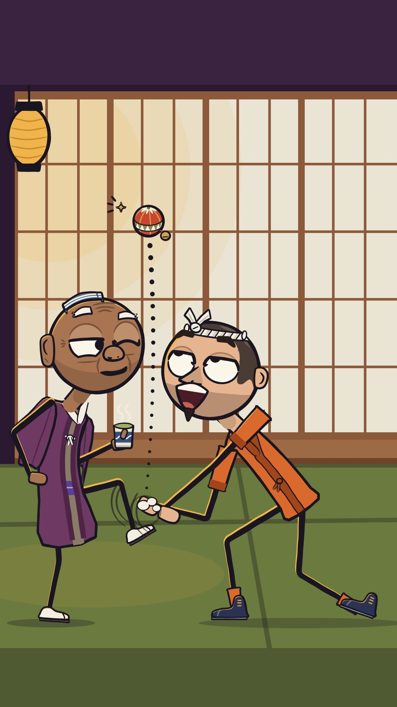

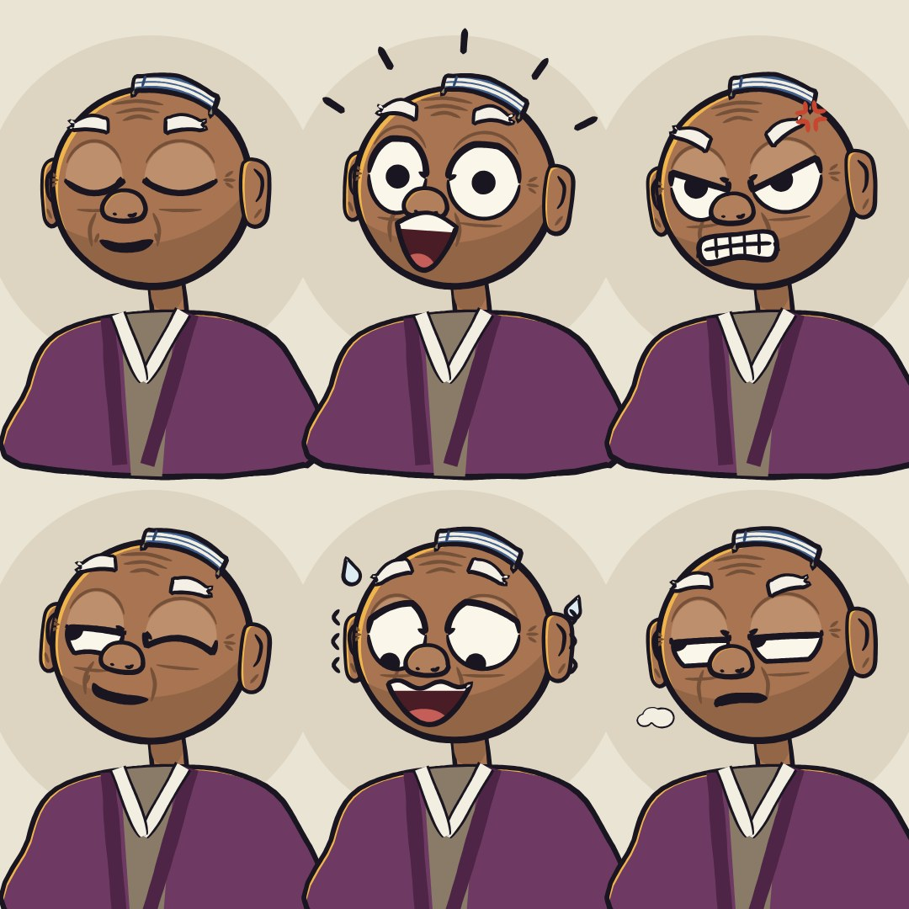

タマのウインク＋足で玉をはね上げる動きと、空振りするヒコは分かりやすく、気持ちのいい一瞬です。ただ、タマはふだん閉じ目なので「大きな目」が伝わりません。驚き顔は、サウスパークに一番近い「くっついた丸目」になります。ヒコはよくあるカートゥーン顔です。手ぬぐいは、しま模様の帽子に見えます。

### 主役 Tama

茶屋の小さな老主人。
いつも目を閉じて、にこにこしている。
お茶をすすりながら、手まりは決して落とさない。
本気で驚いた時だけ、目がまん丸に開く。

ふだんは閉じた目。大きな弧のまぶたと、目じりの笑いじわ
驚くと一瞬だけ、まん丸の大きな目が開く
つるつるのそり頭に、たたんだ手ぬぐいをちょこんとのせる
ふっくら長い耳たぶ
横に広い丸い鼻。ひたいに3本のしわ
短い白いまゆ。驚くとピョンと上がる
プラム色の羽織と紫の帯。手にはいつも湯のみ
一番背が低い。背中が丸く、ちょこちょこ歩く

### 相手役 Hiko

熱血でおっちょこちょいな見習い。
全力で飛びかかっては、手まりに届かない。
大げさにあわてるが、すぐケロッと立ち直る。

横長だ円の大きな目。いつも見開きぎみ
ねじりはちまきを前で結ぶ。結び目が頭の上にピョコッと出る
短い丸刈り
とがった三角の鼻
無精ひげと、あご先のちょびひげ
柿色の作務衣
ひょろ長い手足で内股。いつも前に突っ込む姿勢

よく出た所

【できたこと】
・目を大きくしました。タマの目は閉じていても大きく見えるように、目の形（高さ0.36D）をまぶたの色で塗り、太いまぶたの線・まつげの跳ね・目じりの笑いじわを描いています。眠っているような、満足げな顔に見えます。驚くと、0.38Dのまん丸な目がパッと開きます。
・6つの表情（ふつう／驚き／怒り／得意げ／あせり／あきれた横目）で、目そのものが変わります。まぶたの下がり方と傾き、下まぶた、黒目の位置、眉の高さと角度を毎回変えていて、口だけで表情を作ってはいません。得意げはウインクと半目ののぞき見、あせりは八の字のまぶたで黒目が下（落ちる玉）を見ています。
・ヒコの目は横長のだ円で、上まぶたが15%かぶさるので、上がやや平らな「横長」に見えます。眉は太くて、途中で折れて上がる形です。とがった三角の鼻、無精ひげ（点ではなく平塗り）、あごのちょびひげ、丸刈り、ねじりはちまき（前に結び目があって、端が2本頭の上に飛び出す）、柿色の作務衣、紺の地下足袋、ひょろ長い内股、前のめりの姿勢。全部、仕様どおりに入れました。
・タマは一番背が低く（780px）、背中が丸く、プラム色の羽織の中に紫の帯と生成りの半襟、白い足袋をはいています。手には湯のみ、頭にはたたんだ藍の手ぬぐい、耳たぶは長い福耳。横に広い丸鼻、額の3本じわ、短い白い眉（驚くと跳ね上がる）、ほおのたるみも描きました。前回の長い白ひげは、Genと似てしまうので外しています。
・黒ベタのシルエットでも見分けられます。タマは「頭の上の平らな手ぬぐい＋長い耳たぶ＋丸い背中＋羽織＋湯のみ」、ヒコは「頭の前のV字の結び目＋あごひげ＋長い手足＋内股」です。目と眉だけを切り抜いても、閉じた弧と半目のタマ、横長だ円のヒコで区別できます。
・サウスパーク対策の確認：両目はくっついておらず（すき間0.10〜0.11Dに鼻が入る）、太いまぶた線があり、黒目は大きめ（0.115〜0.12D）、首もあります。斜めから見た顔なので、奥の目は76〜80%に縮めています。数値も全部確認しました。目の中心は頭頂から0.46D、目の上端は0.27D以上下、まぶた線は0.032〜0.033D、ふちは0.021D、白目は#FBF6EAです。
・手まりは、ペパーミントのようなうず巻きをやめました。赤地に金の地割り線、赤道に生成りと緑のうろこ模様、てっぺんに菊を入れた、本物の糸かがりの柄です。
・シーン：ヒコが玉に飛びつきますが、タマが足の甲で玉を真上にはね上げていて、ヒコの手は空をつかみます。タマは湯のみを持ったまま、片目だけ開けて横目でヒコを見て、ニヤリとしています。ヒコの両目は上の玉を追い、眉を上げて口をあんぐり開けています。誰もたたかれていません。
・棒の胴体には、それぞれ衣装の面（羽織・作務衣）をのせたので、頭がペロペロキャンディーのようには見えません。

まだ弱い所

【弱いところ（正直に）】
・ヒコの奥の目は、斜め顔の縮小ルール（76%）のせいで、ほぼ丸に見えます。横長だ円らしさは、手前の目と、平らぎみの上まぶたに頼っています。
・ヒコの丸刈りは、頭の後ろ半分の「濃い茶色の面」にしか見えないときがあります。はちまきの結び目の端は、小さいサイズだと白い葉っぱや羽のようにも見えます。
・作務衣は、ほぼ一枚のオレンジの板です。手前の袖も、肩にのった四角い布のように見えます。ズボンは足首のすそだけで表しました。
・タマの手ぬぐいは、見ようによっては「しま模様の帽子のつば」に見えます。脚は細い棒のままなので、「一番小さい」と感じさせているのは、ほぼ全体の大きさの差です。
・シーンの上3分の1は、天井とふすまだけで空いています。ヒコの手がタマの足首をつかんでいるようにも見えるので、空振りの印として、白いけむりと動きの線を足しました。
・手まりの柄は、スマホの小さい画面だと「赤いしま玉に、ギザギザの帯」くらいにしか見えません。
・顔のシートの胸元（羽織）は、6コマとも同じ形です。
・前回のシーンにいた茶屋のおばあさん（カメオ）と、ちゃぶ台・急須は、画面をすっきりさせるために外しました。

## B-5 日曜版の鼻（レビュー 5位）

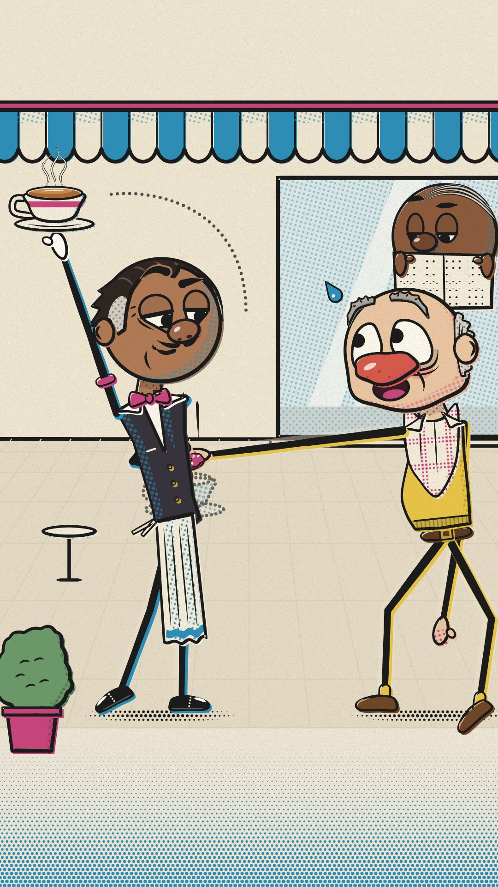

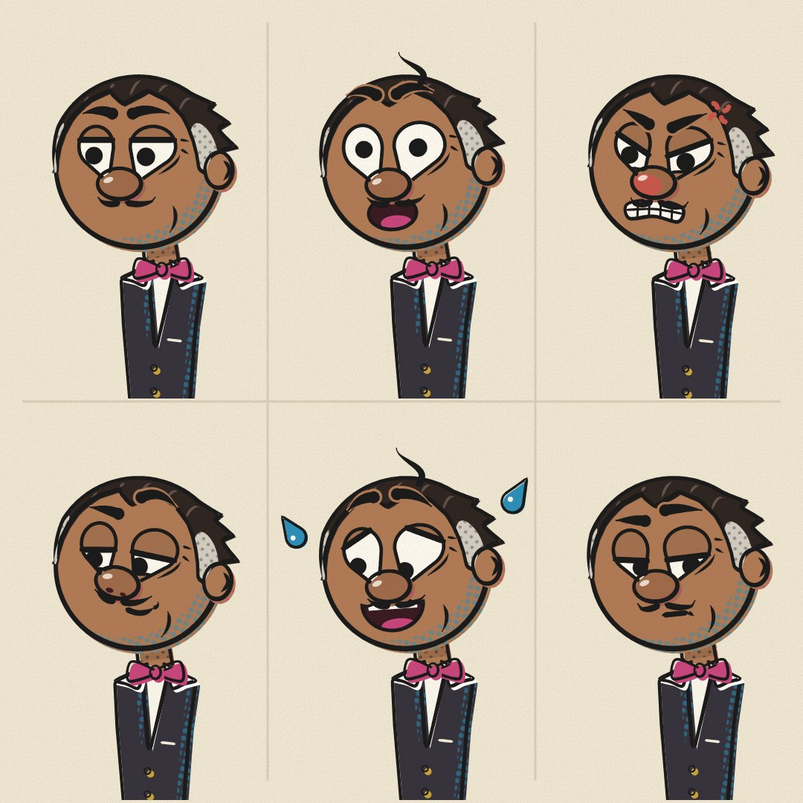

ビックスは大人っぽくなって、表情も豊かで魅力的です。ただ、グレーのもみあげは、点々の模様のせいで耳当てか補聴器に見えます。ガスは赤い鼻でピエロに見えます。網点とずれ印刷の絵柄はおしゃれですが、スマホだとうるさく見え、他の案と合いません。お笑いは「カップを高く上げて逃がす」だけなので、少しおだやかです。

### 主役 Bix

ベテランの給仕。
どんな手が伸びてきても、涼しい顔でカップを守る。
ちょっとキザで、決めポーズの時だけ目が笑う。

しずく形の大きな目が、丸い団子鼻の上にのっている
上まぶたが少しかぶさった余裕の目つき。目の下に小じわ
なでつけたオールバック。こめかみに白髪
鉛筆で引いたような細い口ひげ
ほおの下にたるみの線が1本
黒いベストにローズ色の蝶ネクタイ、腕にローズ色のアームバンド
長い白エプロン。つま先立ちで軽やか、片足立ちでカップを掲げる

### 相手役 Gus

食いしんぼうの常連客。
人のカップを見ると、手が勝手に伸びる。
悪気はなく、見つかるとすぐ真っ赤になる。

赤いジャガイモ鼻。キャストで一番大きい鼻
目じりが下がった、たれ目の大きな目。目の下にふくらみ
もじゃもじゃの灰色まゆ毛
はげ頭に、耳から耳へ灰色の馬てい形の髪
ほっぺが赤く、両ほおがたるんでいる
首にナプキンをよだれかけのように差し込む
からし色のセーターベストにベルト
背が低くてガニ股、前のめり。腕だけ長い

よく出た所

・目が大きくなりました。黒目もはっきり大きく（白目の幅の4〜5割）、スマホの縮小サイズでも、だれがどこを見ているかがわかります。シーンでは、Bixはすました目でGusを見下ろし、Gusは目を見開いて頭上のカップを見上げています。窓の新聞おじさんは、半分閉じた目でドーナツを見ています。
・目の形は2人で別にして、表情で形を変えないようにしました。Bixは鼻にのった「しずく形」、Gusは目じりが下がった「たれ目」です。表情は、まぶた、黒目、まゆ、口だけでつけています。目のまわりだけ切り抜いても、どちらか見分けられました。
・Bixが若く見える問題を直しました。生えぎわが後退したオールバックにしてM字の富士額をつけ、こめかみからもみあげをグレーにしました。ほかに、鉛筆で引いたような口ひげ、あごのたるみの線、目の下の小じわ、目じりの笑いじわを足しています。後頭部の毛先が少し跳ねるので、黒い影だけでも見分けがつきます。
・表情シート6つ（ふつう、驚き、怒り、得意げ、パニック、あきれた横目）は、目の描き方がそれぞれ違います。驚きは、まぶたが上がって白目が全部見えます。怒りは、まぶたが鼻側に下がります。得意げは、上下のまぶたで目を細くします。パニックは、まぶたとまゆが八の字になります。横目は、重いまぶたの下で黒目を端に寄せます。
・Gusは、でこぼこで毛穴のある赤いジャガイモ鼻、目の下のふくらみ、垂れたほお、ボサボサで目じり側が垂れた灰色のまゆにしました。ナプキンは首に差し込んで、角が2つピンと立つようにしています。胴体はからし色のニットベストとベルト、手足はガニ股で長い腕です。
・棒の胴体には、どちらも服の面をつけました。Bixは黒ベストと白シャツのV、Gusはニットベストとナプキンです。これで頭が棒つきキャンディーに見えなくなりました。
・hero.pngは身長900px、partner.pngは780px（背が低い設定）で、どちらも足の裏をy=1010にそろえています。頭の大きさは身長の26.4%と28.4%です。

まだ弱い所

・目の下の小じわや目じりのしわは細いので、スマホサイズではほぼ消えます。小さくても大人に見えるのは、口ひげ、後退した生えぎわ、グレーのもみあげ、太いまぶたの線のおかげです。
・Bixのあごのたるみの線は、遠目だと口の横の「にやり線」にも見えます。
・Gusは大きな赤い鼻と丸い目なので、少しピエロっぽさが残っています。鼻をでこぼこにして毛穴を足し、目の下のふくらみも足して和らげましたが、気になるなら鼻の赤をもう少しレンガ色に寄せる手があります。
・Gusは頭を身長の29%以内に収めるために脚を長めにしました。そのぶん「短い脚のずんぐり体型」には見えません。背の低さは、並べたときの身長の差で見せる形です。
・Gusは鼻がとても大きいので、斜めを向くと奥の目が鼻に隠れぎみになります（ルールでは許されている範囲です）。
・シーンのGusは、驚いた瞬間なのでまぶたがありません（8コマ以内のルールに当てはまる場面）。止め絵だけ見ると、まぶたのない大きな目に見えます。
・テストは目で見て確認しただけで、ほかの5デザインの新しいキャラとはまだ並べて比べていません。

## B-6 アゴで語る（レビュー 6位）

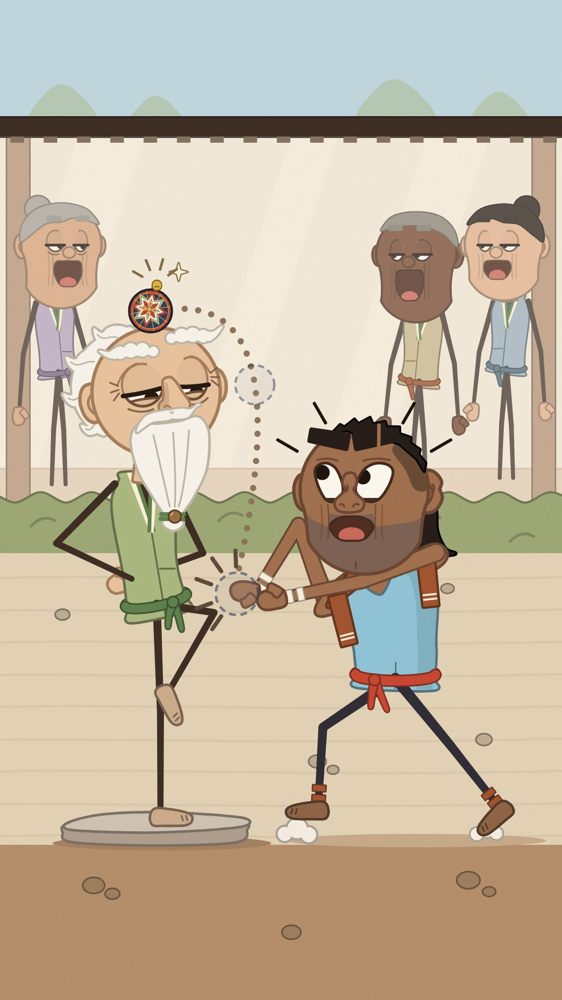

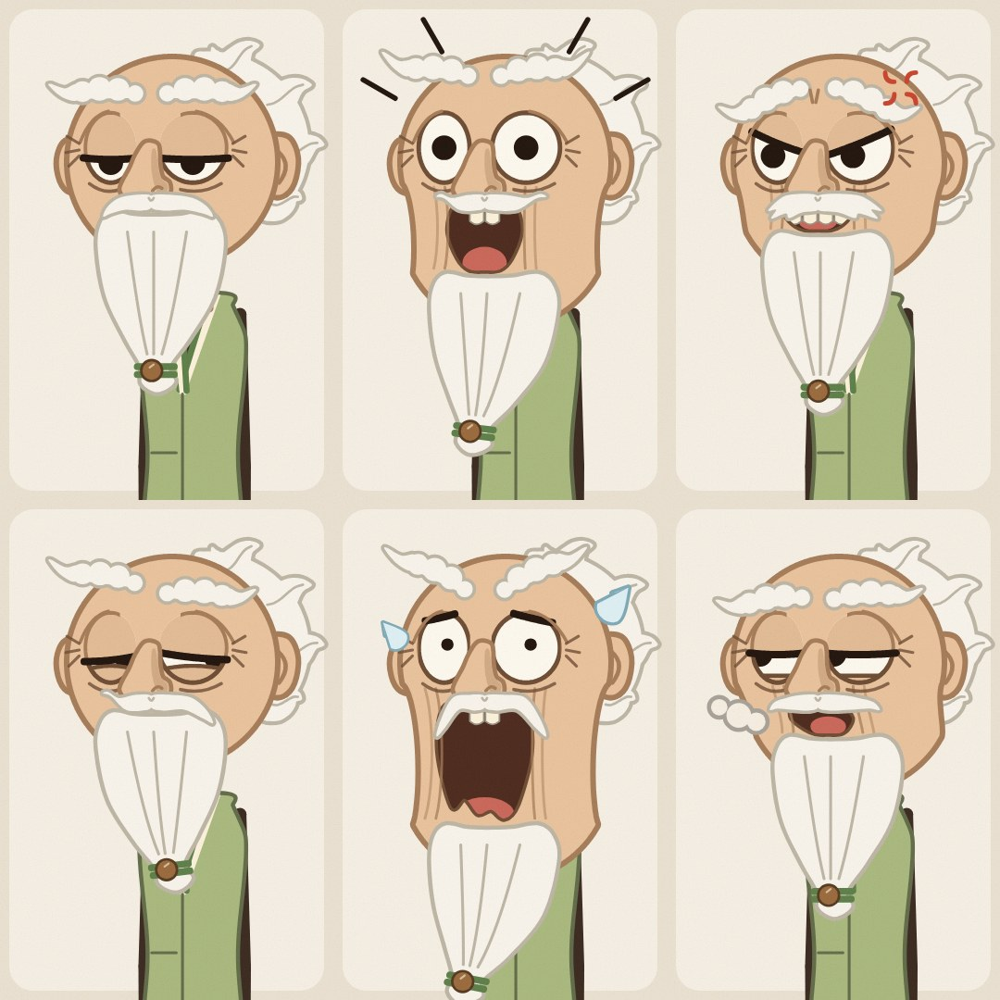

あごの継ぎ目はなくなって、ゴムみたいに伸びるギャグになりました。前回の指摘は解決です。てまりの柄もペパーミント飴には見えなくなりました。ただ、スナップは肌が濃い色で、あごを伸ばすと無精ひげの面が茶色い「口先」になり、金歯と大きく開いた口が加わります。差別的な似顔絵（サルやミンストレルの類型）と受け取られるおそれがあり、世界向けチャンネルには一番危ない絵です。ゲンは「白ひげの拳法の師匠」というよくある型そのものです。シーンは見物人3人のせいでごちゃついています。

### 主役 Gen

居眠りばかりの老師。
半分寝ているのに、手まりは絶対に地面に落とさない。
本気で驚くと、アゴがゴムのようにビヨーンと伸びる。

重いまぶたがかぶさった丸い大きな目。下から黒目がちらっとのぞく
雲のようなもこもこの白いまゆ。頭の外まではみ出す
後ろへなびく白い波形の髪
胸まで届く長い白ひげ。先を緑のひもと木の玉で結ぶ
ワシ鼻
アゴはゴムのように下へ伸びる。閉じるとつなぎ目のないまん丸
ピスタチオ色の重ね襟ベスト、緑の帯
背が高くひょろ長い。片足立ちで、手は後ろで組む

### 相手役 Snap

力自慢でせっかちな弟子。
手まりを奪おうと突っ込んでは、空振りする。
悔しいとアゴがあんぐり、横にずれて伸びる。

目じりがキュッと上がった大きな目（やる気まんまん）
太くまっすぐなまゆ。いつも眉間に寄っている
マレットヘア（上と横は短く、えり足だけ長い）
少し曲がったボクサー鼻
アゴが伸びると金歯が1本見える
無精ひげ（平塗り）、首にシナモン色の汗ふきタオル
空色の袖なしシャツ、朱色の帯
肩幅が広い。ガニ股で前かがみ、つま先で小さく跳ねる

よく出た所

・アゴの継ぎ目をなくしました。閉じているときは頭が一本線のないまん丸です。アゴを落とすと、頭の下40%だけがタフィーのように下へ伸びます（最大+0.55 D）。頬が少しくびれ、伸びている間だけ引っぱりジワが出ます。頭のてっぺんは浮きません。前回指摘された「テレンス&フィリップっぽい割れ頭」は解消しました。
・Gen（師匠）：丸い大きな目（高さ0.34 D）に重いまぶたが65%かぶさり、黒目が下からのぞきます。目の下のふくらみと目じりの笑いじわ、雲のような白いまゆ（頭の外まではみ出す）、ワシ鼻、後ろへなびく白い波形の髪を入れました。長い白ひげの先は緑のひもと木の玉で結んでいます。ピスタチオ色の重ね襟ベストに緑の帯、背が高くひょろ長い体で、片足立ちのまま手を後ろで組んでいます。
・Snap（弟子）：目じりの上がった大きな目（0.31 D、まぶた20%）。太い棒まゆを眉間に寄せ、片方に傷の切れ目を入れました。短いツンツン頭に後退したM字の生え際、えり足だけ外へはねるマレットです。曲がったボクサー鼻、つぶれた耳、平塗りの無精ひげ（灰色寄りで鼻の下まで）、割れたアゴ、アゴを伸ばすと金歯が1本見えます。空色の袖なしシャツに朱色の帯、シナモン色のタオル。肩幅が広く、ガニ股でつま先立ちです。
・表情シートは6種類（ふつう／驚き／怒り／得意顔／パニック／あきれ横目）。口だけでなく、まぶたの角度・黒目の位置と大きさ・まゆで描き分けています。270pxの縮小でも見分けられました。
・テマリは「ペパーミント飴」に見えないよう作り直しました。紺の土台に、菊のかがり模様（3色の入れ子のひし形を8枚）、金の地割り線、帯の輪です。
・シーン：Snapが師匠のひざにあったテマリを両手で挟みにいって空振りし、アゴがみぞおちまで伸びます。目はむき出しで、黒目は2つとも師匠の頭の上のテマリに向いています。師匠は半目の得意顔で、黒目はSnapの手元を見ています。点線の軌道は顔を横切らないように引きました。後ろの見物人3人は、アゴを落としたまま70%の半目（0.27 Dの汎用目）で、主役より目立ちません。
・ロリポップ対策として、2人とも胴に衣装の面（ベスト／タンクトップ）を付けました。
・サイズは画素で実測して調整しました。heroは960px（Genは背が高い設定）、partnerは900pxで、どちらも足裏はy=1010です。シルエット（黒塗り）でも、ひげ＋なびく髪＋片足立ちのGenと、トゲ頭＋マレット＋広い肩＋ガニ股のSnapははっきり別物に見えます。画像に文字は入っていません。

まだ弱い所

・Snapの顔はまだ少し若く、やわらかく見えます。最初の案は女性に見えたので、無精ひげ、生え際、ニヤリ口、傷で大人の男に寄せましたが、もっとゴツくしたいならアゴまわりの面積か首の太さを足す必要があります。
・Genはまぶた65%の設定なので、ふだんは白目の見えている部分が小さく、「大きな目」は主にまぶたの丸いふくらみとまぶたの線の幅で伝えています。丸い目が2つ並んでいるので、角度によってはまだ丸メガネをかけたように少し見えます（輪郭を目じり側だけにして、だいぶ軽くはしました）。
・Genの後ろ髪は白い羽根の束のようにも見えます。
・シーンでSnapのアゴを伸ばすと、無精ひげの面も一緒に伸びるので、アゴの下半分がかなり茶色っぽい面になります。
・表情シートのパニック顔は、ひげの先がマスの下でぎりぎり切れています。
・描き直しは上限の8回を使い切りました（7回目と8回目は高さの調整だけです）。

## 上位3案の直し（レビュー担当の提案）

・heavy_lids：ルーの驚き顔：上が平らなおわん目が2つ並んで鼻筋でつながり、四角いメガネに見えます。驚いた瞬間だけ、目の上の辺を丸くふくらませてください。目頭どうしの間を0.04Dほど広げて、鼻筋が目の上の線に届かないようにします。
・heavy_lids：ルーのふだんの顔：まぶたを55%から45%に上げ、黒目を0.11Dから0.13Dに大きくしてください。半目のままでも「大きな目」が伝わります。
・heavy_lids：ドット：角丸四角の目が、メガネと「若い子」の両方に見えます。目の外側の枠線は目じり側だけ残し、下まぶたに少しカーブを付けてください。大人のしるしを2〜3個足します（カールの中に白いメッシュ、目じりのしわ、小さなピアス、首を少し太く）。身長は780pxから820px前後にすると、子どもに見えません。
・heavy_lids：ほうきのかぶり（SOJI案を両方残す場合）：ルーの持ち物を、T字のモップか先の平らなデッキブラシに変えてください。ちりとりはルーだけのしるしとして残します。ほかに、ロープの輪がシルエットで黒い丸のかたまりになるので、輪を開いた形にしてください。怒りマーク（漫符）は消したほうが、全体の絵柄に合います。
・nose_to_nose：スヌートに、気取った手の芝居を付けてください。シーンでは、けらない方の手でリーゼントをなでるか、親指をベストのポケットに引っかけます。手首を少し反らせると、性格が手に出ます。けり足と線がからむなら、なでる手は頭の後ろ側に回してください。
・nose_to_nose：スヌートのリーゼント：シルエットで帽子のつばに見えるので、前に突き出すのをやめて、上にふくらませてください。前のはしを2〜3本の毛束に割ると、髪だと分かります。3/4の顔では、奥の目を鼻の影から外に出し、上にずらしてください（鼻を少し短く、上向きに）。
・nose_to_nose：ソル：ちょんまげを1.5倍に大きくし、少し前に倒してください。縮小したシルエットでも、ちょんまげだと分かります。正面か3/4の表情シートを足して、大きな目が2つ並んだときの魅力を確認してください。半纏は横向きだと板に見えるので、袖口を広げてください。
・nose_to_nose：シーン：スヌートを左へ40pxずらすか、2人を95%に縮めて、右端の窮屈さをなくしてください。SOJIを2案とも残す場合は、ソルのほうきを竹の手ぼうき（短くて穂が広い）にして、ルーと持ち物を分けてください。
・tall_order：Mr. Levelのフラットトップ：今はコック帽か紙の帽子に見えます。変える点は4つです。(1)色を明るい灰色から、ごま塩の濃いチャコールグレーに。(2)たての線とギザギザの縁を消して、刈り上げの細かい点の質感に。(3)高さを3割下げて、横幅は頭より少しせまく。(4)生えぎわとこめかみが、すき間なく顔の肌につながるように。てっぺんの平らさは残してください。
・tall_order：ビックスとのかぶり（BRIMFULを2案とも残す場合）：Mr. Levelの服を、白か生成りの給仕ジャケットか、深緑の燕尾服にしてください。黒い服の給仕を1人にします。
・tall_order：ハスティのシルエット：頭のてっぺんに、ばねのように跳ねる1本毛を付けてください（あせると揺れます。チャーリー・ブラウンの1本カールとは形を変えて、分け目から立ち上がるようにします）。メガネに細いチェーンを付けて、耳から首に垂らしてください。丸い頭だけのシルエットから抜けられます。まぶたの線は0.04Dにして、スマホで3.5pxを超えるようにしてください。
・tall_order：Mr. Levelの驚き顔は、まぶたのない白いカプセルが2つ並び、サウスパークに一番近くなります。驚いたときも、水平の上まぶたの線を細く残すか、下まぶたの線を足してください。両目の間も少し広げます。もし他の案と同じ世界に並べるなら、他と同じように黒い輪郭線を付けて、絵柄をそろえてください。
・jaw_drop：（上位3案ではありませんが、必ず直してください）スナップのあごを伸ばすときは、無精ひげの面を伸ばさず、元の位置に残すか薄くしてください。金歯も外してください。濃い肌の顔で、茶色い口先と大きな口がそろうと、差別的な似顔絵に見えるおそれがあります。あご伸ばしギャグを、肌の明るいキャラにも同じように使って、特定の人だけにしない手もあります。
・sunday_nose：（参考）ガスの鼻を、赤からレンガ色かくすんだピンクに変えてください。そうするとピエロに見えなくなります。ビックスのグレーのもみあげは、点々の網点をやめてベタ塗りの灰色にしてください（今は耳当てや補聴器に見えます）。

## 大きな目の決まり

・SIZE PER CHARACTER. Eye height is measured on the white shape at its widest resting opening, as a fraction of D (skull diameter without ears, hair or nose). It is set per character, between 0.30 and 0.40 D: Lou, Snoot, Hiko and Mr. Level 0.30; Snap 0.31; Sol, Bix and Hasty 0.32; Gus, Dot and Gen 0.34; Tama 0.36 closed footprint and 0.38 on the pop. Eye width is 0.25-0.36 D. In front view both eyes plus the gap span 0.55-0.82 D of the disc. A shock pop may reach 0.90 D, for 8 frames at most. Heads stay at 25-29% of standing height, so an eye is never more than about 11.6% of body height. Chibi and kid proportions put the eye at 15% or more, so big eyes on our small heads still read as adult.
・PLACEMENT. Eye centers sit 0.40-0.48 D below the skull top, and eye tops are never higher than 0.22 D. That avoids a huge forehead over low eyes (baby schema) and eyes near the chin (Cyanide & Happiness). In 3/4 view the cluster shifts 0.08-0.15 D toward the facing side, and the far eye compresses to 70-80% width and may tuck behind the nose. That asymmetry is required: South Park eyes are always a symmetric front-facing pair. Nose to Nose profiles show one eye per head.
・SEPARATION (anti South Park). The inner gap is at least 0.08 D, and at least 0.10 D for the round, hooded-round and capsule shapes. The nose top, nose bridge or the glasses bridge fills the gap. Eyes never touch, never have a dividing line between them, and are never mirror-identical vertical ovals without lids. South Park check before every export: touching? vertical ovals? dot pupils? no lid? flat-bottomed head with no neck? Any yes means redraw.
・SHAPE IS IDENTITY. Each of the 12 owns one eye-white shape in every shot: Sol almond, Snoot gumdrop (flat bottom), Bix teardrop on the nose, Gus droopy, Lou flat-top bowl, Dot rounded square, Gen hooded round, Snap upturned, Tama closed arc that pops to a circle, Hiko wide oval, Mr. Level capsule, Hasty round. The shape never morphs. Expression comes from lids, brows, pupils and mouth. Eye rims are 0.018-0.024 D in the design's ink: tinted in Jaw Drop, none in Tall Order, where the lid mask makes the edge. Whites are warm off-white (#FBF6EA to #FFFBF2), never #FFFFFF.
・PUPILS READ AT PHONE SIZE. Pupils are solid ink discs 0.10-0.13 D across: at least 30% of the eye width, and at least 9 px on a 360 px-wide phone frame when D is 270 in a 1080 frame. No irises, no colored rings, no highlight dots, no sparkles, no star or heart pupils. Gaze reads from position: on a side look the pupil touches the rim or lid on that side and is clipped by it, and both pupils converge on one target point, which the stare-downs depend on. Pinprick pupils (0.05 D) appear only as a shock accent of 6 frames or fewer. Crossed pupils (Gus tempted by the cup) are a deliberate gag, used once per short at most.
・LIDS KEEP ADULTS ADULT. In neutral, every character shows an upper lid: a skin mask plus an ink lid line 0.028-0.036 D thick, the darkest and thickest mark on the face (at least 3.5 px at phone size). Resting lid coverage is set per character: Dot 10%, Hiko 15%, Snoot, Snap and Hasty 20%, Bix 25%, Gus 30%, Sol and Mr. Level 35%, Lou 55%, Gen 65%, Tama closed. A lidless, fully open white appears only on a shock take of 8 frames or fewer, and then the lid drops back. Every character over 40 (Bix, Gus, Lou, Gen, Tama, Mr. Level) carries a lower-lid crease, bag arc or crow's-feet under at least one eye. Dot carries double coffee bags.
・BROWS CLOSE AND HEAVY. Brows are 0.04-0.12 D thick and sit 0.04-0.10 D above the eye top, each with its own shape: wedge, high arch, comma, bushy scallop, cloud, straight bar, worried comma, detached pill. Lou has no brow; his lid line acts as the brow, which is the Heavy Lids mechanic. Brows float far from the eye only on Mr. Level's gag beats. Outside a take, never pair thin high brows with fully open eyes: that reads as an innocent baby face.
・ADULT COUNTERWEIGHT ON THE LOWER FACE. Big eyes always come with an adult lower face: a nose at least 0.12 D wide or a wedge that breaks the rim; a jaw value on the lower 30% of the disc (flat stubble tone, jowl crease, beard, mustache, cheek bulge); a mouth 0.30-0.45 D wide when open; and grey hair, wrinkles or bags in every design pair, plus adult jobs and costumes. Never combine huge eyes, a tiny nose, a tiny mouth and an empty jaw: that is the baby schema and a made-for-kids flag. Stubble is a flat tone, not dots, because dots vanish on phones.
・NOT CYANIDE & HAPPINESS OR HENRY STICKMIN. No plain dot eyes with a curve mouth, no whites without lids, no blank white or hollow heads, no emoticon faces, no eyes low on the head. Every head keeps a skin tone, two ears, a nose, a hair or headband break, a neck stub and a collar anchor.
・CLOSED EYES STAY BIG. A closed eye is drawn as a lid line across the full eye footprint (at least 0.30 D wide), with a crease and a lash tick. Tama's resting 糸目 becomes a contented closed arc with crow's-feet over a big socket, so it reads as sleep or bliss. Thin slanted slits as a resting look read as an ethnic caricature to a global audience, so they never appear.
・SIGNATURE MECHANICS STAY. Nose to Nose: a profile wedge or ski-slope nose breaks the rim, with one big eye per head and the pupil pinned to the front corner, locked on the opponent. Sunday Nose: teardrop or droopy eyes rest on the nose top with a 0.03 D overlap, with lid cuts, and the mouth stays hidden under the nose (and Bix's mustache) until a take. Heavy Lids: flat-top bowls with straight lid masks that line up into a one-line visor, pupils parked at the bowl bottoms. Jaw Drop: a seamless rubber jaw. Closed, the head is one clean circle with no line. On a drop the lower 40% stretches down like taffy, up to +0.55 D, with stretch creases only while open, and the skull never lifts. Squint House: closed arcs that pop to full circles for 8 frames or fewer. Tall Order: detached pill brows do the talking over capsule eyes whose lids stay level.
・EYES CARRY THE TEMPO (wordless). Blinks take 2-3 frames. A side glance is a 2-frame pupil move, then a hold. A double take is pupils away and back (4 + 4 frames) with a lid jump. A pop is 1 frame open, a 6-frame hold and a 3-frame settle. Lid drops, glances and pops land on music hits.
・TWO PHONE TESTS at 360x640, for every character: (a) cropped to the eyes and brows only, each of the 12 is identified by eye shape plus lid; (b) as a black-fill silhouette, each is identified by hair or headgear break, nose, accessory and posture. Cameos (window grandma, newspaper reader, Gramps, the clerk, hedge witnesses, the tea-house sweeper) use a generic 70%-lidded eye at 0.26-0.28 D, below the 0.30 D floor reserved for the 12, so they never compete.

## 12人のちがい（表）

| # | Character (design, role) | Eye shape · height · resting lid | Hair / top break | Nose · facial hair | Accessory | Torso surface · key colors · skin | Posture · height |
|---|---|---|---|---|---|---|---|
| 1 | Sol (R-1 hero) | almond · 0.32 D · 35% | black forward topknot + thin nape crescent | wedge 0.30 D past rim · chin tuft | brass topknot cord | navy hanten #22314A + sage apron #8FA58A · #9A6243 | low, wide, bow-legged, leans in · 3.7 D |
| 2 | Snoot (R-1 rival) | gumdrop (flat bottom) · 0.30 · 20% | short forward black quiff + long sideburns | ski-slope, tip up · sideburns | gold hoop earring | cocoa/cream striped vest + terracotta tenugui #C0643F · #E2B48C | swayback, chin-up swagger, long legs · 3.8 D |
| 3 | Bix (R-2 hero) | teardrop on nose · 0.32 · 25% + crease | slicked back, grey temples, duck-tail flick | brown ball nose · pencil mustache, jowl crease | rose sleeve garters | black waistcoat, rose bow tie #C8457C, white apron · #B07A55 | tiptoe dancer, one-leg balance · 3.7 D |
| 4 | Gus (R-2 rival) | droopy · 0.34 · 30% + bags | bald + grey horseshoe, bushy grey brows | red potato (largest) · jowls, flush | napkin bib | mustard sweater vest #E8C547 + belt · #F0C6A8 | short, bow-legged, forward reach, long arms · 3.5 D |
| 5 | Lou (R-3 hero) | flat-top bowl · 0.30 · 55% level visor, no brows | 3-strand barcode comb-over, grey sides, jug ears | broad flat · stubble band | toothpick | teal overall bib #5E7F73, dust rag · #D9A383 | C-hunch shuffle, long arms · 3.75 D |
| 6 | Dot (R-3 partner) | rounded square · 0.34 · 10% + double bags | short tight curls (scalloped) | small upturned button · none | mint pen behind ear | cream cardigan #E9DCC6, mint lanyard #9FCFB8, keys · #6E4433 | leans back hauling, springy · 3.55 D |
| 7 | Gen (R-4 hero) | hooded round · 0.34 · 65% | white swept-back wave crest + cloud brows | hooked beak · long white beard, tied | beard cord + wooden bead | pistachio wrap vest #A7B57E + sash · #EDCBA6 | crane stance, hands behind, thin · 3.9 D |
| 8 | Snap (R-4 partner) | upturned · 0.31 · 20% | black mullet (nape flap) | bent boxer nose · stubble | gold tooth (jaw open) | sky sleeveless tee #8FB3BF, cinnamon towel #A0522D · #8C5A3A | boxer crouch bounce, wide shoulders · 3.6 D |
| 9 | Tama (R-5 hero) | closed arc, pops to 0.38 circle | shaved head + folded towel on crown, long earlobes | wide round · none, forehead creases | folded tenugui | plum haori #54365A + purple obi, tea bowl · #A87452 | round-back hunch, tiny steps, shortest · 3.45 D |
| 10 | Hiko (R-5 partner) | wide oval · 0.30 · 15% | buzz cut + front-knotted rope headband | sharp triangle · stubble, chin scruff | nejiri hachimaki knot | persimmon samue #D9773A · #E3B087 | lanky, knock-kneed lunge · 3.75 D |
| 11 | Mr. Level (R-6 hero) | capsule · 0.30 · 35%, always level | silver dead-level flat-top (full width) | long straight wedge · clean-shaven | floating pill brows, pocket square, white gloves | black tailcoat #24211F + white bib · #7A4E34 | ramrod, heels together, tallest · 4.0 D |
| 12 | Hasty (R-6 rival) | round · 0.32 · 20%, worried tilt | black center part, slicked side wings | small pointy (reddens) · none | half-moon glasses on nose tip + gold watch chain | oxblood three-piece vest #5E2A20 · #F2D0B5 | 15° forward tiptoe rush, elbows out · 3.8 D |

Uniqueness: all 12 eye shapes are different and all 12 hairstyles are different, so no eye + hair combination repeats.

Black-fill silhouette keys (one protrusion only that character has): Sol, wedge nose + forward topknot + apron. Snoot, quiff + ski nose + hoop. Bix, duck-tail flick + ball nose + one-leg pose. Gus, side tufts + jowls + bib. Lou, lifted strands + jug ears + toothpick + hunch. Dot, scalloped top + pen. Gen, wave crest + beard spike. Snap, mullet flap + wide yoke. Tama, a narrow towel slab with the dome showing on both sides + earlobes + deep hunch. Hiko, front knot + 20° lunge. Mr. Level, full-width flat silver top + 4.0 D ramrod. Hasty, side wings + forward lean + glasses at the nose tip.

Pair contrasts inside each design: skin value (dark vs light), height (at least 0.15 D apart), and posture direction (one leans in, one leans back or stays upright): Sol/Snoot, Bix/Gus, Lou/Dot, Gen/Snap, Tama/Hiko, Level/Hasty.

Contact rules: only wooden dummies, plus Snap and Hiko (non-cute adults, stylized pratfalls, up within 2 s). Dot, Tama, Gus, Bix, Gen, Hasty, Sol, Snoot, Lou and Mr. Level never take contact.

Fixes from the last review: Bix's spikes become slicked hair, grey temples, a pencil mustache and a jowl crease, with smaller lidded eyes. Lou's single curl becomes a barcode comb-over. Gen's jaw seam becomes a seamless taffy stretch. The candy-swirl temari becomes a kiku-star thread pattern. Mr. Level's dash eyes become 0.30 D capsules on a larger D. Sol's back hair goes from about 40% of the disc to 20% or less. Every torso gets one surface (vest, bib, cardigan, haori, samue, tailcoat bib).

作り方：`tools/nonverbal/prototypes/faces_big/` の各フォルダの `make.py` が、場面・表情6つ・主役と相手役の立ち姿を SVG に書き出す。`tools/nonverbal/prototypes/faces/render.js` で PNG にする。
